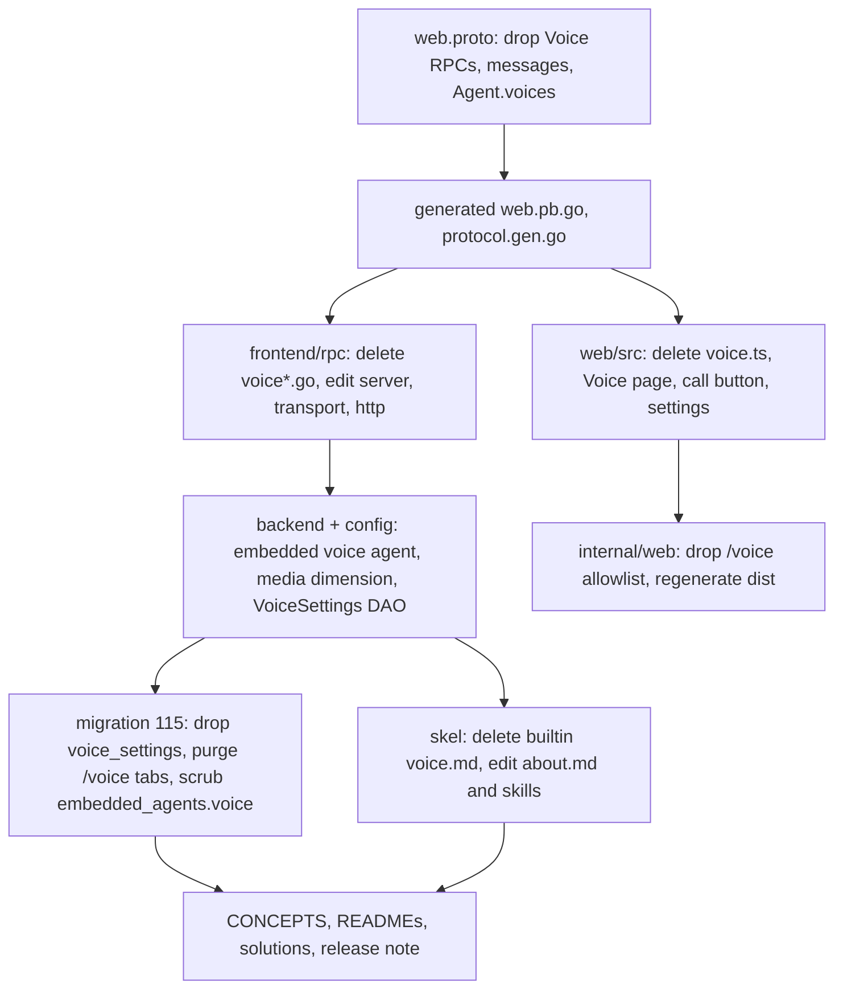

# Remove Web Voice Mode - Plan

## Goal Capsule

- **Objective:** RocketClaw no longer offers spoken calls in any form. People see no Voice page, call button, voice settings or built-in `voice` agent, and the repository, database and living docs keep nothing that exists only for voice, apart from the upstream OpenCode copy under `internal/rocketclaw/oc/` and the shipped migrations listed in Scope Boundaries.
- **Means:** delete every voice code path, migrate its stored data away in one new migration, and rewrite the living docs (KTD1, KTD2, KTD3).
- **Authority:** the user's request ("remove voice mode entirely, leave no leftovers") > this plan's Requirements > KTDs > unit Approach. `AGENTS.md` governs style, verification and the no-shim rule for removals.
- **Stop conditions:** stop and report if removing a voice path would break a non-voice behavior that has no other home. Stop if `make test` cannot run, or if coverage or a CLOC budget fails and the only way out is editing a budget.
- **Execution profile:** one PR with one commit. The merge queue lands commits as written, so the single commit must already be clean.
- **Finishing:** `lfg` implements, reviews and opens the PR. Merging stays with the user.

---

## Product Contract

### Summary

Remove Web voice mode end to end: Voice Sessions, Voice Settings, Voice Hand-offs, the Voice page and tab, the composer call button, the built-in `voice` agent, the `Voice`/`VoiceSettings` RPCs, the `embedded_agents.voice` setting and the `voice_settings` table. A new migration drops the table and removes stored `/voice` tabs. Living docs lose every voice mention, and a README release note tells admins what remains on their deployments.

### Problem Frame

Voice mode spans the Go RPC layer, the backend, config, the database, the React app, the built-in agents, CONCEPTS.md and three READMEs. The user wants it gone completely, not hidden. A partial removal would leave dead protocol, dead settings, dead prompt text and stale tabs. Those keep costing review and test time, and they mislead the agents that read `about.md`, the skills and CONCEPTS.md.

### Requirements

**Runtime surface**
- R1. The Web app has no Voice page, no `/voice` route, no Voice palette or bottom-nav entry, no composer call button and no voice settings UI.
- R2. The server exposes no `Voice` or `VoiceSettings` RPC, no `POST /api/Voice` or `/api/VoiceSettings` route, and serves no `/voice` SPA path.
- R3. The binary has no built-in `voice` agent. `main` is the only built-in agent.
- R4. Config, Behavior Settings and the Web settings page have no `embedded_agents.voice` entry.
- R5. Inbound messages carry no media dimension: no `rocketclaw_media` metadata key, no `media=` prompt-header field, and no Voice-specific skill or provenance branch.

**Stored data**
- R6. A new migration drops `voice_settings`. Its Down step recreates the table empty in its post-085 shape.
- R7. The same migration removes stored `/voice` tab entries from every tab store, including rows whose only entry is `/voice`. It also removes `embedded_agents.voice` from stored Behavior Settings.
- R8. Existing chats whose agent is `voice`, and stored inbound rows with old voice metadata, are left as they are.

**Docs and repo hygiene**
- R9. CONCEPTS.md, `README.md`, `internal/rocketclaw/web/README.md`, `internal/rocketclaw/frontend/rpc/README.md`, the built-in `about.md`, the skel skills and `docs/solutions/` describe a product without voice.
- R10. Files that exist only for voice are deleted: code, tests, mocks, CSS, TLC models, and the voice-only plans and investigation. Test-seconds lists drop voice tests.
- R11. The README carries a release note on what an upgrade leaves behind and what admins should delete.

### Key Decisions

- **Remove voice entirely.** Governs R1-R10. (session-settled: user-directed — chosen over hiding or disabling voice behind a flag: the user asked for removal "entirely")
- **Leave no leftovers.** Governs R5, R7, R9, R10. (session-settled: user-directed — chosen over removing only the user-facing surface: the user asked to "leave no leftovers behind")
- **Keep user chats.** Old `voice` chats and their working folders are user data, not voice code. Removal commits in this repo have always kept chats. Governs R8.

### Scope Boundaries

- The upstream OpenCode copy under `internal/rocketclaw/oc/` keeps its own voice feature. That is OpenCode's experimental voice, copied unchanged and kept mergeable with upstream. It renders only in OpenCode's non-production desktop builds (`packages/app/src/voice/composer.tsx` gates it on `platform === "desktop"`), so RocketClaw users never see it.
- Saved history text that already reads `media=Voice`, and stored inbound JSON with `rocketclaw_media=Voice`, is not rewritten. History is immutable, and old rows run safely as plain Web messages (KTD5).
- `001_baseline.sql`, `085_drop_voice_conversation.sql` and `080_external_mcp_metadata.sql` stay unchanged. Editing or deleting a shipped migration stops startup on databases that ran it.
- Dated plans, investigations and specs that only mention voice in passing stay as written, including `docs/plans/2026-11-23-2259-feat-embedded-main-voice-agents-plan.md`, which also covers `main`.
- Considered and not built: keeping `voice` as a reserved agent name, or deleting stale workspace `agents/voice.md` copies at startup. Both are compatibility code that `AGENTS.md` forbids for removals unless asked, and the startup delete could not reach overlays. A release note covers it (R11, KTD4). Evidence that would change this: the user asks for a reserved name, or a deployment's stale copy fails the load check.
- Considered and not built: a redirect from `/voice`. It would be a leftover; `/cron` was dropped the same way.
- Considered and not built: bumping `web_tab_states.revision` so a browser still running the old bundle cannot save `/voice` back. Only one of the tab write paths checks `revision`, so the guard would be partial. A re-saved `/voice` tab is visible and closable, and 112 shipped without one. Evidence that would change this: re-saved `/voice` tabs reported after the upgrade.
- `docs/verification/oc-view-session/` stays unchanged. It models the upstream OpenCode copy's voice, which this plan keeps.

---

## Planning Contract

### Key Technical Decisions

- KTD1. **Drop `voice_settings` outright in a new migration `115_drop_voice.sql`, and record the exception in CONCEPTS.md.** CONCEPTS says retired data is kept aside until a later release, but "no leftovers" rules out a `retired_voice_settings` table. `101_drop_top_shelf.sql` dropped outright and named itself as an exception, and this follows it. Down recreates the post-085 table so the existing down-migration tests can still run 085's Down. Use the next free number at landing time; 115 is free on `main@origin` today. Implements R6.
- KTD2. **Delete `/voice` with deletion-safe SQL, not 112's rewrite shape.** 112 re-aggregates JSON with `GROUP BY`. In a delete, a row whose only entry is `/voice` aggregates to nothing and keeps its stale value. Use `jsonb - text[]` for `last`, `jsonb - text` for `shared_order`, and a `COALESCE(jsonb_agg(...) FILTER (...), '[]')` re-aggregation over every element for `card_order`. Reset `navigation` to `''`, and delete rows from `web_tabs`, `web_shared_tabs`, `web_closed_tabs`, `web_tab_attention` and `web_tab_lists` for every server. CTEs only, no subqueries (`AGENTS.md`). Implements R7.
- KTD3. **Remove the inbound media dimension completely.** `InboundMediaMetadataKey` was only ever `"Voice"` or `"Text"`, and `media=` was printed only for Voice. Remove the key, its `copyProvenance` entry, the `"Text"` setters, the header branch, the `canonicalOverride` media arguments and the `inboundDirectSkill` Voice clause. Implements R5.
- KTD4. **Stale `agents/voice.md` copies get a release note, not code.** Releases from 2026-11-08 to 2026-11-24 copied `voice.md` into every workspace. Today `skel.BuiltinAgent("voice")` makes the loader skip those copies. Once the built-in file is gone, a stale copy loads as an ordinary `sticky: user` agent in space `Main` with every tool. That includes `rocketclaw_sessions` and `task`, because the old copy lacks the restrictions the built-in file has. `embedded_agents.voice.disabled` no longer turns it off, and migration 115 deletes that setting. Old `voice` chats then keep running on the copy. On a deployment that turned voice off and so left `Main` in a space-limited person's list, that person can reach other spaces through it. The note tells admins to delete `agents/voice.md` and `agents/voice/` from the workspace and every overlay before upgrading, and to keep `Main` out of limited people's space permissions until they have. A code guard would be voice code left behind, so this is the user's call at merge (see Deferred / Open Questions). Implements R11.
- KTD5. **Leave stored voice metadata alone.** After KTD3, a queued hand-off whose metadata still says `rocketclaw_media=Voice` runs as an ordinary Web message. Its text starts with `<realtime_delegation>`, never `/`, so it cannot trigger a skill. Rewriting `turns.inbound_json` would add migration code for no behavior change. Implements R8.
- KTD6. **Keep the shared rpc test harness under a neutral name.** `voice_test.go` holds the harness that `server_test.go`, `tabs_test.go`, `session_mentions_test.go`, `live_test.go` and `permissions_test.go` use. It also holds `TestPausedChat`, which is mostly about pausing. Move both into a non-voice test file, rename `startVoiceHarness` and `voiceModel*`, and remove the `/v1/live/sessions*` handlers and the voice steps. Implements R10.
- KTD7. **Retarget, don't delete, `TestRevertStashKeepsVoiceInbound`.** It is the only test that a stashed item keeps its provenance header across a revert and a restart. Change it to a plain Web inbound and rename it, and rename its `.github/rocketclaw-test-seconds.tsv` line to match.
- KTD8. **Unexport `oai.FreshTokenIn`.** Its only caller outside `oai` is `voice.go`. `AGENTS.md` keeps feature-local symbols private.
- KTD9. **Reserve the removed proto field.** `Agent.voices = 10` becomes `reserved 10; reserved "voices";`, following the existing reserved entries in `web.proto`. The removed messages and RPCs need no reservation, since only field numbers are reserved.

### High-Level Technical Design

The removal runs from the protocol outward. Each layer only loses code, except the new migration and the renamed test harness.

Data cleanup in migration 115 (KTD2):

| Store | Action |
|---|---|
| `voice_settings` | `DROP TABLE` |
| `web_tabs`, `web_shared_tabs`, `web_closed_tabs`, `web_tab_attention`, `web_tab_lists` | delete rows whose path is `/voice` |
| `web_tab_states.navigation` | set to `''` where it is `/voice` |
| `web_tab_states.last` | remove keys whose value is `/voice` |
| `web_tab_states.shared_order` | remove the `/voice` element |
| `web_tab_states.card_order` | remove `<server>\n/voice` keys, leaving `[]` when none remain |
| `behavior_settings.document` | remove `{embedded_agents,voice}` |

### Assumptions

- Voice-only docs count as leftovers and are deleted: `docs/verification/composer-voice-readiness/`, `docs/verification/voice-retry-limit/`, `docs/plans/2026-10-10-1146-feat-web-voice-mode-plan.md`, `docs/plans/2026-10-11-0955-fix-web-voice-review-plan.md` and `docs/investigations/2026-10-10-gpt-live-wire-probe.md`. Repo precedent keeps old plans, but these describe nothing that will still exist.
- "No leftovers" covers stored tab and settings data (R7), not only schema.
- The formal-modeling gate does not apply. This is pure removal: no new state, queue or recovery path. The only state left behind is inert metadata (KTD5). (pack: formal-modeling, stateful-design.md)
- An open pull request that keeps hang-up available without a voice agent is obsolete once this lands. The PR body says so; closing it is the user's call.

### Sequencing

Order the units by dependency: protocol (U1) before the rpc and web units, backend (U2) before the migration and skel units. All units land in one commit. Regenerate the web bundle last (U5), after every TypeScript change.

---

## Implementation Units

### U1. Protocol and RPC layer

- **Goal:** the server has no voice RPCs, routes or call code.
- **Requirements:** R2, R10; KTD6, KTD8, KTD9.
- **Dependencies:** none.
- **Files:**
  - Modify: `internal/rocketclaw/web/proto/web.proto`, `internal/rocketclaw/frontend/rpc/server.go`, `transport.go`, `http.go`, `internal/rocketclaw/oai/oauth.go`, `.mockery.yml`.
  - Regenerate: `internal/rocketclaw/frontend/rpc/web.pb.go`, `protocol.gen.go`.
  - Delete: `frontend/rpc/voice.go`, `voice_codex.go`, `voice_public.go`, `voice_wire.go`, `voice_wire_test.go`, `voice_loop_test.go`, `roundtripper_mocks_test.go`.
  - Replace: `frontend/rpc/voice_test.go` with a non-voice harness file (KTD6).
  - Test updates: `frontend/rpc/server_test.go`, `tabs_test.go`, `session_mentions_test.go`, `live_test.go`, `permissions_test.go`, `permissions_live_test.go`, `http_test.go`.
- **Approach:**
  1. Proto: delete the `Voice*` messages and the `VoiceSettingsAction` enum, the `Voice` and `VoiceSettings` RPCs and `Agent.voices` (KTD9). Regenerate with the package's `go:generate`.
  2. `server.go`: drop `voiceMu`, `voiceCalls` and their initializer, the `voices` computation in `listAgents` and the `Voices` field. Remove any `cfg` clone that only existed for voices.
  3. `transport.go` and `http.go`: drop the `Voice` stream, `VoiceSettings` from the unary list, the `POST /api/Voice` route and the required-field cases.
  4. Delete the voice files and the RoundTripper mock and its `.mockery.yml` block. Regenerate mocks.
  5. Unexport `FreshTokenIn` (KTD8).
- **Patterns to follow:** the reserved-field entries already in `web.proto`. The removal of Dashboards (`098_drop_dashboards.sql` and its commit) shows the RPC-removal shape.
- **Test scenarios:**
  - The tests that used the voice harness pass unchanged on the renamed harness: queue edit, tabs, session mentions, live, space permissions.
  - `TestPausedChat` still proves that a paused chat posts a person's message without starting a turn, minus the voice refusal steps.
  - The space-permission tests no longer list `Voice` or `VoiceSettings` among the checked methods, and every remaining method keeps its row.
  - `listAgents` returns agents without a voices field. The server test that asserted voices drops that assertion only.
- **Verification:** `go build ./...` and `go vet ./...` pass. `rg -i voice internal/rocketclaw/frontend/rpc -g '*.go'` finds only the reserved `voices` name in the generated `web.pb.go`. The rpc README is U6's.

### U2. Backend, config and inbound provenance

- **Goal:** the backend and config know nothing about voice or media.
- **Requirements:** R3, R4, R5, R8; KTD3, KTD5, KTD7.
- **Dependencies:** U1.
- **Files:**
  - Modify: `internal/rocketclaw/config/config.go`, `internal/rocketclaw/backend/bridge.go`, `runtime.go`, `session_tools.go`, `store_dao.go`, `internal/rocketclaw/protocol/types.go`.
  - Test updates: `config/config_test.go`, `backend/bridge_test.go`, `runtime_test.go`, `runtime_reload_test.go`, `definitions_test.go`, `sandbox_test.go`, `agent_drafts_test.go`, `session_tools_test.go`, `store_cancellation_test.go`, `store_test.go`, `revert_test.go`, `cmd/rocketclaw/serve_test.go`.
- **Approach:**
  1. Config: delete `EmbeddedAgentsConfig.Voice` and its normalization row. Delete the `embedded_agents.voice.model` provider check in `runtime.go`.
  2. `bridge.go`: the embedded-agents loop handles `main` only. Collapse it to straight-line code if a one-element loop remains.
  3. Media (KTD3): remove `InboundMediaMetadataKey` and every reader and writer of it.
  4. Delete `VoiceSettings`, `(*SessionService).VoiceSettings` and `UpdateVoiceSettings`.
  5. Tests: delete `TestVoiceInboundRunsNoSlashCommands` and `TestVoiceSettings`. Retarget the revert/stash test (KTD7). Drop voice rows and fixtures from the rest.
- **Patterns to follow:** `AGENTS.md` removal rule: remove fields, call sites and dedicated tests, and add no rejection path for the removed config key.
- **Test scenarios:**
  - A stashed plain Web item survives a revert and a restart with its provenance header intact (the retargeted KTD7 test).
  - A Web inbound whose text starts with `/<skill>` still runs that skill.
  - The provenance header of a Web inbound has no `media=` field.
  - The runtime loads `main` as the only built-in agent.
- **Verification:** `go test ./internal/rocketclaw/config ./internal/rocketclaw/backend ./cmd/rocketclaw` passes. `rg -n 'rocketclaw_media|InboundMediaMetadataKey|media=' internal cmd` finds only `080_external_mcp_metadata.sql` and the header-parsing test cases in `frontend/rpc/server_test.go` and `backend/bridge_test.go`. Those cases stay, because saved history still carries `media=` tokens. Doc hits belong to U6.

### U3. Migration 115

- **Goal:** upgraded databases hold no voice settings and no stored `/voice` tabs.
- **Requirements:** R6, R7; KTD1, KTD2.
- **Dependencies:** U2.
- **Files:**
  - Create: `internal/rocketclaw/backend/migrations/115_drop_voice.sql`.
  - Modify: `backend/store_schema_test.go` (both migration lists plus the new migration test), `backend/store_test.go` (expected table list).
- **Approach:**
  1. Up: carry out the cleanup table in the High-Level Technical Design.
  2. Down: recreate `voice_settings` with `username` primary key and `agent`, `voice` and `transcript` columns, which is the post-085 shape. Deleted tab data and settings keys are not restored, as in 101.
  3. Use the next free number if 115 is taken at landing time, and update the test lists to match.
- **Patterns to follow:** `098_drop_dashboards.sql` and `101_drop_top_shelf.sql` for drop plus Down. `112_routines_tab_paths.sql` for the set of tab stores, but not for its JSON shape (KTD2). `TestRoutinesTabPathsMigration` in `store_schema_test.go` for the test.
- **Test scenarios:**
  - Starting from version 114, seed one user whose `last`, `shared_order` and `card_order` contain only `/voice`, and another whose entries mix `/voice` with other paths. After Up, the first user has `{}`, `[]` and `[]`. The second keeps every other entry in its original order.
  - `navigation = '/voice'` becomes `''`. Other navigation values are untouched.
  - `/voice` rows are gone from `web_tabs`, `web_shared_tabs`, `web_closed_tabs`, `web_tab_attention` and `web_tab_lists`, for local and remote servers alike. Rows for other paths remain.
  - A `/voice/x` or `/voices` path is untouched, because the match is exact.
  - Behavior Settings `{"embedded_agents":{"main":{...},"voice":{...}}}` keeps `main` and loses `voice`.
  - The existing down-migration tests, which run 085's Down, still pass because 115's Down restored the table.
  - The released-store adoption test lists 115 in both the release and the expected ledger.
- **Verification:** the backend schema tests pass against a real Postgres.

### U4. Built-in agent and skel prompts

- **Goal:** `main` is the only built-in agent, and nothing agents read mentions voice.
- **Requirements:** R3, R9.
- **Dependencies:** U2.
- **Files:**
  - Delete: `internal/rocketclaw/skel/builtin/agents/voice.md`.
  - Modify: `skel/builtin/about.md`, `skel/.rocketclaw/skills/main-create-or-update-agent/SKILL.md`, `main-managing-and-running-long-running-processes/SKILL.md`, `main-update-cron-or-heartbeat/SKILL.md`, `main-update-rocketclaw-json/SKILL.md`.
  - Test updates: `skel/skel_test.go`, `backend/definitions_test.go`.
- **Approach:**
  1. Delete the file. `BuiltinAgents` and `BuiltinAgent` read the embedded folder, so no Go change is needed for the name.
  2. `about.md`: one built-in agent, and no Voice page in the Web pages list.
  3. Remove voice wording from the four skills.
  4. Tests: the builtin-filter tests use only non-voice names, such as `main.md`, `main/` and an ordinary workspace agent. Rename `TestRuntimeAgentsUseBuiltinMainAndVoice` to cover `main` alone. Drop `voiceRuntime` and the voice entries from the delegation and prompt tests.
- **Test scenarios:**
  - A workspace or overlay `agents/main.md` is still skipped with a warning.
  - Every built-in agent prompt still ends with `about.md`.
- **Verification:** `go test ./internal/rocketclaw/skel ./internal/rocketclaw/backend` passes. `rg -i voice internal/rocketclaw/skel` finds nothing.

### U5. Web app and bundle

- **Goal:** the React app has no voice UI, types or styles, and the shipped bundle matches.
- **Requirements:** R1, R2, R4, R10.
- **Dependencies:** U1.
- **Files:**
  - Delete: `internal/rocketclaw/web/src/voice.ts`, `voice.test.ts`, `voice-page.browser.test.ts`.
  - Modify: `web/src/ui.tsx`, `api.ts`, `types.ts`, `behavior-settings.tsx`, `web/app/globals.css`, `internal/rocketclaw/internal/web/assets.go`.
  - Test updates: `web/src/composer.browser.test.ts`, `session-list-app_test.ts`, `tabs.test.ts`, `config-page.browser.test.ts`, `permissions-transport.test.ts`, `internal/web/assets_test.go`.
  - Regenerate: `internal/rocketclaw/internal/web/dist/` through `go -C internal/rocketclaw generate ./internal/web`.
- **Approach:**
  1. `ui.tsx`: remove the `/voice` route flag, page tab, bottom-nav and palette entries, `<VoicePage />`, the wake lock, the composer call coupling and `VoiceToggle`, and the whole `VoicePage` family. Remove imports, including icons, that become unused.
  2. Delete voice queries, mutations and types. `behavior-settings.tsx` lists only `main`.
  3. CSS: drop the `.voice-orb*` rules and keyframes, and remove the `"Voice call"` selectors from the composer rules.
  4. Drop `/voice` from the SPA allowlist in `assets.go`.
  5. Keep any helper split react-doctor needs. Simplify the now one-item bottom nav only if react-doctor stays green.
- **Patterns to follow:** `docs/solutions/best-practices/react-doctor-complexity-limit-shapes-web-components.md`. `docs/solutions/best-practices/web-browser-tests-run-the-last-bundle-that-built.md`: use `make test`, so the bundle under test is the new one.
- **Test scenarios:**
  - The composer renders and sends without a call button. Its browser test no longer waits for "Voice call".
  - The command palette and bottom nav list no Voice entry. Update the session-list expected list.
  - The settings page shows a `main` row only, and saving writes no `embedded_agents.voice`.
  - Tab-path handling works with a non-voice sample path, such as `/routines`.
  - A request for `/voice` is not served as the SPA. `assets_test.go` lists the remaining routes.
- **Verification:** `make lint` and `make test` in `internal/rocketclaw/web` pass. The regenerated `dist/index.html.gz` contains no "Voice call" or `/api/Voice` string.

### U6. Docs, release note and CI lists

- **Goal:** living docs describe a product without voice, and admins know what an upgrade leaves behind.
- **Requirements:** R9, R10, R11; KTD1, KTD4.
- **Dependencies:** U1-U5, so the docs match the final code.
- **Files:**
  - Modify: `CONCEPTS.md`, `README.md`, `internal/rocketclaw/web/README.md`, `internal/rocketclaw/frontend/rpc/README.md`, `docs/solutions/best-practices/backend-run-tests-keep-fixture-agents-in-workspace-agents.md`, `docs/solutions/best-practices/posthog-needs-genai-span-attributes.md`, `docs/solutions/security-issues/external-mcp-caller-metadata-shared-the-routing-map.md`, `docs/solutions/best-practices/canceled-transaction-commit-error-is-not-deterministic.md`, `docs/verification/agent-pause/README.md`, `docs/verification/agent-shadow-comparison.md`, `.github/rocketclaw-test-seconds.tsv`, `.github/web-test-seconds.tsv`.
  - Delete: `docs/verification/composer-voice-readiness/`, `docs/verification/voice-retry-limit/`, `docs/plans/2026-10-10-1146-feat-web-voice-mode-plan.md`, `docs/plans/2026-10-11-0955-fix-web-voice-review-plan.md`, `docs/investigations/2026-10-10-gpt-live-wire-probe.md`.
- **Approach:**
  1. CONCEPTS.md:
     - delete the `## Web Voice` section;
     - edit the pause rules, Embedded Agent, Sticky Session and attention paragraphs;
     - in the data paragraph, drop "Voice Settings" and add the KTD1 exception.
  2. READMEs: remove the Voice sections, the voice endpoints, the `media=` line and every passing mention.
  3. Add a release note next to the existing built-in agent notes in `README.md`. It says:
     - delete stale `agents/voice.md` and `agents/voice/` from the workspace and every overlay before upgrading, and keep `Main` out of limited people's space permissions until you have; otherwise `voice` returns as an ordinary agent with every tool (KTD4);
     - old voice chats stay readable; they cannot continue once those files are gone, and until then they run on the stale copy;
     - `/voice` links return 404;
     - `/api/Voice` and `/api/VoiceSettings` are gone.
  4. Solutions docs: edit only the sentences that cite voice code so they no longer mention voice, and leave the rest of each doc unchanged. Restate the claim in `canceled-transaction-commit-error-is-not-deterministic.md` about the only production `context.Canceled` check against the code as it will be.
  5. Remove links from other docs to the deleted files, or point them elsewhere.
  6. Test-seconds lists: delete `TestVoice` and `src/voice-page.browser.test.ts`, and rename the KTD7 test's line.
- **Test expectation:** none, because this unit changes only docs and CI timing lists. Run the workflow's shard split locally to confirm every remaining test file lands in exactly one shard.
- **Verification:** the leftover grep in the Verification Contract returns only the expected survivors.

---

## Verification Contract

| Check | Command or method | Proves |
|---|---|---|
| Format | `gofmt -l` on touched Go files | Go style |
| Go gate | `make test` at the repo root (runs `make lint`, regenerates proto, mocks and bundle, race tests, coverage ≥ 91.8, CLOC budgets) | R2-R8, nothing else broken |
| Web gate | `make lint` and `make test` in `internal/rocketclaw/web` (oxlint, tsc, react-doctor, unit and browser tests, TS CLOC) | R1, R4 |
| Migration | U3 migration test against real Postgres | R6, R7 |
| Vendor | `make vendor` in `internal/rocketclaw` produces no diff | nothing in `vendor/` became unused |
| Leftovers | `rg -i 'voice\|realtime_delegation\|rocketclaw_media\|VoiceSettings'` excluding `vendor/`, `internal/rocketclaw/oc/`, `dist/`, dated `docs/plans/`, `docs/investigations/`, `docs/specs/` | R9, R10 |
| Browser | `ce-test-browser` on the Web app: no Voice nav or palette entry, no call button, the settings page shows `main` only | R1 |

Expected leftover-grep survivors:
- "invoice";
- `001_baseline.sql`, `085_drop_voice_conversation.sql`, `115_drop_voice.sql` and their filenames in `backend/store_schema_test.go`;
- `080_external_mcp_metadata.sql`;
- the reserved `voices` name in `web.proto` and the generated `web.pb.go`;
- the header-parsing test cases with `media=` tokens (U2);
- `docs/verification/oc-view-session/`, which models the upstream OpenCode copy's voice;
- the CONCEPTS exception sentence, the README release note and this plan.

---

## Definition of Done

- Every R1-R11 holds, and every unit's verification passed.
- `make test` at the repo root and in `internal/rocketclaw/web` pass with no budget edits and no linter suppressions.
- The leftover grep returns only the expected survivors.
- The diff contains no new comments, no compatibility shims, no rejection tests for removed keys, and no code from abandoned attempts.
- One commit, rebased on `main@origin`. Before landing, check `main@origin` for new voice files or edits to deleted files, and confirm the migration number is still free.
- The PR body states the KTD4 release-note decision for the user to confirm, and names the obsolete voice pull request.

---

## Risks

| Risk | Mitigation |
|---|---|
| Stale `agents/voice.md` copies come back as a live agent with every tool on most deployments, and can give space-limited people a way into other spaces (KTD4) | Release note with the access warning. Merge waits on the user's answer under Deferred / Open Questions. |
| Another in-flight change edits `voice.md`, `revert_test.go` or the docs, or claims migration 115 | Rebase before landing, renumber the migration, and grep for re-added voice tests |
| Coverage drops below 91.8 after removing heavily tested files | Measure with `make test`. Fix with real tests of remaining code, never a budget edit |
| Deleting the harness file breaks non-voice rpc tests | KTD6: move and rename the harness instead of deleting it |
| Generated bundle conflicts on rebase | Follow the `AGENTS.md` regenerate-and-squash recipe |

---

## Deferred / Open Questions

These are review items left for the author. They do not block implementation.

### From 2026-11-25 review

- **Stale `voice.md` copies come back as a full-power agent** — Planning Contract, KTD4 (P1, adversarial and security-lens, confidence 75)

  On most deployments the upgrade brings `voice` back as an ordinary agent with every tool. It ignores the old off switch, and on deployments that turned voice off it can let space-limited people reach other spaces. The plan handles this with a release note only, because any code guard (a reserved `voice` name, or startup deletion of copies that match a shipped version) would leave voice code behind against the "no leftovers" request. The user decides before merging: keep the release note only, or accept one of those guards as an exception.
