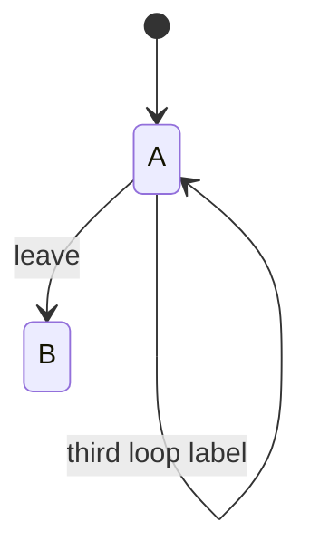
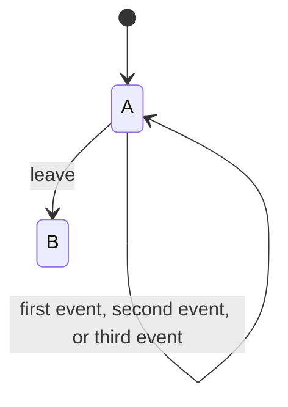

# Mermaid State Diagrams Keep Only the Last Label of Several Self-Loops on One State

## Context

`docs/packs/formal-modeling/stateful-design.md:13` asks every stateful design for a Mermaid `stateDiagram-v2` with its timeout, retry, cancel and recovery paths. Many of those paths are loops: an event that leaves the state where it was. While writing the diagram in `docs/verification/oc-view-session/README.md`, three `Moving --> Moving` transitions rendered as one loop carrying only the third label. The diagram source looked complete, so a reader of the source and a reader of the picture saw different designs.

Measured with mermaid-cli 11.15.0 on 2026-11-13:

- Several self-loops on one state (`A --> A: x`, `A --> A: y`, `A --> A: z`) render one loop labelled `z`. The SVG holds no `x` or `y` text at all, so they are dropped, not overlapping.
- Several transitions between two different states (`A --> B` three times with different labels) keep every label. The `Read --> Waiting` arrows in `docs/specs/2026-11-09-tab-attention-design.md` render correctly.
- A semicolon in a transition label ends the statement: `A --> B: x; y` renders the label `x`, and the rest turns into stray states (the SVG held states named `after`, `semicolon` and `;` for the label `before semicolon; after semicolon`).
- A semicolon inside a quoted state description (`state "a; b" as S`) renders whole.

Whether GitHub's own Mermaid renderer behaves the same was not checked.

## Guidance

- Give each state at most one transition to itself. Put every event that loops there into that one label, separated by commas or "or".
- When the looping events deserve their own arrows, for example because they have different guards, model the difference: give the loop an intermediate state, or split the state.
- Use commas, not semicolons, in transition labels.
- Render the diagram and look at it before trusting it. Mermaid gives no warning for either problem.

Rendering locally, without touching system temp: `mmdc` needs a Chrome it cannot find by default ("Could not find Chrome"). Point it at an installed Chromium through a puppeteer config, and keep its temporary files in the repository's `.tmp/`. Any local Chromium works, such as a Playwright `chromium-<n>` already under the main checkout's `.tmp/ms-playwright/` (a JJ workspace's own `.tmp/` usually has none). The test image's `/opt/ms-playwright` holds a Linux build that the Mac host cannot run:

```sh
mkdir -p .tmp/mermaid
chrome='<path to the Chromium binary>'   # on a Mac, e.g. .../ms-playwright/chromium-<n>/chrome-mac-arm64/Google Chrome for Testing.app/Contents/MacOS/Google Chrome for Testing
printf '{"executablePath":"%s"}\n' "$chrome" > .tmp/mermaid/puppeteer.json
TMPDIR=$PWD/.tmp/mermaid mmdc -p .tmp/mermaid/puppeteer.json -i diagram.mmd -o .tmp/mermaid/diagram.png
```

That worked on the Mac host. Inside the Linux container, a long repository-local `TMPDIR` has made Chromium abort with a socket path that is too long; see `docs/solutions/best-practices/frontend-rpc-tests-need-setup-in-fresh-jj-workspaces.md`.

## Why This Matters

A state diagram is how a reviewer checks a design before its model and code exist. A dropped loop label hides a retry, a timeout or an ignored event from that review, and the source still reads correctly, so nobody notices until someone looks at the picture closely. A stray state from a semicolon is louder but still easy to miss in a large diagram.

## When to Apply

- Any Mermaid `stateDiagram-v2` with a state that loops on more than one event.
- Any transition label with a semicolon.
- Reviewing a diagram from its source alone.

## Examples

Before: three loops on one state, of which only the last label renders.



After: one loop that names every event, as in `docs/verification/oc-view-session/README.md:37`.



## Related

- `docs/packs/formal-modeling/stateful-design.md`: the rule that asks for these diagrams.
- `docs/solutions/best-practices/frontend-rpc-tests-need-setup-in-fresh-jj-workspaces.md`: Chromium and a long repository-local `TMPDIR`.
