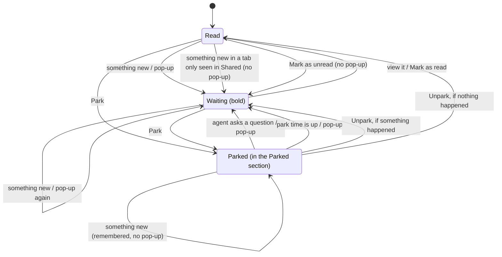

# Tab attention

Replaces today's separate Unread mark, Mute, Snooze and Mark as unread with one attention state per person, per
tab. Every kind of tab has it, not only sessions (decided 2026-11-10). Today's behaviour and its mismatches are
described in `docs/explainers/2026-11-09-tab-attention.md`.

The plan `docs/plans/2026-11-10-0947-feat-tab-attention-plan.md` settled the open points and changed a few
decisions. Passages marked **Built:** say what was built where it differs from what this record first said.

## What the person asked for

1. Anything that needs my attention gives me a notification.
2. Anything that waits for me is bold.
3. I can mark a tab read or unread.
4. I can park a tab so it doesn't bother me.
5. I can put a timer on a tab so it comes back and gets my attention.

## The rule

- **Bold** means it is waiting for you.
- **A pop-up** happens at the moment something starts waiting for you, unless you did it yourself.
- **Parked** means nothing bothers you, except an agent's question. It comes back when its time is up or when you
  unpark it.

The window title count and Cmd/Ctrl+Alt+A both count bold tabs, so they read from the same state.

## What needs your attention

A turn ending, or an agent asking a question, reaches a person in one of two ways. "Asking" keeps today's meaning:
a RocketClaw session's running turn waits on an unanswered question, or a remote OpenCode session, or one under it,
has a pending form or permission request.

| The person… | Bold | Pop-up |
|---|---|---|
| sent or steered that turn from the Web | yes | yes |
| has the session in their own tabs, in any space | yes | yes |
| has the session on their Top Shelf, and this server keeps that shelf | yes | yes |
| only sees it in the Shared group of a space they can see | yes | **no** |
| has no tie to it | no | no |

A timed park reaching its time reaches the person who set it, bold and with a pop-up.

So a cron or a teammate moving a session in your own tabs reaches you, and a Shared session shows everyone that
something changed without interrupting them (decided 2026-11-10).

**A server only uses what it stores itself** (decided 2026-11-10). A person's Top Shelf is kept by the RocketClaw
they open in their browser, so it counts for that server's own sessions. Another server never learns what is on
someone's shelf. A session from another server that is only on the shelf reaches the person for turns they sent; to
hear about other people's and cron turns there, they keep its tab open on that server too, which a shelf tab allows.

**Opening a Shared row doesn't give you a tab of your own today**, so only the person who shared a tab has one.
The Shared row's menu needs an item that adds the tab to your own tabs, as the way to ask for its pop-ups.
**Built:** "Add to my tabs", offered for a session, Cron or Pages tab the person does not have. A Search page or
Dashboard does not offer it, because it would become a second copy of the page.

These still do **not** reach anyone: a turn that ends while the person has been viewing the session within the last
10 seconds (today's rule). **Built:** a question or a timer uses a 4-second window instead. A question still ends a
park inside that window, without a mark.

## Every kind of tab

Attention belongs to a tab's location, whatever page it shows. Every tab can be marked read or unread and parked,
and a park time on any tab brings it back bold with a pop-up. A tab that is not a session is reached
through the same table as above, without the "sent the turn" row.

**Built:** that holds for Cron and Pages tabs. Two kinds differ. A Search page reaches only the person who entered
the search, with a pop-up, wherever they have the tab, Shared included. A Dashboard reaches everyone who has it
open, in their own tabs, on a Top Shelf this server keeps, or in the Shared group of a space they can see, always
with a pop-up: a flagged lane is the request to be told, so the Shared rule does not apply to it.

What differs by kind is what counts as "something new":

| Tab | Something new is… | Who notices it | Status |
|---|---|---|---|
| Session | a turn ends, or an agent asks | the server | decided |
| Search page | a search the person started finishes after they left the page | the server | decided 2026-11-10 |
| Dashboard | a session enters a lane flagged to notify, as today | the server | decided 2026-11-10 |
| One cron's page | a turn of a run of that cron ends | the server | decided 2026-11-10 |
| Cron overview | a turn of a run of any cron shown in that space ends | the server | decided 2026-11-10 |
| One published page | an HTML file of that page is stored | the server | decided 2026-11-10 |
| Pages list | an HTML file of a page shown in that space is stored | the server | decided 2026-11-10 |
| Agents, Skills and one skill's page, Settings, Shortcuts, Voice, Recently closed | nothing; only what the person sets | – | decided |

**Built:** a cron run marks once for each of its turns that ends, so a run with wake turns can mark more than once.
Only HTML files count for pages; page data, other files and deletes mark nothing.

**The server runs a Search page's searches, not the browser** (decided 2026-11-10). Today the browser asks, waits,
and cancels the search when the person leaves the page, keeping nothing. Moved to the server:

- A search belongs to the person who started it and to one search on one Search tab. Starting it again, or changing
  its query, replaces the run before it.
- The server keeps running it after the person switches tabs, closes the window or loses the connection.
- When it finishes and the person is not viewing that tab, the server marks the tab, so it turns bold and raises a
  pop-up. Only the person who started the search is marked, also on a Shared Search page.
- **A finished search marks the tab only if it is still that search's current run**, the same rule as for timers.
- The server keeps the finished results in memory until the person looks, not in a table, because the search can
  always run again. After a restart, opening the tab runs it again.
- A server searches its own sessions. Results from other RocketClaw servers are still fetched by the browser while
  the page is open, as today.

**Built:** the same query for the same search joins the running search, or takes its finished result, which only
one request receives; another query replaces the run. A request says whether the person entered the query: typing,
Enter, Retry, a link or a palette hand-off do, while reopening the page or a change in the session list do not, and
only an entered search marks. A person keeps at most 8 searches, running or finished; a ninth drops the oldest
without a mark. Stopping the server cancels running searches. A Dashboard's lanes are not run this way.

**Dashboards.** Only lanes flagged to notify count, as today. What changes is where it lands: on the Dashboard tab's
own attention, so the tab turns bold, parking it silences it, and it counts like any other tab.

**The server watches Dashboards, not the browser** (decided 2026-11-10). The server already sorts sessions into
lanes; today the browser only compares one answer with the last to find what is new, and only while a window shows
that Dashboard's space. Moved to the server:

- The server reads each person's Dashboards and their flagged lanes from the tabs it already stores.
- After a session changes, it sorts again and marks the Dashboard tab when a session is in a flagged lane it was
  not in before.
- It remembers each flagged lane's last contents in memory, not in a table, because they can always be computed
  again. After a restart the first check only records, as a reloaded browser does today.

That makes a Dashboard work in every space, on every device and with no window open, and there is one watcher, so
two windows can no longer report the same arrival. The cost is that the sorting now runs for everyone with a
flagged lane, also while they are away. To confirm in the plan: that the server's notice of a session change covers
everything a lane's query can depend on.

**Built:** it does not, so the watcher is a timed pass instead. The database's notice of a session change does not
fire for renames, tags, pins, agent switches, queue changes or remote OpenCode state, all of which a lane can
depend on. Every 5 seconds the server reads the Dashboards with a flagged lane from the page rows, with who has
each open. It sorts again only when the session list, without anyone's marks, changed since the last pass, or for
a Dashboard it has not sorted yet. A lane whose query, order or flag changed records before it marks, and a
session sliding into the first 200 of a full lane as another leaves is not new. Several arrivals in one pass give
one mark, whose note names the lane, the newest session and how many more. A failed pass keeps what it held.

**The server notices everything, once.** No kind of tab leaves it to browser windows to report what is new: two
windows would report the same thing twice.

**The browser reports the tab in view, not only a session.** Nobody is marked for a tab they are viewing. Today the
browser tells the server which session a focused window shows; it has to name any tab's location.

Each of these writes the same unread mark, so bold, pop-ups, parking and the counts work the same for every kind.
The Dashboard's own notification path goes away, replaced by the Dashboard tab's attention.

## The state



Rules:

- **A timer only on a parked tab:** its park time. "Park until I unpark" has no timer.
- **Mark as read** clears bold even while an agent waits on your answer. The next attention event turns it bold
  again. The amber "needs you" badge stays, because it reports the session's status, not your attention.
- **Something new** is what the table above lists for each kind of tab. Only a session has an agent that asks.
- **Mark as unread** turns it bold with no pop-up. Marked on the tab you're viewing, the mark stays until you leave
  and come back (today's rule).
- **A question breaks a park.** The session is unparked, goes back to its place, turns bold and pops up.
- **Viewing** a tab (active in a focused window) clears bold, as today for sessions.
- **Pop-ups don't depend on keeping.** A turn you sent pops up even if you've closed its tab; clicking the pop-up
  opens it.
- **Built: a park time that comes due on the tab you're viewing** just unparks it, without a mark.
- **Built: closing a tab keeps its attention.** Its mark and a park with a time stay. When that time
  comes, the tab comes back where it was: in its space, in its group if that still exists, and at its old position
  when possible. A closed tab waiting for its time is never dropped from the 50 recently closed. Closing a tab
  parked "Until I unpark" ends the park, since nothing else would ever bring it back. Close others, Close to the
  right, Close all and Close group skip parked tabs.

## The Parked section

- It's a collapsed section at the bottom of the tab strip. Parked tabs from every space show there, and each row
  shows its wake time, if it has one.
- A parked tab keeps its space, group and position; the strip just shows it in the Parked section instead. Waking
  or unparking shows it in its place again. If that group is gone, it comes back ungrouped in the same space.
- A parked tab stays in the Shared group, because that group belongs to everyone. For the person who parked it,
  its Shared row is shown dimmed.
- A parked tab can't be bold, and isn't counted in the title or by Cmd/Ctrl+Alt+A.

## The menu

```text
Mark as read / Mark as unread
Park        ›  Until I unpark · Until it is done · 1 hour · 4 hours · Tomorrow 9:00 · Next Monday 9:00 · Pick a time…
Unpark                                                                               (in place of Park, when parked)
```

These replace Mute, Snooze, Unmute and the old Mark as unread. The palette commands follow the same names.

**Built:** with several tabs selected, Mark as read shows when any is bold and Mark as unread when any is read, and
each acts only on the tabs it fits. Shared rows and Top Shelf rows offer the same items, sent to the row's own
server. A shelf row whose server is offline is greyed and offers only "Remove from Top Shelf".

## Data (server)

**All of this ships as one pull request** (rule, 2026-11-10). It is not split into several. Inside it the work
goes in this order: the storage reshapes, then the attention core, then each kind of tab's events.

**The two tables that hold attention today are reshaped.** No table is added.

- `web_tab_mutes` is renamed (for example `web_tab_attention`) and becomes the one row per person per tab
  location. Its key changes from person and session to person and location, because a tab that is not a session has
  attention too. A session tab's row still names its session, so deleting the session removes it.
- It gains `unread_at` and `marked_unread`, which are dropped from `web_tabs`. The closed-but-unread rows that have
  no position are deleted, and `web_tabs.position` becomes required.
- One flag, `parked`, is added, because "the row exists" can no longer mean muted. `marked_unread` gets a name
  that says what it means, for example `quiet`: this mark raises no pop-up.
- A tab's mark, its quiet flag and its park state always reach the browser together, in one row. A session's come
  with its row in `ListSessions`; where the other tabs' rows travel is for the plan. The separate mutes list in the
  Tabs call goes.

**Built:** the table is `web_tab_attention`, keyed by person and tab location, with the session for a session tab.
Its columns are `unread_at`, `quiet`, `parked`, `until` and `note`. `note` was added by the plan: it is the pop-up's
text for a mark the server writes on a tab without a session row, and for timers: "Park ended",
"Search finished", "Run finished", "<agent> · <page> updated", or a Dashboard's lane and newest session. A
session's pop-up shows the note only when a timer wrote it, and the reply otherwise. On the wire the quiet flag
keeps the name `marked_unread`. The rows of tabs that are not sessions travel in the last message of
`ListSessions`, only when they changed. A row left read, unparked and without a timer is deleted. Closed tabs also
gain their group and position, so a timer can put them back.

**The migration clears the deck** (decided 2026-11-10). Past attention state is not carried over, and nothing
left over from the old shape stays in the database:

- Every mute and snooze is deleted, including snoozes that ended long ago and were never removed.
- Unread marks are not moved. After the upgrade everything shows as read, once.
- The tab rows kept only to hold an unread mark are deleted.
- The old columns and the shelf blob are dropped, not kept aside.
- What a person arranged stays: their tabs, groups, spaces, Shared tabs, recently closed tabs and Top Shelf.

**The Top Shelf is reshaped too, with no change in behaviour.** It stays on the server the person opens in their
browser, because that is the only place that can order tabs across servers and still list a tab whose server is
offline. A shelf tab stays a record of its own, so a tab can be on the shelf and in the strip at once.

- `web_top_shelves` changes from one JSON blob per person into one row per shelf tab: person, position, server,
  space, path, the Search page for a Search tab, and the session for a local session, so deleting the session
  removes the row. No table is added. Existing shelves are unpacked into rows, leaving out entries whose local
  session was deleted.
- The shelf's collapsed state becomes a column on the person's tab state.
- The filter that drops deleted sessions from the blob on every read goes.
- New in the Web: a shelf tab whose server is offline shows greyed, and its menu still removes it. **Built:** its
  menu offers only that.

**Search page content becomes rows too, with no change in behaviour** (decided 2026-11-10). A Search page's name,
its searches and its flagged lanes are one JSON value today, in four places: tabs, Shared tabs, closed tabs and the
shelf. The server now acts on that content, so it gets a proper shape:

- One row per page copy, with its name and board style, and one row per search, with its position, name, query,
  notify flag and whether it is the one shown.
- The `search` JSON column goes from tabs, Shared tabs, closed tabs and shelf rows. Each of those records points at
  its page instead.
- A page copy belongs to exactly one of those records, and the database deletes it with that record, so no page is
  left behind. How the four kinds of owner are expressed is for the plan.
- Editing a Shared Search page becomes a change to one search row, so two people editing different searches no
  longer collide. Whether the whole-page compare-and-redo can go is for the plan.
- Existing pages are unpacked into rows.

This adds two tables and removes four JSON values.

**Built:** the page row holds which search is shown, and searches are keyed by page and position, because a page's
search ids can repeat. Each of the four kinds of owner row points at its own page copy, and a trigger deletes the
copy when its owner row is deleted or points elsewhere. The whole-page compare stays: an edit made from a page that
has changed since is refused as stale, and edits take turns by locking the Shared row first. The three changes
ship as three one-way migrations: Search pages, then the Top Shelf, then attention.

**How the attention row's columns are used:**

- `until` is the park time on a parked tab; `'infinity'` for a park until it is done.
- The quiet flag is set for a mark the person made themselves, for one written while the tab is parked, and for one
  that was there when the person parked it.
- What happened while parked is the unread mark itself, which events keep writing.
- Nothing stores where a parked tab was, because its tab row doesn't move.

**New behaviour on the server:**

- When a park's time is up, the server sets `unread_at = now()`, as if a turn had ended, so the pop-up
  logic that already exists fires on every open window. This needs something that runs when the time passes. That
  could be the existing Scheduled Messages runner, or a check run when sessions are listed. Which one gets picked
  in the plan. **Built:** the check when sessions are listed. Each `ListSessions` poll from a page the server
  serves or trusts first records the tab in view, then wakes that person's timers that came due, in one statement
  that checks the timer on the locked row, so two windows wake a timer once and a cancelled timer cannot fire. An
  open window polls every few seconds. There is no job and no startup pass; the Scheduled Messages runner starts
  agent turns, so it was not reused. A timer that comes due while no window is open shows bold, without a pop-up,
  when a window opens.
- Today an agent's question is worked out when sessions are listed. It has to become an event that sets the mark:
  for local sessions when the question step is saved, and for remote OpenCode sessions when sync sees `asking`
  turn true. **Built:** as described; a resumed turn that saves its question again does not mark again.
- A cron run finishing and a page being published mark the tabs that show them, for the people who have those tabs.
- Dashboards are watched and searches are run by the server, as described under "Every kind of tab".

## Rules found by model checking

`docs/verification/tab-attention/TabAttention.tla`, a PlusCal algorithm and its TLA+ translation, models one person,
one tab and two browser windows, with the server and each window acting on their own. The tab is modeled as a session;
another kind of tab has the same events without the agent's question, which is a smaller case. The model checker TLC
tried every order of events within the bounds: 2 windows, 2 clock ticks, and 3 events (something new, loud or
bold-only, a question, or Mark as unread). Each build shape set the model's switches one way:

| Shape | Result |
|---|---|
| 1. Windows skip pop-ups for parked sessions, and learn the park state from a separate request (mutes today come from the Tabs call, marks from ListSessions) | **Fails.** A window pops for a session you just parked. And a question that breaks a park can be **lost for good**: both windows see the new mark while still thinking the session is parked, record it as seen, and never pop. |
| 2. The server never marks a parked session, and windows ignore parking | **Fails.** A turn ends, you park, and a window that hadn't polled yet pops anyway. |
| 3. Windows skip pop-ups for parked sessions, with the park state in the same listing as the mark | **Fails.** Something needs you, you park it, you unpark it, and a window that hadn't polled yet pops for the old thing. |
| 4. Shape 3, and the server also never marks a parked session | **Fails** the same way. |
| 5. Shape 6, but a timer's job doesn't check whether it's still the current timer | **Fails.** Park until 9:00, unpark early, and the old job still wakes the session at 9:00. |
| 6. The server decides which marks pop up; windows ignore the park state, which still comes from a separate request | **Passes** |
| 7. Shape 6, with the park state in the same listing as the mark, as the reshaped tables send it | **Passes** |
| 8. Shape 7, but an event that only turns the session bold replaces a mark that is already there | **Fails.** A pop-up is lost for good, see rule 6. |

Shapes 3 and 4 passed a first run. They fail now that "parking settles what's owed" is checked instead of assumed.

So the implementation must follow these rules:

1. **The server decides which marks pop up.** Each mark says whether it is quiet. A window pops for a mark it hasn't
   seen unless the mark is quiet, and never looks at the park state to decide.
2. **These marks are quiet:** one the person set themselves, one written while the session is parked, and one that
   was there when the person parked it. A quiet mark stays quiet after unparking.
3. **Waking is one transaction.** Unpark, clear the timer and write a new, loud mark together, for both a timer and
   a question.
4. **A timer job acts only if it is still the session's timer.** Unpark or a new Park makes the old job do nothing.
5. **Opening a parked session counts as seeing what happened while it was parked.** Unparking it afterwards doesn't
   turn it bold again. Writing the model surfaced this gap.
6. **An event that only turns a session bold never replaces a mark that is already there.** It writes a quiet mark
   on a read session and nothing otherwise. Shape 8 replaces the mark, and loses a pop-up for good: your turn ends,
   then a teammate's turn in the same Shared session ends before your windows poll.

Build shape 7. It is what the reshaped tables give: turns keep marking as they do today, and the park state comes
with each session row, where the browser needs it to draw the Parked section.

**Built (2026-11-11): closed tabs and Shared tabs as ordinary tabs.** The model above left out who an event reaches
and whether the person still has the tab. It now models closing and reopening the tab (one close), a timer bringing a
closed tab back, the sender of a turn reached without a tab, and each window's own view of which tabs the person has,
which it learns from reloading its tabs, apart from the marks. A Shared tab is an ordinary tab of everyone who sees it.
Three requirements are added: no pop-up while the person has no tab, none for news written while the tab was closed,
even after it is opened again, and a closed tab with a timer always comes back. The new shapes run with one window,
as two windows with a closable tab exceed the bounds a run may take:

| Shape | Result |
|---|---|
| 9. Shape 7 with Shared tabs as ordinary tabs, and tabs the person closes and opens again | **Fails.** A turn ends, the person closes the tab, and a window that hasn't reloaded its tabs pops up for a tab they no longer have. |
| 10. Shape 9, where a window holding older tabs than the listing names waits for its reload | **Fails.** A turn the person sent ends while the tab is closed; they open it again, and a window that never saw that mark pops up. |
| 11. Shape 10, where opening a tab again makes its mark quiet, and a question makes a park due at once | **Passes** |
| 12. Shape 11's rules with two windows and the tab always open | **Passes** |

Shape 11 first had a question end a park on the spot, as on an open tab. That fails: a tab parked until a time and
then closed loses its timer to a question and never comes back. Bringing the closed tab back with the question, or
leaving its park alone, both pass; the owner chose to bring it back, and making the park due lets the person's own
timer wake do it, so writers that reach many people never touch tab rows. Shapes 1 to 8 keep their results.

Four claims that should be false were also run against shape 7, and the checker refuted each: nothing ever pops, a
timed park never wakes, a question never breaks a park, a parked session is never marked.
So shape 7 doesn't pass by doing nothing.

Limits of the check: everything is bounded. Each server step is assumed to be one transaction. "Viewing" is a single
flag, so the 10-second and 4-second windows aren't modeled. Who an event reaches (senders, keepers, Shared) is outside the model,
which covers only what happens once an event reaches the person, except whether a turn that background work started
reaches anyone at all (`WakeReaches`, below). Table layout is outside it too.

To rerun the checks, which need curl, and Java 11 or newer on `PATH`:

```bash
make -C docs/verification/tab-attention                    # every check: about 1 minute
make -C docs/verification/tab-attention one-window         # one check
make -C docs/verification/tab-attention translate          # after changing the algorithm
```

Only the design as built is kept as `.cfg` files: shape 11 as `one-window.cfg` and shape 12 as `two-windows.cfg`.
The tables above record what the other shapes found. The Makefile fetches the pinned TLA+ tools into a `.tmp` folder
beside it, translates the algorithm into the TLA+ in `TabAttention.tla`, and runs TLC on each `.cfg`; a run fails if
any requirement breaks.

Each `.cfg` also lists, under `_POSSIBLE`, states the model must reach at least once: a pop-up, a closed tab coming
back, and a question bringing one back. A check would otherwise pass if the model never reached them, finding nothing
because it explored nothing. TLC fails the run when a listed state is never reached ([TLC's
documentation](https://explain.tlapl.us/possible-conditions)); this replaces the older practice of adding an invariant
that should fail and checking that it does. The model was first written in plain TLA+; its PlusCal rewrite reaches the
same number of states in every shape that passes.

**Added (2026-11-11): Park until it is done.** A session's tab can be parked until the session's next turn ends,
finished, failed or stopped, also when nothing runs yet. The model has it as a third kind of park, with no time and no
timer job. A turn end makes it due at once, as a question does, so the person's own timer wake ends it, notifies with
the reply, and brings back a closed tab, which keeps the park. `DoneEndsAtTurnEnd` requires that no tab is still
parked until done once a turn end reached the person; with the turn end's rule taken out, TLC finds that broken at
once. Both checks pass: one-window with 261,720 states, two-windows with 322,470. On the server the park's time is
`'infinity'`, which no clock reaches and closing keeps; a turn end sets it to now.

**Fixed (2026-11-11): a turn no prompt started also ends it.** A background job's result starts a turn of its own,
and its end is a turn end like any other: the agent can say it works on in the background, the person parks until
it is done again, and the result's turn ends the park. The OpenCode sync found a remote session's readers only
through the stamped prompts before an idle marker, so such a turn, which OpenCode starts with a `synthetic` message,
reached no one and left the park in place for good. The model now ends a turn either way, and `DoneEndsAtTurnEnd`
tracks the turn end itself rather than a mark; `WakeReaches = FALSE`, the sync as it was, breaks it in a three-state
trace. With the sync adding the session's own readers to every new idle marker, both checks pass: one-window with
351,172 states, two-windows with 412,014.

## Limits and open points

- **Pop-ups reach you only while a RocketClaw window is open.** The app has no push service or service worker, and
  push notifications are out of scope (decided 2026-11-10). Every event is noticed by the server, so push can be
  added later without a redesign. Bold, parking and timers are stored on the server, so they show up on every
  device anyway.

## For the plan

Each point is settled; the answer follows it.

- What makes a timer fire: a scheduled job, or working it out when the rows are read. Working it out when the
  session list is read.
- How a Search page row names its one owner among four kinds of record, so the database deletes it with that record.
  Each owner row points at its own copy, and a trigger deletes the copy.
- Whether the Shared Search page's whole-page compare-and-redo can go once edits change one search row. It stays.
- Where the attention rows of tabs that are not sessions travel to the browser. In the last message of
  `ListSessions`, only when they changed.
- That the server's notice of a session change covers everything a Dashboard lane's query can depend on. It does
  not, so the watcher runs every 5 seconds.
- How the browser names the tab in view to the server. `ListSessions.viewing` carries the tab's location.

## What's removed

Mute notifications, Unmute notifications, Snooze notifications (all times and the date picker dialog), the
`followed` rule that combines "kept" and "not muted", the browser's own Dashboard notification path, cancelling a
search when its page is left, the Top Shelf blob and its filter for deleted sessions, and the tests for those. The
old snooze dialog becomes Park's "Pick a time…" dialog.
