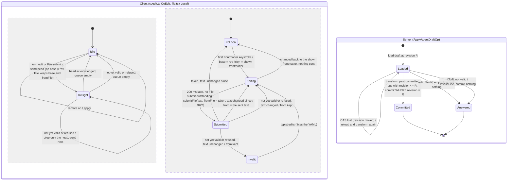

# Agent Editor co-editing: bounded verification

This PlusCal model checks a small abstraction of live co-editing of one Agent
Editor draft: two browser sessions edit a variant's instructions and settings in
the Form and File tabs, the server orders and transforms their ops, and the
assistant's suggestion is accepted on an older revision. **It does not prove the
Go or TypeScript code correct.** Six configurations model the code as built and
pass; the others must find a named violation: the earlier code's bugs, a rejected
alternative, the plan as first written, and reachability witnesses. Passing
`make check` means every check matched its expected outcome, nothing more.

## Run

From the repository root:

```sh
make -C docs/verification/agent-editor-coediting check
# One check (a passing one, or an expected counterexample still checked by the runner):
make -C docs/verification/agent-editor-coediting as-built
make -C docs/verification/agent-editor-coediting reject-drops-queue
```

Requires Java 11+, `curl`, `shasum` and Make. The runner downloads
`tla2tools.jar` v1.8.0 and verifies SHA-256
`e1f11b75c4b5bc4478ba0ac5cb6ae28e40a01b0016bc33e0aa97da22dfdbcd7f`, the same
artifact as `../thread-pr/Makefile`. Tools, the translator's scratch copy, Java
temporary files, TLC metadata and every log and trace go to repository-root
`.tmp/run/agent-editor-coediting/`, never `docs/`. A passing check needs TLC
exit 0 and `Model checking completed. No error has been found.`; an expected
counterexample needs exit 12 or 13 and the exact named violation, so a parse
error never counts. TLC runs with `-workers 2 -Xmx4g` (thread-pr uses one worker
and 1 GiB): the largest checks hold 2–3 million distinct states, and two
workers with more heap keep the full run near the 25-minute budget on this
machine (one worker was not timed). There are no state constraints, symmetry or
simulation; each passing check exhausts its finite state graph. A negative check
stops at the first counterexample, so its counts are an explored prefix.

`AgentEditorCoediting.tla` holds the PlusCal algorithm, every property (in the
`define` block) and the generated translation. Edit outside the translation
markers, then `make translate`.

## Design as built



An op's body part is a list of splices; a delete with a teammate's insert
strictly inside it becomes two deletes around the insert. Settings are last
write wins in server order; the client's view is the server's draft plus its
pending ops, so a remote write to a key with a pending local write stays hidden
until that write is acknowledged. File-tab instruction edits go as splices like
the Form's. A File-tab frontmatter edit goes as the whole file with the
instructions at its base revision, so only settings change; the server diffs
its settings against `fromFile`. A File edit queued behind a teammate's variant
rename keeps its old name (the server renames it while moving it). The
assistant's accepted suggestion commits an exact diff (linear-space Myers, no
size cap) made on its base revision, moved past later ops.

## Actors and assumptions

- **Actors.** The server; two editors (`a` may use the File tab, `b` uses the
  Form only, except in `file-both`); one delivery process per client; the
  assistant (one suggestion, accepted later) in the assistant checks.
- **What persists.** Server text, settings, op log and the draft at every
  revision (`agent_drafts`, `agent_draft_ops`) persist. Each client's view,
  queue and File-tab state live only in the page. No crash, reload or restart is
  modeled.
- **Delivery.** Per-client FIFO in both directions, never lost or duplicated.
  This stands for "wake, fetch the ops since my revision": each read is one
  revision's snapshot (`frontend/rpc/drafts.go` cuts ops at the read revision)
  and the client recognises its own op by `opId` as its acknowledgement. The
  network is always present.
- **Atomic steps.** The server's load–transform–commit is one step. That is
  faithful because it transforms only against ops its loaded draft holds and
  commits with a revision compare-and-swap, retrying on loss. Each client edit,
  each delivered message and each File submit is one step. An `edit_file` that
  writes several settings is one revision here (several in the code, committed
  in one transaction).
- **Fairness.** The server and delivery processes are weakly fair: the server is
  up and replies, so a message waiting in a channel is eventually handled.
  Editors and the assistant are not fair: people may stop typing and a
  suggestion may never be accepted.
- **Characters** are unique ids, so "what an author saw and deleted" and order
  can be stated. One edit is one inserted character, one selected range
  deleted, one setting written, or one frontmatter value changed.

## Properties

| Property | Meaning |
| --- | --- |
| `Convergence` | When nothing is pending anywhere, every client's text and settings equal the server's. |
| `NoLostEdit` | The server text is the seed plus everything inserted, minus exactly what some author saw and deleted. |
| `NoDuplicate` | No character appears twice in any view. |
| `OrderPreserved` | Any two characters keep the same order in every pair of views. |
| `InvalidPrivate`, `InvalidNoRevision` | A not-yet-valid whole-text File version reaches no teammate; handling an invalid submit commits nothing. |
| `HistoryComplete`, `SettingsLWW` | Every form setting write is in the op log or still pending; each key's value is its last logged write. |
| `NoDroppedEdit` | Every typed insert or delete is committed or still queued in its client. |
| `OwnLastWrite` | When quiet, each key holds the value its typist last chose, unless someone else wrote that key later. |
| `FileKeepsOthers` | A File submit never changes a key the typist did not edit in the File tab. |
| `NoStuck` | Each in-flight entry has exactly one request or reply in transit (a cheap stand-in for liveness at wide bounds). |
| `EventuallySettled` | Once typing stops, every queue empties and every channel drains (liveness). |
| `ShapeSingleSplice` | Witness: every committed op fits one `{at, remove, insert}` splice. |
| `NoRefusalWithTextBehind`, `NoStartValueRewritten`, `NoFileFromPendingWrite`, `NoLateAccept` | Witnesses: the as-built checks never reach a refusal with typed text queued behind it, a File change back to its start value, a File edit started on an unacknowledged own form write, or a late-accepted suggestion. Each must be violated. |

`InvalidPrivate`, `InvalidNoRevision` and `HistoryComplete` hold largely by
construction of the model's server; they guard paths but find no design flaw.
`OwnLastWrite` relies on ghost bookkeeping: sending a File text re-chooses the
values it shows for keys edited there, and "changed back" is measured against
the last submit the server will take.

## Checks and results

Recorded on 2026-11-13 with `make check` (exit 0, 16 min 40 s in total), on a 12-core Mac shared with other TLC runs, so times are rough.
TLC banner `TLC2 Version 2026.11.06.222357 (rev: d8fb231)`
(`pcal.trans` 1.12); OpenJDK 21.0.13.0.3 (Homebrew). Constants not listed are
as built: Clients `{a, b}`, FileClients `{a}`, MaxOps 2 (File-tab client),
OtherOps 1, SeedLen 2, Keys `{k1, k2}`, Mode `split`, FileBody `splices`,
FileRebase `fromtext`, SetMode `pendingwins`, FormEdits `{body, set}`,
Assistant off, DiffCap 0, RejectFile on (one refused File submit), OnReject
`drophead`. With FileClients `{}` both clients get OtherOps edits.

| Check (`.cfg`) | Constants beyond as built | Expected | Actual | Distinct states | Depth | Time |
| --- | --- | --- | --- | ---: | ---: | ---: |
| `as-built` | none: every invariant and `InvalidNoRevision` | pass | pass | 461,594 | 27 | 45 s |
| `as-built-wide` | OtherOps 2, Keys `{k1}`, no refusal | pass | pass | 2,769,348 | 27 | 8 min 43 s |
| `file-both` | FileClients `{a, b}`, FormEdits `{}`, no refusal | pass | pass | 887,740 | 37 | 2 min 26 s |
| `file-three-edits` | MaxOps 3, FormEdits `{set}` | pass | pass | 1,809,163 | 36 | 3 min 24 s |
| `assistant` | Assistant on, FileClients `{}`, Keys `{k1}` | pass | pass | 316,648 | 13 | 38 s |
| `liveness` | MaxOps 1, Keys `{k1}`; `EventuallySettled` only | pass | pass | 3,507 | 18 | 1 s |
| `diff-cap-lost-delete` | DiffCap 1, Assistant on, File off, MaxOps 1, Keys `{k1}` | `NoLostEdit` violated | as expected | 2,337 | 5 | 1 s |
| `diff-cap-reorder` | same | `OrderPreserved` violated | as expected | 2,316 | 5 | 1 s |
| `file-stale-base-revert` | FileRebase `stale`, FormEdits `{set}`, Keys `{k1}` | `OwnLastWrite` violated | as expected | 3,668 | 10 | 1 s |
| `file-resends-form-write` | FileRebase `stale`, FormEdits `{set}` | `FileKeepsOthers` violated | as expected | 7,138 | 9 | 1 s |
| `reject-drops-queue` | OnReject `dropall`, Keys `{k1}` | `NoDroppedEdit` violated | as expected | 9,030 | 7 | 1 s |
| `file-ackrev-rebase` | FileRebase `ackrev`, FileClients `{a, b}`, FormEdits `{}` | `FileKeepsOthers` violated | as expected | 96,088 | 13 | 5 s |
| `witness-refusal-text-behind` | Keys `{k1}` | `NoRefusalWithTextBehind` violated | as expected | 3,523 | 6 | 1 s |
| `witness-change-back` | FormEdits `{set}`, Keys `{k1}` | `NoStartValueRewritten` violated | as expected | 1,305 | 8 | <1 s |
| `witness-from-pending-write` | FormEdits `{set}` | `NoFileFromPendingWrite` violated | as expected | 68 | 4 | <1 s |
| `witness-late-accept` | Assistant on, File off, Keys `{k1}` | `NoLateAccept` violated | as expected | 1,314 | 5 | <1 s |
| `plan-widen` | Mode `plan`, File off, OtherOps 2, Keys `{k1}` | `NoLostEdit` violated | as expected | 2,182 | 5 | <1 s |
| `plan-diverge` | Mode `plan`, File off, Keys `{k1}` | `Convergence` violated | as expected | 1,643 | 9 | 1 s |
| `plan-clip` | Mode `clip`, File off, OtherOps 2, Keys `{k1}` | `NoLostEdit` violated | as expected | 2,383 | 5 | <1 s |
| `plan-delete-wins` | Mode `deletewins`, File off, OtherOps 2, Keys `{k1}` | `NoLostEdit` violated | as expected | 2,383 | 5 | <1 s |
| `plan-single-splice` | Keys `{k1}` (code as built) | `ShapeSingleSplice` violated | as expected | 1,389 | 5 | <1 s |
| `plan-file-prefix-suffix` | FileBody `whole`, FileEdits `any`, Keys `{k1}` | `OrderPreserved` violated | as expected | 4,187 | 6 | 1 s |
| `plan-file-prefix-suffix-lost` | same | `NoLostEdit` violated | as expected | 4,289 | 6 | 1 s |
| `plan-file-while-busy` | FileBody `whole`, FileNeedsSync FALSE, Keys `{k1}` | `NoDuplicate` violated | as expected | 1,709 | 5 | <1 s |
| `plan-remote-set-wins` | SetMode `naive`, Keys `{k1}` | `Convergence` violated | as expected | 45,538 | 10 | 3 s |

Negative counts are the prefix explored before the first counterexample and
vary slightly between runs with two workers. Every counterexample trace is in
`.tmp/run/agent-editor-coediting/<check>.log`; the traces of the four
earlier-code checks were read and show the mechanisms described below.

Each earlier-code check changes one switch from the as-built main check, so it
shows that fix alone is needed. Each negative configuration lists only its
expected property, so the reported violation does not depend on search order.

## Earlier-code bugs, now fixed (negative checks)

1. **Capped diff undid a deletion** (`diff-cap-lost-delete`, `diff-cap-reorder`).
   The assistant suggests `x1 s1` for `s1 s2`; past the cap the accept replaces
   the whole middle, deleting and retyping `s1`. Alice's delete of `s1`, made on
   the old revision, then misses and `s1` stays; an insert can move. The code
   now diffs exactly with no cap (the user chose exact merge over refusing large
   suggestions); `assistant` passes with it.
2. **Stale File base dropped a change back** (`file-stale-base-revert`). Alice
   sets `k1 = a1` in the File tab, then changes it back while the submit is in
   flight; the second submit diffs against the first keystroke's revision, finds
   nothing, and everyone ends on `a1`.
3. **File submit resent an unconfirmed Form write** (`file-resends-form-write`).
   Alice's form write `k1 = a1` is unacknowledged when she edits `k2` in the
   File tab; Bob writes `k1 = b1`; Alice's submit, diffed against the old base,
   writes `a1` over `b1`. Fix for 2 and 3: `fromFile` (the text she started from,
   then the last acknowledged submit) and one File submit in flight.
4. **Rename plus refusal dropped typed text** (`reject-drops-queue`). A queued
   File edit was renamed after a teammate's variant rename, the server refused
   it, and the client dropped every pending edit, including instructions typed
   after it. Now the queued File edit keeps its name and a refusal drops only
   itself. The model abstracts the rename as one refusal.

`file-ackrev-rebase` keeps the rejected alternative to fix 2: rebasing the File
state on the acknowledged revision writes back a stale value of a key the typist
never touched once two people edit two keys in the File tab.

## Plan as first written (negative checks)

- `plan-widen`, `plan-diverge`: a single splice widened over a concurrent insert
  loses it, and the client that kept it diverges from the server.
- `plan-clip`: clipping the delete keeps text its author deleted.
- `plan-delete-wins`: dropping the insert converges but loses it.
- `plan-single-splice`: as built, a committed op needs two splices.
- `plan-file-prefix-suffix`, `plan-file-prefix-suffix-lost`: a whole-text File
  submit diffed by common prefix and suffix re-inserts untouched text, moving a
  teammate's insert or undoing their delete.
- `plan-file-while-busy`: a whole-text File submit sent while a form op is
  unacknowledged inserts that text twice.
- `plan-remote-set-wins`: applying a remote write over a pending one diverges.

## Model step to code map

Paths under `internal/rocketclaw/`.

| Model step | Code |
| --- | --- |
| `srv`: move past committed ops, commit | `backend/agent_drafts.go`: `ApplyAgentDraftOp` (load, retry loop), `agentDraftChanges` (only ops with revision ≤ the loaded one), `commitAgentDraftOps` (`WHERE revision = $2`) |
| `XOne`, `XS` | `transformAgentDraftSplice`, `transformAgentDraftSplices`; client `coedit.ts` `past`, `transform` |
| `srv` `qfile` diff (`SetDiff` from `m.from`) | `agentDraftChanges` `AgentDraftEditFile` case with `op.FromFile`, `diffAgentDraft` |
| `qfileack` (nothing to commit) | `ApplyAgentDraftOp`: `len(ops) == 0` returns without committing |
| `qinvalid`, `qreject` | `frontend/rpc/drafts.go` `applyAgentDraftOp` (`InvalidLine` or error); `coedit.ts` `flush` `drop` |
| `CappedDiff` with DiffCap 0 (`Exact`) | `diffAgentDraftBody`, `shortestAgentDraftEdits`, `middleAgentDraftEdit` |
| `asst` propose / accept | `backend/agent_draft_assistant.go`: `ProposeAgentDraftChanges` (`BaseRevision: draft.Revision`), `DecideAgentDraftProposal` (diff on the base body, apply at the base revision) |
| `ed` form edits, `LocalOp` | `form.tsx` (`editBody(spliceBetween(...))`, `setField`); `coedit.ts` `editBody`, `setField`, `open`, `flush` (op base = `rev`) |
| `ed` File change | `file.tsx` `useFileEdit` `change` (Local: base, body, from = shown head; cleared when back to the head with nothing sent) |
| `ed` File submit | `file.tsx` `useFileEdit` effect `submit` (`busy`: one at a time; `local.text + local.body`, `local.from + local.body`); `coedit.ts` `submitFile` |
| `ed` fix after invalid | `file.tsx` `change` after `invalid` is set |
| `rx` | `coedit.ts` `receive` (own `opId` = ack), `rebase` (instructions vs instructions; `edit_file` not renamed), `settle`, `update` (view = server + pending); `file.tsx` submit callback (`from` = sent on success, keep or clear Local) |
| One-revision reads | `frontend/rpc/drafts.go` `getAgentDraft` cuts ops at the read revision |

## Configurations dropped from the earlier model, and bound changes

- The earlier main config (as built then) failed `OwnLastWrite` with the same
  counterexample as `file-stale-base-revert`: dropped as a duplicate.
- The earlier passing fix configs became the as-built checks: `fixed` and
  `reject_head` merged into `as-built`; `wide` → `as-built-wide`;
  `fromtext_both` → `file-both`; `fromtext_keys` → `file-three-edits`;
  `cap_exact` → `assistant`; `live` → `liveness`; `core` superseded by
  `as-built`; `cap_all` → `diff-cap-reorder`.
- Dropped passing checks of designs that were not built: `cap_refuse` (refuse
  over-cap suggestions; the user chose exact diffs), `filerevert_ackrev` (the
  rejected alternative; its failing case stays as `file-ackrev-rebase`), and
  the plan-era `whole`, `minimaldiff`, `deletewins` (their failing cases stay).
- Dropped `plan_oob`: it ended in a TLC evaluation error (an op past the end of
  the text), not a named violation, so this runner cannot count it; it follows
  the same divergence `plan-diverge` shows.
- Bounds raised: `as-built` now has two keys and one refusal (the earlier
  as-built core had one key and none); `file-three-edits` and `liveness` add a
  refusal.
- Bounds kept below the main check, for the time budget (recorded, not hidden):
  `as-built-wide` has no refusal (with one it had not finished after 4 minutes
  and 1.1 million states, still growing); `file-both` has no refusal (with one
  it passed, 2,344,395 states, depth 41, 5 min 22 s, on this model before the
  witnesses and the assistant's `late` ghost were added, neither of which
  changes its states). Liveness is checked
  only at one edit per client.
- Negative configs now list only their expected property (the earlier ones
  listed all invariants and reported whichever broke first).
- The SANY in v1.8.0 rejects `UNION S \ T` and `UNION S \cup T` without
  parentheses; they were parenthesized, with no change in meaning.

## Accepted limits

None decided for this model.

## What the model leaves out

- Variants (add, rename, remove), mode changes, restore and save-state ops. The
  rename behind the old refusal is one abstract refusal; "a queued File edit
  keeps its name" is checked by reading the code, not by the model.
- **A refused instructions or setting op.** Only a File submit can be refused
  here. As built, a refusal drops only its own entry; if a refused `edit_body`
  had later instruction entries queued behind it, those were made on a view that
  included it and are sent unchanged, so they could land in the wrong place or
  be refused as outside the instructions. As built this needs a server error on
  an instructions op; it is not modeled or verified.
- The File tab remounting on a variant rename (`key={variant.name}`), which
  drops unsent frontmatter edits; raw mode (no closing `---`); several changes
  in one `onChange`; the 200 ms debounce (the model sends at once).
- Form edits join one tail entry whatever their kind; the code keeps
  instructions and setting entries apart. That only removes interleavings
  between one client's own consecutive, independent changes.
- The assistant's setting changes, a suggestion with two bodies for one
  variant, a partial apply after a proposal is marked accepted, and the
  assistant together with the File tab (it is checked with the File tab off).
- Repeated characters (the real diff works on characters, not ids), cursors and
  presence, three or more clients, longer texts, crashes and reconnects.

README impact: this README is the evidence record. No other README changes.
