# Agent editor "Test as External MCP": bounded verification

This PlusCal model checks a small abstraction of the agent editor's draft test chat
when it poses as an External MCP call: the External MCP setting two people co-edit,
the send that captures and checks the draft, the queue, and the bridge that turns
metadata pairs into variables. **It does not prove the Go or TypeScript code
correct.** A pass means the listed properties hold in the explored finite model
under its assumptions.

Two checks model the code as built and pass. Every other check must find a named
violation: the behavior before a fix, a limit still open in the code (a hint only),
an accepted limit, a rejected or earlier design, or a non-vacuity probe.

## Run

From the repository root:

```sh
make -C docs/verification/agent-editor-external-mcp check
# one check, still judged by the runner:
make -C docs/verification/agent-editor-external-mcp as-built
make -C docs/verification/agent-editor-external-mcp queue-steer
```

Requires Java 11+, `curl`, `shasum` and Make. The runner downloads tla2tools
v1.8.0 and checks SHA-256
`e1f11b75c4b5bc4478ba0ac5cb6ae28e40a01b0016bc33e0aa97da22dfdbcd7f`. Tools,
the translator's scratch copy, Java temp files, TLC metadata and every log and
counterexample trace go to the repository root's
`.tmp/run/agent-editor-external-mcp/`. A passing check needs exit 0 and
`Model checking completed. No error has been found.`; a negative check needs exit
12 or 13 and its exact `Error:` line, so a parse error never counts.

The runner uses `-Xmx4g -workers 2` (thread-pr uses 1 GiB and one worker): the
main check explores several million states, and other models' checks may run on
the same machine. With two workers a counterexample is not always the shortest one.

`AgentEditorExternalMCP.tla` holds the algorithm, every property (in its `define`
block) and the generated translation. Edit outside the translation markers, then
`make ... translate`.

## The design as built

```mermaid
stateDiagram-v2
    [*] --> Off
    Off --> On: panel switch or notice button (page checks sticky; no server guard)
    On --> Off: panel switch
    On --> On: edit pairs or caller (whole object; panel and notice share one queue that sends each write after the previous one committed)
    state Send {
        Lock --> Capture: per-draft advisory lock
        Capture --> Refused: draft invalid / a variant not sticky off / two keys of one variable or a key of external_conversation_id's / mode differs from first record / locked key changed or dropped (compared as variables)
        Capture --> Queued: record row + queue item (Live left out and recorded when its file is not sticky off)
    }
    On --> Send: send
    Off --> Send: send (Web)
    Refused --> RestartOffered: mode or locked key
    Queued --> Running: bridge takes the next queued message, in order
    Running --> Done: A gets turnShellEnv's variables (first External MCP turn stores them); B and Live reuse A's
    Queued --> Queued: generic Prompt (except $stop), steer, release, edit, remove, reorder refused for test chats
    RestartOffered --> On: restart, new chat
```



## Actors and assumptions

- **Actors:** two editors (pages), each able to edit the draft and send; the test
  chat's bridge. Anyone else reaches the chat only through the generic RPCs; for a
  test chat they refuse every message and queue change except `$stop`.
- **What persists:** the draft, the message records (agent_draft_messages), the
  queue, and the bridge's stored metadata entry are in Postgres. Each page's view
  (sticky, switch, whether the agent reads a metadata variable) and in-flight
  requests live in the browser.
- **Pages:** a page shows the External MCP switch as last read from the server;
  after its own write commits it re-reads the draft (`apply` settles by
  refetching). Pairs and caller inputs show only while the page shows the switch
  on. Settings edits (sticky, instructions) are co-edit ops the page shows at once.
- **Writes:** set_external_mcp replaces the whole object; a page's write may commit
  after a later one from the same page (one request in flight per page; its late
  commit is modeled on the switch). The panel and the notice button send through one
  queue that waits for the previous write.
- **Delivery:** requests are never lost (the network is assumed present) but may be
  delayed and reordered as above.
- **Atomic steps:** a send's capture, checks, record and queue write are one step
  (the per-draft lock serializes sends); column A's turn (variables, stored entry)
  is one step; B and Live are one later step.
- **Crashes and errors:** not modeled (see "What the model leaves out").
- **Fairness:** none. Only safety properties are checked (`Spec == Init /\
  [][Next]_vars`), so no fairness assumption is needed.

## Properties

| Property | Meaning |
|---|---|
| `RealRule` | Every External MCP turn, in every column, gets the variables real External MCP would give for the same sequence of entered pairs (first message's variables keep their values; others count for one message; `external_conversation_id` is the conversation's id) |
| `InboundHonest` | An External MCP turn ran with exactly the variables its message's row shows |
| `LocksAgree` | The variables the page marks as fixed are the ones the bridge stored |
| `FrozenPerChat` | Every turn of a chat has the first turn's mode |
| `ModeHonest` | A turn ran in the mode the draft showed when it was sent |
| `NoHybridTurn` | A Web-mode turn carries no External MCP variables |
| `OnlyStickyOff` | No External MCP turn runs an agent version that is not `sticky: off` |
| `ColumnsAgree` | One message gives every column the same mode, variables and caller, and no ask-user in External MCP mode |
| `NotRunHonest` | Live answered exactly the messages whose record does not list it as not run |
| `BusyHasSender` | The send lock is held only by a sender past the send gate |
| `TypeOK` | Variables stay in their domains |
| `NoOwnRegress` | A page's External MCP writes commit in the order the page made them |
| `NoSwitchOverwrite` | (action property) A pairs or caller write never changes the switch |
| `MetaVarSuggestion` | A Web first message of a `sticky: off` agent that reads a metadata variable was sent from a page showing the "Test as External MCP" suggestion |
| `MetaFrozenInMCPChat`, `NoMCPTurn`, `NoSecondMCPMessage`, `NoMCPInRestartedChat`, `NoLiveMCPTurn`, `NoRenamedLockedKey` | Probes that must fail, showing the states they name are reachable |

## Checks and results

As built means: server sticky check on the capture, mode change refused, locked
keys checked on the capture and compared as variables, pairs refused when two keys
become one variable or a key becomes `external_conversation_id`'s variable,
`external_conversation_id` set after the pairs, Live left out when not
`sticky: off` (live file `sticky: user`), no queue edits, generic Prompt attempts
(refused), whole-object writes that may commit late, the panel and notice button
sharing one serial queue, pair sets {none, k1=v1, k1=v2, k1=v1+k2=v1, k1x=v1,
k1=v1+k1x=v2, k1=v1+external_conversation_id=v1} typeable at any time. Two editors,
two messages per chat, one restart, one caller. A refused prompt or send changes no
state, so those inputs pass by leaving nothing behind; what the check shows is that
no other path lets them through.
"Small" means no restart and no late commits (`MaxRestarts=0`, `OutOfOrder=FALSE`).

| Check (`.cfg`) | Constants and bounds | Expected | Actual | Distinct states | Depth | Time |
|---|---|---|---|---:|---:|---:|
| `as-built` | As built (generic prompts, notice writes, clashing and reserved keys included); 11 safety invariants + `NoOwnRegress` | pass | pass | 2,867,088 | 29 | 02min 52s |
| `two-callers` | As built, small, callers c1 and c2; 11 safety invariants | pass | pass | 2,280,600 | 26 | 02min 40s |
| `queue-steer` | Pre-fix: small + steer accepted | `InboundHonest` violated | `InboundHonest` violated | 10,289 | 9 | 01s |
| `queue-delete` | Pre-fix: small + remove accepted | `LocksAgree` violated | `LocksAgree` violated | 13,425 | 9 | 00s |
| `queue-delete-later` | Pre-fix: small + remove accepted, 3 messages | `InboundHonest` violated | `InboundHonest` violated | 393,793 | 14 | 13s |
| `queue-reorder` | Pre-fix: small + reorder accepted | `InboundHonest` violated | `InboundHonest` violated | 36,928 | 11 | 01s |
| `panel-unordered` | Pre-fix: no serial chain, no notice button, 1 message, no restart | `NoOwnRegress` violated | `NoOwnRegress` violated | 71 | 4 | 00s |
| `raw-lock-check` | Pre-fix: small, locked keys compared by raw name, no pairs check, {k1=v1, k1x=v2} sent only while V1 is locked | `InboundHonest` violated | `InboundHonest` violated | 16,332 | 10 | 01s |
| `cid-before-pairs` | Pre-fix: small, `external_conversation_id` set before the pairs, no pairs check | `RealRule` violated | `RealRule` violated | 635 | 6 | 00s |
| `generic-prompt` | Pre-fix: small, generic Prompt accepted | `NoHybridTurn` violated | `NoHybridTurn` violated | 43,338 | 8 | 01s |
| `notice-overtakes` | Pre-fix: notice button outside the queue, 1 message, no restart | `NoOwnRegress` violated | `NoOwnRegress` violated | 475 | 5 | 00s |
| `clash-unlocked` | Pre-fix: small, no pairs check (two keys of one variable) | `InboundHonest` violated | `InboundHonest` violated | 637 | 6 | 00s |
| `reserved-key` | Pre-fix: small, no pairs check (reserved key) | `InboundHonest` violated | `InboundHonest` violated | 611 | 6 | 00s |
| `stale-suggestion` | Open (hint only): small + metadata-variable edits | `MetaVarSuggestion` violated | `MetaVarSuggestion` violated | 1,761 | 6 | 00s |
| `peer-overwrite` | Accepted: small | `NoSwitchOverwrite` violated | `NoSwitchOverwrite` violated | 291 | 5 | 00s |
| `no-conflict-check` | Plan: small, no locked-key check | `InboundHonest` violated | `InboundHonest` violated | 22,687 | 11 | 01s |
| `early-conflict-check` | Plan: small, locked-key check on an earlier read | `InboundHonest` violated | `InboundHonest` violated | 19,960 | 10 | 01s |
| `mode-toggle` | Plan: small, mode change sent | `FrozenPerChat` violated | `FrozenPerChat` violated | 15,834 | 10 | 00s |
| `mode-toggle-metadata` | Plan: small, mode change sent | `NoHybridTurn` violated | `NoHybridTurn` violated | 21,110 | 10 | 00s |
| `no-sticky-check` | Plan: small, no server sticky check | `OnlyStickyOff` violated | `OnlyStickyOff` violated | 497 | 6 | 00s |
| `page-clears-only` | Plan: small, no server sticky check, page clears the switch | `OnlyStickyOff` violated | `OnlyStickyOff` violated | 857 | 7 | 00s |
| `sticky-uncaptured` | Plan: small, sticky checked on an earlier read | `OnlyStickyOff` violated | `OnlyStickyOff` violated | 778 | 7 | 00s |
| `live-run` | Plan: small, Live runs regardless | `OnlyStickyOff` violated | `OnlyStickyOff` violated | 896 | 7 | 00s |
| `freeze-draftguard` | Rejected: small, draft-write guard instead of the send check, chat holds its mode and pairs | `OnlyStickyOff` violated | `OnlyStickyOff` violated | 2,613 | 7 | 00s |
| `chatfreeze-realrule` | Rejected: small, chat holds its mode and first pairs | `RealRule` violated | `RealRule` violated | 23,917 | 10 | 00s |
| `chatfreeze-modehonest` | Rejected: small, chat holds its mode and first pairs | `ModeHonest` violated | `ModeHonest` violated | 17,570 | 10 | 00s |
| `probe-mcp` | Probe: small | `NoMCPTurn` violated | `NoMCPTurn` violated | 318 | 6 | 00s |
| `probe-second` | Probe: small | `NoSecondMCPMessage` violated | `NoSecondMCPMessage` violated | 10,034 | 9 | 00s |
| `probe-restart` | Probe: as built, no late commits | `NoMCPInRestartedChat` violated | `NoMCPInRestartedChat` violated | 20,173 | 10 | 00s |
| `probe-newkey` | Probe: small | `MetaFrozenInMCPChat` violated | `MetaFrozenInMCPChat` violated | 22,203 | 11 | 01s |
| `probe-live` | Probe: small, live file `sticky: off` | `NoLiveMCPTurn` violated | `NoLiveMCPTurn` violated | 947 | 6 | 00s |
| `probe-renamed-key` | Probe: small (k1 locked, then k1x=v1 accepted) | `NoRenamedLockedKey` violated | `NoRenamedLockedKey` violated | 20,712 | 10 | 01s |

Negative checks stop at the first counterexample: their counts are the explored prefix, not a full search.

## Fixes the negative checks record

- **Queue edits** (`queue-steer`, `queue-delete`, `queue-delete-later`,
  `queue-reorder`): the draft locks the first *record's* keys at send time, the
  bridge the first message that *runs*. Steering a waiting message into the running
  turn drops its extra key though its row shows it; removing or reordering waiting
  messages makes another message lock its keys. Fixed: `queueKeptAsSent` refuses
  Steer, Remove and Reorder for test chats.
- **Out-of-order panel writes** (`panel-unordered`): before the fix each panel
  change was its own request. Turn the switch off, then edit a pair before the off
  request returns: the pair write (carrying the switch the page still shows, on)
  commits first, then the off request, which also writes back the old pairs.
  Fixed: the panel sends each write after the previous one committed.
- **Raw-key lock check** (`raw-lock-check`): with k1=v1 locked, a message with
  k1=v1 and k1x=v2 passed a raw-name check; the bridge kept V1=v1 while the row
  showed k1x=v2 "this message only". Fixed: keys are compared as variables.
- **`external_conversation_id` before the pairs** (`cid-before-pairs`): a typed pair
  of that name reached the agent instead of the chat id, which real External MCP
  never does. Fixed by setting it after the pairs; with the pairs check below such a
  key is now refused before it is sent, so this config also turns that check off.
- **Generic Prompt into a test chat** (`generic-prompt`, `NoHybridTurn`): the
  generic `Prompt` RPC accepted a test chat. Its message had no draft files and no
  record, so it ran the *live* agent alone, as a Web turn with ask-user, and the
  bridge gave it the chat's stored External MCP variables (`$stash` then
  `PopQueueItem` reached the same path). Fixed: `prompt` refuses test chats, and
  `queueKeptAsSent` now also refuses `PopQueueItem` and `EditQueueItem`.
  **Deliberate exception:** `$stop` still works, so a running test turn can be
  stopped. It adds no message and changes no record; cancelling a turn is not
  modeled.
- **Notice button outside the queue** (`notice-overtakes`, `NoOwnRegress`): the
  notice's "Test as External MCP" button wrote directly. Click it, then the panel
  switch (still showing off) before the notice request returns; once the page shows
  on, turn it off: the slow notice request committed last and turned it back on.
  Fixed: both use the one `useMcpWrites` queue.
- **Two keys of one variable** (`clash-unlocked`, `InboundHonest`): in the first
  message, or on a key not locked, `a-b=1` and `a_b=2` gave the agent one value (Go
  map order) while the row showed both. Fixed: `agentDraftPairsProblem` refuses the
  send.
- **A key of `external_conversation_id`'s variable** (`reserved-key`,
  `InboundHonest`): after the order fix, such a key was overwritten by the chat id
  while the row still showed the typed value. Fixed: `agentDraftPairsProblem`
  refuses it, using the bridge's own `externalMCPMetadataVariable`. The page shows
  the same reason and disables Send (UI, not modeled).
- **Page compared raw key names** (not modeled): the restart offer and lock icons
  now compare variables (`mcpState`, `fixed`), as the server does.

## Limit still open (a hint only)

**`stale-suggestion`** (`MetaVarSuggestion`): a page that has not yet seen a
teammate's `$ROCKETCLAW_METADATA_*` edit shows no "Test as External MCP"
suggestion and sends in the Web. It breaks no safety property.

## Accepted limit

**`peer-overwrite`** (`NoSwitchOverwrite`), accepted by the owner: two people
changing External MCP settings at the same moment can overwrite each other's field,
because each write is the whole object built on the writer's view. In the trace,
editor 2 still shows the switch on after editor 1 turned it off, edits a pair, and
turns it back on. The config has no late commits, and a page re-reads after each of
its own writes, so the overwrite comes from the other person. It loses a UI edit
only: the `as-built` check runs whole-object writes from two editors (with late
commits too, a superset of this config's behaviors) and every safety property holds,
because each send checks and records the one capture it runs.

## Mapping to the code

Paths are under `internal/rocketclaw/` unless they start with `cmd/`.

| Model step | Code |
|---|---|
| send gate, `Capture` | `backend/agent_draft_chat.go:SendAgentDraft`: advisory lock, `CaptureAgentDraft`, sticky check on every variant, `agentDraftPairsProblem`, `liveAgentDraftProblems`, `agentDraftRecord`, first-record query, mode and locked-key refusals, inbound built per text, `StashQueueItem`, record row |
| `PairsProblem` (PairsCheck) | `backend/agent_draft_chat.go:agentDraftPairsProblem` (variable names from `backend/bridge.go:externalMCPMetadataVariable`) |
| `LockBroken` (NormalizedLocks) | `backend/agent_draft_chat.go:changedAgentDraftKey` |
| `Inbound` (CidAfterPairs) | `backend/agent_draft_chat.go:SendAgentDraft` (pairs copied, then `external_conversation_id`); real path `cmd/rocketclaw/mcp.go` (same order) |
| `LiveRuns` (LivePolicy skip) | `backend/agent_draft_chat.go:liveAgentDraftProblems` |
| `BRun` | `backend/bridge.go:Bridge.turnShellEnv`, `externalMCPMetadataEnv`, `externalMCPMetadataVariable` |
| `BShadows`, `Columns` | `backend/shadows.go:startShadowManifests`, `claimShadowTurn` (draft files per variant, live file; no shadows without draft files) |
| queue edits refused | `frontend/rpc/server.go:queueKeptAsSent`, called from `queueItem` (Steer, Pop, Remove, Edit) and `reorderQueue` |
| generic Prompt (PromptRefused) | `frontend/rpc/server.go:prompt` (refuses `KindAgentDraft` after the `$stop` branch); pre-fix path: `backend/conversations.go:Runtime.StashQueueItem`, and `backend/bridge.go` loads workspace agents when the message has no draft files |
| `writeMcp`, late commit | `backend/agent_drafts.go:ApplyAgentDraftOp`, `applyAgentDraftOp` (`set_external_mcp` replaces the object; revision CAS with retry) |
| one write queue (SerialWrites, NoticeInChain) | `web/src/agent-editor/mcp.tsx:useMcpWrites`, one instance in `chat.tsx:TestChat` passed to `McpPanel` and `Notices` |
| notice button (NoticeWrites) | `web/src/agent-editor/chat.tsx:Notices` |
| re-read after a write | `web/src/agent-editor/chat.tsx:TestChat` (`apply`, `settle`) |
| page view of the switch | `web/src/agent-editor/coedit.ts` (view = server draft plus pending co-edit ops; `set_external_mcp` is not one) |
| row shown (`InboundHonest`) | `web/src/agent-editor/chat.tsx:Row` |
| suggestion (`sugg`) | `web/src/agent-editor/chat.tsx:Notices` (`!state.on && state.allowed && required && fresh`) |

## Changes from the earlier model, dropped checks, and bounds

- The page now shows the switch as last read and re-reads after its own write, and
  pairs and caller edits need the page to show the switch on. The earlier model let
  a page see its own switch write at once; its `_ooo_regress` trace (switch on, then
  off, out of order) is not possible in the real page, whose switch shows the
  server's value. The realistic pre-fix trace goes through a pair edit
  (`panel-unordered`). This removes behaviors the code does not have.
- New in the model: raw keys and variables, `NormalizedLocks`, `CidAfterPairs`,
  `GenericPrompt`/`PromptRefused`, `NoticeWrites`/`NoticeInChain`, `PairsCheck`,
  `NoSwitchOverwrite`; the suggestion also needs the page to see `sticky: off`, as
  the code's `state.allowed` does.
- With the latest fixes the main check no longer leaves any input out: generic
  prompts, notice writes, two keys of one variable and the reserved key are all in
  it. The "clashlocked" scenario (two keys of one variable sent only while V1 is
  locked) remains only in `raw-lock-check`, which needs the pairs check off to reach
  the lock comparison at all. With the pairs check on, comparing locks by variable
  name decides only whether a renamed key with the same value is accepted
  (`probe-renamed-key`); a raw-name comparison would refuse it, which is safe.
- Negative checks are now "as built minus one guard" rather than variants of the
  plan as first written, and most use the small bounds: they only need one
  counterexample.
- `NoOwnRegress` is now in the `as-built` invariants, with the notice button and
  late commits, at full bounds. The earlier separate `panel-order` check (one
  message, no restart, no notice button) only covered a subset of those behaviors,
  so it was dropped. The property confirms that the shared queue keeps a page to one
  write in flight; it is close to restating that mechanism.
- `NoLiveMCPTurn` left the main invariant list: with the live file `sticky: user`
  it follows from `OnlyStickyOff`. It stays as the `probe-live` probe.
- Dropped as duplicates: `_base_honest` (same lesson as `no-conflict-check`: a
  changed locked value silently ignored) and `_base_newkey` (same as
  `probe-newkey`).
- Dropped as checks of designs not built: `_chatfreeze`, `_base_columns`,
  `_sticky_captured`, `_sticky_draftguard`, `_refuse_draftguard`. The counterexamples
  that explain why those designs were not chosen stay (`chatfreeze-*`,
  `freeze-draftguard`).

## What the model leaves out

- Error paths: a turn failing before its variables are set, or the send's
  transaction failing after `StashQueueItem` (the queue write is outside that
  transaction). Either separates the first record from the bridge's stored entry,
  as a removed message did.
- After a restart the old chat keeps running in the code; the model restarts only
  an idle chat. Restart & replay, multi-text sends (one record per text from one
  capture), the draft column's own validity check, labels, the caller principal,
  prompt text, `$stop` (cancelling a running turn).
- The page's own copy of the key-to-variable rule (`envName` in mcp.tsx) uses
  JavaScript's upper-casing and UTF-16 code units, which differ from Go's for some
  non-ASCII keys (for example `ß` or emoji). The server's check uses the bridge's
  function and decides; the page can then fail to say why a send is refused.
- One sticky for every variant; Live as a shadow of A.
- A whole-object write takes pairs and caller from the server's current value, not
  the page's possibly older view; a stale pairs or caller overwrite is covered only
  by the fact that any page may write any pair set at any time while it shows on.
- The panel queues a change made while its previous write is in flight; the model
  makes the page wait to make it.
- The notice button is offered whether or not the agent reads a metadata variable
  (more behaviors than the code).
- `RealRule` is written from the bridge's code, so it checks that the test path
  feeds the bridge the entered pairs, not the bridge itself; with two keys of one
  variable it only checks that the value is one real External MCP could give.
- Bounds: two editors; two messages per chat (three in `queue-delete-later`); one
  restart; keys k1, k1x, k2, external_conversation_id; values v1, v2; one caller
  (two in `two-callers`). Liveness is not checked.

Recorded with `make check` on macOS (Apple Silicon, 12 cores): make exit status 0, wall time 6 min 26 s. TLC banner: `TLC2 Version 2026.11.06.222357 (rev: d8fb231)`. Java: `openjdk version "21.0.13.0.3" 2026-10-24`.

README impact: this README is the model's evidence record; no other README changes.
