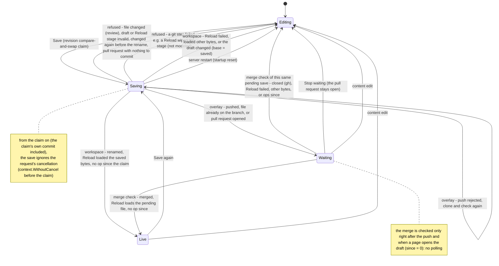

# Agent Editor save: bounded verification

This PlusCal model checks how one shared Agent Editor draft is saved to one agent
file: the claim, the review of changes to the live file, the workspace write and
Reload, the Git overlay push or pull request, waiting for the merge, Stop waiting,
co-editors, browser disconnects, Reload failures and server crashes. **It does not
prove the Go code correct.** A pass means the properties hold in the small finite
worlds below, under the assumptions below.

`make check` checks two kinds of configuration. Four configurations model the code
as built, fixes included, and must pass, with a browser disconnect allowed at the
claim or at any later step. The other 29 must find a named violation: bugs of the
code before its fixes, the plan as first written, two accepted limits, and
reachability probes. Exit 0 means every check ended as
expected. It does not mean every property holds in production.

## Run

From the repository root:

```sh
make -C docs/verification/agent-editor-save check
# one check, still judged by the runner:
make -C docs/verification/agent-editor-save workspace
make -C docs/verification/agent-editor-save claim-reply-lost
```

You need Java 11+, `curl`, `shasum` and Make. The runner downloads `tla2tools.jar`
v1.8.0, verifies SHA-256
`e1f11b75c4b5bc4478ba0ac5cb6ae28e40a01b0016bc33e0aa97da22dfdbcd7f`, and keeps the
tools, the translator's scratch copy, Java temporary files, TLC metadata and every
log and trace under the repository root's `.tmp/run/agent-editor-save/`. A passing
check needs TLC exit 0 and `Model checking completed. No error has been found.`. A
check that must fail needs TLC exit 12 or 13 and its exact named violation, so a
parse error never counts as an expected failure.

TLC runs with `-workers 2 -Xmx4g`, not thread-pr's one worker and 1 GiB. The two
overlay liveness checks explore 800,000 to 1.1 million states each, and
`overlay-two-users` about 2.3 million. Two workers keep the whole run near 15 minutes,
and 4 GiB leaves room for the liveness graph. With two workers, the state counts of
the expected failures change a little from run to run. The passing checks explore
the full graph, so their counts do not change.

`AgentEditorSave.tla` holds the PlusCal algorithm, every property (in the `define`
block), and the generated translation. Edit outside the translation markers, then
run `make … translate`.

## Design as built



A review stores the reviewed file as the draft's base, so it also counts for later
saves. A failed Reload has no undo: the draft goes back to editing, with the saved
bytes as its base. Stop waiting does not close the pull request.

## Actors and assumptions

- **People.** `user` processes (one or two) click Save, at most twice in all
  (`MaxSaves = 2`). A `coeditor` makes one content edit at any time and can make
  revision-only ops (test chat, External MCP) while a save runs or waits. A
  `stopper` can click Stop waiting at any time. With `StopFair`, a `patient`
  process eventually clicks it.
- **Third party.** The main agent or a teammate writes the live file once
  (`MaxThird = 1`): the workspace file, or the pinned branch. It can trigger a
  Reload at any time.
- **GitHub.** When a pull request opens, its fate is picked from `Outcomes`: merge
  commit, squash, rebase, close, or never acted on. GitHub eventually applies it.
- **Merge checks.** These are two steps (read, then Reload and move), so a slow
  check can finish after a later save started waiting. Three things run them: the
  save request right after its push, a page opening the draft (`opener`, never
  forced to act), and a `poller` that only the plan-as-written checks turn on.
  With `gh` a pull request reports merged or closed. Without `gh`, or for a push,
  the check asks whether the pinned branch contains the commit, so without `gh`
  a squash or rebase merge stays unseen.
- **Failures.** Reload can fail once for reasons outside the file
  (`MaxFail = 1`), so a draft can pass validation and Reload can still fail. File
  validity is fixed per version and picked in the initial state. The server
  crashes at most once at any step (`MaxCrash = 1`). A crash kills in-flight
  requests (epoch check). The restart loads what is on disk, re-fetches overlays
  at the pinned ref, and resets "saving" drafts to editing.
- **Disconnects** (`MaxCancel`, fix flags `claimnocancel` and `nocancel`). The
  `canceller` can drop a save request while its claim commits (a branch of the
  `Idle` step) or at any later save step. As built, `SaveAgentDraft` switches to
  `context.WithoutCancel` before the claim, so neither the claim's commit nor any
  later move or git command sees the disconnect, and the save runs on. The passing
  checks set `MaxCancel = 1`, so one disconnect lands at every possible point.
  Without `claimnocancel`, a disconnect during the claim lands the claim, loses its
  reply, and no save runs (`claim-reply-lost`). Without `nocancel`, the steps after
  the claim fail their moves and kill their git commands (`disconnect-*`). Only one
  disconnect per run is explored, not one per user. As built, a disconnect changes
  nothing but a flag, so more would only add states. That is reasoning, not
  something TLC checked.
- **What persists.** The draft (state, base, pending save, revision), the files on
  disk and on the branch, and the pull request. The save request's local values
  live only in its process.
- **Atomic steps.** Each PlusCal label is one step. The revision compare-and-swap
  makes each move atomic. The compare before the rename and the rename are
  separate steps with no lock between them. The Reload and the moves of one merge
  check are one step.
- **Delivery.** The network is always there. Git, gh and database calls do not
  fail, except where the model says so: rejected pushes, Reload failures,
  cancellations and crashes.
- **Fairness.** Users, GitHub, the restarter, the poller and `patient` are weakly
  fair: a step that stays enabled eventually runs. People's optional actions
  (editing, Stop, opening a page), the third party, the canceller and the crash
  are not fair, so nobody is assumed to act. Liveness that passes only because
  someone clicks Stop says so below.

## Properties

| Property | Meaning |
|---|---|
| `NoInvalidLive`, `StartupOK` | At rest, the file the next start loads is valid, and a start never breaks |
| `StaleNeedsReview` | A save replaces only bytes that someone on the draft reviewed or saved |
| `StaleNeedsReviewOutsideRace` | The same, except for a write that lands between the last compare and the rename (accepted race) |
| `SaveExclusive` | At most one save holds the claim at a time |
| `NoMixedLive` | A draft marked live holds exactly the bytes that went live |
| `HonestLive` | When a draft is marked live, the loaded file is the saved bytes |
| `NoUndoClobber`, `UndoUnreachable` | Nothing puts old bytes back over a later edit, and the undo path never runs |
| `EditedNotLive` | A draft edited after its last claim is never shown as live |
| `NoStaleCheckEnd` | A merge check never ends the wait of a later save |
| `SavingResolves` | "Saving" always ends |
| `WaitingResolves` | Waiting always ends, given that someone eventually clicks Stop waiting (`StopFair`) |
| `MergeResolves` | Once the pull request is merged (or seen closed), the draft stops waiting with nobody acting |
| `Probe…` | Reachability probes: each must be violated, which shows the state the passing checks rely on can happen |

## Checks

Unless a row says otherwise, every check uses `MaxCrash = 1`, `MaxFail = 1`,
`MaxThird = 1` and `MaxSaves = 2`. The workspace (ws) checks use two users. The
overlay checks use one user, `gh`, outcomes merge/squash/close/none, and push and
pull-request saves. As built means `Fixes <- AsBuilt`, `EditLeaves = TRUE`,
`Poll = FALSE` and `StopFair = TRUE`. The passing checks set `MaxCancel = 1`; the
other checks set it to 0 unless their row says otherwise. Recorded on 2026-11-13.
The full `make check` took 866 s and exited 0. Depth is TLC's search
depth. A failing check stops at the first violation, so its counts cover only a
prefix of the graph.

Passing checks (the code as built):

| cfg | World | Checks | Result | Distinct states | Depth | Time |
|---|---|---|---|---:|---:|---:|
| `workspace` | ws, as built, one disconnect | all safety properties (with `StaleNeedsReviewOutsideRace`, `UndoUnreachable`), `SavingResolves`, `WaitingResolves` | PASS | 64,832 | 17 | 19 s |
| `overlay-gh` | overlay, gh, as built, one disconnect | all safety properties (strict `StaleNeedsReview`), `SavingResolves`, `WaitingResolves` | PASS | 1,087,763 | 21 | 7 min 35 s |
| `overlay-no-gh` | overlay, no gh, as built, one disconnect | same | PASS | 811,747 | 21 | 4 min 37 s |
| `overlay-two-users` | overlay, gh, two users, `MaxCrash = 0`, as built, one disconnect | safety only | PASS | 2,338,536 | 20 | 59 s |

Expected violations:

| cfg | What it shows | World beyond the defaults | Expected and actual | Distinct | Depth | Time |
|---|---|---|---|---:|---:|---:|
| `disconnect-workspace` | **Pre-fix:** the steps after the claim ran on the request's context. A closed tab made the refusal's move fail, so the draft stayed saving. Only `nocancel` is removed, which isolates this bug from the claim window (that combination never shipped) | ws, `Fixes <- LaterStepsCancelled`, `MaxCancel = 1` | `SavingResolves` violated | 22,244 | 11 | 3 s |
| `disconnect-overlay` | **Pre-fix:** the same for the overlay: the killed git step's refusal also failed | overlay gh, `Fixes <- LaterStepsCancelled`, `MaxCancel = 1` | `SavingResolves` violated | 36,525 | 10 | 3 s |
| `claim-reply-lost` | **Pre-fix:** with `WithoutCancel` only after the claim, a disconnect while the claim committed landed the claim and lost its reply, so no save ran and the draft stayed saving | ws, `Fixes <- ClaimCancelled`, `MaxCancel = 1` | `SavingResolves` violated | 21,801 | 11 | 3 s |
| `stale-check-end` | **Pre-fix:** a check that read save 1 finished after save 2 began waiting, and its "still waiting?" test ended save 2's wait | overlay gh, `Fixes <- WithoutSamePending` | `NoStaleCheckEnd` violated | 42,327 | 11 | 1 s |
| `edit-keeps-live` | **Pre-fix:** an edit of a live draft kept saying live | ws, `EditLeaves = FALSE` | `EditedNotLive` violated | 2,295 | 7 | <1 s |
| `write-race` | **Accepted:** the main agent writes between the save's last compare and its rename, and the rename erases that write | ws | strict `StaleNeedsReview` violated | 1,211 | 7 | <1 s |
| `merge-unnoticed` | **Accepted (no polling):** the save's own check sees the pull request open, GitHub squash-merges it later, and the open editor never checks again | overlay gh, pull request only, outcomes merge/squash/close, `StopFair = FALSE`, `MaxCrash = 0` | `MergeResolves` violated | 27,093 | 15 | 3 s |
| `plan-double-save` | Plan: two people click Save at once, and both save | ws, `Fixes = {}`, `EditLeaves = FALSE`, `Poll = TRUE` | `SaveExclusive` violated | 384 | 5 | <1 s |
| `plan-overlay-double-save` | Plan: the same on an overlay | overlay, no gh, two users, all five outcomes, plan | `SaveExclusive` violated | 366 | 5 | <1 s |
| `plan-invalid-live` | Plan: an invalid draft is written, then a crash comes before Reload rejects it | ws, plan | `NoInvalidLive` violated | 1,779 | 7 | <1 s |
| `plan-broken-start` | Plan: the next start loads an invalid or half-written file | ws, plan | `StartupOK` violated | 1,771 | 7 | <1 s |
| `plan-stale-overwrite` | Plan: the stale check reads the loaded copy, not the file it overwrites | ws, plan | `StaleNeedsReview` violated | 717 | 6 | <1 s |
| `plan-overlay-stale-push` | Plan: a teammate's push is overwritten without review | overlay, no gh, one user, plan | `StaleNeedsReview` violated | 566 | 7 | <1 s |
| `plan-mixed-live` | Plan: an edit made during the save is shown as live | ws, plan | `NoMixedLive` violated | 3,913 | 8 | <1 s |
| `plan-false-live` | Plan: Reload loads another writer's file, and the draft says live | ws, plan | `HonestLive` violated | 3,372 | 8 | <1 s |
| `plan-undo-clobber` | Plan: the undo after a failed Reload erases a later edit | ws, plan | `NoUndoClobber` violated | 6,181 | 9 | <1 s |
| `plan-stuck-saving` | Plan: a restart mid-save leaves the draft saving | ws, one user, plan | `SavingResolves` violated | 29,006 | 22 | 2 s |
| `plan-stuck-waiting` | Plan: a merge the check cannot see keeps the draft waiting | overlay, no gh, one user, plan | `WaitingResolves` violated | 26,051 | 12 | 3 s |
| `reach-live` | A workspace draft goes live | ws, as built | `ProbeNotLive` violated | 1,275 | 6 | <1 s |
| `reach-stale-review` | A third-party change is caught and reviewed, and the save goes on | ws, as built | `ProbeNoStaleCatch` violated | 483 | 5 | <1 s |
| `reach-crash-mid-save` | The server crashes mid-save | ws, as built | `ProbeNoCrashSave` violated | 47 | 3 | <1 s |
| `reach-invalid-draft` | An invalid draft reaches a save step | ws, as built | `ProbeNoInvalidDraft` violated | 12 | 2 | <1 s |
| `reach-reload-fail` | A Reload fails after the rename, and the draft returns to editing | ws, as built | `ProbeNoReloadFailEditing` violated | 1,276 | 6 | <1 s |
| `reach-live-edit` | A live draft is edited | ws, as built | `ProbeNoLiveEdit` violated | 2,278 | 7 | <1 s |
| `reach-cut-save` | A request disconnected at its claim still runs a save step, so the passing disconnect is not vacuous | ws, as built, `MaxCancel = 1` | `ProbeNoCutSave` violated | 14 | 2 | <1 s |
| `reach-cut-push` | A disconnected overlay request still pushes or runs its merge check | overlay gh, as built, `MaxCancel = 1` | `ProbeNoCutPush` violated | 94 | 3 | <1 s |
| `reach-pr-live` | A pull request merges, and the draft goes live | overlay gh, as built | `ProbeNoPrLive` violated | 2,228 | 7 | <1 s |
| `reach-push-retry` | A rejected push clones and checks again | overlay gh, as built | `ProbeNoRetry` violated | 430 | 5 | <1 s |
| `reach-stale-finish` | A check of an earlier save finishes while a later save waits, so the same-pending fix is exercised | overlay gh, as built | `ProbeNoStaleFinish` violated | 23,163 | 10 | 1 s |

Versions: the TLC banner read `TLC2 Version 2026.11.06.222357 (rev: d8fb231)` and
the translator `pcal.trans Version 1.12 of 01 July 2024`, both from the pinned
v1.8.0 jar. Java was OpenJDK 21.0.13.0.3 (Homebrew), on macOS aarch64.

## Accepted limits

- **No polling (user decision, because of GitHub rate limits).** The merge is
  checked only by the save right after its push, and by a page that opens the
  draft (`GetAgentDraft` with `since = 0`). An editor that stays open never checks
  again. A draft whose pull request merges later keeps waiting until someone
  reopens the page, edits, or clicks Stop waiting. `merge-unnoticed` shows this.
  Other cases end the same way and are not separate checks:
  - a crash between the move to waiting and the post-push check (startup resets
    only "saving" drafts);
  - a page-open check whose request is dropped (its moves fail, so the draft
    keeps waiting);
  - a post-push check that fails because a Reload wiped its clone.
  `WaitingResolves` passes only because someone eventually clicks Stop
  (`StopFair`). Without `gh`, a squash or rebase merge is never seen at all.
- **Write race before the rename (accepted earlier).** No lock covers the emulated
  shell or the agent's file tools between the save's last compare and its rename.
  The workspace checks use `StaleNeedsReviewOutsideRace`, and `write-race` shows
  the strict property failing.

## Model steps and the code

Paths are under `internal/rocketclaw/`.

| Model step | Code |
|---|---|
| `Idle` (claim, `cas`); the disconnect-at-claim branch (`claimnocancel`) | `backend/agent_draft_save.go:SaveAgentDraft`: `ctx = context.WithoutCancel(ctx)` before the claim (165-168); claim via `moveAgentDraft` + `agentDraftClaim` (170-177); `commitAgentDraftOps` revision compare-and-swap (`backend/agent_drafts.go:383-409`) |
| `canceller`, `Cut` (`nocancel`) | the same uncancellable context for every later move, git and gh command; `refuse` (179-185) |
| `Check` (stale check, `targetbase`, `prevalidate`, `reloadfirst`) | `changed` / `staleAgentDraft` reading the destination itself (207-218); `checkAgentDraftVariant` (220, 261-279) |
| `Recheck`, `Write` (`cmpwrite_nolock`, `atomicwrite`) | temp file, sync, `changed()` again, `root.Rename` (231-254) |
| `Reload` (`noundo`, `snapcheck`), `MarkLive` | `reloadAgentDraft` with `agentDraftLoaded` / `agentDraftStill` (285-305, 358-387) |
| `Restart` (`startreset`) | `resetSavingAgentDrafts` (326-339), called at `backend/app.go:182` |
| `Stage`, `Publish` | `backend/agent_draft_overlay.go:saveAgentDraftToOverlay`: clone, stale check, validate, unchanged file (145-205); push, `[rejected]` loop (207-222); `gh pr create` (224-233); move to waiting (235) |
| `PostPush`, `PostPush2` | `CheckAgentDraftMerge` after the push (239) |
| `CheckStart`, `CheckFinish` (`samepending`) | `CheckAgentDraftMerge` (58-102): CLOSED → `agentDraftStill{pending: pending.Revision}` (75-78); clone fallback (79-95); MERGED → `reloadAgentDraft(…, pending.Revision)` |
| `opener` | `frontend/rpc/drafts.go:getAgentDraft` when `Since == 0` (46-51); the page sends `since = coedit.rev` (`web/src/agent-editor/index.tsx:72`) |
| `stopper`, `patient` (`stopwait`) | `StopAgentDraftWaiting` (`agent_draft_overlay.go:106-110`), `frontend/rpc/drafts.go:stopWaiting` (256) |
| `coeditor` (`EditLeaves`) | `ApplyAgentDraftOp`: an edit of a waiting or live draft commits a move to editing first; test chat and External MCP ops do not (`agent_drafts.go:359-367`) |
| `third` Reload, `Restart` overlay re-fetch | `Runtime.Reload` (`backend/runtime.go:60`), `skel/skel.go:applyGitOverlay` |

## What the model leaves out

- **The stage can be wiped mid-save.** The overlay stage and the merge check's
  clone live in the runtime folder (`.rocketclaw/agent-save-*`). Reload rebuilds
  that folder and removes entries it does not keep (`skel/skel.go`), so a Reload
  during an overlay save can delete the clone. The next git step fails and the
  save returns to editing. In pull-request mode the branch may already be pushed
  with no pull request. A wiped clone makes its next git step fail, and every step
  after a push uses its own directory. This is a failure path, not a modeled
  property.
- Network, git, gh and database failures other than those listed above. A hung
  git command keeps a claimed save in "saving", because `WithoutCancel` leaves it
  with no deadline. A branch that moves under every push keeps the save cloning
  again (ponytail in `saveAgentDraftToOverlay`). One third-party write bounds
  that here.
- Layer shadowing between workspace and overlays. New-agent saves and renames
  during a save. Name and variant refusals.
- Review always accepts. The real refuse-review-save-again loop is collapsed into
  one save that adopts the file it reviewed as its base. Cancelling a review only
  makes a save safer.
- Only one pull request is tracked. An older pull request merging after a newer
  save is not covered.
- A merge check cut off by a crash may finish after the restart, which is more
  permissive than the code.
- Bounds: one crash, one Reload failure, one third-party write, one content edit,
  two Save clicks. The overlay liveness checks use one user. The two-user overlay
  check has no crash and checks safety only.

## Changes from the earlier model

This model replaces `DraftLifecycle.tla` and its configurations, which lived in a
shared `agent-editor-model/` folder before the models moved to one folder each.

- The main checks now model the fixed code and pass: `workspace`, `overlay-gh`,
  `overlay-no-gh` and `overlay-two-users`. They replace `DraftLifecycle.cfg`,
  `_overlay.cfg` and `_overlay_gh.cfg`, which modeled the code before
  `WithoutCancel`, and `_ws_fixed.cfg`, `_overlay_cancelfix.cfg` and
  `_overlay_fixed.cfg`.
- `CancelOnDisconnect` became the fix flags `nocancel` (steps after the claim)
  and `claimnocancel` (the claim's own commit). The claim window was found by
  this model as an open problem and is now fixed in the code (`WithoutCancel`
  moved ahead of the claim, with a regression test); `claim-reply-lost` keeps it
  as a pre-fix check. The pre-fix disconnect is `disconnect-workspace` and
  `disconnect-overlay`. The old no-gh pre-fix overlay check was dropped, because
  it showed the same bug the same way.
- Dropped, because the design was not built: `_ws_recommended` and
  `_ws_guardundo` (earlier alternative fixes), and `_merge_poll` (polling, which
  the user declined). The model's `cmpwrite` and `guardundo` flags and its
  `MergeRule` constant (`contains_or_bytes`) went with them. The poller stays
  only for the plan-as-written checks.
- The plan's counterexamples, which earlier needed hand-made copies of a config,
  now have one check each. The reachability probes that guard the passing checks
  are now checks too.
- `merge-unnoticed` uses `MaxCrash = 0`. With one crash, TLC reports a crash
  between the push and its check first. That case is real too and covered above,
  but the plain trace is the common one.
- The passing checks use `MaxCancel = 1`. That covers a disconnect during the
  claim and at every later step, and roughly triples the overlay state space.
  `reach-cut-save` and `reach-cut-push` show those disconnects really happen in
  the passing worlds.
