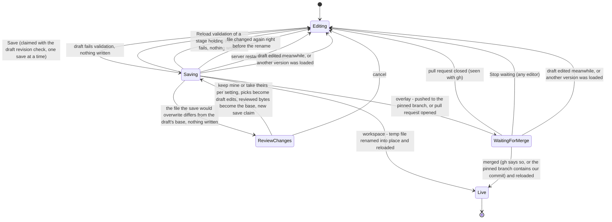
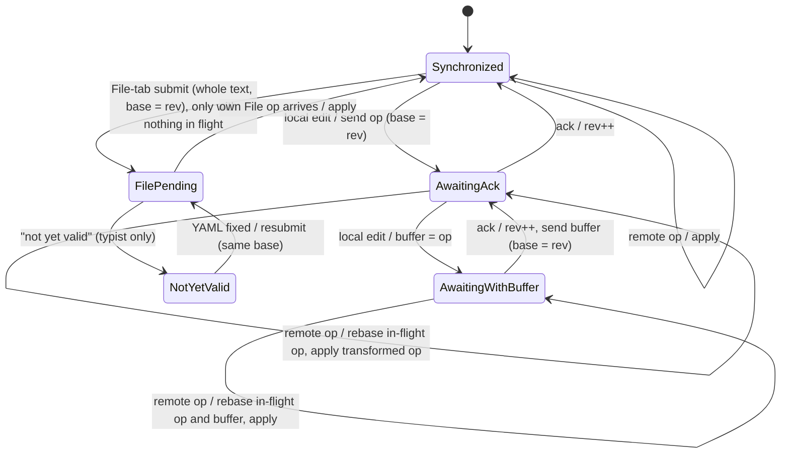
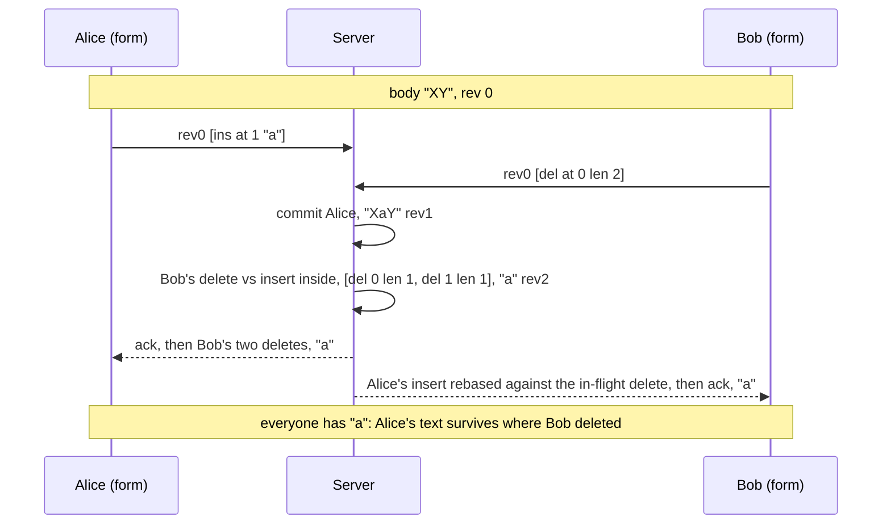
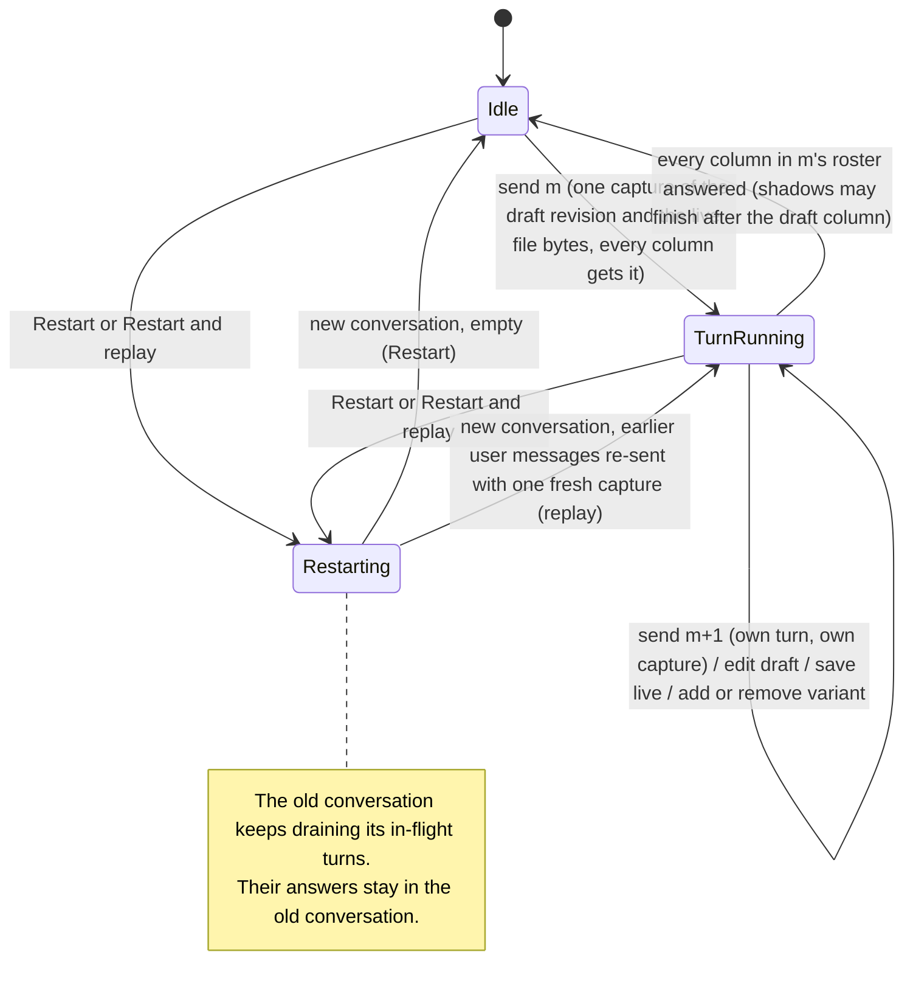

# Agent Editor state models

Plan: `docs/plans/2026-11-11-1123-feat-agent-editor-plan.md`.
Specs and configs: `docs/verification/agent-editor-model/`.

## Purpose

The Agent Editor has four parts where people and processes run at the same time, and a wrong design there loses work or lies to the user.
Before writing code, each part was drawn as a state diagram, written as a PlusCal algorithm, and checked with the TLC model checker:

| Area | Spec | What can go wrong |
|---|---|---|
| Draft lifecycle | `DraftLifecycle.tla` | Save, review of live changes, workspace and Git overlay writes, waiting for a pull request, crashes |
| Co-editing | `CoEditing.tla` | Two people editing the same draft in the Form and File tabs |
| Test turns | `TestTurns.tla` | Which draft and live version each test answer used, variants, restart |
| External MCP mode | `ExternalMCP.tla` | Metadata, mode and `sticky` rules when a test chat behaves as an External MCP call |

Each spec has a constant that switches between the plan as first written and the fixed design.
The main config of each area checks the fixed design, which is the design the plan now builds.
The other configs reproduce the counterexamples that changed the plan.

Every property is in the spec's `define` block.
The PlusCal algorithm sits in a comment at the top of each spec; the translator's output sits between the `BEGIN TRANSLATION` and `END TRANSLATION` markers.

## How to re-run

Download `tla2tools.jar` into the repository's `.tmp/tla/` folder. Never use `/tmp`.

```sh
mkdir -p .tmp/tla
curl -L -o .tmp/tla/tla2tools.jar https://github.com/tlaplus/tlaplus/releases/download/v1.8.0/tla2tools.jar
```

The recorded runs used TLC 2.19.
Run from the spec folder. The relative paths keep every generated file under the repository's `.tmp/`:

```sh
cd docs/verification/agent-editor-model
java -cp ../../../.tmp/tla/tla2tools.jar pcal.trans -nocfg DraftLifecycle.tla
rm -f DraftLifecycle.old
java -XX:+UseParallelGC -cp ../../../.tmp/tla/tla2tools.jar tlc2.TLC -workers auto \
  -metadir ../../../.tmp/tla/states/DraftLifecycle -config DraftLifecycle.cfg DraftLifecycle.tla
```

- Re-translate only after editing the PlusCal algorithm. `-nocfg` stops the translator from overwriting the hand-written `.cfg`; it leaves a `<Spec>.old` backup that you delete.
- A run that finds a violation writes `<Spec>_TTrace_*.tla` and `.bin` files into the spec folder. Delete them; do not commit them.
- Replace `DraftLifecycle` and the config name for the other specs. Use a separate `-metadir` per run.

## Draft lifecycle

The design as built, for one draft of one agent file:



There is no "file on the branch equals our bytes" merge rule.
A squash or rebase merge without `gh`, a closed pull request without `gh`, and a pull request nobody acts on all leave the draft waiting until someone clicks Stop waiting.
Stop waiting does not close the pull request; it stays open on GitHub.

The keep mine / take theirs choices in ReviewChanges are not in the model: it treats the review as one step that accepts the live bytes.
The design keeps that true by applying the picks as ordinary draft edits before a new save claim, so the save the model checks starts from a draft that already contains them.

Properties:

| Property | Meaning | Requirements |
|---|---|---|
| `NoInvalidLive`, `StartupOK` | At rest, the file the next start loads is valid, and a start never breaks | R18, R19 |
| `StaleNeedsReview` | A save replaces only bytes equal to the draft's base or bytes the saver reviewed | R21 |
| `SaveExclusive`, `NoMixedLive` | At most one save per draft at a time; a draft marked live holds exactly the bytes that went live | R16, R17 |
| `HonestLive` | When a draft is marked live, the loaded file is the saved bytes | R19, R21 |
| `NoUndoClobber` | Nothing ever puts old bytes back over someone else's later edit | R21 |
| `UndoUnreachable` | The undo-after-failed-Reload path never runs, so the design has none | Plan KTD8 |
| `SavingResolves`, `WaitingResolves` | Saving and waiting for merge always end (liveness) | R16, R19 |

Main configs (two users, at most one crash, one Reload failure and one outside edit):

| Config | Mode | Result | Distinct states | Depth | Time |
|---|---|---|---|---|---|
| `DraftLifecycle.cfg` | workspace | pass, all properties | 5,946 | 22 | 6 s |
| `DraftLifecycle_overlay.cfg` | overlay, no `gh`, push and PR, every merge kind | pass | 168,858 | 29 | 24 s |
| `DraftLifecycle_overlay_gh.cfg` | overlay, with `gh` | pass | 188,136 | 30 | 21 s |

`DraftLifecycle_ws_guardundo.cfg` checks the alternative that keeps an undo, guarded by a compare (pass, 8,597 states). The plan does not use it.

Plan-as-written counterexamples. `DraftLifecycle_ws_plan.cfg` and `DraftLifecycle_overlay_plan.cfg` stop at the first violation (`SaveExclusive`). To see another property fail, copy one of them and keep only that property in `INVARIANTS` or `PROPERTIES`:

- **Crash after the write** (`NoInvalidLive`, `StartupOK`; `_ws_plan`). An invalid draft is written to `agents/x.md` and the server crashes before Reload rejects it, so the next start fails. A crash in the middle of the write leaves a half-written file the same way.
- **Stale check reads the wrong file** (`StaleNeedsReview`; `_ws_plan`, `_overlay_plan`). The check compares against the copy the server loaded, so an unreloaded edit by the main agent, or a teammate's push to the pinned branch, is overwritten without review.
- **Check only at click** (`StaleNeedsReview`). The main agent edits the file after the review but before the write, and the save overwrites it.
- **Double save** (`SaveExclusive`; `_ws_plan`, `_overlay_plan`). Two people click Save at once, both see "editing", and both write.
- **Edited while saving** (`NoMixedLive`). A teammate types while the save runs, and the draft is marked live with text that was never saved.
- **Someone else's change wins** (`HonestLive`). The main agent rewrites the file right after the save, Reload loads that, and the editor still says the draft is live.
- **Undo erases an edit** (`NoUndoClobber`; `_ws_plan`). After the write, the main agent edits the file, Reload fails for an unrelated reason, and the undo writes the old bytes over the edit.
- **Stuck saving** (`SavingResolves`; `_ws_plan`). The server restarts mid-save and the draft says "saving" forever.
- **Stuck waiting** (`WaitingResolves`; `_overlay_plan`). Without `gh`, a squash or rebase merge never puts our commit on the branch; a closed or ignored pull request never resolves either.

## Co-editing

Client state for one editor:



Remote ops keep arriving and are applied in FilePending and NotYetValid.
A body op is a list of splices applied in order, so a delete with a teammate's insert strictly inside becomes two deletes around the insert:



The design also needs:

- The File tab's whole text is turned into ops with an exact multi-range diff against the body at the submit's base revision, on the server. A prefix/suffix diff re-inserts text the typist never touched.
- A File-tab submit is sent only when no form op is in flight or buffered.
- While your own write to a setting is unacknowledged, a remote write to the same setting is ignored on your screen. The server still applies last write wins and logs both.
- Each op carries a client and sequence id, so a client that fetches "ops since my revision" knows its own op is the ack.

Properties:

| Property | Meaning | Requirements |
|---|---|---|
| `Convergence` | When nothing is pending, every client's body and setting equal the server's | R17, R18 |
| `NoLostEdit` | The server text is the seed plus every insert minus what an author saw and deleted | R17 |
| `NoDuplicate`, `OrderPreserved` | No character appears twice; any two keep the same order in every view | R17 |
| `InvalidPrivate`, `InvalidNoRevision` | Invalid File-tab text reaches no teammate and changes nothing on the server | R17 |
| `HistoryComplete`, `SettingsLWW` | Every setting write is logged or pending; the server value is the last logged write | R16, R17 |
| `NoStuck`, `EventuallySettled` | Every op has one request or ack in transit; once typing stops, everything drains | R17 |

Results (two clients, two seed characters):

| Config | Result | Distinct states | Depth | Time |
|---|---|---|---|---|
| `CoEditing.cfg` (main) | pass | 276,529 | 19 | 3 s |
| `CoEditing_wide.cfg` (two edits each) | pass | 8,357,857 | 23 | 1 min 37 s |
| `CoEditing_live.cfg` (`EventuallySettled`) | pass | 7,265 | 12 | 34 s |
| `CoEditing_minimaldiff.cfg` (any File edit, exact diff) | pass | 499,347 | 19 | 6 s |

Plan-as-written counterexamples:

- **Single splice widened over an insert** (`NoLostEdit`; `CoEditing_plan.cfg`). Bob deletes a passage after Alice typed inside it unseen; the widened delete removes her text.
- **Clients diverge** (`Convergence`; `CoEditing_plan_conv.cfg`). Bob's screen keeps Alice's text while the server deleted it, forever. `CoEditing_plan_oob.cfg` goes on to send an op past the end of the text.
- **Clipped delete** (`NoLostEdit`; `CoEditing_clip.cfg`). The server keeps text Bob saw and deleted.
- **Delete wins** (`NoLostEdit`; `CoEditing_deletewins_lost.cfg`). Dropping the insert converges (`CoEditing_deletewins.cfg` passes the rest) but loses Alice's text, against the agreed rule.
- **One splice cannot carry the fix** (`CoEditing_shape.cfg`). The fixed design commits a delete as two splices; this config shows that shape is required.
- **Prefix/suffix File diff** (`OrderPreserved`, `NoLostEdit`; `CoEditing_anyfile.cfg`, `CoEditing_anyfile_lost.cfg`). Two separate changes in the File tab become "replace everything", which re-inserts untouched text and undoes a teammate's delete or reorders their insert.
- **File submit while a form op is pending** (`NoDuplicate`; `CoEditing_busyfile.cfg`). The whole text already holds the pending insert but its base does not, so the insert lands twice.
- **Remote setting write over a pending one** (`Convergence`; `CoEditing_naiveset.cfg`). Bob shows Alice's value while the server keeps Bob's.

## Test turns



```mermaid
sequenceDiagram
    participant E as Editor
    participant S as Server (send and admission)
    participant A as Column A (draft)
    participant B as Column B (variant shadow)
    participant L as Live column (shadow)
    E->>S: send m1
    S->>S: read draft A rev 3, B rev 5, live file v7 together; store with the turn and every shadow manifest
    S->>A: turn m1, frames its prompt from A rev 3
    E->>S: edit draft A (rev 4) mid-turn
    S->>S: teammate saves live (v8) mid-turn
    B->>B: runs captured B rev 5 with its own framing
    L->>L: runs captured v7, not v8 from disk
    A->>E: answer m1, labeled A rev 3
    B->>E: answer m1, labeled B rev 5
    L->>E: answer m1, labeled live v7
    E->>S: send m2 (captures A rev 4, live v8)
```

Properties:

| Property | Meaning | Requirements |
|---|---|---|
| `VersionAtSendDraft`, `VersionAtSendLive` | Each answer used the version current when its message was sent | R11, R12, R15 |
| `LabelTruthful` | The label shows the version actually loaded, all from one version | R12 |
| `AlignedPerMessage` | Each column answers each message at most once, in order, placed by message id | R14 |
| `RestartIsolation`, `ReplaySameOrder` | No old-chat answer shows in the new chat; replay re-sends the same texts in order | R12 |
| `RosterMatchesDraft` | A message goes to exactly the variants the draft has when it is sent | R14 |
| `FramingOwn` | Each column's prompt framing comes from its own definition | R14, R15 |
| `EveryColumnAnswers` | Every message gets an answer from every column in its roster (liveness) | R11, R14, R15 |

Results (two messages, two edits, one save, two variant toggles, one restart):

| Config | Result | Distinct states | Depth | Time |
|---|---|---|---|---|
| `TestTurns.cfg` (main) | pass, all eight invariants | 3,740,278 | 35 | 56 s |
| `TestTurns_live.cfg` (`EveryColumnAnswers`, smaller bounds) | pass | 46,578 | 32 | 27 s |

Plan-as-written counterexamples:

- **Live reads disk when it runs** (`VersionAtSendLive`; `TestTurns_plan_live_disk.cfg`). A teammate saves after m1 is sent, and the lagging live shadow answers m1 from the newer file.
- **Label from send time** (`LabelTruthful`; `TestTurns_plan_label_at_send.cfg`). The same run, labeled with the version at send, so the label is false. `TestTurns_plan_label_only.cfg` shows that a truthful late label alone passes everything except `VersionAtSendLive`.
- **Capture at parent turn start** (`VersionAtSendDraft`; `TestTurns_capture_parent_start.cfg`). m2 is queued behind m1, the draft is edited, and m2 runs the newer version.
- **Today's code** (`VersionAtSendDraft`; `TestTurns_today.cfg`). Every column reads disk when it runs.
- **Restart in place** (`RestartIsolation`; `TestTurns_restart_in_place.cfg`). An old in-flight answer shows up in the cleared chat under a reused message id.
- **Positional answers** (`AlignedPerMessage`; `TestTurns_positional.cfg`). A variant removed and added back puts its answer to m2 next to m1.
- **Roster from disk** (`RosterMatchesDraft`; `TestTurns_roster_disk.cfg`). A variant removed in the draft but still on disk keeps getting messages.
- **Torn save** (`LabelTruthful`; `TestTurns_torn_save.cfg`). A capture reads one new file and one old file of the same save.
- **Parent's framing** (`FramingOwn`; `TestTurns_parent_framing.cfg`). Variant and live columns run the prompt the draft column framed, with its instructions and mode.

## External MCP mode

Metadata follows real External MCP (`turnShellEnv`, `internal/rocketclaw/backend/bridge.go`):

- The keys sent with the first message are locked for the chat.
- A key added later is in effect for that message only and is never stored.
- Real External MCP silently keeps a locked key's first value when a caller changes it. The test chat refuses that send on the server, checking the version the turn will run, and offers a restart instead.
- Every column gets the same variables through the parent turn's captured snapshot.

```mermaid
stateDiagram-v2
    [*] --> Off
    Off --> OnEditable: switch on (only if the draft is sticky off; checked on the server too)
    OnEditable --> Off: switch off
    OnEditable --> OnEditable: edit pairs or caller
    OnEditable --> OnRunning: first message (its keys become locked)
    Off --> WebRunning: first message
    OnRunning --> OnRunning: add, change or remove an unlocked key (sent, in effect for that message)
    OnRunning --> OnRunning: change caller (sent, as External MCP allows)
    OnRunning --> RestartOffered: change or remove a locked key (send refused on the server)
    OnRunning --> RestartOffered: switch turned off (send refused)
    WebRunning --> RestartOffered: switch turned on (send refused)
    OnRunning --> Refused: sticky became non-off (send refused)
    Refused --> OnRunning: sticky back to off
    RestartOffered --> OnRunning: undo the change
    RestartOffered --> Off: restart, switch off
    RestartOffered --> OnEditable: restart, switch on
```



The chat shows each message's metadata as the agent got it: locked keys with a lock, later keys as "this message only".
In External MCP mode the Live column does not run when the saved file is not `sticky: off`, and says why.

Properties:

| Property | Meaning | Requirements |
|---|---|---|
| `RealRule` | Every External MCP turn's variables, in every column, equal what real External MCP gives for the same messages | R29 |
| `InboundHonest` | A turn ran with exactly the pairs its message carried, which the page shows | R29, AE8 |
| `FrozenPerChat`, `ModeHonest`, `NoHybridTurn` | Every turn has the first turn's mode, the one the page showed; a Web turn carries no metadata | R27, R29 |
| `OnlyStickyOff` | No External MCP turn runs for a draft version or live file that is not `sticky: off` | R28, AE7 |
| `ColumnsAgree` | One message gives every column the same mode, metadata and caller, and no ask-user in this mode | R27 |
| `MetaVarSuggestion` | A Web first message of an agent using a metadata variable was sent from a page showing the suggestion | R30 |

Results (two editors, two messages, one restart):

| Config | Result | Distinct states | Depth | Time |
|---|---|---|---|---|
| `ExternalMCP.cfg` (main) | pass, 10 invariants | 5,649,728 | 31 | 47 s |
| `ExternalMCP_fixed_callers.cfg` (two callers, no restart) | pass | 12,613,824 | 27 | 2 min 26 s |

Counterexamples against the plan as written and against rejected designs:

- **Locked key changed silently** (`InboundHonest`; `ExternalMCP_real_silent.cfg`). The page sends `k1=v2` after `k1=v1` was locked, and the agent still gets `k1=v1`.
- **Conflict check on an earlier read** (`InboundHonest`; `ExternalMCP_real_early.cfg`). The check passes, a teammate then drops the key, and the message runs with the locked value the page no longer shows.
- **Whole-set freeze** (`RealRule`, `ModeHonest`; `ExternalMCP_chatfreeze_realrule.cfg`, `ExternalMCP_chatfreeze_modehonest.cfg`). Freezing all pairs hides a key real External MCP would pass, and holding the mode runs a turn in a mode the page no longer shows. `ExternalMCP_chatfreeze.cfg` passes its own rules; it was rejected for not matching real External MCP.
- **Mode toggled mid-chat** (`FrozenPerChat`, `NoHybridTurn`, `InboundHonest`; `ExternalMCP_base_frozen.cfg`, `ExternalMCP_base_hybrid.cfg`, `ExternalMCP_base_honest.cfg`). Switching on after a Web message, or off after an External MCP message, gives mixed turns; an edited locked value is ignored.
- **Sticky checked only on the page** (`OnlyStickyOff`; `ExternalMCP_base_sticky.cfg`, `ExternalMCP_sticky_pageclears.cfg`). The switch is on, then a teammate sets `sticky: user`, and the next send runs anyway, even with one editor.
- **Sticky checked on a different version** (`OnlyStickyOff`; `ExternalMCP_sticky_uncaptured.cfg`). The server checks one version and the turn runs another. `ExternalMCP_sticky_captured.cfg` passes.
- **Live column runs a sticky file** (`OnlyStickyOff`; `ExternalMCP_live_run.cfg`). Shadows are created `sticky: off` and never check, so a `sticky: user` live agent answers as External MCP.
- **No suggestion shown** (`MetaVarSuggestion`; `ExternalMCP_base_suggest.cfg`). A stale page sends a Web first message for an agent that uses a metadata variable without showing the suggestion.

Guarding draft writes instead of checking at send is safe only when mode changes are refused (`ExternalMCP_refuse_draftguard.cfg` passes, `ExternalMCP_freeze_draftguard.cfg` fails). The design checks at send, one place for every path.

## Limits

These were not checked and stay as review and test items:

- **Bounds.** Two users or clients, at most two messages or edits per actor, one crash, one Reload failure and one outside edit. More only adds paths to the same failures found, but that is a judgment, not a proof.
- **Draft lifecycle.** Layer shadowing between workspace and overlays (R18, R20); new-agent saves; a pull request still open after Stop waiting; a merge into a branch that moved after validation. The keep mine / take theirs picks are not modeled. The re-check before the rename assumes no other writer slips into the window between compare and rename: a write from the emulated shell or an agent's file tool there is lost (replace `cmpwrite` with `cmpwrite_nolock` in a copy of `DraftLifecycle.cfg` to see it). The plan accepts this race.
- **Overlay merge detection.** The runtime overlay clone is fetched with depth 1, so it cannot answer "the pinned branch contains our commit". This is a code reading, not a model result.
- **Co-editing.** Cursors, undo, reconnect after missed messages, three or more clients, edits longer than one character or range per step, repeated characters in the real character diff. Liveness only at small bounds.
- **Test turns.** Steer messages that join a running turn (`bridge.go:645`), so two messages could get one answer; a variant added mid-chat inheriting the draft column's history (`shadows.go:756-780`); a shadow stopped by the 1.5x step limit; crash and recovery; tool side effects; where the rule "a shadow's mode matches its parent's" is enforced.
- **External MCP mode.** Whether variants can change `sticky`; that the Live column is a shadow of the draft column; how easy-agent commands expand an unset metadata variable; liveness. `RealRule` is written from the bridge's code, so it checks that the test path feeds the bridge the entered pairs, not the bridge's own behavior. `MetaVarSuggestion` (R30) was checked only against the plan as written, not in the main config.
