# Agent Editor test turns: bounded verification

`AgentEditorTestTurns.tla` is a PlusCal model of the Agent Editor's draft test chat: which draft and live
version each column's answer used, how the answer is labelled and placed, Restart and Restart & replay,
later (wake) turns started by background work, and keystrokes still pending when Send is pressed.
**A pass means the properties hold for this finite model under the assumptions below, not that the code
is correct.** Three configurations model the code as built and pass. The other configurations must fail
with a named violation: two are canaries; the rest reproduce bugs the fixes removed, rejected or incomplete
fixes, earlier plans, and one accepted limit pending a fix (`stash-without-record`). The as-built checks
include a teammate's page that sends and a Restart & replay the draft's checks refuse.

## Run

From the repository root:

```sh
make -C docs/verification/agent-editor-test-turns check
# One check (a passing one, or an expected counterexample, still checked by the runner):
make -C docs/verification/agent-editor-test-turns as-built
make -C docs/verification/agent-editor-test-turns replay-skips-queued
```

Requires Java 11+, `curl`, `shasum` and Make. The runner downloads tla2tools v1.8.0 and checks SHA-256
`e1f11b75c4b5bc4478ba0ac5cb6ae28e40a01b0016bc33e0aa97da22dfdbcd7f`. Tools, the translator's scratch copy,
Java temp files, TLC metadata and every log and counterexample trace go to the repository root's
`.tmp/run/agent-editor-test-turns/`. A passing check needs exit 0 and `Model checking completed. No error has
been found.`; a negative check needs exit 12 or 13 and its exact `EXPECTED_<check>` message, so a parse
error never counts. The runner uses `-Xmx4g` and `-workers 2` (the two large safety checks hold 7–15
million distinct states; two workers keep the whole run near 15 minutes) and `-lncheck final` (liveness is
checked once on the complete graph instead of periodically; same result, less time). Written as 14
separate leads-to formulas, the liveness check did not finish in 30 minutes even with `-lncheck final`; the
equivalent `<>[]` / `[]<>` forms below finish in about 2 minutes on the same bounds. No state constraints, symmetry or simulation are used: each
passing check exhausts its graph. Negative checks stop at the first counterexample; their counts are prefixes.

Edit the algorithm and the `define` block, then translate; never edit between the translation markers.
`UnfairSpec` after the translation is the same spec without fairness, used only by the liveness canary.

## The design as built

```mermaid
stateDiagram-v2
    [*] --> Editing
    Editing --> Editing: type (edit waits in the co-editing queue or a File tab's unsent text) / teammate edits, saves, sends / add or remove variant
    Editing --> SendPressed: press Send (records what the editor shows)
    Editing --> RestartPressed: press Restart or Restart & replay [no restart of this page in progress]
    SendPressed --> SendPressed: more typing (drained() waits for it too)
    SendPressed --> Locked: every pending edit acknowledged → SendAgentDraft takes the per-draft lock
    RestartPressed --> Locked: every pending edit acknowledged → SendAgentDraft (Restart) takes the per-draft lock
    Locked --> Stashed: capture; Restart & replay reads the old chat's records (texts, seq order); every check passes; the new chat is made and bound; each text stashed in the queue on its own connection
    Stashed --> Recorded: record inserts commit with the transaction; the lock is released
    Stashed --> Unrecorded: record insert or commit fails (stashed messages still run; no record)
    Locked --> Refused: a draft check refuses; no new chat is made, the draft stays on its chat
    Locked --> Editing: plain Restart (no texts): the new chat is made and bound at once
    note right of Stashed
        One capture: every variant's rendered file + the live file (config lock).
        One agent_draft_messages record per text: text, labels, live hash.
        Queue item per text; roster = variants in the capture (+ live).
        A stashed message can be claimed before its record commits.
    end note
    Stashed --> ParentRunning: A claims the message (FIFO); shadow manifests written
    ParentRunning --> ShadowsRunning: A's input captured; B and Live claim (FIFO), own framing, captured files
    ParentRunning --> Answered: A answers with the captured files (background work inline, no later-turn tools)
    ShadowsRunning --> Answered: each column answers; label from the record; placed by input id
    Answered --> [*]
    note left of Locked
        Sends and restarts, from any page, run one at a time under the lock.
        The old conversation keeps draining its turns; their answers stay in the old chat.
    end note
```



## Actors and assumptions

- **User** (not fair): this editor presses Send (one at a time: the composer waits for its reply) and
  Restart / Restart & replay (both disabled only while this page's restart is in progress); this editor
  types; teammates edit (committed at once), save the live file, add or remove variant B, and send one
  message from their own page, which this page's buttons never wait for.
- **Client** (weakly fair): this editor's page. It commits pending edits of one variant as one op, delivers a
  pressed Send or Restart to the server, and (server side) commits or fails an open `SendAgentDraft`
  transaction. In the older page-side designs it also re-reads the queue, shows started turns through a
  lagging live stream (`replay-stale-lists`), reads the queue then History (`replay-fresh-reads`), or reads the
  records from the page (`replay-teammate-send`, `replay-send-during-restart`). Fair because the 200 ms
  timer, `drained()`, the poll and the stream always progress, transactions end, and requests always arrive
  (network assumed present). Typing is bounded, so a wait always ends.
- **Jobs** (not fair): background jobs finish and, pre-fix, wake a subagent session. As built no job exists.
- **Columns A, B, L** (weakly fair): A is the parent conversation running the draft's first variant, B a
  variant shadow, L the live shadow. Each claims its oldest turn, runs it, and answers. A shadow claims only
  after A's turn captured its input.
- **What persists:** the draft, its revisions, the saved file, queue items with their captured files,
  `agent_draft_messages` records, shadow manifests and answers. Pending edits and pressed-but-unsent
  requests live only in the page.
- **Atomic steps:** a teammate's edit, a save (one file read whole under the config lock; the two-file save is
  plan era), one committed op, a column's claim, a column's answer. `SendAgentDraft` is two steps under the
  per-draft advisory lock: (1) capture, replay read, the draft's checks (which may refuse: then nothing
  changes), the new chat, and the queue stash, which commits at once on its own connection (claimable from
  then on); (2) the transaction's commit of the records (or its failure).
  No other send or restart runs between the two. The one-transaction stash (`StashInTx = TRUE`) was not built.
- **History lags the queue:** a claimed turn leaves the queue when it starts, but its user text reaches
  History only at the looper's first checkpoint. The model puts that checkpoint at the turn's end, the latest
  it can be; only `replay-fresh-reads` reads History, and a later checkpoint only widens its gap.
- **Not modeled:** crashes, refused co-editing ops, network loss, steering (draft test messages are always
  their own turn), a stash that fails after earlier texts of the same send were stashed, and refusals of plain
  sends.

## Properties

| Property | In plain words |
|---|---|
| `VersionAtSendDraft`, `VersionAtSendLive` | Each column ran the draft or live version that was current when its message was stored. |
| `LabelTruthful` | The label shown is the version actually run, and a single real version. |
| `AlignedPerMessage` | In the chat shown, each column answers each message at most once, in send order, by message id. |
| `RestartIsolation` | An answer shows only in the chat its message was sent in. |
| `ReplayAll` | Restart & replay re-sends every message of the chat it replaces, in send order, as the button says ("gets every earlier message again"). |
| `RosterMatchesDraft` | A message goes to exactly the variants the draft has when it is stored. |
| `FramingOwn` | Each column frames the prompt (instructions, easy mode) with its own definition. |
| `WakeUsesCapture`, `SubWakeUsesCapture` | A later turn of A, or of a subagent session, runs the files of the message it continues. |
| `WakeOneCapture` | One later turn continues work from one capture only. |
| `NoShadowWakeTurn` | Shadow columns never run a later turn of A. |
| `WakeRowHonest` | No row shows "Waiting…" in a column that will never answer it. |
| `SendIncludesTyped` | A message runs every keystroke this editor showed when Send or Restart & replay was pressed. |
| `EveryColumnAnswers` (liveness) | Every stored message is eventually answered by every column it was sent to. Written as `<>[](Sent ⇒ Answered)`, the same as per-message leads-to because both predicates never become false again. |
| `PressedSendGoesOut` (liveness) | A pressed Send or Restart always reaches the server (`[]<>~pending`, the same as `pending ~> ~pending`). |
| `NeverWaitsForKeystrokes` | Canary only: must be violated, showing a pressed send really waits with keystrokes pending. |

## Checks

All checks: `MaxSaves = 1` unless listed, `MaxRestarts = 1`, `MaxMsgs = 2` composer sends over all chats
unless listed (a replay re-sends every recorded message). As-built switches: capture at send, live file captured, labels from the
record, new conversation per restart, answers by id, roster from the capture, atomic save, own framing,
`WakeFix = "inert"` with `MaxJobs = 1, SubJobs = TRUE` offered, `PageWakeAOnly = FALSE`, `Flush = "all"`,
`ReplayFrom = "server"`, `StashInTx = FALSE`, `MaxTeamSends = 1`, `RestartWhileSending = TRUE`,
`SendWhileRestarting = TRUE` (neither page lock), `MaxRecordFailures = 0`, `MaxRefusals = 1` (a Restart & replay
may be refused), `RefuseSwitches = FALSE`.
Negative checks list only their target property. Results from one `make check` run on 2026-11-14.

| cfg | Constants / bounds (changes from as built) | Expected | Actual | Distinct states | Depth | Time |
|---|---|---|---|---:|---:|---:|
| `as-built` | as built; composer sends 1, teammate sends 1, refusals 1, edits 2, toggles 2, typed 0 | PASS (all 14 safety properties) | pass | 6,257,228 | 38 | 3m49s |
| `as-built-typing` | as built; composer sends 1, teammate sends 1, refusals 1, edits 1, toggles 2, typed 1 | PASS (same 14) | pass | 13,133,253 | 39 | 6m07s |
| `as-built-liveness` | as built; composer sends 1, teammate sends 1, refusals 1, edits 1, saves 0, toggles 1, typed 1 | PASS (`EveryColumnAnswers`, `PressedSendGoesOut`) | pass | 987,891 | 37 | 3m26s |
| `liveness-unfair` | as `as-built-liveness`, `UnfairSpec` | canary: `EveryColumnAnswers` | violated | 987,891 | 37 | 51s |
| `witness-drain-wait` | as `as-built-typing` | canary: `NeverWaitsForKeystrokes` | violated | 22 | 4 | <1s |
| `replay-skips-queued` | typed 0, no teammate; `ReplayFrom=started`, no page locks | pre-fix bug: `ReplayAll` | violated | 987 | 7 | <1s |
| `replay-send-during-restart` | typed 0, no teammate; `ReplayFrom=records`, Restart lock only | pre-fix (page-side records): `ReplayAll` | violated | 4,806 | 8 | <1s |
| `replay-stale-lists` | typed 0, no teammate; `ReplayFrom=cached`, both page locks | earlier code: `ReplayAll` | violated | 6,433 | 9 | <1s |
| `replay-fresh-reads` | typed 0, no teammate; `ReplayFrom=fresh`, both page locks | earlier design: `ReplayAll` | violated | 21,280 | 11 | <1s |
| `replay-teammate-send` | typed 0; `ReplayFrom=records`, both page locks | earlier design: `ReplayAll` | violated | 3,659 | 7 | <1s |
| `stash-without-record` | typed 0; `MaxRecordFailures=1` | accepted (pending): `ReplayAll` | violated | 1,592 | 6 | <1s |
| `refused-replay-switches-chat` | typed 0; `RefuseSwitches=TRUE` | pre-fix bug: `ReplayAll` | violated | 1,371 | 6 | <1s |
| `wake-disk` | `WakeFix=none`, own jobs, toggles 1, typed 0 | pre-fix bug: `WakeUsesCapture` | violated | 18,213 | 9 | <1s |
| `wake-row` | same | pre-fix bug: `WakeRowHonest` | violated | 12,481 | 8 | <1s |
| `wake-sub-lineage` | `WakeFix=none`, subagent jobs, toggles 1, typed 0 | pre-fix bug: `SubWakeUsesCapture` | violated | 7,244 | 8 | <1s |
| `typed-no-flush` | `Flush=none` | pre-fix bug: `SendIncludesTyped` | violated | 476 | 5 | <1s |
| `typed-flush-send-only` | `Flush=send` | first fix attempt: `SendIncludesTyped` (via Restart & replay) | violated | 6,705 | 7 | <1s |
| `wake-copy-fanout` | `WakeFix=copyFanOut`, page A-only, own jobs | rejected fix: `NoShadowWakeTurn` | violated | 12,454 | 8 | <1s |
| `wake-copy-sub` | `WakeFix=copy`, page A-only, subagent jobs | rejected fix: `WakeUsesCapture` | violated | 48,590 | 10 | 1s |
| `wake-copy-batch` | `WakeFix=copy`, 2 jobs, toggles 0, restarts 0 | rejected fix: `WakeOneCapture` | violated | 123,985 | 14 | 2s |
| `plan-live-disk` | live not captured, label = loaded | plan: `VersionAtSendLive` | violated | 4,330 | 7 | <1s |
| `plan-label-at-send` | live not captured, label from record | plan: `LabelTruthful` | violated | 4,507 | 7 | <1s |
| `capture-parent-start` | capture at A's turn start | plan: `VersionAtSendDraft` | violated | 1,399 | 6 | <1s |
| `pre-feature-disk` | every column reads disk at run | earlier code: `VersionAtSendDraft` | violated | 1,363 | 6 | <1s |
| `restart-in-place` | Restart clears the same conversation | plan: `RestartIsolation` | violated | 12,462 | 8 | <1s |
| `positional` | answers placed by position | plan: `AlignedPerMessage` | violated | 309,277 | 12 | 4s |
| `roster-disk` | roster from disk | plan: `RosterMatchesDraft` | violated | 60 | 4 | <1s |
| `torn-save` | two live files saved one by one | plan era: `LabelTruthful` | violated | 3,866 | 7 | <1s |
| `parent-framing` | shadows reuse A's framing | earlier code: `FramingOwn` | violated | 1,282 | 6 | <1s |

Full `make check`: exit 0, 888 s (3 PASS, 26 expected counterexamples confirmed). Negative counts are
prefixes up to the first counterexample and vary slightly between runs with two workers.

TLC banner: `TLC2 Version 2026.11.06.222357 (rev: d8fb231)` from the pinned v1.8.0 artifact. Java: OpenJDK
21.0.13.0.3 (Homebrew), macOS aarch64. Other models were running on the same machine, so times are rough.

### Bound choices

- The replay checks run without typing (keystrokes do not affect which texts are replayed);
  `replay-stale-lists`, `replay-fresh-reads` and `replay-teammate-send` keep this page's button locks on, so
  each shows only its own window.
- The as-built checks have one composer send plus one teammate send (`MaxMsgs = 1`, `MaxTeamSends = 1`), so a
  chat still holds two messages, from two senders. With two composer sends plus the teammate's, `as-built`
  passed 45 million distinct states without finishing in 30 minutes.
- `as-built` and `as-built-typing` split one world: `as-built` has two teammate edits and no typing;
  `as-built-typing` has one keystroke and one teammate edit. Two edits plus a keystroke together did not fit
  the time budget. Typing only matters for `SendIncludesTyped` and the drain wait; teammate edits only move
  versions.
- `MaxMsgs` now counts composer sends over all chats (the earlier model allowed two per chat). One chat
  still holds two messages, and Restart & replay can still carry both into the new chat.
- Liveness bounds are the earlier ones (one edit, no save, one toggle) plus one keystroke, with one composer
  and one teammate send; with two composer sends it had not finished after 10 minutes.
- Variant B is never removed while this editor holds an unsent keystroke for it. In the code the server
  refuses that op and drops it; that is a teammate conflict, not the send race this model checks.
- The rejected-fix and pre-fix wake checks use one toggle (`wake-copy-batch`: no toggle, no restart, two
  jobs), as before.

### Checks dropped from the earlier model, and why

- Earlier main config (pre-fix, failed on missed keystrokes): replaced by `as-built` / `as-built-typing`; its
  failure is `typed-no-flush`.
- Earlier `core` and `live`: now `as-built` and `as-built-liveness`, with the fixes in.
- Earlier `wake_inert` and `typed_flush`: these fixes are what was built, so they are `as-built` and
  `as-built-typing` now.
- Earlier `wake_shadows` (a pre-fix pass: shadows never ran a later turn): `NoShadowWakeTurn` is in
  `as-built`; pre-fix it held, so it cannot become a counterexample.
- Earlier `typed_label` (a pre-fix pass: labels stayed truthful with pending keystrokes): `LabelTruthful` with
  typing is in `as-built-typing`.
- `replay-history-first` (read History, then the queue): dropped once History was found to lag the queue.
  Any replay that reads History misses a started, not yet checkpointed turn whichever read comes first, so it
  only repeated `replay-fresh-reads`.
- Earlier `wake_defer`, `wake_copy` and `plan_label_only`: alternative designs that passed but were not
  built. `wake_copy` alone took 7 minutes. The `defer` mechanism was removed from the model; the copy
  mechanism stays for its three counterexamples.

## Findings

1. **Restart & replay, step by step.** Each step is a negative check against `ReplayAll`:
   - `replay-skips-queued` (pre-fix): the page replayed only started turns, and Restart stayed enabled while
     a Send was still on its way. A queued message, or that Send landing in the old chat, was missed.
   - `replay-stale-lists` (page lists, Restart disabled until a Send is re-read): replay = turns the live
     stream shows + the last polled queue. A turn that starts after the last poll, before the stream shows
     it, is in neither list.
   - `replay-fresh-reads` (page reads the queue fresh, then History): a claimed turn has left the queue but
     is not in History until its first checkpoint, so it is in neither read.
   - `replay-send-during-restart` (page reads the records, Send not disabled while restarting; pre-fix): a
     Send pressed after the click is stored in the old chat after the read.
   - `replay-teammate-send` (page reads the records, with both page locks): a teammate's page is not held
     by this page's buttons; its message lands in the old chat after the read.
   As built, the restart's own transaction reads the old chat's records under the per-draft lock, before it
   makes the new chat. `ReplayAll` passes with a teammate send and neither page lock: every send and restart
   takes the same lock, so a message is either stored (stash and record committed) before the restart's read,
   and replayed, or stored after the restart, in the new chat. A stash can run before its record commits, but
   only while its own transaction still holds the lock, so the restart cannot read in between.
2. **Accepted, pending a fix: a stash without a record (`stash-without-record`).** The stash commits on its
   own connection before the record (the one-transaction stash needs a new abstraction and was not built).
   If the record insert or the commit then fails, the message stays queued and runs, but has no record, so
   no replay includes it.
3. **Fixed: a refused replay switched the chat (`refused-replay-switches-chat`, pre-fix).** `SendAgentDraft`
   used to make the new chat and bind it to the draft outside its transaction before the draft's checks, so a
   refused Restart & replay left the draft on a new empty chat and later replays read that chat. It now picks
   the new id early (:100-103) and makes and binds the chat in `startAgentDraftTestChat` (:243-255) only after
   every check passed (:184-188), or at once for a restart with no texts (:105-108); refusals return
   `draft.TestChat` (:119, :123, :127). The as-built checks include a refused Restart & replay and pass.
   Regression test: `TestAgentDraftChatWebMessages` ("A refused replay leaves the draft on its chat…").
4. **The other bugs the fixes removed** are reproduced by `wake-disk`, `wake-row`, `wake-sub-lineage`
   (pre-fix later turns ran the saved agent, left a "Waiting…" row, or took another turn's files),
   `typed-no-flush` (Send went at once) and `typed-flush-send-only` (the first flush fix covered Send only;
   Restart & replay still missed the keystroke).
5. **The wake properties pass in `as-built` because no later turn can start**: the model encodes the code's
   choice (draft test turns, and their subagents through lineage, run background work inline and lose
   `sessions_write`, `schedule_message`, `reset_scheduled_messages` and `update_goal`). That every source of a
   later turn is gone is a code-reading assumption, not a model result.

## Model steps and the code

Paths are under `internal/rocketclaw/`.

| Model step | Code |
|---|---|
| User: press Send | `web/src/agent-editor/chat.tsx:Composer` (`send.mutationFn`: `await coedit.drained()`, then `draftPrompt`); not disabled by a restart in progress |
| User: press Restart / Restart & replay, only while this page's restart is not in progress | `chat.tsx:40-44` (`restart` mutation: `coedit.drained()`, then `restartDraftChat` with `replayEarlier`, :41); both buttons `disabled={restart.isPending}`, `chat.tsx:52-53` |
| User: a teammate's Send | another page's `chat.tsx:Composer` → `SendAgentDraft` |
| Client: Send / restart takes the per-draft lock | `backend/agent_draft_chat.go:80` (`pg_advisory_xact_lock` on the transaction) |
| Client: restart's replay read (`ReplayFrom = "server"`) | `agent_draft_chat.go:93` → `replayedAgentDraftTexts` (:260 on: the old chat's `agent_draft_messages` texts in seq order, on the transaction), after the lock and before any new chat; RPC field `replay_earlier` (`web/proto/web.proto` `RestartDraftChatRequest` = 3; `frontend/rpc/transport.go:274`) |
| Client: refusal (`refused`, as built) | checks `agent_draft_chat.go:113-128` return `draft.TestChat` with no chat made; the Restart-mode refusals at :159-168 cannot fire for a fresh chat (its first message is this one) |
| Client: new chat (`RefuseSwitches = FALSE`) | new id `agent_draft_chat.go:100-103`; `startAgentDraftTestChat` (:243-255: `recordConversation`, bind, `ApplyAgentDraftOp`, outside the transaction, under the lock) called at :184-188 after every check, or at :105-108 for a restart with no texts |
| Client: stash (step 1) | `agent_draft_chat.go:213` `queue.StashQueueItem(ctx, chat, item)`, on its own connection, not the transaction (`backend/conversations.go:Runtime.StashQueueItem`) |
| Client: record commit, or its failure (step 2) | record insert `agent_draft_chat.go:226-231` on the transaction; commit :235; a failure after a stash returns without committing (`stash-without-record`) |
| Page-side records read (`replay-teammate-send`, `replay-send-during-restart`) | the earlier design (not built): the page read `AgentDraftMessages` on click |
| Page-side lists (`replay-stale-lists`) | earlier `chat.tsx:TestChat` (`turns` user lines + cached `queued`, deduplicated by id) |
| `replay-fresh-reads`: History lags the queue | `backend/bridge.go:activateInbound` (`claimQueueItem` takes the item off the queue at turn start); `harness/looper.go` (`Journal.SaveTurn` at the first checkpoint puts the user text in History) |
| User: type | `web/src/agent-editor/coedit.ts:CoEdit.editBody/setField` (pending queue); `web/src/agent-editor/file.tsx:useFileEdit` (File tab unsent text, `holdFile`) |
| User: teammate edit; add/remove variant | `backend/agent_drafts.go:ApplyAgentDraftOp`; `chat.tsx:TestChat` (`apply`) |
| User: save | live file `agents/<name>.md`, read whole by `backend/agent_drafts.go:agentLayerFiles` under the config lock (saving itself is modeled in `../agent-editor-save/`) |
| Client: commit an op | `coedit.ts:CoEdit.soon/flush/receive/settle` (200 ms pause, one op in flight, ack on read) |
| Client: wait before capture | `coedit.ts:CoEdit.drained/release/holdFile` |
| Client: Send / restart reaches the server | `frontend/rpc/transport.go` (`DraftPrompt`, `RestartDraftChat` :274) → `backend/agent_draft_chat.go:SendAgentDraft` → `backend/agent_drafts.go:CaptureAgentDraft` (after the lock), `agent_draft_chat.go:agentDraftRecord`; Restart → `recordConversation` (new chat) |
| A: claim | `backend/bridge.go:activateInbound` → `backend/shadows.go:admitShadowInputs/startShadowManifests` (roster from the captured files) |
| A: run with the capture | `bridge.go:runTurn` (`agentDraftFiles(origin)` → `loadRocketCodeDefinitionsIn` with the layer) |
| B, L: claim and run | `shadows.go:claimShadowTurn` (needs A's inputs; live column gets the live bytes); `bridge.go:runTurn` (own framing when `b.shadow && layer != nil`) |
| Finish: label and placement | `chat.tsx:Cell` (label from the record), `chat.tsx:TestChat` / `useTestChat` with `web/src/ui.tsx:comparisonRows` (by input id and parent turn) |
| No job as built | `bridge.go:runTurn` (`case layer != nil`: `InertBackgroundJobs` kept, later-turn tools removed) |
| Pre-fix wake (A) | `bridge.go:pickLaterWork` → `activateInbound` → `claimWakeNotes` (Metadata = job ids only) |
| Pre-fix subagent wake | `backend/session_tools.go:subagentLineage` (the top-level session's running turn, or none) |

## Accepted limits

`stash-without-record`: accepted until the stash and the record share one transaction (pending).

## What the model leaves out

- Agent content is a version number; skills are still read from disk when a turn runs, for every column.
- One queue per column serves both chats in order, so a new chat's turns wait behind the old chat's. In the
  code each chat has its own conversations and runs independently. This only removes interleavings of old-
  and new-chat turns; no property here compares them except through `RestartIsolation`, which a new
  conversation makes hold by construction.
- Problems that keep a column from running (NotRun), refused sends, External MCP mode, the shadows' step
  limit, stopped turns, crash and recovery, tool side effects, a variant added mid-chat inheriting A's history.
- Other sources of a later turn after the fix: a session that writes into the test chat by id (the chat is never
  listed), or a goal on the test chat. Not found in the code paths read; not modeled.
- The header's "next message uses rN" hint, which counts no-op ops.
- A records read is taken as every record of the chat, exactly; paging is not modeled. One restart per run.
- One teammate send; the teammate's own page (its keystrokes, its buttons) is not modeled.
- The first variant's own problems refuse the send; a draft with no saved agent has no live column.
