# Agent Pause: bounded verification

This PlusCal model checks the Agent Pause of one Web chat as built, with the four fixes earlier model runs led to
(`internal/rocketclaw/backend/bridge.go`, `thread_bridges.go`, `revert.go`, `conversations.go`, and
`frontend/rpc/server.go`). **It does not prove the Go code correct**: a pass means the properties hold for the finite
model under the assumptions below. The step table was checked against the working-copy change that built the fixes
(`jj diff --git -r @`: `bridge.go`, `revert.go`, `thread_bridges.go`).

**Gate status: VERIFIED** for the finite worlds below. Every required check finished with `Model checking completed.
No error has been found.`, and every must-fail check failed with its named violation. The product code was not
changed by this work; the fixes it checks were built separately.

## Run

From the repository root:

```sh
make -C docs/verification/agent-pause          # translate, then every check
make -k -C docs/verification/agent-pause       # every check, even after one fails
make -C docs/verification/agent-pause goal     # one check
```

Needs Java 11+, `curl`, `shasum`, `perl` and Make. The Makefile downloads `tla2tools.jar` v1.8.0 and checks its
SHA-256 `e1f11b75c4b5bc4478ba0ac5cb6ae28e40a01b0016bc33e0aa97da22dfdbcd7f`. Tools, the translator's scratch copy,
Java's temporary files, TLC metadata and every log (with full counterexample traces) live under the repository
root's `.tmp/run/agent-pause-model/`. Each TLC run is killed after 600 seconds, which fails its check; passing
checks use 4 workers, must-fail checks one, so their first counterexample is the same on every run. A passing check
must exit 0 and print `Model checking completed. No error has been found.`; a must-fail check must exit 12 (safety)
or 13 (liveness) and print its named violation, so a parse error or a timeout never counts as an expected failure.

`AgentPause.tla` holds the algorithm, the properties and the generated translation. Edit outside the
`BEGIN TRANSLATION`/`END TRANSLATION` markers, then `make translate`. The constant `Mutation` is `"none"` for the code
as built; each other value removes the gate or turns one fix off, for the must-fail checks.

## The pausable chat

```mermaid
stateDiagram-v2
    [*] --> LiveIdle
    LiveIdle --> LiveTurn: a request passes the gate and starts a turn
    LiveTurn --> LiveIdle: turn ends (an active goal queues its next turn; later work is picked)
    LiveIdle --> PausedIdle: pause
    LiveIdle --> PausedRace: pause after a request passed the gate, before its turn starts
    LiveTurn --> PausedFinishing: pause (the reply's input closes)
    PausedRace --> PausedFinishing: the turn starts anyway (forward-looking pause)
    PausedFinishing --> PausedIdle: reply ends, taking no steers
    PausedIdle --> PausedIdle: request reaches the gate (a person's input or a recurring firing is held as a row with its caller; a goal continuation is refused and recorded; anything else is refused with AgentPausedError)
    PausedIdle --> PausedIdle: plain message posted as chat; restart (held work stays in rows)
    PausedFinishing --> PausedFinishing: restart (the interrupted turn resumes past the gate)
    PausedIdle --> LiveIdle: resume (the recorded goal continuation is re-submitted; later work picked)
    PausedFinishing --> LiveTurn: resume
    LiveTurn --> LiveTurn: restart (the interrupted turn resumes)
```



## What the model contains

Actors, each a PlusCal process:

- **People**: `Toggle` (pause and resume, in turn), `Sender` (a plain message), `Queuer` (a `$enqueue` item).
- **Work sources**: the goal's continuation (queued by a goal turn's end, by startup and by resume), `Writer`
  (another agent's session write), `Source` (a Completion Note or a one-time Scheduled Message), and a recurring
  Scheduled Message that `pickLaterWork` fires.
- **The chat's bridge**: `Loop`, one instance per boot: dequeue, the handle gate, `activateInbound`, the input
  window, turn end, `finishGoalTurn`, `settleSteers`, then `pickLaterWork` (a procedure every caller shares).
- **Crash and restart**: `Lifecycle` may crash once at any step. A crash keeps the database (`paused`, rows, the
  active turn and its journaled steers, the goal) and drops memory (`requestCh`, `b.waiting`, `b.goalHeld`,
  `handling`, `inputOpen`, every caller and in-flight call). Startup then runs `StartActiveGoals` and
  `StartQueuedConversations`; the new boot's loop runs `headRequest` concurrently.

A process whose boot crashed is dead: its steps stay disabled, as its goroutine died with the process.

### Atomic steps and the code

Each label is one step. Its lock or transaction boundary is the code's:

| Label | Code | Boundary |
| --- | --- | --- |
| `TStart` | `SetAgentPaused` → `recordAgentPauseLocked`: flag, line, and on pause `inputOpen = false` | `b.mu` and one transaction |
| `TGoal`, `TRunning` | resume: `Sessions.Goal`, `Sessions.HasActiveTurn` | unlocked reads |
| `TIdle` | resume: `held := b.goalHeld; b.goalHeld = false` (fix A) | `b.mu` |
| `TSubmit` | resume: when the goal is active, no turn runs and `held`, `b.Submit(goalContinuation(...))`; then `b.pickLaterWork` | `enqueue` |
| `SRoute` | `Server.pausedSend` → `AgentPaused` | unlocked read |
| `SPost` | `PostPausedMessage` → `postPausedMessageLocked`: re-read the flag, post the line, else `RunTurn` | `b.mu` and one transaction |
| `SAdmit`, `SEnqueue` | `RunTurn` → `admitWeb` (Thread Queue row), then `enqueue` (steer if `inputOpen`, else `requestCh`) | two `b.mu` sections; one step unless `SplitAdmit` |
| `SWait` | `RunTurn` waits on its completion | — |
| `QAdmit`, `QEnqueue` | `StashQueueItem` → `admitWeb`, then `bridge.enqueue` straight into `requestCh` | two `b.mu` sections |
| `WAdmit`, `WPick` | `writeSession` → `admitAgentWrite` (row, steer if `inputOpen`), then `PickLaterWork` | `b.mu` and one transaction |
| `NCreate`, `NPick` | a Completion Note (`noteReady`) or a one-time schedule (its timer), then `pickLaterWork` | — |
| `PL1` | `pickLaterWork`: the cutoff read of `revert_message_id` and `paused` | unlocked read |
| `PL2` | `pickLaterWork`: `requestCh` and goal checks, wake first, else the head row via `submitEnqueuedItem` (hands back a `b.waiting` request with its caller) or `submitDueScheduled` (a recurring rule's claim advances it) | collapsed into one step |
| `LBoot` | `Bridge.Run` → `headRequest`: the interrupted turn, with its `turnID` | — |
| `LDequeue` | `loop`: `<-b.requestCh` | none |
| `LGate` | `handle`: read the flag; a `turnID` request passes; human or recurring → `preserveRevertRequestLocked` (row and `b.waiting`; a request already held for the same queue item ID takes the arriving one's completion, fix B1); a goal continuation → `AgentPausedError` and `b.goalHeld = true` (fix A); else `AgentPausedError` closes the completion; pass → `b.handling = true` | `b.mu` |
| `LActivate` | `activateInbound`: an active goal holds a queued (`queueItemID`) request: not admitted | unlocked `Goal` read |
| `LStart` | `activateInbound`'s transaction: claim the row, one-time schedule or notes, `startTurnDB`. No pause check. After the commit, `takeHeldCaller` (fix C) drops the `b.waiting` request held for the same queue item ID: the claiming request takes its completion (and `b.activeCompletion`), or, having its own, the held one is closed at once | history lock, one transaction; then `b.mu` (one step in the model) |
| `LOpen` | `openInputWindow`: `inputOpen := !paused && …` | `b.mu` |
| `LEnd` | `finish` → `finishTurn`: the row closes; journaled steers it took are done; a goal turn counts | one transaction |
| `LGoalNext` | `finishGoalTurn`: an active goal enqueues its continuation, handing it the request's completion | `enqueue` |
| `LSettle` | `settleSteers` (`inputOpen = false`, steer completions close), then `handle` closes the request's completion and calls `pickLaterWork` | `b.mu` |
| `LNotAdmitted` | `handle` after `activateInbound` returns false without an error: closes `request.completion` (fix B2), then `pickLaterWork`. (On `activateInbound`'s history-busy branch, preservation takes the caller and `request.completion` is nil; Undo is not modeled.) | — |
| `LIdle` | `handle`'s deferred cleanup: `b.handling = false` | `b.mu` |
| `LCrash`, `LBootGoals`, `LBootSubmit` | process death; `StartActiveGoals` (`HasActiveTurn`, then `Submit`); `StartQueuedConversations` | — |

## Properties

Safety (invariants):

- `PausedMessageNeverTurns`: a message posted to the people in a paused chat is never held, queued, run or waited on.
- `ForwardLookingPause`: no request that reaches the handle gate while the chat is paused starts a turn. Only a
  request that passed the gate before the pause committed may still start one: the allowed race, at most one per
  pause because the loop handles one request at a time.
- `InputClosedWhilePaused`: `paused ⇒ ¬inputOpen`. A paused chat's running reply takes no steer, also when it resumes
  after a restart.
- `NothingLost`: a recurring firing the pause catches becomes a row (a missed firing after a crash is the design:
  "a missed interval is not made up"), and a running turn's item is its row. With the gate's branches this says held
  work stays durable until it runs: the gate refuses only requests whose row, note or goal stays.
- `CompletionOwned`: every open caller completion rides a queued request, a `b.waiting` hold, the loop's hand, or a
  steer, so someone will close it.
- `AtMostOneContinuation`: at most one goal continuation waits for the loop.

Liveness (temporal):

- `StopsTurning`: `(<>[]paused) ⇒ (<>[]parity ∨ <>[]¬parity)`: in a chat that stays paused, new turns stop.
  `parity` flips on each new turn start; only a goal that never finishes gives endless turns, so the checks that
  use it have one.
- `GoalCompletes`: once the chat stays live, the goal the pause held finishes its turns.
- `HeldRunsAfterResume`: once the chat stays live, every held row eventually runs.
- `CallerReleased`: a caller's completion closes, or its request is held in `b.waiting` for resume (or the process
  died, taking the caller with it).
- `CallerReleasedWhenLive`: once the chat stays live, every caller's completion closes.

### Fairness

Every process is weakly fair (`fair process`), procedure steps included: a step that stays enabled eventually
happens. This stands for: goroutines keep running, database calls return, and RPCs run to their end unless the
process dies. A crash is optional, so no fairness forces it. People's toggles happen in order and each runs to its
end; a check's toggle count fixes how the chat ends (even: live; odd: paused), which is what the premises
`<>[]¬paused` and `<>[]paused` select. Senders, queuers and sources always act once; for reachable states that only
merges "acts later" with "never acts", and a source acting early is explored too.

## Found and fixed

Earlier runs of this model, against the pause as first built and then with fixes A, B1 and B2, found these. The fixes are in the code the model now
follows; each must-fail check turns one off and finds the old counterexample again.

| Finding | What went wrong | Fix in the code | Check with the fix off |
| --- | --- | --- | --- |
| A. A resume could strand an active goal and the queue behind it | The gate refused the goal's continuation; a person's `$enqueue` item reached `requestCh`; the resume saw a request waiting, guessed the bridge was busy and did not re-submit the continuation; the item was then held behind the goal. Neither ever ran, until another pause and resume or a restart. The same guess could queue a second continuation. | `Bridge.handle` sets `b.goalHeld` under `b.mu` when its gate refuses a goal continuation; `SetAgentPaused` re-submits exactly when it takes that flag (`held := b.goalHeld; b.goalHeld = false`), the goal is active and no turn runs. The idleness guess is gone. | `stranded` and `duplicate` (`Mutation = "guess-idle"`); `no-resubmit` (no re-submission at all) |
| B1. A paused gate could drop a message's caller | Two requests for one message row reached the paused gate; `preserveRevertRequestLocked` held the one without the caller and dropped the one with it, so the person's send never returned. | `preserveRevertRequestLocked` hands the arriving request's completion to the request already held for the same queue item ID. | `repause-orphan` (`Mutation = "no-hold"`) |
| B2. A request not admitted kept its caller waiting (on main before the pause) | When `activateInbound` returned not admitted without an error (row already claimed by a duplicate, or held behind an active goal), `handle` never closed the request's completion. Without a pause it took `RunTurn`'s two-step admission racing later work; the pause made it reachable without that. | `Bridge.handle` closes `request.completion` when `activateInbound` returns `admitted = false` without an error. | `orphan-baseline` (`Mutation = "no-close"`, no pause, `SplitAdmit = TRUE`) |
| C. A held caller whose row a duplicate ran was never answered | Ann's request was held in `b.waiting` while paused; a caller-less duplicate of her row, from a `pickLaterWork` that read the flag before the pause, passed the gate after the resume and ran her message; her held request then waited in `b.waiting` for a row that no longer waited, and her send never returned while the chat stayed live. | `Bridge.activateInbound`, after a real claim, calls `takeHeldCaller`: under `b.mu` it removes the first `b.waiting` request with the same queue item ID; the claiming request takes its completion (answered when the turn ends, with that turn's error), or, when it has its own, the held completion is closed at once. | `no-take` (`Mutation = "no-take"`) |

## Checks, bounds and results

Recorded 2026-11-14 on macOS (aarch64) while Go tests ran on the same machine; OpenJDK 21.0.13.0.3; TLC
`2026.11.06.222357 (rev: d8fb231)` from the pinned v1.8.0 jar; `-Xmx3g`; every run under the 600-second limit. Each
check ran through `make -C docs/verification/agent-pause <check>`, one after another (logs
`.tmp/run/agent-pause-model/<check>.log` and `make-<check>.out`). Passes used 4 workers, must-fail checks one. There
are no state constraints, sampling or simulation: a pass explores the whole finite graph, and a failure stops at its
first counterexample, so its counts are an explored prefix.

Required, the code as built (`Mutation = "none"`); each printed `Model checking completed. No error has been found.`:

| Check | World (one chat) | Checked | Distinct (generated) | Depth | Time |
| --- | --- | --- | ---: | ---: | ---: |
| `safety` | plain message, one-time schedule; pause, resume, pause; no crash | `PausedMessageNeverTurns`, `ForwardLookingPause`, `InputClosedWhilePaused`, `NothingLost`, `CompletionOwned` | 284,133 (1,371,003) | 51 | 2s |
| `callers` | plain message, one-time schedule; pause, resume; no crash | the five invariants; `HeldRunsAfterResume`, `CallerReleased`, `CallerReleasedWhenLive` | 104,601 (437,601) | 50 | 37s |
| `queue` | `$enqueue` item, recurring schedule; pause, resume; one crash | the five invariants; `HeldRunsAfterResume` | 296,663 (925,506) | 56 | 44s |
| `sources` | agent write, Completion Note; pause, resume; no crash | the five invariants; `HeldRunsAfterResume` | 126,078 (541,400) | 51 | 29s |
| `goal` | goal of one turn, `$enqueue` item; pause, resume; one crash | the five invariants; `GoalCompletes`, `HeldRunsAfterResume` | 1,015,475 (3,396,294) | 57 | 3m24s |
| `goal-once` | as `goal`, no crash | `AtMostOneContinuation` | 15,513 (53,504) | 46 | 0s |
| `stops` | goal that never finishes; pause, resume, pause; one crash | the five invariants; `StopsTurning` | 604,686 (2,221,068) | 59 | 52s |

Must fail (each exited 12 or 13; `make` printed `<check>: expected counterexample confirmed`):

| Check | What is off | TLC summary | Distinct (generated) | Depth | Time |
| --- | --- | --- | ---: | ---: | ---: |
| `no-gate` | `Bridge.handle`'s pause check | `Error: Invariant ForwardLookingPause is violated.` | 7,609 (19,017) | 9 | 0s |
| `no-gate-stops` | the same; goal that never finishes, one pause, nothing else | `Error: Temporal property StopsTurning was violated.` | 351 (796) | 29 | 0s |
| `no-resubmit` | resume never re-submits the goal (fix A's re-submission) | `Error: Temporal property GoalCompletes was violated.` | 257,326 (780,998) | 25 | 1m04s |
| `stranded` | fix A: resume guesses idleness (`guess-idle`) | `Error: Temporal properties GoalCompletes and HeldRunsAfterResume were violated.` | 491,854 (1,540,573) | 28 | 3m17s |
| `duplicate` | fix A (`guess-idle`), no crash | `Error: Invariant AtMostOneContinuation is violated.` | 439 (1,218) | 9 | 0s |
| `repause-orphan` | fix B1 (`no-hold`); plain message, one-time schedule, one pause, one crash | `Error: Invariant CompletionOwned is violated.` | 53,736 (153,805) | 20 | 1s |
| `orphan-baseline` | fix B2 (`no-close`), no pause, `SplitAdmit = TRUE`; plain message, agent write | `Error: Invariant CompletionOwned is violated.` | 2,439 (6,545) | 28 | 0s |
| `no-take` | fix C (`no-take`); the `callers` world | `Error: Temporal property CallerReleasedWhenLive was violated.` | 108,357 (450,701) | 52 | 27s |

### Reductions, recorded

To make every check finish inside the time box, the worlds are smaller than in the first run of this model:

- Goals have one turn (two before) in `goal`, `goal-once`, `no-resubmit`, `stranded` and `duplicate`.
- `safety` has no crash: with one it passed 12.7M distinct states at depth 35 without finishing, and was stopped.
- `callers` has no crash: with one it passed 833k distinct states after 5 minutes without finishing, and was
  stopped (in an earlier round). A crash kills the caller, so caller properties across a crash are trivial in the
  model.
- `stops` has no queued item (the first run's had one and took 25 minutes).
- `sources` has no recurring or one-time schedule; `queue` has the recurring one, `safety`, `callers` and
  `repause-orphan` the one-time one.
- The first run's six-kind `repause` and `items-held` worlds are gone; pause, resume, pause is checked in `safety`
  (no crash) and `stops` (goal only).
- `no-gate-stops` has only the goal and one pause.

The crash is checked in `queue`, `goal`, `stops` and `repause-orphan`. No check combines a plain message with a goal:
a `RunTurn` request held behind an active goal is now released by fix B2, but that pairing is not modeled.
`takeHeldCaller` runs right after `activateInbound`'s commit, under `b.mu`; the model makes it part of the claim step.
After the commit the row is claimed, so no `pickLaterWork` can hand the held request back in between.

## What the model leaves out

- Undo (`revert_message_id`, `historyMutation`), Fork and its resume line, Voice Hand-offs, `$goal`, `$workflow`,
  `$stop`, `$agent`, promoting or popping a queued item, the sidebar and `pausable`, attention marks, Shadow
  Sessions, hidden runs and producer hand-off. Their pause checks are early refusals or unchanged paths.
- The sticky-cron auto-resume (`resumeScheduledSessions`) is not a separate actor: it calls the same
  `SetAgentPaused(…, false)` as a person, which `Toggle`'s resume models, and a toggle may run right after a restart.
- Message text, the pause and resume lines, and what the agent reads: only that lines are posted.
- Queue order: `pickLaterWork` picks any waiting row (wakes first). Only that rows run is checked; the goal runs first
  because `pickLaterWork` holds the queue while it is active.
- Steers are drained when the turn ends; a steer joining after `finishTurn` but before `settleSteers` keeps its row
  for later work. An agent write's row joins as a steer only when written, not when later work resubmits it.
- `pickLaterWork`'s second half is one step; `RunTurn`'s admission and enqueue are one step except in
  `orphan-baseline` (`SplitAdmit`).
- What fixes B2 and C say to the caller: the model only checks that the completion closes, not the result it carries.
- `activateInbound`'s history-busy branch (Undo), where preservation owns the caller.
- One chat, at most one crash, small item sets; the worlds are split so each check finishes (see the reductions).
