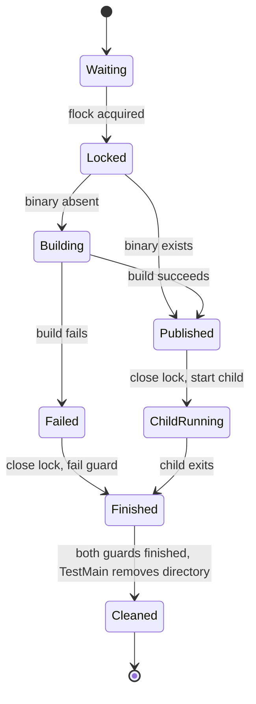

# Shared backend guard binary

## Scope and check plan

The two parallel guards share a binary, not their child processes. This is a
stateful lifecycle: the binary must be built before either child starts and
must remain available until both guards finish. This proof was added to an
existing implementation; it does not retroactively satisfy the requirement
to model before building it. No further Go behavior is changed here.
No waiver is recorded; the historical pre-build gate remains unresolved.

1. Translate the PlusCal algorithm and run all three TLC configurations.
2. Require the shared implementation to satisfy all invariants and cleanup
   liveness, including when either build attempt fails.
3. Require removing the lock or cleaning up early to produce the named
   invariant violation, not a parser or tool failure.

Status: the finite model passes; both negative checks find their required violation.



## Code mapping and assumptions

| Model step | Code in `internal/rocketclaw/backend/` |
| --- | --- |
| Initial directory | `store_fixture_test.go`: `TestMain` creates a unique directory and sets `ROCKETCLAW_TEST_BACKEND_BINARY` |
| Acquire | `backendTestBinary` opens the lock file and acquires exclusive `flock` |
| Inspect | `backendTestBinary` checks `os.Stat(binary)` under the lock |
| Build | `go test -c -race=false -cover=false` completes before returning a path |
| Release / Failed | the helper's deferred `lock.Close`, including `require.NoError` failure |
| StartChild / FinishChild | both guards call `CombinedOutput` synchronously, with their original environments and limits |
| Finish / Cleanup | `m.Run` waits for parallel tests and their cleanups; `TestMain` removes its directory afterward |

The finite world has two guards, one directory and one lock. Each guard makes
at most one build attempt, which may succeed or fail. A failed caller terminates;
the other caller may still build. Successful publication is modeled as one
atomic step after the compiler exits successfully. File operations and process
exit eventually return; weak process fairness rules out a permanently
descheduled guard or parent. No sleeps or timeouts are added by the model.
Eventual directory removal also assumes cleanup succeeds; reporting
`os.RemoveAll` errors is outside the model.

The lock remains held across inspection and building, and closing its descriptor
releases it. Every test process creates a fresh directory in its own `TestMain`,
so children do not share their parent's binary path. They select only their
guard's inner branch through the existing environment flag. Tests do not mutate
the package's source while building.
The child command does not inherit the lock descriptor.

This checks successful-build uniqueness, publication before use, cleanup after
use, and eventual cleanup. It does not prove Go compiler, kernel `flock`, race
detector or PostgreSQL correctness, validate performance, or promise cleanup
after an abrupt process kill or test timeout. The failed-build branch assumes
no binary is published; partial output left by a failed compiler and a resulting
child execution error are outside its scope. File and lock errors fail the caller
rather than starting its child; directory creation errors stop the package.

## Run evidence

Run on 2026-11-14 UTC:

```sh
make -C docs/verification/backend-guard-build
```

Java: Homebrew OpenJDK 21.0.13.0.3, macOS aarch64. Tool archive: `tla2tools.jar`
v1.8.0, SHA-256
`e1f11b75c4b5bc4478ba0ac5cb6ae28e40a01b0016bc33e0aa97da22dfdbcd7f`.
The archive reports PlusCal 1.12 (2024-07-01) and TLC2
2026.11.06.222357, revision `d8fb231`. TLC used one worker and a 256 MiB heap.

| Configuration | Result | Generated / distinct states | Depth | TLC elapsed |
| --- | --- | --- | --- | --- |
| `shared` | all three invariants and `EventuallyCleaned` pass | 143 / 95 | 16 | 00s |
| `no-lock` | required `AtMostOneSuccessfulBuild` violation | 74 / 42 | 7 | 00s |
| `early-cleanup` | required `CleanupAfterUse` violation | 10 / 10 | 5 | 00s |

The command exited zero after requiring TLC exit 12 or 13 and the named
violation for each negative check. Tools, translation backups, logs and TLC
metadata live only under the workspace's `.tmp/backend-guard-build-model/`.
These results establish neither package speedup nor unchanged coverage; those
remain separate measurement gates.
