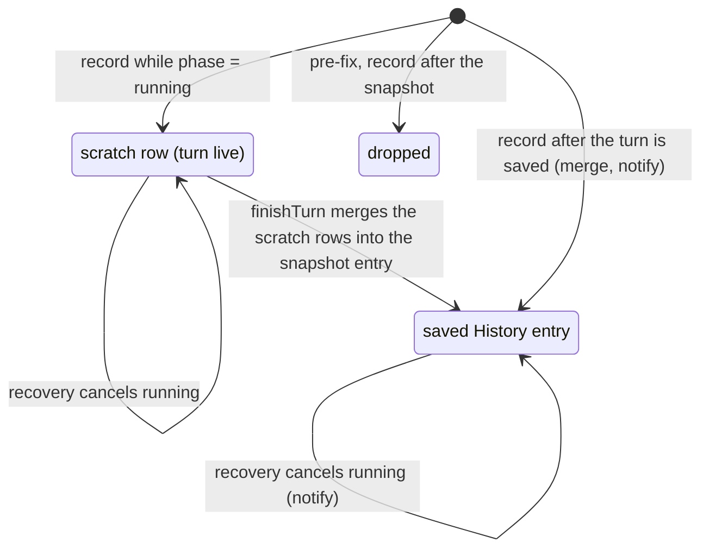

# A background script's call list after its turn: bounded verification

`CodeModeCallRecords.tla` models the per-call records ("call list") of a background `execute` script: the records it
saves while its turn runs, the ones that arrive after the turn has ended and been saved, the turn save itself, a server
restart at any point, and the restart recovery that ends a killed job's calls. It checks the commit that adds it
("internal/rocketclaw: keep a background script's call list updating after its turn").

The model found one mismatch in a first version of that commit: a restart that fell inside restart recovery, between
killing the job and cancelling its calls, left those calls `running` forever (see [Findings](#findings)). It was
reproduced in Go and fixed in the same commit; `fixed` checks the code as built.

**Passing checks do not prove that code correct.**

## Run

From the repository root:

```sh
make -C docs/verification/code-mode-call-records          # translate, then every check
make -C docs/verification/code-mode-call-records fixed    # one check
```

Requires Java 11+, `curl` and Make. The Makefile downloads `tla2tools.jar` v1.8.0 and verifies SHA-256
`67f9575c3b9ef7a0787b1bded34812862ffe79d711298e5a75b1a77720b19928`. The tools, the translator's copy, Java's temporary
files, TLC's working files and each check's log go to the repository root's `.tmp/verification/code-mode-call-records/`.
A passing check needs TLC exit 0 and `Model checking completed. No error has been found.`. A check that must fail needs
TLC exit 12 (safety) or 13 (liveness) and its named violation, so a parse or tool error never counts.

The 2026-11-22 run used a local copy of the previous pin because a fresh download no longer matched it.

## What the code does

A script call's record (`CodeModeCall`: key `<turn>/call/<execute call>/host/<n>`, status `running`, then `ok`,
`error` or `cancelled`) is saved by `harness/public_progress.go` `turnObservations.recordCodeModeCall`. That function
holds the turn's observation mutex `o.mu` across the database save, then updates its in-memory list `o.calls`. Before
this commit it returned without saving once the turn had closed (`o.closed`). The commit removes that check, so a
background script keeps saving after its turn ends.

`backend/store_dao.go` `conversationJournal.SaveCodeModeCall` runs one transaction:

1. `SELECT … FROM turns WHERE id = $1 FOR UPDATE` locks the turn row and reads whether the turn is live
   (`phase = 'running' AND terminal = ''`).
2. If the turn is live, it upserts the record into the scratch rows (`steps` key `<turn>/code_mode/<record key>`).
   Otherwise it merges the record into the saved History entry (`mergeCodeModeCallsSQL`). The merge replaces the item
   with the same `type` and `key`, or appends the record if there is none. It runs `UPDATE entries` only when the
   entry changes, and the `entries_transcript_change` trigger notifies the Web.

The turn ends in two steps:

- `harness/looper.go` `Loop`, holding `o.mu`, sets `o.closed`, copies `o.trace` and `o.calls` into the turn's
  `OutputTrace` (the harness snapshot), and appends the turn to the in-memory `memoryStore` (`backend/bridge.go`
  `runTurn`, `staged`).
- Later, `bridge.go` `finish` calls `store_dao.go` `SessionService.finishTurn`. In one transaction it runs
  `UPDATE turns SET phase = 'delivering' … WHERE id = $1 AND phase = 'running'`, which takes the same row lock and
  holds it until commit. `turnFinish.appendEntries` then inserts the entry and merges every scratch record of the turn
  into it (the records that arrived after the snapshot), and `deleteUnownedStepsSQL` deletes the scratch rows.

On startup, `backend/app.go` runs `backgroundRegistry.recoverJobs` before it resumes any turn
(`StartActiveTurns`). For each script job still `running` (`runningBackgroundJobs`: `phase = 'running'`), it:

calls `finishBackgroundJob` with the status killed. In one transaction it locks the job's turn row, sets the job's
`phase = 'done'`, and, in one statement (`cancel background job calls`), sets the job's `running` records to
`cancelled`, both in the scratch rows and in the saved entry (merged with `mergeCodeModeCallsSQL`). It matches keys with
the prefix `<execute call id>/`, so job `…/call/a` does not match `…/call/ab/…`. A job that finishes normally goes
through the same transaction, so a call whose final record could not be saved does not stay `running` after its job.

A turn that was running at the restart resumes. `looper.go` `openTurn` reloads `o.calls` from the scratch rows
(`CodeModeCalls`).



## The model

One process, the **server**, weakly fair, written in PlusCal. Each step is one atomic database transaction or one
harness action, so a restart can fall between any two. The restart is a choice in the same loop, bounded by
`MaxRestarts`. It can fall anywhere, including between the two recovery steps. The loop ends when recovery is done, the
turn is saved and the job has ended.

| Constant | Meaning | Values |
|---|---|---|
| `N` | the script's calls `1..N`, all of one job; they run concurrently, each saving `running` then `ok` | 2, 3 |
| `MaxRestarts` | server restarts | 1, 2 |
| `PreFix` | the code before the commit: records dropped after the snapshot, no merge into the saved entry, no recovery cancel | variant |
| `RowLock` | `SaveCodeModeCall` locks the turn row (`FOR UPDATE`) | `TRUE` as built |
| `SnapshotWins` | `finishTurn` keeps the snapshot's item and adds a scratch record only for a missing key | variant |
| `Recovery` | `"cancelThenKill"` as built (see below); `"killThenCancel"` the first version; `"none"` no cancel | per check |
| `SloppyPrefix` | recovery matches another job whose id has this job's id as a prefix (`a` vs `ab`) | variant |

Key `0` is a call of a different job (`ab`) in the same turn. It is `running` and its job is not a running job, as
in `TestRestartEndsAKilledScriptsRunningCalls`. It is in the scratch rows and the harness memory from the start.

| Variable | Meaning |
|---|---|
| `phase` | the turn row: `running`, or `delivering` once `finishTurn` committed |
| `scratch` | the `steps` code-mode rows, per key |
| `entry` | the saved entry's `output_trace` records, a sequence, so a duplicate row is visible |
| `web` | the entry as of the last notification |
| `jobPhase` | the job row: `running`, `done` (finished normally), `killed` |
| `hMutex`, `rowLock` | `o.mu` holder, turn row lock holder |
| `hCalls`, `snapshot`, `closed` | `o.calls`, the harness snapshot, `o.closed`; lost on a restart |
| `cpc`, `cst`, `liveSeen` | each call's progress, the record being saved, the `live` it read |
| `tpc`, `rpc` | the turn's progress (`running`, `snapped`, `resume`, `saved`), recovery's progress |
| `reported` | ghost: the newest status `recordCodeModeCall` returned for, per call |
| `written` | ghost: the newest status committed to the database for the call, by anyone |
| `mergedLate`, `pickedUp`, `cancelledSaved`, `cancelledScratch` | ghosts for the witnesses |

`Stored(k)` is what the Web and a resumed turn see for a key: the scratch row while the turn is live, else the
entry's item.

### Mapping to the code

| Model step | Code |
|---|---|
| a call takes `o.mu` (pre-fix: dropped if `closed`) | `public_progress.go` `recordCodeModeCall`: `o.mu.Lock()`; pre-fix `if o.closed { return nil }` |
| lock the turn row, read `live` | `store_dao.go` `SaveCodeModeCall`: `lock code mode call turn` (`FOR UPDATE`) |
| write: scratch upsert, or merge into the entry, then commit and update `o.calls` | `save code mode call` / `save code mode call in its saved turn` (`mergeCodeModeCallsSQL`), `tx.Commit`, `o.calls[index] = *record` |
| job ends | `background.go` `work` → `finishBackgroundJob` after the script returned (its records were saved synchronously) |
| snapshot (waits for `o.mu`) | `looper.go` `Loop`: `observations.mu.Lock()`, `closed = true`, `trace` + `o.calls` → `turn.OutputTrace`, `sessionOut.Append` (in memory) |
| turn save, atomic, waits for the row lock | `finishTurn`: `finish active turn` (`UPDATE turns … phase`), `appendEntries` (entry + `keep late code mode calls`), `clear turn steps`, commit |
| restart | the process dies: memory, in-flight transactions and locks are gone; uncommitted writes roll back |
| resume (turn was live) | `app.go` `StartActiveTurns` after `recoverJobs`; `openTurn`: `o.calls = CodeModeCallsFromTrace(CodeModeCalls)` |
| recovery cancel / kill | `background.go` `recoverJobs` → `store_dao.go` `finishBackgroundJob(backgroundKilled)`: one transaction that kills the job and cancels its running records |

The model keeps recovery's cancel and kill as two steps with a possible restart between them. The code does both in
one transaction, which allows only the interleavings where nothing falls between the two, so every safety property
`fixed` checks holds for it too.

Modelling `finishTurn` as one step is sound under READ COMMITTED (the default here: `beginStateTx` passes no options).
Its writes are invisible until commit. It takes the row lock at its `UPDATE turns`, before it reads the scratch rows,
and none of its earlier statements touch the scratch rows or the entry. So a `SaveCodeModeCall` either commits before
that lock (and `appendEntries`, a later statement, sees its row), or reads `live` after `finishTurn` committed (and
merges into the saved entry). Without the lock, the read of `live` and the write are two separate steps.

## Properties

- `NoLoss`: every record `recordCodeModeCall` returned for is in `Stored`, at its state or a newer one. So a record
  is in the saved History entry, or in the scratch rows that the resumed turn reads.
- `Latest`: `Stored` equals the newest state committed for the call, at every state.
- `OneRow`: the entry holds at most one row per key.
- `NeverOlder` (action property): a key's `Stored` status never moves to an older one (`running` after a final one),
  and never changes between two final ones.
- `JobEndsCalls`: once recovery is done and the job has finished or been killed, every call shown is final (`ok` or
  `cancelled`).
- `OtherUntouched`: the other job's call keeps its status.
- `WebNotified`: once the entry exists, the Web's last notified entry equals it. This holds by construction, because
  every write to the entry is an `UPDATE entries` and the trigger notifies.
- `Ends` (liveness): the loop ends. Deadlock checking is on, so a stuck state also fails.

Witnesses that must fail, so the passing checks are not vacuous: `NeverMergedLate` (a record merges into the saved
entry), `NeverPickedUp` (`finishTurn` takes a scratch record newer than the snapshot), `NeverCancelledSaved` (recovery
cancels a call in the saved entry), `NeverCancelledScratchSaved` (recovery cancels a scratch row and the resumed turn
saves it) and `NeverFinishWaits` (the turn save waits for a record that holds the row lock).

## Results

On 2026-11-26, `make -k` with TLC `2026.11.26.020825` (rev `1138302`) and OpenJDK `21.0.13.1`
matched every TLC outcome (4 passes, 11 named counterexamples) in 12s.

Recorded 2026-11-22 on Linux (aarch64, 16 cores), OpenJDK 21.0.13.1, TLC `2026.11.19.180144` (rev `bc1b506`),
`pcal.trans` 1.12, one TLC worker. `make -k all` ran every check in about 13 s with the tools in place and exited 0,
and the translation left `CodeModeCallRecords.tla` unchanged. Every check matched its expected outcome.

| Check | Shape | Expected | Result | Generated / distinct states | Depth |
|---|---|---|---|---:|---:|
| `fixed` | as built, recovery cancels before (or with) the kill; N=2, 2 restarts | every property holds | pass | 2151 / 1399 | 20 |
| `fixed-three-calls` | `fixed`, N=3 | every property holds | pass | 19985 / 12415 | 26 |
| `kill-then-cancel-one-restart` | first version (kill, then cancel); 1 restart | every property holds | pass | 1427 / 900 | 19 |
| `kill-then-cancel-holds` | first version; 2 restarts | every property except `JobEndsCalls` holds | pass | 2318 / 1566 | 20 |
| `kill-then-cancel` | first version; 2 restarts | `JobEndsCalls` violated | violated | 177 / 127 | 8 |
| `pre-fix` | before the commit | `NoLoss` violated | violated | 14 / 9 | 3 |
| `no-row-lock` | `RowLock` off | `NoLoss` violated | violated | 87 / 59 | 6 |
| `snapshot-wins` | `SnapshotWins` on | `NeverOlder` violated | violated | 223 / 154 | 9 |
| `no-recovery-cancel` | recovery kills only | `JobEndsCalls` violated | violated | 51 / 40 | 6 |
| `sloppy-prefix` | `SloppyPrefix` on | `OtherUntouched` violated | violated | 6 / 6 | 3 |
| `witness-merged-late` | `fixed`, 1 restart | `NeverMergedLate` violated | violated | 75 / 56 | 6 |
| `witness-picked-up` | `fixed`, 1 restart | `NeverPickedUp` violated | violated | 73 / 55 | 6 |
| `witness-cancelled-saved` | `fixed`, 1 restart | `NeverCancelledSaved` violated | violated | 158 / 113 | 8 |
| `witness-cancelled-scratch` | `fixed`, 1 restart | `NeverCancelledScratchSaved` violated | violated | 204 / 141 | 9 |
| `witness-finish-waits` | `fixed`, 1 restart | `NeverFinishWaits` violated | violated | 21 / 17 | 4 |

For a failing safety check, the counts cover only what TLC explored before the first counterexample.

### Counterexamples

Each was read state by state.

- `kill-then-cancel`: call 1 saves `running` to the scratch rows; the server restarts; recovery marks the job killed; the
  server restarts again before the cancel; the next recovery finds no running job and skips it. The killed
  job's call stays `running`, and the resumed turn saves it that way.
- `pre-fix`: the turn takes its snapshot; call 1's `running` record is dropped because `o.closed` is set, and the
  script was told it was saved. That is the bug the commit fixes.
- `no-row-lock`: after the snapshot, call 1 reads `live = true`; `finishTurn` commits (entry from the snapshot, scratch
  rows deleted); call 1 then writes its scratch row for a turn that is no longer live. Nothing reads that row again.
- `snapshot-wins`: call 1 is `running` in the snapshot and saves `ok` to the scratch rows before the turn save; the
  turn save keeps the snapshot's `running` over the scratch row's `ok`.
- `no-recovery-cancel`: call 1 is `running` at the restart; recovery kills the job and leaves the call `running`.
- `sloppy-prefix`: at the first recovery, the other job's call `0` (job `ab`) is cancelled with job `a`.
- The witnesses take the paths their names describe. In `witness-cancelled-scratch`, the restart falls while the turn
  runs: recovery cancels the scratch row, the resumed turn loads it as `cancelled`, and saves it.

## Findings

1. **A restart during recovery left a killed job's calls running forever (fixed).** In the first version,
   `recoverJobs` committed the job as killed (`finishBackgroundJob`, `phase = 'done'`) before it cancelled the job's
   calls in a separate statement. If the process died between the two, or the cancel failed (`recoverJobs` then
   returned the error and the server stopped), the next start's `runningBackgroundJobs` (`phase = 'running'`) no
   longer listed the job, and its calls stayed `running` in History and in a resumed turn's scratch rows forever.
   `kill-then-cancel` fails on `JobEndsCalls`; `kill-then-cancel-one-restart` and `kill-then-cancel-holds` show it
   needs that second restart.

   Now `finishBackgroundJob` cancels the job's running records in the same transaction as the kill. A failed cancel
   rolls the kill back, so the next start still lists the job and ends its calls.
   `TestRestartDuringRecoveryStillEndsAKilledScriptsCalls` refuses the cancel on the first start and checks that the
   next start shows the call cancelled and the job killed; it fails on the first version.

2. **No out-of-order write for one call was found.** One call's records come from one goroutine in order: `running`
   in `recordHostCall`, then the final record after the call returns. `recordCodeModeCall` holds `o.mu` until the
   database commit, so one turn's saves commit one at a time in that order. The scratch row is written before
   `o.calls` changes, so the harness snapshot is never newer than the scratch rows, and `finishTurn`'s merge lets the
   scratch row win. Recovery changes only `running` records, and the process that would write them is dead. Startup
   runs `recoverJobs` before any turn resumes. `NeverOlder` and `Latest` hold in every passing check.

## Limits

- One turn, one script job of `N` concurrent calls, each with one `running` and one final record (`ok`). `error` and
  a script's own `cancelled` follow the same path as `ok`. One saved entry per turn: `runTurn` sends the looper one
  input, so it appends at most one entry. With two entries for one turn, `mergeCodeModeCallsSQL` would append a new
  record to both.
- Not modelled, and not checked:
  - A turn that ends stopped without a History entry. An interrupted turn appends no entry (`looper.go`: the
    `interrupted` branch closes the observations and appends nothing), and `preserveStoppedInput` saves only the
    person's input, and only when the model never answered. A background job can outlive such a turn, and its late
    records are dropped (no entry to merge into). The `execute` step is then not in History at all, so no call list
    is left showing a stale state; the job's note still arrives.
  - A failed save: `recordCodeModeCall` keeps `o.err` and refuses every later record of the turn, so one transient
    database error leaves the call at its last saved state, possibly `running`, until its job ends. The job's end
    (`finishBackgroundJob`) now cancels its running records, so the call ends then
    (`TestBackgroundScriptEndsACallWhoseRecordFailedToSave`, which fails without that cancel). The cancel at a normal
    job end is not modelled: in every modelled state the job's records are final by then, so it changes nothing.
  - The `MaxCodeModeCalls` (200) cap, which drops a turn's records beyond it by design.
  - Notifications for scratch rows: the live path touches `turns` to notify the Web, but recovery's cancel of the
    `steps` rows does not. That happens only at startup, before the turn resumes.
  - Several server instances, and pruning or reverting the entry.
