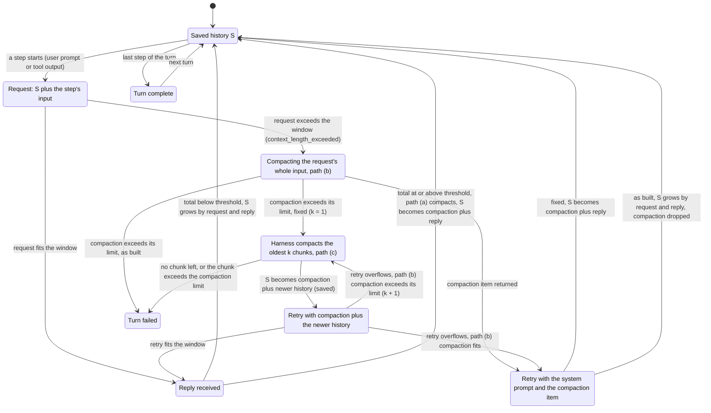

# Context overflow compaction for ChatGPT-login providers: bounded verification

`ContextOverflowCompaction.tla` models how a ChatGPT-login ("Codex") provider session keeps its saved history
short. The transport in `internal/rocketclaw/oai/oauth.go` emulates the Responses API's compaction in two places:

- (a) `codexCompaction`: after a successful reply whose token total reaches the request's `compact_threshold`, it
  compacts the request's input and prepends the compaction item to the reply's `output`.
- (b) `retryCodexAfterCompaction`: when the stream fails with `context_length_exceeded`, it compacts the request's
  whole input and retries with only the compaction item behind the leading developer message that carries the system
  prompt.

The system prompt goes in front of every request and is never part of the saved history, so the model counts it in
neither the history nor a compaction item; keeping it on path (b)'s retry adds no transition.

The harness (`internal/rocketclaw/harness/looper.go`) saves every output item of a reply (`appendProviderReplay`) and
sends only the history from the latest compaction item on (`pruneHistoryBeforeLatestCompaction`). So history shrinks
only when the compaction item reaches the reply's `output`. Path (a) does that; path (b), as built, returns the retried
reply without it. `Fixed` switches path (b) between the two shapes:

(A `/responses/compact` window from an API-key provider can keep items in front of its compaction item, and the
harness keeps those too. Every compaction on these ChatGPT-login paths returns the compaction item alone, so the model
is unaffected.)

- `Fixed = FALSE`, as built: the retried reply is returned alone, and the harness keeps the full history.
- `Fixed = TRUE`: the compaction item is prepended to the retried reply's `output`, as path (a) does.

Path (b) compacts the whole input in one request, and that request can overflow too. The harness has its own fallback
for an overflow, (c) `newResponseAfterContextCompaction`: it compacts the oldest 10% of the history blocks with
`Client.Compact` (`/responses/compact`), saves the shortened history, retries, and on another overflow compacts the
oldest 20%, and so on. `Fallback` switches what happens when path (b)'s compaction overflows:

- `Fallback = FALSE`, as built: the transport returns the stream error as a Go error. `isContextLengthExceeded` does
  not recognize it, so path (c) never runs, the SDK repeats the whole sequence as a connection error, and the turn
  fails.
- `Fallback = TRUE`: the transport returns it as an HTTP 400 with OpenAI's `context_length_exceeded` error body, which
  the SDK does not retry and the harness recognizes, so path (c) runs. The transport answers `/responses/compact`,
  which the ChatGPT Codex backend no longer serves, with path (b)'s `compaction_trigger` request.

**Passing checks do not prove that code correct.**

## Run

From the repository root:

```sh
make -C docs/verification/codex-context-overflow-compaction          # translate, then every check
make -C docs/verification/codex-context-overflow-compaction fixed    # one check
```

Requires Java 11+, `curl` and Make. The Makefile downloads `tla2tools.jar` v1.8.0 and verifies SHA-256
`fdffef247f563ef6edbfd44958d2a82db79e7564e07cb673262d896353fa6713`. The tools, the
translator's copy, Java's temporary files, TLC's working files and each check's log go to the repository root's
`.tmp/verification/codex-context-overflow-compaction/`. A passing check needs TLC exit 0 and `Model checking
completed. No error has been found.`; a check that must fail needs TLC exit 12 (safety) or 13 (liveness) and its named
violation, so a parse or tool error never counts.

On 2026-11-15 the tlaplus project replaced the v1.8.0 release's `tla2tools.jar` (now SHA-256
`7e53aa636dac8a3cb0533f343115c0548e03fc0ce5edc7739becf58d3d0fb84f`), so a fresh download fails the pinned checksum.
The recorded run used a jar with the pinned checksum already on the machine, copied into the work directory.

## A session's history, step by step



With `Fixed = FALSE`, the second `Retry --> Saved` leaves S above the window, so the next request overflows again, and
S keeps growing until compaction itself overflows. With `Fixed = TRUE` and `Fallback = FALSE`, one large step after a
history just below the threshold is enough for compaction to overflow, and the turn fails.

## The model

One session process runs `Turns` turns of `StepsPerTurn` steps. Sizes are small integers:

| Constant | Meaning | Value |
|---|---|---|
| `Window` | the model's context window; a request larger than this overflows | 6 |
| `Threshold` | `compact_threshold`; path (a) compacts when request plus reply reach it | 5 |
| `CompactLimit` | the largest input a compaction request accepts | 7 |
| `Compacted` | size of a compaction item | 1 |
| `Reply` | size of a reply | 1 |
| `MaxInput` | largest input one step adds (user prompt or tool output); each step picks any of `1..MaxInput` | 4 |
| `Turns`, `StepsPerTurn` | session length | 3, 2 |

`Request` is one atomic step: the request sends `saved + input`, then either overflows and runs path (b), or replies
and runs path (a) when the threshold is reached. When path (b)'s compaction exceeds `CompactLimit`, `Fallback` either
fails the turn or starts path (c) with `chunk = 1`. Each `ChunkedFallback` step is one try of path (c): compact the
oldest `chunk` units of the saved history, save `Compacted + (history - chunk) + input`, and send it as the retry.
`Advance` moves to the next step or turn.

| Model step | Code |
|---|---|
| request size `saved + input` | `looper.go` builds params from `pruneHistoryBeforeLatestCompaction(baseHistory + turnItems)` |
| overflow when `request > Window` | the Codex stream's `response.failed` with `context_length_exceeded` (`oauth.go` `RoundTrip`) |
| path (b), `request <= CompactLimit` | `retryCodexAfterCompaction` → `codexCompactItem`, then the retry |
| path (b), `request > CompactLimit`, as built | `codexCompactItem` returns no item; `RoundTrip` returns the stream error, which `isContextLengthExceeded` does not recognize |
| path (b), `request > CompactLimit`, fixed | `RoundTrip` returns HTTP 400 `{"error":{"code":"context_length_exceeded",...}}`; `newResponseWithProviderRetry` calls `newResponseAfterContextCompaction` |
| path (c), compact `chunk` units | `Client.Compact` of `original[:end]`; the transport answers `/responses/compact` with `codexCompactItem` |
| path (c), `chunk > history` or `chunk > CompactLimit` | the tries run out (`errLast`), or `Client.Compact` fails |
| path (c), save `Compacted + (history - chunk) + input` | `checkpointCompacted`, before the retry |
| path (c), the retry | `l.Client.New(retryParams)`, which goes through the transport and so through paths (a) and (b) |
| path (a), `request + Reply >= Threshold` | `codexCompaction` prepends the compaction item |
| `saved := ...` after a reply | `appendProviderReplay`, then pruning to the latest compaction item |

`ASSUME`s state the world the design needs: a compaction item, a reply and one step's input fit the window
(`Compacted + Reply + MaxInput <= Window`); the threshold is not above the window; and a compaction request accepts at
least a window's worth (`Window <= CompactLimit`). The earlier `Threshold - 1 + MaxInput <= CompactLimit` is dropped:
it made a path (b) compaction overflow unreachable once `Fixed = TRUE`. With the values above, a history of 4 plus an
input of 4 sends 8 > `CompactLimit`.

The process is weakly fair: the session keeps sending requests and the provider keeps answering. Inputs are chosen
freely, so TLC explores every sequence of step sizes.

## Properties

- `SavedWithinWindowAfterCompaction` (safety): after any completed compaction, path (a) or (b), the saved history fits
  the window. Path (c)'s intermediate save (`lastStep = "chunked"`) is excluded; a successful path (c) ends in path
  (a), path (b) or a reply below the threshold.
- `NoResendOfCompactedHistory` (safety): the saved history never holds items a compaction already summarized, so the
  request after a recovery does not resend the pre-compaction history (`holdsCompacted` is ghost state).
- `OneOverflowPerEpisode` (bound): no two consecutive steps' requests overflow (`overflowStreak` is ghost state). A
  step's request that fits, including path (c)'s retry, ends the episode; path (c)'s retries do not count as steps.
- `WithinCompactLimit` (safety): no turn fails because a compaction exceeds its limit.
- `EveryTurnCompletes` (liveness, under the weak fairness above): every turn of the session eventually completes.
- `TypeOK`.

Witnesses that the passing check is not vacuous, each of which must fail under `Fixed = TRUE, Fallback = TRUE`:
`NeverRecovered` (path (b) succeeds), `NeverThresholdCompaction` (path (a) runs) and `NeverChunkRecovered` (path (c)
recovers a request; `chunkRecovered` is ghost state).

## Results

On 2026-11-21, `make all` passed with TLC `2026.11.19.180144` (rev `bc1b506`) and OpenJDK `21.0.13.1`.

Recorded 2026-11-17 on Linux (aarch64, 16 cores), OpenJDK 21.0.13.0.3, TLC `2026.11.06.222357 (rev: d8fb231)`,
`pcal.trans` 1.12, one TLC worker. `make` ran every check in about 10 s with the tools in place. Every check matched
its expected outcome.

Rerun 2026-11-18 after the `tla2tools.jar` pin moved to build `bc1b506` (one upstream commit, "Fix races in TLCSet/TLCGet with multiple workers"): TLC `2026.11.15.002146 (rev: bc1b506)`, OpenJDK 21.0.13 on linux/aarch64; `make -k` exited 0.

| Check | Shape | Expected | Result | Generated / distinct states | Depth |
|---|---|---|---|---:|---:|
| `fixed` | `Fixed`, `Fallback` | every property holds | pass, complete state space | 301 / 177 | 22 |
| `current-window` | neither | `SavedWithinWindowAfterCompaction` violated | violated | 21 / 18 | 5 |
| `current-resend` | neither | `NoResendOfCompactedHistory` violated | violated | 21 / 18 | 5 |
| `current-overflow` | neither | `OneOverflowPerEpisode` violated | violated | 58 / 38 | 8 |
| `current-fails` | neither | `EveryTurnCompletes` violated | violated | 253 / 177 | 20 |
| `compact-overflow-limit` | `Fixed` only | `WithinCompactLimit` violated | violated | 25 / 19 | 5 |
| `compact-overflow-fails` | `Fixed` only | `EveryTurnCompletes` violated | violated | 189 / 113 | 20 |
| `fixed-recovers` | `Fixed`, `Fallback` | `NeverRecovered` violated | violated | 21 / 18 | 5 |
| `fixed-compacts` | `Fixed`, `Fallback` | `NeverThresholdCompaction` violated | violated | 5 / 5 | 2 |
| `fixed-chunks` | `Fixed`, `Fallback` | `NeverChunkRecovered` violated | violated | 41 / 31 | 7 |

Counts for failing safety checks are the prefix explored before the first counterexample.

### Counterexample with `Fixed` only (`compact-overflow-limit`, `compact-overflow-fails`)

| State | Step | Request | Saved after | Outcome |
|---|---|---:|---:|---|
| 1 | start | | 0 | running |
| 2 | turn 1 step 1, input 3: reply below threshold | 3 | 4 | running |
| 5 | turn 1 step 2, input 4: overflow, whole-input compaction exceeds its limit | 8 | 4 | failed |

`compact-overflow-fails` reaches the same failure on turn 3 (saved 4, input 4) after compacting on the earlier steps,
then stutters with the turn never done.

### Path (c) recovering the same request (`fixed-chunks`)

| State | Step | Request | Saved after | Last step |
|---|---|---:|---:|---|
| 2 | turn 1 step 1, input 3 | 3 | 4 | reply |
| 5 | turn 1 step 2, input 4: overflow, whole-input compaction exceeds its limit, path (c) starts | 8 | 4 | reply |
| 6 | path (c), oldest 1 compacted: retry 1 + 3 + 4 overflows, its compaction exceeds the limit | 8 | 8 | chunked |
| 7 | path (c), oldest 2 compacted: retry 1 + 2 + 4 overflows, path (b) compacts it | 7 | 2 | recovery |

### Counterexample as built (`current-fails`)

| State | Step | Request | Saved after | Overflows in a row | Outcome |
|---|---|---:|---:|---:|---|
| 2 | turn 1 step 1, input 1: reply below threshold | 1 | 2 | 0 | running |
| 5 | turn 1 step 2, input 3: reply reaches threshold, path (a) compacts | 5 | 2 | 0 | running |
| 8 | turn 2 step 1, input 1: reply below threshold | 3 | 4 | 0 | running |
| 11 | turn 2 step 2, input 3: overflow, compaction succeeds, retry succeeds, compaction dropped | 7 | 8 | 1 | running |
| 14 | turn 3 step 1, input 2: overflows again, compaction exceeds its limit | 10 | 8 | 2 | failed |

State 11 breaks `SavedWithinWindowAfterCompaction` and `NoResendOfCompactedHistory` (the first counterexample of
`current-window` and `current-resend` is the same overflow on turn 1); state 14 breaks `OneOverflowPerEpisode`. With
`Fixed = TRUE` the same state 11 saves `Compacted + Reply = 2`.

## Limits

- Bounded: one session, 3 turns of 2 steps, sizes up to 12. A pass covers this finite model only.
- One request at a time; no concurrency, cancellation, steering or interruption.
- Path (c) compacts one unit more per try; the code compacts 10% of the history blocks more per try, at most 10 tries.
  A unit stands for a chunk, and the newest input is one block that path (c) never compacts.
- A retry that fails for a reason other than overflow, other HTTP errors and the SDK's retries are not modeled; with
  `Fallback = FALSE` the SDK's two repeats of the whole sequence end in the same failure.
- A pending function call (where `codexCompactItem` declines to compact) is not modeled.
- Token counts are abstracted into history sizes; the reply's size is constant.
