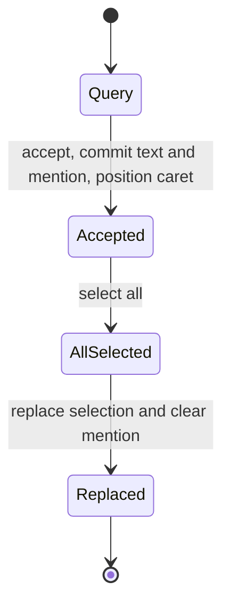

# Composer mention selection

Accepting a mention must leave the caret after it before the next edit. Replacing the whole draft must remove the notification even if the replacement has the same visible name.

## Model and checks

One mounted composer, one chosen mention, one full selection and one replacement. `editor` runs those three steps in order. The old `frame` actor may restore the caret any time after acceptance, including between selection and replacement. It does nothing in the corrected model. These are in-memory changes; no delivery, cancellation, recovery or retry is needed.

| Step | Browser or application code |
| --- | --- |
| `Accept` | `select` in `internal/rocketclaw/web/src/composer-mentions.tsx` focuses the textarea, replaces the query and positions the caret with `setRangeText`, then records the resulting text and mention. The old implementation left a frame callback pending. |
| `SelectAll` | The browser selects the whole textarea, via user keys or Playwright's fill preparation. |
| `Replace` | Browser insertion and `edit` preserve a mention only if the edit does not overwrite its span. |
| `Restore` | The old animation callback focuses the textarea and collapses its selection after the mention. |

The model assumes each labeled event is atomic with respect to other events; a completed browser edit includes its `beforeinput` and `input` handlers. Both processes are weakly fair only for the liveness check, which assumes the three planned actions and any pending frame eventually run. Safety does not depend on fairness.

| Check | Expected |
| --- | --- |
| `fixed` | The caret is ready after acceptance, a later full selection stays put until the edit, the replacement clears the tag, and the edit finishes. |
| `old` | `ReplacementRemovesTag` fails with an acceptance, full selection, frame restore, then insertion instead of replacement. |

Run `make -C docs/verification/composer-mention-selection`. The check uses `tla2tools.jar` v1.8.0 with SHA-256
`67f9575c3b9ef7a0787b1bded34812862ffe79d711298e5a75b1a77720b19928`; all tool files, translation output and logs stay under `.tmp/`.

## Result

On 2026-11-26, `make -k` with TLC `2026.11.26.020825` (rev `1138302`) and OpenJDK `21.0.13.1`
matched every TLC outcome (1 pass, 1 named counterexample) in 1s.

Verified before implementing the fix, using Linux arm64, OpenJDK 21.0.13.1, PlusCal 1.12 and TLC 2026.11.19.180144. Each check used one worker and took less than one second.

| Check | Exit | Generated / distinct states | Depth |
| --- | ---: | ---: | ---: |
| `fixed` | 0 | 10 / 7 | 5 |
| `old` | 12 | 9 / 9 | 5 |

The old model found the expected sequence: the frame collapsed the full selection, so the replacement text was inserted and the tag remained.

## Limits

The model does not verify React commit timing or browser behavior. It models the ordering and notification outcome for a single replacement, not partial edits, IME events, or sending.
