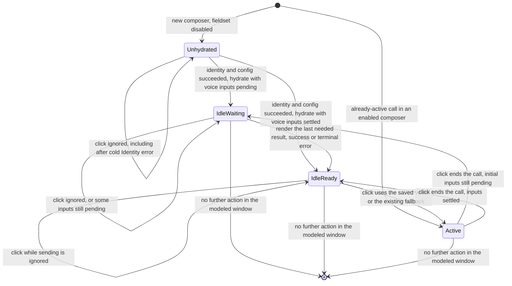

# Composer voice readiness: bounded verification

A new composer call must wait for the initial voice inputs so it does not pick the default instead of the saved voice.
If the composer is enabled and the agents or voice settings read fails, the existing fallback still applies.
A cold Identity failure leaves the composer disabled. The voice guard does not block hang-up in an enabled composer.

## States



## Model and checks

The corrected model was translated and checked on the source parent, without the composer fix applied.

One composer, one selected agent, and one identity/voice-settings key. `received` and `shown` hold the latest and
rendered statuses of agents, identity, config, and voice settings. In the cold case, all four start pending and
the composer is disabled; each read can settle once with success or terminal error. The settings read can settle
only once a successful identity is rendered. A failed identity leaves the disabled settings query pending and
the fieldset disabled. In the warm boundary case, identity and config have succeeded, and the hydrated composer
already has an active call; the model varies the still-pending voice inputs to check the hang-up guard. `sending`
can start true or false in either case. The agent's
catalog is empty, offers only `cove`, or offers `cove` followed by the saved `cedar` (twelve initial states).
An empty catalog stands for either no matching agent or a matching agent with no voices. There are at most two
clicks (`MaxClicks = 2`), enough to ignore a pending click and then start, or to start and hang up. `lastClick` records the
snapshot and effect of the last click; `blockedForPreference` remembers a click blocked while only settings was
pending. Those two fields are for assertions, not product state.

| Atomic step | Code |
| --- | --- |
| `Settle` (one process per read) | `App` in `internal/rocketclaw/web/src/ui.tsx` observes identity and config. `VoiceToggle` observes agents, the same identity query, and voice settings with `enabled: identity.isSuccess`. Retries before a terminal result are still pending. |
| `Commit` | React commits the button state and handler from one `useQuery` snapshot. TLC can schedule a click before or after a commit. |
| `Hydrate` | `App` supplies `DraftScope` only after identity and config succeed. Without that scope, `useComposerDraft` does not hydrate. Once draft hydration finishes and renders, `Transcript` enables the fieldset around `SessionComposer` (assuming neither opening nor previewing). |
| `Click` | The disabled fieldset prevents dispatch before hydration. Within an enabled fieldset, the native button disables a fresh Start when `sending` or `voiceInputsPending(...)`; otherwise a click calls `call(speaker)`, or `stopVoice()` for an active call. `voiceChoice` uses the saved voice if offered, otherwise the first voice, or leaves the selection to the server if the agent offers none. |

Only `Commit` is weakly fair: with a stable unpublished result and a mounted, running browser, the view eventually
catches up. The user does not have to click, and a read or hydration does not have to finish. The safety checks do not depend on
either happening. `RenderedInputsCatchUp` checks eventual convergence after the last result, not whether the server
will deliver it. Deadlock checking is disabled: no further user action after two clicks and no further read results
are both allowed. A permanently pending read can still prevent a fresh call.

| Check | Expected |
| --- | --- |
| `fixed` | Pass: statuses and click records stay in range; hydration needs identity and config; a disabled composer ignores clicks, including after a cold Identity failure; Starts never use unresolved inputs; a settled, non-sending Start works in an enabled composer; active clicks in an enabled composer hang up; Starts choose the correct voice; rendered inputs eventually catch up. |
| `old` | Fail `NoDefaultWhilePreferencePending`: with only settings pending, the old button starts with `cove`. |
| `witness-preferred` | Fail `NoPreferredStartAfterBlockedClick`: a blocked Start and then a saved-voice Start are reachable in the fixed model. |
| `witness-settings-error` | Fail `NoStartAfterSettingsError`: a terminal settings error still allows a default-voice Start. |
| `witness-identity-error` | Fail `NoBlockedClickAfterIdentityError`: a cold Identity error leaves settings pending and the fieldset disabled; a click is ignored even though agents and config succeeded and nothing is sending. |
| `witness-agent-error` | Fail `NoStartAfterAgentError`: a failed agent read still allows the server-default Start after the other required reads settle. |
| `witness-empty-catalog` | Fail `NoStartWithEmptyVoiceCatalog`: all reads succeed but the selected agent has no voices; a Start leaves voice selection to the server. |
| `witness-hangup` | Fail `NoHangupWhilePending`: a call in an enabled composer ends with agents and settings pending even while sending. |

## Run

```sh
make -C docs/verification/composer-voice-readiness
```

Requires Java 11+, `curl`, `unzip`, `shasum` and Make. The Makefile extracts the original `tla2tools.jar` v1.8.0
from TLA+'s versioned VS Code extension `2026.11.150034` and verifies it against the unchanged repository SHA-256.
The mutable GitHub release now serves a different build. The extension, jar, translator copy, Java temporary
files and TLC logs stay under `.tmp/run/composer-voice-readiness-model/`.
A passing check requires exit 0 and TLC's success message. An expected counterexample requires exit 12 or 13 and the
named invariant violation, not just a failing exit.

## Recorded run

2026-11-20 on Linux arm64, OpenJDK `21.0.13.1`, `pcal.trans` 1.12, TLC `2026.11.15.002146 (rev: bc1b506)`,
one worker and a 1 GiB heap. With `WORK` pointing to a new directory under `.tmp/`, the command exited 0 in
8.35 s, including the download, checksum verification and translation. The source parent was
`f12f893b5a443ff7eabade2db88edb10791adea7`.
After making the invariant's fallback precedence explicit, a cold rerun on base
`bbb0fd825532a5db50494cb291d031f2f3b487c2` passed in 12.02 s with the same state counts and depths.

| Check | TLC exit | Generated / distinct states | Depth | TLC time |
| --- | ---: | ---: | ---: | ---: |
| `fixed` | 0 | 58,602 / 21,468 | 12 | 1 s |
| `old` | 12 | 13,110 / 6,080 | 7 | <1 s |
| `witness-preferred` | 12 | 47,277 / 18,385 | 10 | <1 s |
| `witness-settings-error` | 12 | 33,462 / 13,841 | 9 | <1 s |
| `witness-identity-error` | 12 | 4,695 / 2,533 | 6 | <1 s |
| `witness-agent-error` | 12 | 31,450 / 13,149 | 9 | <1 s |
| `witness-empty-catalog` | 12 | 31,349 / 13,117 | 9 | <1 s |
| `witness-hangup` | 12 | 76 / 70 | 2 | <1 s |

`fixed` exhausted the state graph and checked the temporal property. `old` found a start with `cove` after
agents and identity succeeded but before settings arrived, even though the agent offered `cedar`. Each witness
stopped at its named invariant: two clicks around settings settlement, default voice after failed settings,
a disabled click after failed cold Identity, server default after failed agents or a successful empty catalog,
and hang-up in an enabled composer while sending with agents and settings pending. These checks visit the relevant
paths in the fixed model instead of passing just because those paths are unreachable.

## Limits

The model is only the initial-read race in one mounted composer. Each read settles at most once; agents, identity
and config can settle in any order, settings depends on rendered identity, and React can coalesce publications.
Draft completion and rendering the enabled fieldset are a single step; no draft contents, history opening or
previewing are modeled. No reload, identity/agent changes, refetches with cached data, browser teardown, delivery
retries, or request deadlines are modeled. Transport, sticky-session navigation, WebRTC, and the time from accepting
Start/Stop to connecting or ending are outside the model. Active represents any state `VoiceToggle` treats as
calling, including connecting. Sending is held fixed in each trace, with both values explored. A pass applies only
to this finite model and its assumptions, not to React, Chromium, or the TypeScript implementation.
