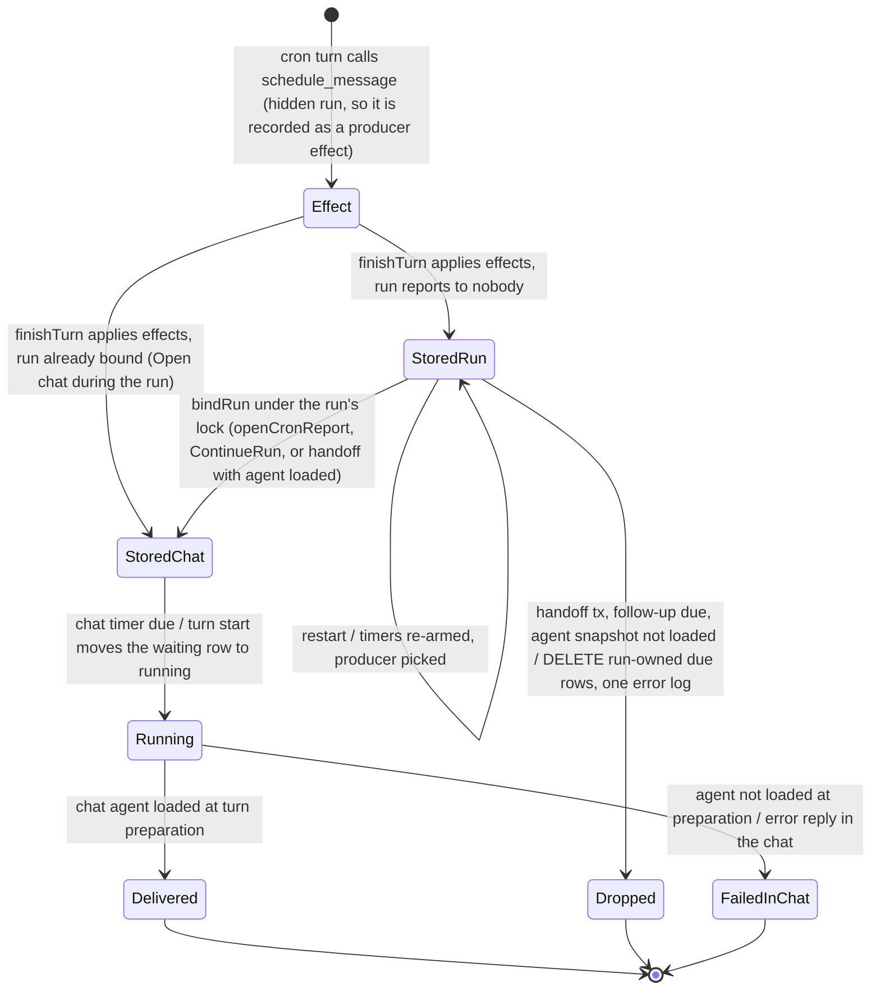
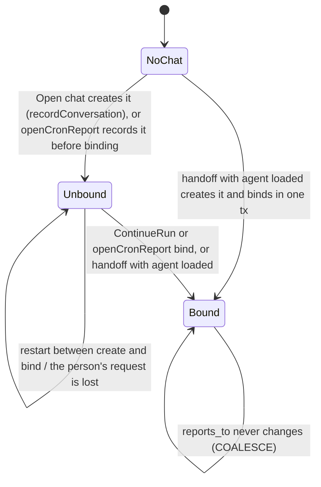

# Cron follow-ups whose agent is not loaded: bounded verification

This PlusCal model checks a small abstraction of one planned change. A cron run's follow-up comes due while the
run reports to no chat. If the run's agent is not loaded (turned off in Behavior Settings, or removed),
`handoffProducer` deletes the run's due follow-ups and logs one error that names the agent. Today it keeps them
stored. **The model does not prove the Go code correct.** A pass means the properties hold in the finite model
below, under its assumptions.

**Verdict.** VERIFIED for the planned design (`design`, `design-wide`), given the constraints below. The
liveness property is "every due follow-up is eventually delivered, dropped, or failed in its chat". The
stricter "delivered or dropped" fails (`design-strict`). It holds only with one more chat-side change, which
was also checked (`chat-drops`).

## Run

From the repository root:

```sh
make -C docs/verification/cron-follow-up-unloaded-agent check
make -C docs/verification/cron-follow-up-unloaded-agent design      # one check
```

Each check runs this command, with `WORK=<repo>/.tmp/run/cron-follow-up-unloaded-agent`:

```sh
cd $WORK && java -Djava.io.tmpdir=$WORK/java -XX:+UseParallelGC -Xmx4g -cp $WORK/tla2tools-1.8.0.jar \
  tlc2.TLC -workers auto -deadlock -noGenerateSpecTE -metadir $WORK/<check> \
  -config docs/verification/cron-follow-up-unloaded-agent/<check>.cfg \
  docs/verification/cron-follow-up-unloaded-agent/CronFollowUpUnloadedAgent.tla
```

Translation: `java -cp tla2tools-1.8.0.jar pcal.trans -nocfg CronFollowUpUnloadedAgent.tla`, run on a scratch
copy under `$WORK/translate` and copied back. The `Makefile` does this.

- Tools: `tla2tools.jar` v1.8.0, SHA-256 `67f9575c3b9ef7a0787b1bded34812862ffe79d711298e5a75b1a77720b19928`.
- The original run used TLC `2026.11.19.180144` (rev `bc1b506`), `pcal.trans` 1.12, and OpenJDK 21.0.13.1,
  with 16 workers on 16 cores (Linux aarch64).
- `-deadlock` turns off deadlock reporting. Once every follow-up has settled, every process waits, and that is
  the intended end state, not a deadlock. Liveness still checks those final states as stuttering.
- A passing check needs exit 0 and `Model checking completed. No error has been found.` A check that must fail
  needs exit 12 (invariant) or 13 (temporal) and the exact named violation, so a parse error never counts.
- No symmetry, state constraints or simulation are used. Every passing check explores its whole state graph.
  A failing check stops at its first counterexample, so its counts cover only the part explored so far, and
  they change a little from run to run with several workers.

## Lifecycle

One follow-up:



The run's `web:<run>` chat:



## Actors and atomic steps

Each label is one atomic step. Its PlusCal `either` branch matches the transaction or lock named here. All file
references are under `internal/rocketclaw/`.

| Actor (process) | Step | Code | Atomicity |
|---|---|---|---|
| Cron turn (`Run`, fair) | finish: create follow-ups owned by `COALESCE(reports_to, run)`, arm their timers, phase `delivering` | `backend/store_dao.go` `finishTurn` (lockRunHistories, line 1425), `applyEffects` → `applyProducerEffects`; `backend/bridge.go` `ScheduleMessage` → `recordProducerEffect`; `armSchedules` after `finishTurn` (bridge.go:1859) | one tx under the run's history lock |
| | deliver check: reply non-empty and agent loaded? | `bridge.go` `deliver` 1890; `openCronReport` 1919–1929 (`LoadRuntimeAgents` snapshot) | config read; off → log and close the turn |
| | record `web:<run>` | `openCronReport` → `recordConversation` (`backend/conversations.go:28`) | its own tx; `ON CONFLICT DO NOTHING`; the lock on a missing row locks nothing |
| | bind | `openCronReport` 1943–1962: `lockHistories([run, web])`, `bindRun`, commit, `armSchedules` | one tx under the run's lock |
| | close: phase `done`, then pick later work | `deliver` → `closeTurn` (1899); `handle` → `pickLaterWorkLogged` (877–881) | |
| Run bridge (`Handoff`, fair) | snapshot: take the run's lock; if a turn is active, bound, has no rows, or nothing is due, do nothing (or arm the earliest); else read whether the agent is loaded | `pickLaterWork` 1143–1195 → `handoffProducer` 1285–1353 (`beginStateTx`, `lockHistories` 1297, `active` 1316, earliest 1338, `LoadRuntimeAgents` 1348) | the tx and the run's lock stay held into the act step |
| | act (**new**): agent snapshot not loaded → delete the run's due rows and log one error; else create `web:<run>` if missing, `bindRun`, commit, `armSchedules` | replaces 1367–1371; 1373–1395 unchanged | the same tx, still under the run's lock |
| Timers (`Timers`, fair) | a due in-memory timer fires a pick on its bridge | `armScheduledMessage` 3330–3349; while busy: `timerWaiting` 1146, re-armed in `handle` 804–812 | |
| Clock (`Clock`, fair) | a follow-up becomes due | wall clock | |
| Web chat bridge (`Chat`, fair) | claim and start: a due chat-owned row becomes the running turn | `pickLaterWork` → `submitDueScheduled` 1464, `ClaimScheduledMessage` (`store.go:451`), "start scheduled turn" 978–985 | turn-start tx |
| | prepare: agent loaded → delivered; not loaded → `agent "…" is not loaded` failure in the chat | `bridge.go` 2341–2344 | config read |
| Person + server (`Person` unfair, `OpenChat` fair) | check that the run's agent is loaded, or refuse | `frontend/rpc/server.go` `CreateSession` 1613, 1630–1632 | config read |
| | create `web:<run>` with the run's agent | `CreateConversation` → `recordConversation` | its own tx |
| | bind | `ContinueRun` (`conversations.go:77`): `lockHistories([run, chat])`, `bindRun`, commit, `armSchedules` | one tx under the run's lock |
| Admin (`Admin`, unfair, ≤ `MaxToggles`) | turn the agent off or on; it applies at once | Behavior Settings save → `LockedConfig`; read by `LoadRuntimeAgents` (bridge.go:3008, `cfg.Do`) | not ordered against any DB tx |
| Restart (`Restart`, unfair, ≤ `MaxRestarts`) | lose timers, picks, the open handoff tx and the in-flight Open chat request. Keep rows, binding, the chat and turns. Re-arm every stored row on its owner's bridge, pick producers that have rows, resume a delivering turn from its check | `Bridge.Run` → `armPendingScheduledMessages` (253, 488); `StartPendingScheduledMessages`, `StartActiveTurns` (`thread_bridges.go:157–222`) | crash plus startup as one step |

Several labels are collapsed into one step. The handoff is two steps because the admin can toggle the agent
between the config snapshot and the commit. The run's lock does not keep the admin out. It does keep out every
other writer of the run's rows and binding: `finishTurn`, the `openCronReport` bind, `ContinueRun`, and other
handoffs. Open chat is three steps because `CreateSession` checks, creates and binds in separate calls.

## Properties

Invariants:

- `NeverDeliveredAndDropped`: no follow-up is both delivered and dropped (history ghosts).
- `OwnAgentOnly`: a follow-up is only delivered by the run's own agent.
- `DropOnlyOnUnloadedDecision`: every drop was decided on a snapshot in which the agent was not loaded.
- `DropOnlyOwnRows`: the handoff only deletes rows still owned by the run (not ones rehomed to the chat). The
  chat only drops its own.
- `NoLateOrDoubleDelete`: each follow-up is deleted at most once, and never while it runs or after it
  delivered or failed.
- `NoBindOnUnloadedDecision`: the handoff never binds the run to a chat on a not-loaded snapshot.
- `NoDropWhileLoadedAtCommit` (stricter, expected to fail): the agent is still not loaded when the drop commits.

Temporal:

- `DueSettles`: `\A f : due[f] ~> fu[f] \in {"delivered", "dropped", "failed"}` (no follow-up stuck forever).
- `DueDeliveredOrDropped`: `\A f : due[f] ~> fu[f] \in {"delivered", "dropped"}` (the literal request).
- `TurnCloses`: `<>(turn = "done")`. The cron run's turn always closes.

Fairness is weak fairness on `Clock` (time passes), `Timers` (a due timer fires), `Run`, `Handoff`, `Chat` and
`OpenChat` (a started step finishes; DB errors are not modeled). `Admin`, `Person`, `Restart` and the agent
`Switcher` are not fair. A person may never click, and an admin may leave the agent off forever. They are
bounded, so they act finitely often.

## Bounds and constants

One run, `FollowUps = {f1, f2}` (both created by the same turn, due in either order), `MaxToggles = 2`,
`MaxRestarts = 1`, one Open chat click, initial agent state loaded or not, and a reply that is empty or not.
`design-wide` uses `MaxToggles = 3`, `MaxRestarts = 2`.

Design switches:

- `DropAt`: `"unbound"` is the design: drop whenever the run reports to no chat, before the `recorded` check.
  `"unrecorded"` drops only when `web:<run>` does not exist, so the check stays inside today's `!recorded`
  branch. `"none"` is the code as built: log and keep.
- `SplitDrop`: decide in the tx, then delete by id after commit, without the lock.
- `ChatDropsUnloaded`: the extra chat-side change. A follow-up turn whose agent is not loaded at preparation is
  deleted, not failed.
- `AllowSwitch`: a person may switch the chat's agent with `/agent` (`server.go:1852`,
  `switchConversationAgent`).

## Results

On 2026-11-26, `make -k` with TLC `2026.11.26.020825` (rev `1138302`) and OpenJDK `21.0.13.1`
matched every TLC outcome (4 passes, 10 named counterexamples) in 1m 57s.

| Check | Constants | Expect | Result | States generated / distinct | Depth | Time |
|---|---|---|---|---|---|---|
| `design` | unbound | all invariants above except the commit-time one, `DueSettles`, `TurnCloses` | No error has been found | 701,860 / 155,404 | 23 | 12 s |
| `design-wide` | unbound, 3 toggles, 2 restarts | same | No error has been found | 1,840,856 / 380,669 | 26 | 26 s |
| `drop-unrecorded` | unrecorded | same minus `NoBindOnUnloadedDecision` | No error has been found | 761,058 / 167,720 | 24 | 11 s |
| `chat-drops` | unbound + ChatDropsUnloaded | same plus `DueDeliveredOrDropped` | No error has been found | 701,860 / 155,404 | 23 | 13 s |
| `design-strict` | unbound | `DueDeliveredOrDropped` fails | violated, as expected | 701,860 / 155,404 | 23 | 8 s |
| `drop-unrecorded-binds` | unrecorded | `NoBindOnUnloadedDecision` fails | violated, as expected | ~51k / ~16k (prefix) | 13 | <1 s |
| `keep-stored` | none (as built) | `DueSettles` fails | violated, as expected | ~304k / ~80k (prefix) | 18 | 3 s |
| `split-drop` | unbound + SplitDrop | `NeverDeliveredAndDropped` fails | violated, as expected | ~336k / ~97k (prefix) | 18 | <1 s |
| `drop-race` | unbound | `NoDropWhileLoadedAtCommit` fails | violated, as expected | ~19k / ~6k (prefix) | 12 | <1 s |
| `agent-switch` | unbound + AllowSwitch | `OwnAgentOnly` fails | violated, as expected | ~56k / ~18k (prefix) | 14 | <1 s |
| `witness-*` (4) | unbound | reachability: drop then deliver, failed in chat, drop after restart, drop beside an unbound chat | each reached | | 11–17 | <1 s each |

The whole `make check` took 1 min 24 s.

The witnesses show the passing checks are not vacuous. Each of these happens in the design: one follow-up is
dropped and the other is later delivered after the admin turns the agent back on. A follow-up fails in its
chat. A drop happens after a restart. The handoff drops while an unbound `web:<run>` exists: Open chat passed
its check, the admin turned the agent off, Open chat created the chat, and the handoff took the run's lock
before `ContinueRun` did. `ContinueRun` then binds the remaining not-yet-due follow-up.

## What the counterexamples show

- **`design-strict`** (pre-existing chat behavior, not caused by the drop). The run's turn closes with nothing
  bound. The handoff snapshots the agent as loaded. The admin turns the agent off before the handoff commits
  (turning it off any time before the chat's turns start has the same effect). The handoff creates
  `web:<run>` and binds. Both follow-ups start in the chat and fail with `agent "…" is not loaded`. Nothing is stuck, and the
  person sees the errors in the chat. To make the literal "delivered or dropped" hold, the smallest change is:
  when a scheduled follow-up turn's agent is not loaded at preparation, delete it and log, rather than failing
  the turn (`chat-drops` passes). That changes every Web chat's scheduled messages, not only cron ones, so it
  needs an owner decision. It is not part of the planned change.
- **`keep-stored`** (the code today). The agent is off when the follow-up comes due. The handoff logs and keeps
  the rows, and the row's timer has already fired. Nothing picks the run again until a restart, even after the
  admin turns the agent back on. The follow-up is stuck. The planned drop fixes this.
- **`split-drop`**. The tx decides to drop f2 and commits, but the delete runs later by id, outside the lock.
  Meanwhile the admin turns the agent on, a second handoff binds the run, and the chat starts f2. The late
  delete hits f2's running turn row, and the chat then delivers it. The result is dropped and delivered at once.
- **`drop-unrecorded-binds`**. The handoff snapshots the agent as not loaded and holds the run's lock. The
  admin turns the agent on, and Open chat passes its check and creates `web:<run>`, then waits for the run's
  lock. With the check left in today's `!recorded` branch, the handoff now sees the chat and binds the run on a
  "not loaded" decision. If the agent is still off, the follow-ups fail in the chat. A restart between Open
  chat's create and `ContinueRun` gives the same unbound chat. It still settles (`drop-unrecorded` passes), but
  it is not the requested "drop".
- **`drop-race`** (accepted). The admin turns the agent on between the handoff's config snapshot and its
  commit. The drop is decided on "not loaded" but commits while the agent is on. Closing this would need the
  config lock (`cfg.Do`) held across the DB commit. It is not worth it, because the outcome is the same as a
  toggle one moment later.
- **`agent-switch`** (outside the change). After the run is bound, a person can switch `web:<run>`'s agent
  with `/agent`, and later follow-ups are delivered by the new agent. `OwnAgentOnly` holds only without that
  person's action.

## Design constraints the implementation must follow

1. **Drop in the handoff transaction.** The delete must run in `handoffProducer`'s tx, after `lockHistories`
   and the `owner == ""` read, and commit with it. Do not decide in one tx and delete later (`split-drop`).
2. **Delete only rows the run still owns that are due.** Filter on `conversation_id = run`, waiting,
   scheduled, `run_at <= now`. Do not reuse `resetScheduledMessages`: it deletes not-yet-due rows and recurring
   schedules. Not-yet-due rows keep their own timers and are decided when they come due (`witness-drop-then-deliver`).
3. **Check the agent before checking `recorded`.** When the run reports to no chat and the agent is not
   loaded, drop, even if an unbound `web:<run>` exists (`DropAt = "unbound"`). Otherwise the handoff binds while
   the agent is off (`drop-unrecorded-binds`).
4. **Keep the run's lock in every bind.** `ContinueRun` and `openCronReport` must keep binding under the run's
   history lock, so Open chat and the turn's own delivery are ordered against the drop (`DropOnlyOwnRows`).
   With that lock, Open chat may race the drop safely: either the chat gets the rows first, or the person gets
   an empty bound chat.
5. **One error log per drop.** Log once per handoff that deletes rows, naming the agent. The model does not
   track logs.
6. `TestDueFollowUpOfTurnedOffCronAgentOpensNoChat` (`backend/active_turn_test.go:2029`) currently asserts that
   the follow-up "waits for the next start". That assertion becomes "deleted".

## Implementation

`handoffProducer` in `internal/rocketclaw/backend/bridge.go` drops the run's due one-shot follow-ups in its own
transaction when the run's agent is not loaded, before the `recorded` check, and logs
`cron follow-up dropped: agent is not loaded` with the agent. Recurring follow-ups (`schedules` rows) are not
dropped. `TestDueFollowUpOfTurnedOffCronAgentOpensNoChat` (`backend/active_turn_test.go`) covers it with and
without an unbound `web:<run>`.

## What the model leaves out

- Recurring follow-ups (`schedules` rows), `ResetScheduledMessages`, a second turn on the run (background
  wakes), paused or revert-marked runs, goals, Slack, and the global-sticky `openCronReport` path in the handoff.
  An unloaded sticky agent reads as the zero `Agent`, so it reaches the same drop branch, but that path was not
  modeled.
- DB, config-load and publish errors. For example, if `LoadRuntimeAgents` fails, a timer with an id is not
  re-armed. A failed `openCronReport` leaves the turn in `delivering`.
- Clock values: "due" is a boolean that becomes true once, and the "arm the earliest" step picks any row that
  is not yet due.
- The run conversation's agent is assumed equal to `Cronjob.Agent`, which `CreateSession` uses as
  `thread.Agent`. Removing an agent and turning it off are the same "not loaded".
- Restart is one atomic crash-and-startup step. Startup and live work do not interleave.
