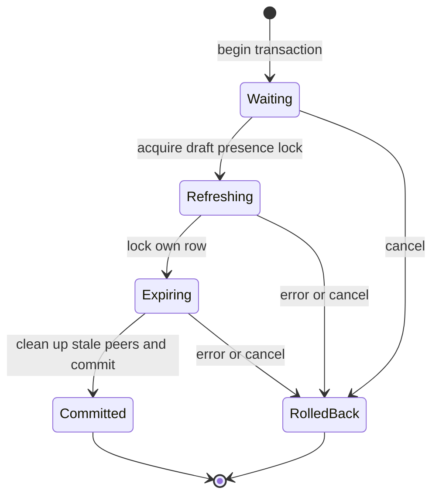

# Draft presence lock order

Two editors with stale presence rows can each lock their own row to refresh it, then wait for the other's row while deleting expired presence. PostgreSQL breaks the deadlock by failing one request. The fix admits one presence write per draft before the SQL statement takes any presence row locks. A different draft uses a different lock key, except in the event of a hash collision, which only adds serialization.

The model represents one draft and two writers with initially stale rows. Each writer holds its row lock until transaction end. `Admit` represents the transaction-scoped lock, `Refresh` and `Expire` represent a refresh-first interleaving, and `Finish` represents commit and lock release. Expiry and refresh still run in one SQL statement, which does not promise that order. The model covers that one lock cycle, not other execution orders, larger groups, row visibility, notifications, or rollback. Each request runs once. Weak fairness represents a runnable writer eventually taking its next step.

`make -C docs/verification/draft-presence check` checks `NoCycle` and `BothFinish` with serialization enabled. It also checks that removing admission finds a `NoCycle` violation in the same two-writer world.
The Makefile extracts the pinned jar from the upstream TLA+ extension on Open VSX and checks the repository's tool checksum before use.

With TLC2 `2026.11.06.222357` (`d8fb231`) and OpenJDK `21.0.13`, the serialized check passed both properties (20 generated states, 16 distinct, depth 9). The overlap check found `NoCycle` violated (31 generated states, 21 distinct, depth 7). Each finished in under one second. This is a finite check of the lock order, not a proof about PostgreSQL or all editor behavior.
