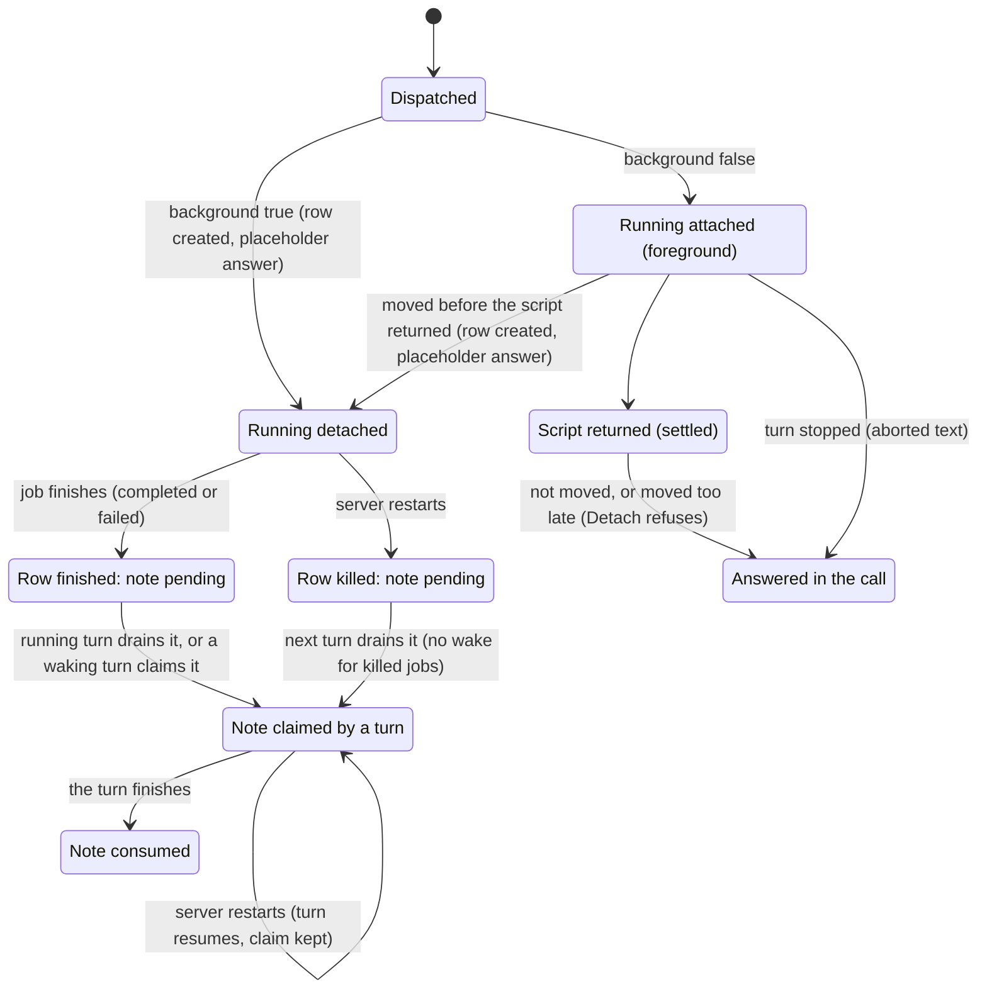

# Execute results delivered in the foreground or as a background note: bounded verification

`ExecuteBackgroundDelivery.tla` models one conversation running `execute` calls that either answer in the
foreground (attached), start in the background (`background: true`), or are moved to the background while they
run. It follows each call's returned value to what the model receives: the call's answer, or a Completion Note
delivered into a waking turn or into a running turn. Around that it models the job finishing, server restarts at any
point, the user stopping the turn, files held back over the 20 MiB budget and fetched later with
`load_execute_result(result_id=…)`, the 7-day expiry and its sweep, and the conversation being deleted.

The approved behaviour (RESULT-MODEL.md, owner decisions U2 and Q10 C+) is the spec. The `as-built-*` checks follow the
Go code of the commit that adds this model. Run against the first version (`da1172f0`), the model found three
differences from the spec; all are fixed now, and the old shapes stay as failing checks (see
[Mismatches](#mismatches-with-the-go-code)).

**Passing checks do not prove the Go code correct.** They cover this finite model only.

## Run

From the repository root:

```sh
make -C docs/verification/execute-background-delivery            # translate, then every check
make -C docs/verification/execute-background-delivery spec-one-job
make -C docs/verification/execute-background-delivery WORKERS=12 spec-two-jobs
```

Requires Java 11+, `curl` and Make. The Makefile downloads `tla2tools.jar` v1.8.0 and verifies SHA-256
`67f9575c3b9ef7a0787b1bded34812862ffe79d711298e5a75b1a77720b19928`. The tools,
the translator's copy, Java's temporary files, TLC's working files and each check's log go to the repository root's
`.tmp/verification/execute-background-delivery/`. A passing check needs TLC exit 0 and `Model checking completed. No
error has been found.`; a check that must fail needs TLC exit 12 and its named invariant, so a parse or tool error
never counts. `WORKERS` (default 4) sets TLC workers for the passing checks; failing checks use one worker.

## The call and its note



## The model

Three processes:

- `Job(j)` (weakly fair) is both sides of one call: the caller (`backgroundTool` and `backgroundTurn.Run`) and the
  worker goroutine (`backgroundRegistry.work` running `backgroundWork.RunBackground` and `callExecute`).
- `Delivery` (weakly fair) is the conversation's lane: draining notes into a running turn, waking a turn for notes,
  starting a user turn, ending a turn.
- `Env` (not fair) is everything outside: the user moving work to the background, server restarts (at most
  `MaxRestarts`), the user stopping a turn (at most `MaxStops`), time passing, the sweep, `load_execute_result`
  calls, deleting the conversation.

What a returned value renders to is abstracted to its kind: `text`, `file` (an attached image or PDF), `held` (a file
held back over the budget, with the "Not attached … Fetch with load_execute_result(result_id=…)" trailer),
`failure` (a returned Failure), `crash` (a runtime error) and `bigtext` (text over 2000 lines or 50 KiB, clipped with a
result_id footer). A body is its text kind, the expiry phrase where one is printed, its
attached files (job identities, so a wrong file set is visible) and whether the files were dropped as expired.

| Constant | Meaning | Values used |
|---|---|---|
| `Jobs` | execute calls in the turn | `{"j1"}`, `{"j1","j2"}` |
| `Outcomes` | what `main()` may return | all six kinds with one job; `file`, `held`, `failure` with two |
| `Modes` | the `background` argument | `fg`, `bg` |
| `MaxRestarts`, `MaxStops` | bounds on restarts and turn stops | 1, 1 |
| `Expired` | age at which a retained file has passed 7 days | 2 with one job, 1 with two |
| `WakeMerges` | a waking turn puts every claimed note into one message with one combined attachment list | `FALSE` as built (`TRUE` before the fix) |
| `LateMoveListed` | Move to background lists every attached run, even one whose script already returned | `FALSE` as built (`TRUE` before the fix) |
| `NoteRender` | `shared` (the one renderer) or `separate` (broken variant) | |
| `DedupOnResume` | a resumed turn remembers which notes it already applied | `FALSE` is a broken variant |
| `RetainUnderTurn` | retained files are deleted when a turn ends | `TRUE` is a broken variant |
| `StrictPhrase` | compare the footer's closing phrase too | `TRUE` in the phrase checks |
| `PhraseByStore` | the footer of a clipped result names its store's lifetime ("expires when this turn ends" / "expires in 7 days") | `FALSE` as built (`TRUE` before the owner's decision) |
| `AllowDelete` | the conversation may be deleted | `TRUE` |

## How the model maps to the Go code

| Model step | Go code |
|---|---|
| dispatch `bg`: create the row, start the worker, answer with the placeholder | `harness/background.go` `backgroundTool` → `backend/background.go` `backgroundTurn.Run` (`job.Detached`: `createBackgroundJob`, `work.Detach`, `Moved: true`) |
| re-dispatch after a restart finds the row and answers the placeholder | `backgroundTurn.Run`: `notedBackgroundJobs` non-empty → `Moved: true` |
| dispatch `fg`: register an attached run | `backgroundTurn.Run`: `run.attached`, `context.AfterFunc` link to the turn, `markMoved` |
| script returns, `settled := TRUE` (not on a crash) | `harness/mcp_tools.go` `callExecute`: `tc.sink.settled = true` after `convertExecuteReturn` |
| render: `detached` → retain for 7 days, else spill for the turn | `callExecute`: `backgroundDetached(ctx)` → `retainExecuteResult`, else `looper.saveExecuteResult`; both call `executeToolResult` (`harness/execute_results.go`) |
| crash renders through the shared renderer | `backgroundWork.RunBackground` → `ToolCallResult` (`harness/looper.go`) |
| worker leaves the registry and reads `attached` | `backgroundRegistry.work`: `delete(r.runs, key)`, `attached := run.attached` under `r.mu` |
| finish the row: completed or failed, note pending, wake | `work`: `finishBackgroundJob` (`backend/store_dao.go`, `UPDATE … WHERE runner_id = $3 AND phase = 'running'`) |
| Move: detach each attached run that still can, queue the moved notice for those | `Runtime.MoveToBackground` (`backend/conversations.go`) → `backgroundRegistry.move`, which calls `backgroundWork.Detach` (`detached || !settled`) under the registry lock and flips and lists only the runs that detached |
| caller reacts to the move: create the row, or stay foreground when the run was not moved | `backgroundTurn.Run` `case <-moved.Done()` (only reached for a detached run) or `case <-run.done` |
| restart: running rows killed with a pending, non-waking note; unanswered calls re-dispatched; turn resumes with its claims and applied inputs | `backgroundRegistry.recoverJobs` (`backgroundKilled`, `notePending`, `hiddenRun`), `releaseStaleBackgroundClaims`, `restoreTurnExecuteResults`, the journal's applied input IDs |
| drain: claim pending notes, one input per note, skip applied ones | `Bridge.Drain` (`claimBackgroundNotes` with `held`, `notesOffered`, `applied`), `looper.appendSteers` |
| wake: claim every pending unclaimed note when one may wake; each note is its own input with its own files | `claimWakeNotes`; `Bridge.wakePrompt` puts the first claimed note in the waking message, and the turn's first `Drain` offers the others one input each (`notesOffered` holds only the first) |
| note body: shared text, files reloaded unless expired | `backgroundNote`, `SessionService.backgroundNoteInput`, `harness.LoadRetainedFiles` |
| turn end: claimed notes consumed, turn spill deleted | `SessionService.finishTurn` (`note = consumed` when the turn has entries), `looper.deleteTurnExecuteResults` |
| turn stop: attached calls answer the aborted text | the call context is cancelled; replay fills the missing output with `genericAbortedToolOutputText` (`harness/replay.go`), the same text `ToolCallResult` gives `ErrBackgroundKilled` |
| tick, sweep | file mtime against `retainedResultTTL`; `SweepRetainedResults` at startup, `sweepRetainedDir` on each retained result |
| fetch | `looper.loadExecuteResult` → `storedExecuteResult`, `openStoredExecuteResult` (removes an expired file it opens; an expired or missing result answers `unknown or expired execute result` either way) |
| delete the conversation | `SessionService.removeRetainedResults` |

## Properties

Safety:

- `SameText` (U2): a result note's text is the text the call would have answered in the foreground (the expiry phrase
  is compared only with `StrictPhrase`); a foreground answer's text is that text too.
- `NoteCarriesOwnFiles` (U2): a result note carries exactly the files its own value attached, or none when they
  expired before delivery; a foreground answer carries its own files.
- `KilledTextShared`: a killed job's note is the shared renderer's killed text, the same text an aborted foreground
  call reads.
- `ExactlyOnce`: at most one note per job, never a note for a call that answered in the foreground, never a note
  without a job row.
- `StatusCPlus` (Q10): a finished call is `failed` exactly when its value is a Failure or a crash, in both paths. In
  the model both paths derive the status from the same fact (`err != nil` in the dispatcher, `errWork != nil` in
  `work`), so this check mainly guards the model itself.
- `HeldFetchableUntilExpiry`: fetching a background result's held-back file by its result_id before expiry gives the
  file.
- `ExpiredFetchFails`: fetching it after expiry fails (`unknown or expired execute result`, whether or not the file was
  already swept).
- `RetainedDeletedOnlyBySweep`: retained files disappear only once expired (sweep, or a read that finds them
  expired) or with their conversation.
- `MovedNoticeHonest`: a call the moved notice told the model is "still unfinished … until its result arrives as a
  note" never also answered in the foreground.
- `TypeOK`.

Liveness, under the weak fairness of `Job` and `Delivery`:

- `NoteDelivered`: every pending note is eventually consumed, unless the conversation is deleted.
- `PlaceholderGetsNote`: every call that answered with the background placeholder eventually gets a note.

Witnesses, each of which must be violated in the spec shape: a moved job's result note (`NeverMovedNote`), a late
move that stays foreground (`NeverLateMoveForeground`), a killed job's note (`NeverKilledNote`), a note with its file
delivered by a waking turn (`NeverWakeDelivery`) and into a running turn (`NeverDrainDelivery`), a held-back file
fetched in a later turn (`NeverLaterTurnFetch`), an expired fetch (`NeverExpiredFetch`), a note whose files expired
before delivery (`NeverDegradedNote`), a running foreground call aborted by a turn stop (`NeverAbortedCall`), and a
foreground result_id used after its turn ended (`NeverForegroundExpiredID`).

## Results

On 2026-11-26, `make -k` with TLC `2026.11.26.020825` (rev `1138302`) and OpenJDK `21.0.13.1`
matched every TLC outcome (7 passes, 17 named counterexamples) in 12m 57s.

Recorded 2026-11-22 on Linux (aarch64, 16 cores), OpenJDK 21.0.13.1, TLC `2026.11.19.180144` (rev `bc1b506`),
`pcal.trans` 1.12, against the code with the fixes. Passing checks used 12 workers, failing ones 1.
`make -k WORKERS=12 all` ran every check in 13 min 9 s and exited 0, and the translation left the `.tla` file unchanged;
every check matched its expected outcome. The as-built switches now equal the spec's, so `as-built-one-job` and
`as-built-two-jobs` explore exactly the states of `spec-one-job` and `spec-two-jobs`.

| Check | Shape | Expected | Result | Generated / distinct states | Depth |
|---|---|---|---|---:|---:|
| `spec-one-job` | spec, one call, all six kinds | every property holds | pass, complete state space | 33,607 / 16,450 | 22 |
| `spec-two-jobs` | spec, two calls | every property holds | pass, complete state space | 6,246,929 / 2,234,482 | 34 |
| `as-built-one-job` | as built, one call | every property holds | pass, complete state space | 33,607 / 16,450 | 22 |
| `as-built-two-jobs` | as built, two calls | every property holds | pass, complete state space | 6,246,929 / 2,234,482 | 34 |
| `as-built-wake-merge` | as built, two background calls returning files | `NoteCarriesOwnFiles` holds | pass, complete state space | 53,719 / 19,794 | 21 |
| `as-built-late-move` | as built, a foreground call moved | `MovedNoticeHonest` holds | pass, complete state space | 1,098 / 724 | 16 |
| `as-built-strict-phrase` | as built, clipped text, `StrictPhrase` | `SameText` holds with the phrase compared | pass, complete state space | 7,973 / 3,794 | 21 |
| `wake-merge` | `WakeMerges` (before fix 1) | `NoteCarriesOwnFiles` violated | violated | 13,407 / 6,478 | 13 |
| `late-move-listed` | `LateMoveListed` (before fix 2) | `MovedNoticeHonest` violated | violated | 537 / 393 | 10 |
| `phrase-by-store` | `PhraseByStore`, `StrictPhrase` (before fix 3) | `SameText` violated | violated | 471 / 339 | 7 |
| `separate-note-render` | `NoteRender = "separate"` | `SameText` violated | violated | 204 / 143 | 7 |
| `duplicate-after-restart` | `DedupOnResume = FALSE` | `ExactlyOnce` violated | violated | 307 / 206 | 9 |
| `early-delete` | `RetainUnderTurn` | `RetainedDeletedOnlyBySweep` violated | violated | 81 / 64 | 5 |
| `early-delete-fetch` | `RetainUnderTurn` | `HeldFetchableUntilExpiry` violated | violated | 706 / 394 | 9 |
| `witness-moved-note` | spec | `NeverMovedNote` violated | violated | 721 / 504 | 10 |
| `witness-late-move-foreground` | spec | `NeverLateMoveForeground` violated | violated | 346 / 262 | 9 |
| `witness-killed-note` | spec | `NeverKilledNote` violated | violated | 30 / 27 | 4 |
| `witness-wake-delivery` | spec | `NeverWakeDelivery` violated | violated | 333 / 215 | 8 |
| `witness-running-turn-delivery` | spec | `NeverDrainDelivery` violated | violated | 257 / 174 | 7 |
| `witness-later-turn-fetch` | spec | `NeverLaterTurnFetch` violated | violated | 517 / 308 | 9 |
| `witness-expired-fetch` | spec | `NeverExpiredFetch` violated | violated | 821 / 451 | 10 |
| `witness-degraded-note` | spec | `NeverDegradedNote` violated | violated | 583 / 338 | 9 |
| `witness-aborted-call` | spec | `NeverAbortedCall` violated | violated | 32 / 25 | 4 |
| `witness-foreground-id-ends` | spec | `NeverForegroundExpiredID` violated | violated | 560 / 406 | 9 |

Counts for failing checks are the prefix explored before the first counterexample. Every counterexample below was
read state by state.

### Mismatches with the Go code

Found against the first version (`da1172f0`); each is fixed, and its old shape stays as a failing check.

1. **A waking turn merged the notes' files** (fixed in the commit that adds this model; old shape: `wake-merge`).
   `claimWakeNotes` (`backend/bridge.go`) claims every pending note, and `Bridge.wakePrompt` joined all their texts into
   one prompt and all their files into one attachment list. Two background executes that each `return read("a.png")` /
   `return read("b.png")` and finished while no turn ran reached the model as one message: two notes that each said
   "Attached file 1: …" and two images in a row. Now `wakePrompt` puts only the first claimed note in the waking message,
   with its own files, and the turn's first `Drain` offers each other claimed note as its own input with its own files,
   as for a running turn. The waking turn therefore answers the first note before it sees the others (one more model
   request per extra note). Test: `TestWakeGivesEachNoteItsOwnFiles` (two finished jobs, one image each: each note's
   message carries exactly one image); `TestBackgroundNotesWakeIdleConversation` now expects one input per note.
   `as-built-wake-merge` passes.

2. **Move to background promised a note that never came** (fixed in its own commit before the feature, because it is
   on main too; old shape: `late-move-listed`). `backgroundRegistry.move` flipped every attached run and
   `Runtime.MoveToBackground` listed all of them in `movedNote` ("… until its result arrives as a note"), but
   `backgroundWork.Detach` refuses once `callExecute` has set `sink.settled`, so such a run answered in the foreground
   and its promised note never came. Now `move` calls `Detach` under the registry lock and flips and lists only the runs
   that detached; `backgroundTurn.Run` no longer asks again. Test: the "moved after the result settled" case of
   `TestBackgroundJobAttachedCall` (the move lists nothing and the call answers in the foreground).
   `as-built-late-move` passes.

3. **The expiry phrase differed** (fixed by the owner's decision, option (c), in the commit that adds this model; old
   shape: `phrase-by-store`). The footer of a clipped result said "This result expires when this turn ends." in the
   foreground and "This result expires in 7 days." in the background. Both now end with the same line, which names no
   lifetime: "Fetch the rest with the top-level load_execute_result tool, using this result_id, start_line, limit and
   line_numbers." The lifetimes themselves are unchanged (turn end, 7 days). Test: `TestBackgroundExecuteRetainsLargeResult`
   checks the foreground and background answers for the same long result are equal apart from the result_id.
   `as-built-strict-phrase` passes.

4. **Expired-files note** (documented, reachable: `witness-degraded-note`). A note delivered after its files expired
   (for example a conversation that does not run for 7 days) carries the text plus "The files this result attached
   are no longer available: they expire 7 days after the job finishes." and no files
   (`SessionService.backgroundNoteInput`). That is intended, and the U2 checks exempt it, but it is the one case where
   a note differs from the foreground answer.

5. **Two wordings for an expired fetch** (fixed in its own commit before the feature, because it is on main too).
   `openStoredExecuteResult` answered `execute result expired` while the expired file was still on disk and
   `unknown or expired execute result` once it was gone. Both now answer `unknown or expired execute result`, the only
   wording that is true once the file is gone. Test: `TestBackgroundExecuteRetainsLargeResult` fetches an expired result
   twice, before and after its file is removed.

Not modelled, checked after the model was written:

- `backgroundRegistry.work` gives up after three failed `finishBackgroundJob` attempts and only logs. Reproduced with a
  scratch test (a trigger refuses the finishing UPDATE): the row stays running with no note, and after a restart it
  reads killed with an empty result though the work returned. Also on main. Not fixed: it needs a retry policy that
  still lets shutdown finish; raised with the coordinator.
- During shutdown, `work` returns without writing the row when the cause is `errBackgroundAbandoned`, so a script that
  returned just as the shutdown cancelled it reads killed after the restart; its retained files stay on disk until the
  sweep. Not tested or fixed: recording it as completed needs every background tool to report a cancellation as an
  error, which was not confirmed. Raised with the coordinator.
- `Bridge.Drain` commits the claim and the turn's inputs, then returns an error if `notifyShadowInputs` fails. Not
  reproduced: that error is an input persistence error, the turn is then left without `finishTurn`, so nothing is
  marked consumed, and a resumed turn re-offers every saved input it has not applied.
- `backgroundNoteInput` reloads files only for `backgroundCompleted`. A top-level Failure has no files today, so this
  is harmless, but it ties file delivery to the status.

## Limits

- Bounded: one or two calls, one restart, one turn stop, two or three ages. A pass covers this finite model only.
- Rendering is abstracted to the value's kind, the expiry phrase and the file identities; it assumes the one
  renderer (`executeToolResult`, `ToolCallResult`) is deterministic for a value. Attachments rebuilt from disk for a
  note (`attachmentsFromInbound`) are assumed to equal `fileAttachment`'s.
- A restart resumes the running turn with its claims and applied input IDs, and re-dispatches calls that had not
  answered; a foreground `execute` reruns (it is resumable). Turns that are abandoned rather than resumed, hidden runs'
  wake retries, Slack sync destinations, subagent tasks and session replies are not modelled.
- Delivering a claimed note and applying it to the turn are one step; the code commits the claim and the turn inputs
  together and a resumed turn re-offers what it had not applied. A waking turn delivers every note it claimed in one
  step here, while the code gives the first note in the waking message and the others at the turn's first drain.
- The moved notice is delivered by the next drain after every call of the step answered, and is lost on a restart, as
  `Bridge.movedNotes` is in memory.
- A turn stop is not modelled while a move is in flight. Stopping a single background job and DB write failures are
  not modelled.
- Time is a shared tick that ages every retained result; expiry is the file's mtime plus 7 days, as in the code.
