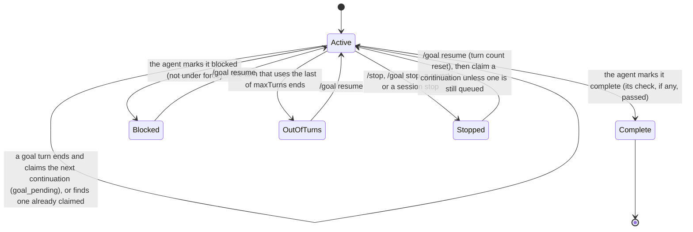

# Goal lifecycle: bounded verification

This PlusCal model checks how one conversation's goal keeps exactly one continuation queued while a person stops and
resumes it, its turns end, and the process restarts (`internal/rocketclaw/backend/bridge.go`, `conversations.go`,
`store.go`, `thread_bridges.go`, `app.go`). **It does not prove the Go code correct**: a pass means the properties
hold for the finite model under the assumptions below.

**Gate status: VERIFIED** for the finite world below. The required check finished with `Model checking completed. No
error has been found.`, and every must-fail check failed with its named violation.

## Run

From the repository root:

```sh
make -C docs/verification/goal-lifecycle          # translate, then every check
make -k -C docs/verification/goal-lifecycle       # every check, even after one fails
make -C docs/verification/goal-lifecycle safety   # one check
```

Needs Java 11+, `curl`, `shasum`, `perl` and Make. The Makefile downloads `tla2tools.jar` v1.8.0 and checks its
SHA-256 `67f9575c3b9ef7a0787b1bded34812862ffe79d711298e5a75b1a77720b19928`. Tools, the translator's scratch copy,
Java's temporary files, TLC metadata and every log live under the repository root's `.tmp/run/goal-lifecycle-model/`.
Each TLC run is killed after 600 seconds, which fails its check. A passing check must exit 0 and print `Model checking
completed. No error has been found.`; a must-fail check must exit 12 or 13 and print its named violation.

`GoalLifecycle.tla` holds the algorithm, the properties and the generated translation. Edit outside the
`BEGIN TRANSLATION`/`END TRANSLATION` markers, then `make translate`. The constant `Mutation` is `"none"` for the code
as built; each other value turns one part of the continuation claim off.

## The goal



A continuation taken from the bridge's request channel releases the claim; one taken while the goal is not active is
skipped and starts no turn. A crash drops the request channel; startup releases every claim before any work runs,
and then claims a continuation for each active goal whose turn is not resuming.

## What the model contains

Processes:

- **Lane** (`bridge.loop` / `handle` / `Run`): runs the goal's turns one at a time. `Turn` lets the agent mark the goal
  complete or blocked, or not; `Account` counts the turn (`finishTurn`'s `accountGoal`, which ends the goal out of
  turns at `maxTurns`); `FinishGoalTurn` claims and enqueues the next continuation (`finishGoalTurn` →
  `ContinueGoal`); `Take` dequeues a continuation and releases the claim (`releaseGoalContinuation` in `handle`);
  `SkipObsolete` starts the turn only if the goal is active (`skipObsoleteGoal`).
- **Person**: `/goal stop` (`Runtime.StopGoal` → `setGoalStatus`) and `/goal resume` (`SessionService.ResumeGoal`,
  then `ResumeClaim`: `ContinueGoal`), each at most twice.
- **Startup** (`app.go`, `StartActiveGoals`): one crash drops the request channel and the dequeued request; `Restart`
  releases every claim and comes back up; `StartActiveGoals` claims for an active goal with no running turn. The
  running turn survives the crash, as a resumed turn does.

`claim` is one SQL statement (`claimGoalContinuation`: set `goal_pending` where the goal is active and not pending)
followed by the enqueue; the model makes the pair one step, and the code releases the claim when the enqueue fails.

Mutations, one per must-fail check:

| Mutation | What it turns off |
|---|---|
| `no-claim` | the claim: a turn's end and a resume both enqueue whenever the goal is active |
| `resume-no-claim` | the resume's own enqueue: a resumed idle goal relies on a turn that will never end |
| `no-startup-clear` | the startup release: a claim left over from before the crash blocks every later claim |

## Properties

| Property | Kind | Meaning |
|---|---|---|
| `AtMostOneContinuation` | invariant | the request channel never holds two continuations of the goal |
| `ClaimMatchesQueue` | invariant | while up, `goal_pending` is set exactly when a continuation is queued |
| `TurnsWithinBudget` | invariant | the turn count never passes `maxTurns` |
| `GoalKeepsMoving` | liveness | an active goal always comes to have a turn running or queued, or ends |
| `GoalEnds` | liveness | every run ends with the goal no longer active and no turn running |

Fairness: every process is weakly fair, so a step that stays enabled is taken. The person's actions are bounded, so
the goal's turns, which `maxTurns` bounds, eventually end.

## Checks and results

TLC 2026.11.26 (rev 1138302) on OpenJDK 21.0.13.1; world: `MaxTurns = 2`, `MaxStops = 2`, `MaxResumes = 2`,
`MaxCrashes = 1`.

| Check | Expect | Result | States (generated / distinct) |
|---|---|---|---|
| `safety` | pass: every invariant and property above | No error has been found | 14,222 / 5,527 |
| `no-claim` | `Invariant AtMostOneContinuation is violated.` | confirmed | 467 / 317 |
| `resume-no-claim` | `Temporal property GoalKeepsMoving was violated.` | confirmed | 11,521 / 4,493 |
| `no-startup-clear` | `Temporal property GoalKeepsMoving was violated.` | confirmed | 17,062 / 6,592 |

A wider one-off run of `safety` with `MaxTurns = 3`, `MaxStops = 3`, `MaxResumes = 3` and `MaxCrashes = 2` also
passed (48,766 / 18,546 states) before the dequeue and start were split into two steps; it is not kept as a check.

## What the model leaves out

- The agent pause. A continuation refused while the agent is paused is taken (its claim released) and held; resuming
  the agent claims again through `ContinueGoal`. The agent-pause model in `docs/verification/agent-pause/` covers
  the hold itself.
- A bridge that stops while the process keeps running (`storeQueued`): it releases the claim of each continuation it
  drops, so the goal waits for the next restart, as before this change.
- Starting a new goal over a stopped one while that goal's continuation is still queued: the queued continuation
  serves the new goal, and the claim keeps it to one.
- Steers, queued messages, shadows, the check command's own run, and the goal events the Web shows.
