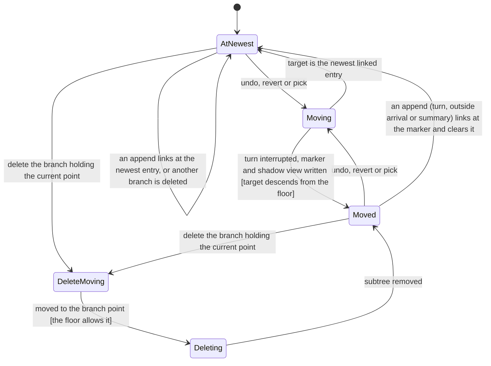

# Message Tree: bounded verification

This PlusCal model checks the planned Message Tree of one native chat (`docs/plans/2026-11-23-0931-feat-message-tree-plan.md`): one current point per chat, moves that never delete, appends that link at the current point, branch delete, Shadow Sessions that follow the parent, and on-demand branch summaries. **It does not prove the Go code correct.** A pass means the properties hold for the finite model under the assumptions below.

**Gate status: VERIFIED** for the finite worlds below. Every required check finished with `Model checking completed. No error has been found.`, and every must-fail check failed with its named violation.

## Run

From the repository root:

```sh
make -C docs/verification/message-tree          # translate, then every check
make -k -C docs/verification/message-tree       # every check, even after one fails
make -C docs/verification/message-tree move     # one check
```

Needs Java 11+, `curl`, `shasum`, `perl` and Make. The Makefile downloads `tla2tools.jar` v1.8.0 and checks its SHA-256 `67f9575c3b9ef7a0787b1bded34812862ffe79d711298e5a75b1a77720b19928`. Tools, the translator's scratch copy, Java's temporary files, TLC metadata and every log (with full counterexample traces) live under the repository root's `.tmp/run/message-tree-model/`. Each TLC run is killed after 600 seconds, which fails its check. A passing check must exit 0 and print `Model checking completed. No error has been found.`; a must-fail check must exit 12 or 13 and print its named violation, so a parse error or a timeout never counts as an expected failure.

`MessageTree.tla` holds the algorithm, the properties and the generated translation. Edit outside the `BEGIN TRANSLATION`/`END TRANSLATION` markers, then `make translate`. The constant `Mutation` is `"none"` for the design as planned; each other value turns one rule off.

## The current point



## What the model contains

- **Entries:** integers in creation order; `0` is the root. `parent` is the per-chat history link. One entry stands for one message, so a branch point inside a stored entry is not modeled.
- **Current point:** `head` is the marker (`Empty` means the most recently linked entry, `latest`). `Leaf` and `Path` follow from it.
- **Processes:**
  - `Viewer` (one or two people): send (enqueue an input), move to any live entry, delete a branch, request a summary.
  - `Agent`: start the queue head with its anchor at the leaf, then finish by appending at the current point.
  - `Outside`: a cron, External MCP or Slack arrival appends at the current point and becomes the floor.
  - `Summary`: completes a request later, in its own step, and adds nothing while a turn runs (`AppendBranchSummary` refuses with "conversation history is busy").
  - `Crash`: drops the running turn and the history-mutation flag; the database stays.

### Atomic steps and the code

| Label | Code | Boundary |
| --- | --- | --- |
| `M1` | `StageRevert`: take `b.historyMutation` | `b.mu` |
| `M2` | `StopGoal`, `settleShadowRevert`, `InterruptActiveTurn`, wait for settlement | in process |
| `M3` | `stageRevertDB`: floor check by ancestry, write `revert_message_id` and each shadow child's marker | history lock, one transaction |
| `D1` | branch delete: move to the branch point when it holds the current point or a live turn's anchor | as `M1`–`M3` |
| `D2` | branch delete transaction: re-check, delete the subtree, clip a split entry | history lock, one transaction |
| `AStart` | `activateInbound` → `startTurnDB`: anchor at the leaf | history lock |
| `AFinish`, `O1`, `S1` | `appendSessionEntryDB`: write the link at the current point and clear the marker | history lock, one transaction |
| `C1` | process death | — |

## Properties

Safety:

- `NoLoss`: only branch delete removes entries, and every surviving entry's parent survives.
- `HeadAfterFloor`: the newest outside entry is on the current path.
- `OutsideNeverDeleted`, `HeadIsNode`.
- `QueueKept`: every queued input either waits or has started; a move drops none.
- `OnePath`: a running turn's anchor is on the current path.
- `NoLiveTurnDeleted`: no running turn's anchor is deleted.
- `ShadowFollowsParent`: the shadow's view is a subset of the parent's path.
- `SummaryLandsOffBranch`: a summary never lands on a path holding the branch it summarizes.

Liveness: `QueuedEventuallyRun` (`<>[](Len(queue) = 0)`), with weak fairness on every process but `Outside` and `Crash`.

Witness: `NeverBranched` must fail, which shows a branch is reachable.

## Checks and results

On 2026-11-26, `make -k` with TLC `2026.11.26.020825` (rev `1138302`) and OpenJDK `21.0.13.1`
matched every TLC outcome (6 passes, 7 named counterexamples) in 11s.

TLC 2026.11.19.180144 (`tla2tools.jar` v1.8.0), OpenJDK 21.0.13.1, run 2026-11-23. Every PASS check took about one second.

| Check | World | Result | Distinct states |
| --- | --- | --- | --- |
| `move` | 5 entries, 1 viewer, 3 moves, 3 inputs, 1 crash | pass | 6,378 |
| `delete` | 5 entries, 3 moves, 3 inputs, 1 delete | pass | 3,704 |
| `outside` | 5 entries, 3 moves, 3 inputs, 1 arrival, 1 delete | pass | 27,470 |
| `crash` | 5 entries, 3 moves, 3 inputs, 1 delete, 1 crash | pass | 10,717 |
| `shadow` | 5 entries, 2 viewers, 2 moves each, 2 inputs | pass | 8,634 |
| `summary` | 5 entries, 3 moves, 3 inputs, 1 summary | pass | 11,128 |
| `commit-deletes` | today's commit on send | `NoLoss` violated | — |
| `no-floor-check` | a move skips the floor | `HeadAfterFloor` violated | — |
| `delete-outside` | the delete's own move skips the floor | `OutsideNeverDeleted` violated | — |
| `park-drops-queue` | a move drops the queue | `QueueKept` violated | — |
| `delete-without-interrupt` | delete the current branch without moving first | `NoLiveTurnDeleted` violated | — |
| `shadow-id-cut` | today's ID-ordered shadow cut | `ShadowFollowsParent` violated | — |
| `witness-branch` | as planned | `NeverBranched` violated | — |

## What the runs changed in the design

- An outside message can only sit on the current path, because the floor stops every move before it. A branch holding one is therefore the current branch, and deleting it must first move to the branch point, which the floor refuses. The branch-delete transaction needs no separate outside-message check: `delete-outside` shows that the floor check in that move is what protects outside messages. The tree RPC's deletable flag is the same test, whether the subtree holds the floor.
- The first run found the viewer must be fair: a move that holds the history-mutation flag forever blocks the queue. In the code the flag is released on every return path of the move.

## What the model leaves out

- Rows left by older code. The model starts from a fresh chat, so its finding that branch delete needs no separate outside-message check holds for migrated chats only because migration `108_history_links.sql` settles legacy staged Undo markers first (see `docs/solutions/best-practices/a-tlc-models-initial-state-must-include-what-a-migration-leaves-behind.md`).
- A branch point inside a stored entry, and clipping that entry on delete.
- Delegations (subagent sessions) and background job completion notes.
- Reporting runs bound after the fact (`bindRun`), and the continued-run lock question the plan leaves to implementation.
- Paging, search and every reader of history.
- More than one shadow child, and the shadow's own turns.
