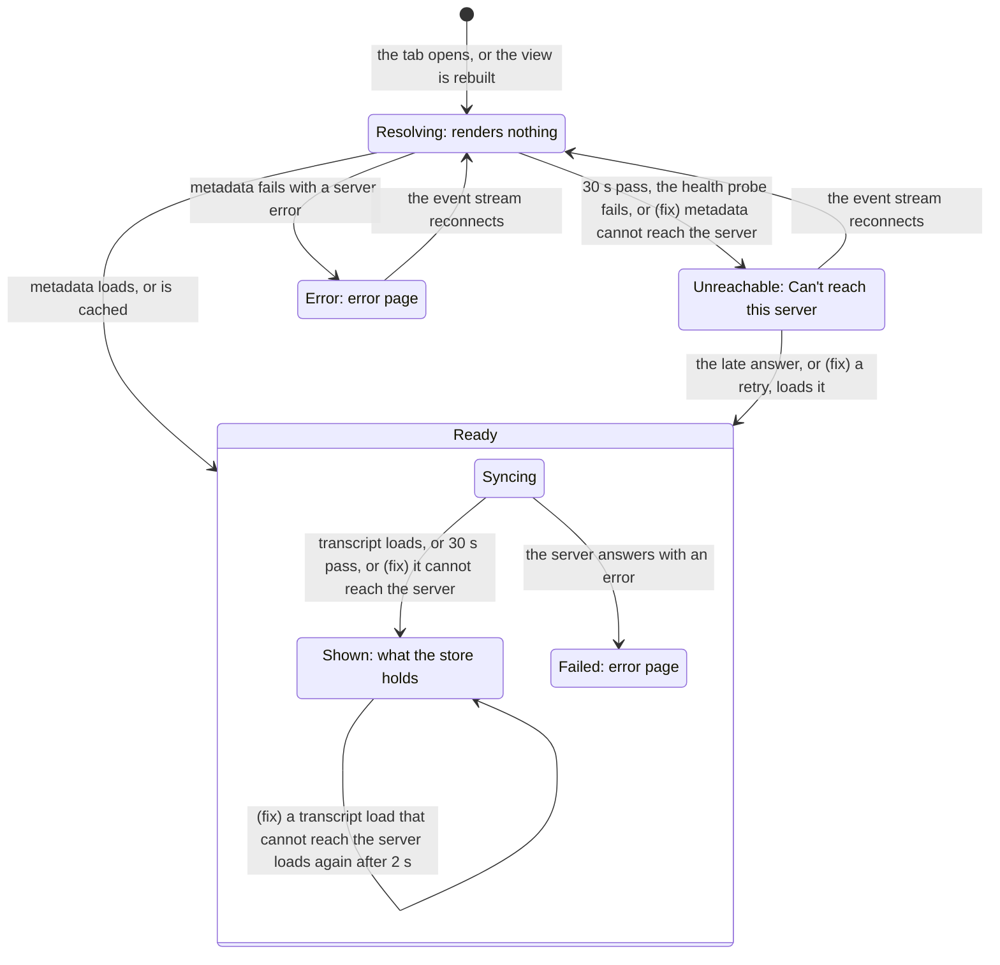

# An OpenCode tab through network outages: bounded verification

`OcTabRecovery.tla` models what an OpenCode tab in RocketClaw's Web shows after network outages, from RocketClaw's own
`Identity` check down to the copied OpenCode view's metadata load, transcript load, event stream and timeline. It was
written to find every way a tab can stay blank or broken until the page reloads, and it gates the fix: transcript and
metadata loads that cannot reach the server load again. **Passing checks do not prove the code correct.**

## Run

From the repository root:

```sh
make -C docs/verification/oc-tab-recovery          # translate, then every check
make -C docs/verification/oc-tab-recovery design   # one check
```

Requires Java 11+, `curl` and Make. The Makefile downloads `tla2tools.jar` v1.8.0 and verifies SHA-256
`67f9575c3b9ef7a0787b1bded34812862ffe79d711298e5a75b1a77720b19928`. The tools, the translator's copy, Java's
temporary files, TLC's working files and each check's log go to the repository root's
`.tmp/verification/oc-tab-recovery/`. A passing check needs TLC exit 0 and
`Model checking completed. No error has been found.`; a check that must fail needs TLC exit 13 and the named
violation, so a parse or tool error never counts as the expected counterexample. The `translate` step copies the
translation back over `OcTabRecovery.tla`; check `jj diff --git` after a run.

## What the model holds, and where it is in the code

| Model | Code |
|---|---|
| `rcDown`, `ocDown`: the browser cannot reach RocketClaw, or RocketClaw cannot reach OpenCode | a laptop asleep, a network reset, a restart, a proxy whose upstream connection hangs |
| `list`, `mounted`: RocketClaw's OpenCode server list and the one OpenCode view | `ServerSessions` and `useRemoteView` in `internal/rocketclaw/web/src/ui.tsx`; a refused `Identity` clears the list, which disposes the view |
| `conn`: the view's event stream; leaving `connected` invalidates every load | `createClientConnection` (`oc/packages/client/src/solid/connection.ts`) and `sync.invalidate()` (`oc/packages/client/src/solid/data.ts`) |
| `mE`/`tE`: the shared loads of the session's metadata and transcript | `createSync` in `data.ts`: one pending load per key, shared; invalidated loads queue a fresh one |
| `res`: session resolution: resolving (renders nothing), unreachable, error, ready | `oc/packages/app/src/session/resolution-machine.ts` and `session-resolution.ts`, 30 s timeout |
| `timeline`: syncing, ready (shows what the store holds), failed (the error page) | `oc/packages/app/src/session/timeline/sync-machine.ts` and `model.ts`, 30 s timeout |
| `health`: the server's health probe; an unreachable server turns resolving into a panel | `oc/packages/app/src/runtime/server/health.ts` |
| request kinds `ok`, `fail` (cannot reach the server, at once), `stall` (cannot reach it, until the request queue's 60 s cutoff), `error` (the server answers with an error) | `ClientError` reasons in `oc/packages/client/src/promise/generated/client.ts`; `oc/packages/app/src/runtime/server/request-queue.ts`; `unreachable` in `oc/host/unreachable.ts` |



## Switches

- `FastFail`: a request that cannot reach the server may fail at once; otherwise it stalls.
- `ServerError`: one request may get an error answer from a reachable server.
- `StreamSurvives`: the event stream may stay connected through an outage.
- `KeepList`: a network failure of `Identity` keeps the server list, and the view (the `ui.tsx` change).
- `RetryTranscript`: session resolution loads a transcript that could not reach the server again after 2 s.
- `TransportAsTimeout`: the timeline treats a transcript load that could not reach the server as its timeout.
- `MetaUnreachable`: metadata that could not reach the server shows the session unreachable and loads again.
- `MaxOutages`: how many outages a behavior holds.

## Properties

- `Recovers`: once the outages are over, a person on the tab ends up seeing the session's transcript.
- `NoStuckBlank`: once the outages are over, the tab is not blank forever (renders nothing, or a header and composer
  without the transcript).
- `NoStuckEmpty`: once the outages are over, the tab does not render nothing forever.
- `ServerErrorVisible`: after a server error, the tab ends up showing the transcript or an error page.

## What each check proves

| Check | Shape | Expected | Result |
|---|---|---|---|
| `design` | every fix; fast and stalled failures; the stream may survive; two outages | `Recovers` holds | pass, 54,360 distinct states |
| `without-identity` | as `design` without `KeepList` | `Recovers` holds | pass, 62,697 distinct states |
| `before-empty` | the code before the fix; two outages | `NoStuckEmpty` holds | pass, 43,134 distinct states |
| `before-blank` | the code before the fix; one outage | `NoStuckBlank` violated | violated, as expected, 2,130 distinct states |
| `no-retry` | `design` without `RetryTranscript` | `Recovers` violated | violated, as expected, 17,425 distinct states |
| `no-timeline` | `design` without `TransportAsTimeout` | `Recovers` violated | violated, as expected, 60,200 distinct states |
| `no-metadata` | `design` without `MetaUnreachable` | `Recovers` violated | violated, as expected, 16,960 distinct states |
| `hidden-server-error` | `design` with a server error | `ServerErrorVisible` violated | violated, as expected, 5,392 distinct states |

What the counterexamples show:

- `before-blank`: the session opens, an outage drops the event stream, its metadata still loads, and the timeline
  starts the transcript load while the stream is down. That load stalls; the timeline's 30 s timeout shows an empty
  store; the reconnect joins the stalled load, which was never invalidated because it started while disconnected; it
  fails, and nothing loads it again. The tab shows a header and composer without the transcript for good.
- `no-timeline`: a transcript load the timeline waits on cannot reach the server; the timeline shows the error page,
  and it stays after the transcript arrives.
- `no-metadata`: with the event stream still connected, the metadata load cannot reach the server; resolution shows
  the error page, and nothing clears it until the stream reconnects.
- `no-retry`: the transcript stays missing as in `before-blank`.
- `before-empty` passing: a tab that renders nothing always turns into "Can't reach this server" within the 30 s
  resolution timeout, or loads.
- `without-identity` passing: rebuilding the view after a refused `Identity` recovers by itself; `KeepList` only
  shortens the blank phases and keeps the view's state.
- `hidden-server-error`: the fix leaves this case. A transcript load cannot reach the server, so the timeline shows
  the empty store, as its timeout already does; the retry then gets a server error, and nothing is waiting to show
  it. The code before the fix hides a server error the same way when it arrives after the timeline's timeout.

## Assumptions

- One session S on one server; the person opens S's tab once and stays on it. Moving to another session, which
  resets resolution and the timeline, is not modeled.
- A request that cannot reach the server either fails at once or stalls until the 60 s cutoff, which outlasts the
  30 s wait of resolution or the timeline when they wait on it. A request in flight when an outage starts may survive
  it, stall or fail.
- Nothing happens inside the browser task in which resolution becomes ready and the timeline's effect starts its load.
- Rebuilding the view needs only RocketClaw: the saved listing names the OpenCode server.
- The retries' 2 s delay knows nothing of the network; a retry during an outage may fail again. The retries run while
  the view is hidden behind another tab, so the session is ready on return.
- All processes are weakly fair; outages are bounded by `MaxOutages`.

## Recorded run

2026-11-27, linux/aarch64, OpenJDK 21.0.13.1, TLC `2026.11.26.020825 (rev: 1138302)`, `pcal.trans` 1.12: `make -k`
matched every outcome (3 passes, 5 named counterexamples) in about 33 s.

## Limits

- Bounded: one or two outages.
- A tab that stays empty for longer than the 30 s resolution timeout needs something this model leaves out, such as
  a browser storage read that never settles; none was reproduced.
- Child sessions, older transcript pages, the composer's saved drafts, and the health probe's own retries are not
  modeled.
- The transcript is one load here; in the code the timeline also loads the session's queued inputs. When only that
  load cannot reach the server, the transcript shows and the queued inputs wait for the next reconnect or visit.
