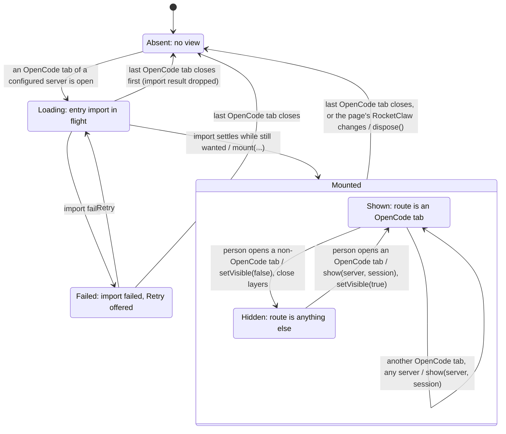

# The page's one OpenCode view, kept behind other tabs: bounded verification

`ViewKeep.tla` models the lifecycle of the one OpenCode view RocketClaw's Web keeps for the page
(`internal/rocketclaw/web/src/ui.tsx`) and what it may do while hidden (`internal/rocketclaw/oc/host`). The plan is
`docs/plans/2026-11-22-1942-feat-keep-opencode-view-plan.md`. **Passing checks do not prove that code correct.**

## Run

From the repository root:

```sh
make -C docs/verification/oc-view-keep         # translate, then every check
make -C docs/verification/oc-view-keep keep    # one check
```

Requires Java 11+, `curl` and Make. The Makefile downloads `tla2tools.jar` v1.8.0 and verifies SHA-256
`67f9575c3b9ef7a0787b1bded34812862ffe79d711298e5a75b1a77720b19928`. The tools, the translator's copy, Java's
temporary files, TLC's working files and each check's log go to the repository root's
`.tmp/verification/oc-view-keep/`. A passing check needs TLC exit 0 and
`Model checking completed. No error has been found.`; a check that must fail needs TLC exit 12 (an invariant) or 13 (a
temporal property) and the named violation, so a parse or tool error never counts as the expected counterexample.

## The view's states



## What each check proves

Properties:

- `MarkedWhileVisible`: OpenCode never marks a session viewed while the view is hidden.
- `SlotOnlyShown`: RocketClaw's `remoteView` slot names a session only while the view is visible and shows it.
- `NoOrphanView`: a view never mounts for an effect that was already cleaned up.
- `Agreement`, once nothing is pending: the view is mounted (or failed) exactly while an OpenCode tab is open; it is
  visible exactly while the route shows an OpenCode tab, then shows that session and owns the slot; otherwise the slot
  is empty.
- `EventuallyShown`: once the person stops on an OpenCode tab, the view eventually shows that session, visibly.
- `EventuallyWarm`: once the person stops with any OpenCode tab open, the view is eventually mounted, even if another
  tab shows.

| Check | Shape | Expected | Result |
|---|---|---|---|
| `keep` | the design; the import may fail and be retried | the four safety properties hold | pass, 10,587 distinct states |
| `keep-live` | the design; the import never fails | `EventuallyShown` and `EventuallyWarm` hold | pass, 5,906 distinct states |
| `no-mark-gate` | OpenCode marks viewed whenever the window has focus | `MarkedWhileVisible` violated | violated, as expected |
| `no-slot-gate` | the show effect reruns, claiming the slot, when open tabs change while hidden | `SlotOnlyShown` violated | violated, as expected |
| `no-guard` | an import settling after cleanup still mounts | `NoOrphanView` violated | violated, as expected |
| `dispose-hidden` | the design before: a non-OpenCode tab disposes the view | `EventuallyWarm` violated | violated, as expected |

The failing checks show each fence is needed and that the passing checks reach the states that matter. They run with
one TLC worker, so the first counterexample is the same on every run.

## Assumptions

- One browser page and one view, which holds every server; sessions A and B are one server's and C another's. Which
  session a move settles on, through OpenCode's router and its own navigations, is `../oc-view-session`'s model; here
  `show()` takes effect in the effect's task.
- Each Web effect runs in one browser task, so its writes are atomic; a person's action and the effect it causes are
  separate steps, and the import settles between any two steps.
- The Web's effects and the import are weakly fair; the person, the window's focus and OpenCode's marking are not.
- `EventuallyWarm` and `EventuallyShown` are checked with an import that never fails; with failures the view waits on
  the person's Retry, which the model does not force.

## Recorded run

On 2026-11-26, `make -k` with TLC `2026.11.26.020825` (rev `1138302`) and OpenJDK `21.0.13.1`
matched every TLC outcome (2 passes, 4 named counterexamples) in 4s.

2026-11-22, linux/aarch64, OpenJDK 21.0.13.1, TLC `2026.11.19.180144 (rev: bc1b506)`, `pcal.trans` 1.12: every check
matched its expected outcome; `make` took about 5 s with the tools already downloaded.

## Limits

- Bounded: three OpenCode tabs on two servers plus one other tab, at most 4 actions by the person (3 in the failing
  checks).
- Several browser windows, the RocketClaw a page shows changing, and a server going offline are not modeled.
- Key presses, overlays and the typing pill are fenced by the same visible flag as marking; only marking and the slot
  are modeled.
- Warming the other servers' first sessions only reads data into the view; it changes no state the model tracks.
