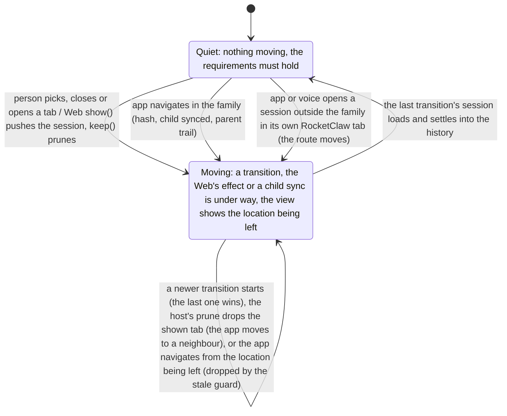

# Remote OpenCode tab view: bounded verification

`ViewSession.tla` models which session a RocketClaw remote OpenCode tab shows, with the page's one view serving two
OpenCode servers that each hold a session with the same ID. The Web's sidebar marks the tab its
route names; the copied OpenCode view inside the tab shows what its own router shows. Once nothing is moving, both
must name the same session, or a subagent of it. The design as built is `ViewHistory` in
`internal/rocketclaw/oc/host/navigation.tsx`, driven by `RemoteSession` in `internal/rocketclaw/web/src/ui.tsx`.
**Passing checks do not prove that code correct.**

## Run

From the repository root:

```sh
make -C docs/verification/oc-view-session         # translate, then every check
make -C docs/verification/oc-view-session view    # one check
```

Requires Java 11+, `curl` and Make. The Makefile downloads `tla2tools.jar` v1.8.0 and verifies SHA-256
`67f9575c3b9ef7a0787b1bded34812862ffe79d711298e5a75b1a77720b19928`. The tools, the translator's copy, Java's
temporary files, TLC's working files and each check's log go to the repository root's
`.tmp/verification/oc-view-session/`. A passing check needs TLC exit 0 and
`Model checking completed. No error has been found.`; a check that must fail needs TLC exit 12 and its named
invariant violated, so a parse or tool error never counts as the expected counterexample.

## The view's states

An abstraction of the model's variables: `Quiet` is the model's predicate, and `Moving` is every other state.



## What each check proves

On 2026-11-22, `make all` passed with TLC `2026.11.19.180144` (rev `bc1b506`), OpenJDK `21.0.13.1` and Lean 4.36.0.
Every check except `id-keys` sets `Keys = "pair"`, how the code compares sessions since the view serves several
servers: by server and ID (`routeKey` in `oc/host/navigation.tsx`, the keep keys in `oc/host/session-tab.tsx`,
`show(server, …)` in `oc/host/mount.tsx`, full `opencode:<server>:<id>` IDs in `web/src/ui.tsx`). With pair keys the
model explores exactly the states the one-server model did: telling sessions apart by server and ID is all the second
server changes.

Requirements, checked once nothing is moving (`Quiet`: no transition pending, the Web's effect has told the view
everything, no child still syncing):

- `Agreement`: the view shows the session the sidebar marks, or one of its subagents;
- `NoHijack`: the app's own housekeeping never opens a session in a tab of its own;
- `ChoiceStands`: the sidebar marks the tab the person chose last, unless they asked the view for another session.

| Check | Shape | Expected | Result |
|---|---|---|---|
| `view` | as built: stale guard, `Outside = "open"`, voice | all three requirements hold | pass, 577,351 distinct states |
| `drop-request` | stale guard, `Outside = "drop"`, voice | `RequestNeverOpened` holds: dropping keeps the requirements, but voice never opens a session | pass, 190,133 distinct states |
| `view-child` | as built | `ChildNeverShown` violated: a subagent can show inside its parent's tab | violated, as expected |
| `view-request` | as built | `RequestNeverOpened` violated: voice can open a session in its own tab | violated, as expected |
| `before` | the design before: no stale guard, `Outside = "navigate"` | `Agreement` violated | violated, as expected |
| `stale-only` | stale guard, `Outside = "navigate"` | `Agreement` violated | violated, as expected |
| `open-only` | no stale guard, `Outside = "open"` | `NoHijack` violated | violated, as expected |
| `id-keys` | as built, but sessions compared by ID alone, as the one-server code did | `Agreement` violated: moving to another server's session with the same ID leaves the view on the first | violated, as expected |

`view-child` and `view-request` show the passing `view` check is not passing because the model never reaches those
states. Checks that must fail run with one TLC worker, so the first counterexample, and the invariant it names, is the
same on every run.

## Assumptions

- The Web's effect runs `show()` and `keep()` in one browser task, so no other process steps while it runs.
- The Web's effect, the router and the child sync are fair; the person and the app act when they like.
- The router follows `@solidjs/router` 1.0.0: the last transition started wins, and its location shows only once its
  session has loaded.

## Recorded run

On 2026-11-26, `make -k` with TLC `2026.11.26.020825` (rev `1138302`) and OpenJDK `21.0.13.1`
matched every TLC outcome (2 passes, 6 named counterexamples) in 16s; the Lean check passed too.

2026-11-13, on arm64, OpenJDK 21.0.13, TLC `2026.11.06.222357 (rev: d8fb231)`, `pcal.trans` 1.12:
every check matched its expected outcome; `make` took 10 to 12 s including the tools download. Translating changed
nothing in `ViewSession.tla`.

Rerun 2026-11-18 after the `tla2tools.jar` pin moved to build `bc1b506` (one upstream commit, "Fix races in TLCSet/TLCGet with multiple workers"): TLC `2026.11.15.002146 (rev: bc1b506)`, OpenJDK 21.0.13 on linux/aarch64; `make -k` exited 0.

## Limits

- Bounded: three top-level sessions and one subagent, at most 2 tab choices by the person and 2 navigations by the app.
- Two servers and one view; three top-level sessions, two of them on different servers with the same ID. Several
  browser windows and network failures are not modeled.
- Liveness is not checked: no temporal property says the view eventually agrees.

## Lean proof

`SessionTabs.lean` states the prune of OpenCode's own tab list (`SessionTab` in `internal/rocketclaw/oc/host/session-tab.tsx`)
as a filter over any list of tabs and proves, for every input:

| Theorem | What it says |
|---|---|
| `shown_tab_stays` | The tab of the session the view shows is never pruned. |
| `open_tab_stays_on_every_server` | A session open as a RocketClaw tab keeps its tab, whatever its server. |
| `other_tabs_stay` | Tabs that are not sessions are never pruned. |
| `closed_tab_goes` | Every session tab left is the shown one or one open as a RocketClaw tab. |
| `prune_keeps_its_own_result` | Pruning again changes nothing. |
| `matching_ids_alone_keeps_a_closed_tab_of_another_server` | Comparing IDs alone keeps a closed tab whose ID matches another server's open session; comparing server and ID drops it. |

`make lean` (part of `make`) downloads Lean 4.36.0 into the repository's `.tmp/lean/`, checks its SHA-256 and runs
`lean` on the file; any unproved or false theorem fails the target. Recorded run 2026-11-22, linux aarch64: the file
checked in under a second. The theorems depend only on `propext` and `Quot.sound`; none uses `sorry` or
`native_decide`. A deliberately false theorem, that comparing IDs alone keeps only shown or open tabs, was rejected.

Limits: the code removes tabs from the last index back, one `removeTab` at a time; the proof takes that as the same as
filtering the list, and is about the rule, not about Solid or OpenCode's tab store.
