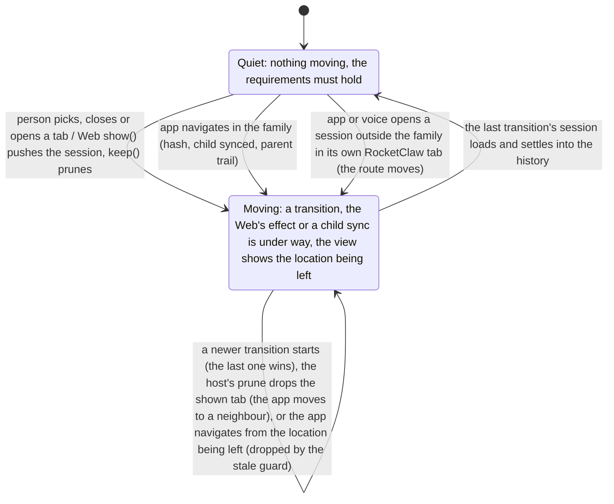

# Remote OpenCode tab view: bounded verification

`ViewSession.tla` models which session a RocketClaw remote OpenCode tab shows. The Web's sidebar marks the tab its
route names; the copied OpenCode view inside the tab shows what its own router shows. Once nothing is moving, both
must name the same session, or a subagent of it. The design as built is `ViewHistory` in
`internal/rocketclaw/oc/host/navigation.tsx`, driven by `RemoteSession` in `internal/rocketclaw/web/src/ui.tsx`.
**Passing checks do not prove that code correct.**

## Run

From the repository root:

```sh
make -C docs/verification/oc-view-session         # translate, then every check
make -C docs/verification/oc-view-session view    # one check
```

Requires Java 11+, `curl` and Make. The Makefile downloads `tla2tools.jar` v1.8.0 and verifies SHA-256
`e1f11b75c4b5bc4478ba0ac5cb6ae28e40a01b0016bc33e0aa97da22dfdbcd7f`. The tools, the translator's copy, Java's
temporary files, TLC's working files and each check's log go to the repository root's
`.tmp/verification/oc-view-session/`. A passing check needs TLC exit 0 and
`Model checking completed. No error has been found.`; a check that must fail needs TLC exit 12 and its named
invariant violated, so a parse or tool error never counts as the expected counterexample.

## The view's states

An abstraction of the model's variables: `Quiet` is the model's predicate, and `Moving` is every other state.



## What each check proves

Requirements, checked once nothing is moving (`Quiet`: no transition pending, the Web's effect has told the view
everything, no child still syncing):

- `Agreement`: the view shows the session the sidebar marks, or one of its subagents;
- `NoHijack`: the app's own housekeeping never opens a session in a tab of its own;
- `ChoiceStands`: the sidebar marks the tab the person chose last, unless they asked the view for another session.

| Check | Shape | Expected | Result |
|---|---|---|---|
| `view` | as built: stale guard, `Outside = "open"`, voice | all three requirements hold | pass, 577,351 distinct states |
| `drop-request` | stale guard, `Outside = "drop"`, voice | `RequestNeverOpened` holds: dropping keeps the requirements, but voice never opens a session | pass, 190,133 distinct states |
| `view-child` | as built | `ChildNeverShown` violated: a subagent can show inside its parent's tab | violated, as expected |
| `view-request` | as built | `RequestNeverOpened` violated: voice can open a session in its own tab | violated, as expected |
| `before` | the design before: no stale guard, `Outside = "navigate"` | `Agreement` violated | violated, as expected |
| `stale-only` | stale guard, `Outside = "navigate"` | `Agreement` violated | violated, as expected |
| `open-only` | no stale guard, `Outside = "open"` | `NoHijack` violated | violated, as expected |

`view-child` and `view-request` show the passing `view` check is not passing because the model never reaches those
states. Checks that must fail run with one TLC worker, so the first counterexample, and the invariant it names, is the
same on every run.

## Assumptions

- The Web's effect runs `show()` and `keep()` in one browser task, so no other process steps while it runs.
- The Web's effect, the router and the child sync are fair; the person and the app act when they like.
- The router follows `@solidjs/router` 1.0.0: the last transition started wins, and its location shows only once its
  session has loaded.

## Recorded run

2026-11-13, on macOS (Apple silicon), OpenJDK 21.0.13, TLC `2026.11.06.222357 (rev: d8fb231)`, `pcal.trans` 1.12:
every check matched its expected outcome; `make` took 10 to 12 s including the tools download. Translating changed
nothing in `ViewSession.tla`.

## Limits

- Bounded: three top-level sessions and one subagent, at most 2 tab choices by the person and 2 navigations by the app.
- One server and one view; other servers' tabs, several browser windows and network failures are not modeled.
- Liveness is not checked: no temporal property says the view eventually agrees.
