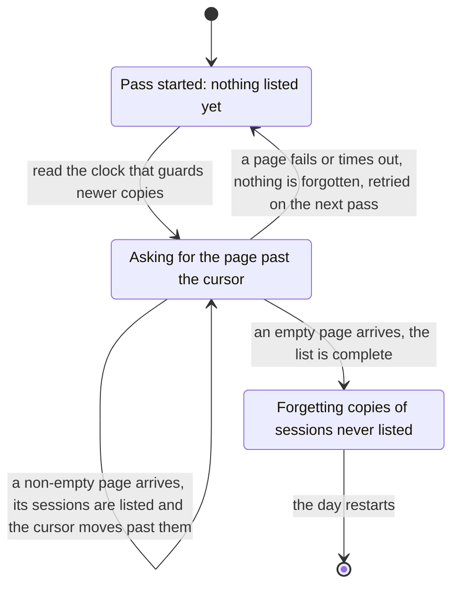

# Forgetting remote OpenCode sessions page by page: bounded verification

Once a day per configured OpenCode server, RocketClaw's sync loop (`SyncOpenCode` in
`internal/rocketclaw/backend/opencode.go`) runs `pruneOpenCode`: it lists the server's root sessions, then forgets the
local copy of every session the list no longer holds, except copies written after the prune started. The day counts
from the last prune that succeeded; a failed prune runs again on the next pass, about 5 seconds later. (Since then
the prune has its own loop beside the sync loop: at startup, then a day after each attempt, whatever its outcome. See
`docs/verification/opencode-prune-schedule/`.)

As built, the prune asks for every session in one request (`limit=1000000`) with the 5-second timeout every OpenCode
call has. On a server whose full list takes longer than that, every pass fails and starts over, so the prune never
finishes and the server gets a heavy request every few seconds.

The change lists the sessions a few thousand at a time with the server's `session.list` cursor, and forgets local
copies only once every page has arrived. OpenCode pages by the key (last update time, session ID): the cursor in each
response holds the request's filters and that key of the page's last session, and the next page holds the sessions
past it in the requested order. A session updated while the prune pages moves to the newest end of that order, so:

- listed newest first, the server's default, a session updated after the first page jumps ahead of the cursor and no
  later page lists it, and the prune would forget a session the server still has;
- listed oldest first, the updated session moves past the cursor and a later page lists it, perhaps a second time.

So the change lists oldest first. The model checks both orders, what a failed page may leave behind, and whether the
prune finishes.

**Passing checks do not prove that code correct.**

## Run

From the repository root:

```sh
make -C docs/verification/opencode-prune-pages          # translate, then every check
make -C docs/verification/opencode-prune-pages fixed    # one check
```

Requires Java 11+, `curl` and Make. The Makefile downloads `tla2tools.jar` v1.8.0 and verifies SHA-256
`67f9575c3b9ef7a0787b1bded34812862ffe79d711298e5a75b1a77720b19928`. The tools, the translator's copy, Java's temporary
files, TLC's working files and each check's log go to the repository root's `.tmp/verification/opencode-prune-pages/`.
A passing check needs TLC exit 0 and `Model checking completed. No error has been found.`; a check that must fail
needs TLC exit 12 (safety) or 13 (liveness) and its named violation, so a parse or tool error never counts.

The 2026-11-19 run used a local copy of the then-pinned jar because a fresh download no longer matched it.

## One prune, step by step



## The model

`OpenCodePrune.tla` has two processes.

- `Server` is the OpenCode server. Up to `MaxChanges` times it updates a live session, which gives it the newest
  update time, or deletes one. A deleted session never comes back. It may also stop changing anything at any time.
- `Prune` is one prune of one server, retried pass after pass until it succeeds. `Pass` starts a pass with nothing
  listed. `Fetch` is one request: it returns up to `PageSize` live sessions past the cursor, in `Order`, sorted by
  (update time, ID) as OpenCode's store sorts them. A request that would return more than `Budget` sessions always
  times out; any other request may fail up to `MaxFailures` times in all. A non-empty page adds its sessions to the
  listed set and moves the cursor to its last session's key as it was when the page was read. An empty page ends the
  list: every local copy not listed is forgotten, at once, and the prune is done. A failure goes back to `Pass`; with
  `ForgetOnFailure` it first forgets every local copy not listed so far, which is what using a partial list would do.

All sessions start live, with a local copy, at the same update time, so ties order by ID. Each request reads one
consistent snapshot, one atomic step; changes interleave only between requests.

Properties:

- `NoLiveForgotten` (safety): no session the server still has is ever forgotten.
- `PruneCompletes` (liveness): the prune eventually succeeds. `Prune` has weak fairness, because the sync loop keeps
  running passes. `Server` has none: it may make no change at all.
- `NothingForgotten` and `NeverMultiPage` are witnesses that must fail in the fixed design, to show the prune does
  forget deleted sessions and does finish after more than one page of sessions plus the final empty one.

## Checks and results

On 2026-11-26, `make -k` with TLC `2026.11.26.020825` (rev `1138302`) and OpenJDK `21.0.13.1`
matched every TLC outcome (2 passes, 6 named counterexamples) in 6s.

On 2026-11-21, `make all` passed with TLC `2026.11.19.180144` (rev `bc1b506`) and OpenJDK `21.0.13.1`.

With TLC2 `2026.11.06.222357` (rev `d8fb231`) and OpenJDK `21.0.13`, `-workers 1`, on 2026-11-19. Every check uses
`Sessions = {1, 2, 3}`, `MaxChanges = 2` and `MaxFailures = 1` except `fixed-wide`, and finished in under 15 seconds.
The whole run took 41 seconds.

| Check | Switches | Expected | Outcome |
| --- | --- | --- | --- |
| `current` | one request for everything (`PageSize = 3`), `Budget = 2`, newest first | `PruneCompletes` violated | violated (751 states, 377 distinct, depth 9): every pass times out, forever |
| `paged-desc` | `PageSize = 1`, `Budget = 1`, newest first | `NoLiveForgotten` violated | violated (471 states, 292 distinct, depth 6): session 2 is updated after the first page and forgotten while live |
| `forget-on-failure` | `PageSize = 1`, oldest first, `ForgetOnFailure` | `NoLiveForgotten` violated | violated (52 states, 37 distinct, depth 3) |
| `fixed` | `PageSize = 1`, `Budget = 1`, oldest first | both properties hold | passed (3,776 states, 1,887 distinct, depth 13) |
| `fixed-wide` | `Sessions = {1, 2, 3, 4}`, `PageSize = 2`, `Budget = 2`, `MaxChanges = 3`, `MaxFailures = 2`, oldest first | both properties hold | passed (68,136 states, 32,140 distinct, depth 16) |
| `fixed-slow` | as `fixed`, but `PageSize = 2`, `Budget = 1` | `PruneCompletes` violated | violated (325 states, 140 distinct, depth 9) |
| `fixed-forgets` | as `fixed` | `NothingForgotten` violated | violated (430 states, 251 distinct, depth 6) |
| `fixed-pages` | as `fixed` | `NeverMultiPage` violated | violated (458 states, 272 distinct, depth 6) |

`fixed-slow` records what paging leaves as it was: a server too slow to answer even one page in time still fails
every pass, and the prune is still retried on the next pass, as before. Paging bounds each request; it does not
change when a failed prune runs again.

## Mapping to the code

| Model | Code (`internal/rocketclaw/backend/opencode.go`) |
| --- | --- |
| `Prune` retried until `done` | `SyncOpenCode`: a prune runs when a day has passed since `pruned[name]`, which only a successful prune sets |
| `Pass` | `pruneOpenCode` reads the state store's clock as `started`, then starts with no cursor |
| `Fetch`, success | `GET /api/session?parentID=null&order=asc&limit=2000`, then `?limit=2000&cursor=<cursor.next>` |
| `Fetch`, empty page | the response has no `cursor.next`, which OpenCode leaves out only for an empty page |
| `Fetch`, failure | `openCodeCall` returns an error and `pruneOpenCode` returns it before deleting anything |
| forgetting | one `DELETE` of the server's rows not listed and synced before `started` |
| `Budget` | the 5-second timeout of each `openCodeCall` |

## What the model leaves out

Copies written after the prune started (by the sync, or by creating or forking a session) are guarded by `started` in
the `DELETE` and are not modeled; the model's local copies all exist before the prune. Subagent sessions, which the
prune does not list, the database, more than one server, the day between prunes, and sessions created on the server
during a prune are left out; a created session has the newest update time, so oldest first lists it on a later page.
The bounds are small: three or four sessions, two or three server changes, one or two transient failures.
