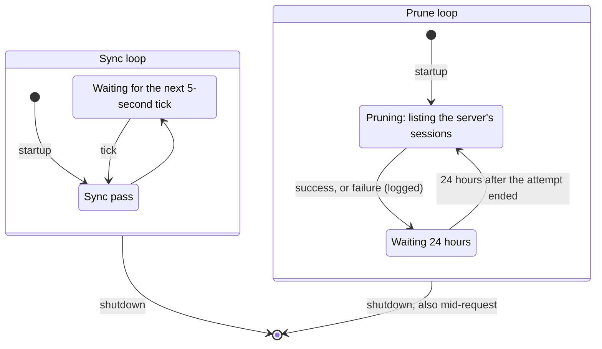

# OpenCode prune on its own daily schedule: bounded verification

`OpenCodePruneSchedule.tla` models when RocketClaw prunes one configured OpenCode server (`pruneOpenCode`: forget the
local copies of sessions the server no longer has) and how that shares time with the server's sync loop
(`SyncOpenCode` in `internal/rocketclaw/backend/opencode.go`).

As built, the 5-second sync loop prunes at the end of a pass when 24 hours have passed since the last prune that
succeeded. A failing prune therefore runs again on every pass, about every 5 seconds, and every prune, slow or failing,
holds up the next sync pass of every server.

The change gives each server a prune loop of its own, beside the sync loop: it prunes once at startup, then 24 hours
after each attempt ends, whether that attempt succeeded or failed. A failure is logged. Both loops stop when RocketClaw
shuts down.

`Separate` switches between the two shapes:

- `Separate = FALSE`, as built: the sync loop prunes, and only a success restarts the day.
- `Separate = TRUE`: the prune loop of its own.

`WaitFirst = TRUE` (with `Separate`) is a loop that waits a whole period before its first prune, as a plain ticker
would. It is not a candidate; it shows that `PrunesBeforeWaiting` catches that mistake.

**Passing checks do not prove that code correct.**

## Run

From the repository root:

```sh
make -C docs/verification/opencode-prune-schedule          # translate, then every check
make -C docs/verification/opencode-prune-schedule fixed    # one check
```

Requires Java 11+, `curl` and Make. The Makefile downloads `tla2tools.jar` v1.8.0 and verifies SHA-256
`fdffef247f563ef6edbfd44958d2a82db79e7564e07cb673262d896353fa6713`. The tools, the translator's copy, Java's temporary
files, TLC's working files and each check's log go to the repository root's
`.tmp/verification/opencode-prune-schedule/`. A passing check needs TLC exit 0 and `Model checking completed. No error
has been found.`; a check that must fail needs TLC exit 12 (safety) or 13 (liveness) and its named violation, so a
parse or tool error never counts.

A fresh download no longer matches the pinned checksum. The recorded run used a jar with the pinned checksum already
on the machine, copied into the work directory.

## One server, step by step



## The model

| Process | Fairness | Meaning |
|---|---|---|
| `sync` | weak | the sync loop: a pass on every tick; as built, it also prunes at the end of a pass and waits for the answer |
| `prune` | weak | the prune loop of the change; as built it does nothing |
| `clock` | weak | time, one tick per step, up to `MaxTime` |
| `server` | none | answers an outstanding prune request, whenever it likes or never: a slow prune |
| `shutdown` | none | cancels everything, at any time or never |

The process that waits for the answer picks whether the attempt succeeded or failed. A request in flight is abandoned
on shutdown, as the context cancels it.

| Constant | Meaning | Value |
|---|---|---|
| `Period` | the prune's day, in ticks; the sync loop's tick is 1 | 2 |
| `MaxTime` | the last tick | 6 |

| Variable | Meaning |
|---|---|
| `now`, `stop` | the clock, and whether shutdown happened |
| `syncedAt` | the tick of the last sync pass |
| `lastPruned` | as built: the end of the last prune that succeeded (starts a full period in the past) |
| `lastEnd` | the change: the end of the last attempt |
| `requesting`, `replied` | a prune request is in flight; the server has answered it |
| `attempts` | ghost: every attempt's start, end and outcome |

| Model step | Code (`opencode.go`) |
|---|---|
| `SyncWait`, `SyncPass` | the `SyncOpenCode` loop on its `openCodeSyncInterval` ticker: `pushOpenCodeNames`, `syncOpenCode`, `addOpenCodeBridges` |
| `SyncPrune` (as built) | `time.Since(lastPruned) >= openCodePruneEvery && s.pruneOpenCode(...) == nil` sets `lastPruned` |
| `PruneStart`, `PruneReply` | the prune goroutine calls `s.pruneOpenCode`, and logs a failure unless the context was canceled |
| `PruneWait` | `select` on `ctx.Done()` and `time.After(openCodePruneEvery)` |
| `Stop` | the context passed to `SyncOpenCode` is canceled; `workers.Wait()` returns once both loops have |

## Properties

- `AtMostOncePerPeriod` (safety): two attempts start at least `Period` apart, whatever their outcome.
- `NoBackToBackRetry` (safety): after a failed attempt, the next one starts no sooner than `Period` after it ended.
- `PrunesBeforeWaiting` (safety): the prune loop prunes before it first waits, so a prune runs at startup.
- `SyncKeepsUp` (liveness): at every tick a sync pass happens at that tick or later (or shutdown happens), however slow
  the prune is.
- `PruneRepeats` (liveness): a waiting prune loop starts again once its period is over, within `MaxTime`.
- `ShutdownStops` (liveness): after shutdown both loops end.
- `TypeOK`.

Witnesses that the passing check is not vacuous, each of which must fail in the change's shape:
`NeverRetriedAfterFailure` (a failed attempt is followed by another one) and `NeverSyncsDuringPrune` (a sync pass
starts while a prune request is in flight).

## Results

On 2026-11-21, `make all` passed with TLC `2026.11.19.180144` (rev `bc1b506`) and OpenJDK `21.0.13.1`.

Recorded 2026-11-20 on Linux (aarch64, 16 cores), OpenJDK 21.0.13.1, TLC `2026.11.15.002146 (rev: bc1b506)`,
`pcal.trans` 1.12, one TLC worker. `make -k` ran every check in about 79 s with the tools in place and exited 0. Every
check matched its expected outcome.

| Check | Shape | Expected | Result | Generated / distinct states | Depth |
|---|---|---|---|---:|---:|
| `fixed` | `Separate` | every property holds | pass, complete state space (69 s) | 396,509 / 151,734 | 29 |
| `current-retry` | as built | `NoBackToBackRetry` violated | violated | 393 / 213 | 8 |
| `current-blocked` | as built | `SyncKeepsUp` violated | violated | 32,531 / 15,891 | 17 |
| `wait-first` | `Separate`, `WaitFirst` | `PrunesBeforeWaiting` violated | violated | 3 / 3 | 2 |
| `witness-retry` | `Separate` | `NeverRetriedAfterFailure` violated | violated | 1,668 / 871 | 9 |
| `witness-overlap` | `Separate` | `NeverSyncsDuringPrune` violated | violated | 26 / 19 | 4 |

Counts for failing checks are what TLC had explored when it reported the counterexample.

### Counterexamples as built

`current-retry`: the first pass at tick 0 prunes; the clock moves to 1; the server answers and the prune fails at
tick 1; the next pass, at tick 1, prunes again, while `NoBackToBackRetry` needs tick 3.

`current-blocked`: the first pass at tick 0 prunes and the server never answers. The clock runs to 6, and the sync loop
stays in the prune: no pass after tick 0.

## Limits

- Bounded: one server, a period of 2 sync ticks, 6 ticks of time. A pass covers this finite model only.
- One prune attempt is one request. In the code it lists pages of 2,000 sessions, each with its own 5-second timeout
  (`openCodeCall`), so an attempt is never endless; the unfair server stands for one that is as slow as it likes.
- The model follows one server. In the code every server has its own prune loop, and as built one server's prune held
  up the sync of every server, since the sync loop goes through them in turn.
- What the prune deletes is left out; `docs/verification/opencode-prune-pages/` checks that. Running beside the sync
  does not change it: the prune forgets only rows last synced before the prune started (`synced_at < started`), and a
  row a sync pass wrote after that start is kept.
- The shells-following loop, the names push and the MCP bridges inside a sync pass are not modeled.
