# Automatic title checks for remote OpenCode sessions: bounded verification

`OpenCodeTitleCheck.tla` models every writer of a remote OpenCode session's title once RocketClaw checks automatic
titles for remote sessions. A Remote OpenCode Session row holds `name`, `title`, `generated_name`, `typed_titles` and
`synced_at`. OpenCode holds its own copy of the title. Four kinds of writer interleave:

- the OpenCode sync loop (`SyncOpenCode` in `internal/rocketclaw/backend/opencode.go`): `pushOpenCodeNames`, then
  `syncOpenCode`, which reads `now()`, lists OpenCode's sessions and upserts each row;
- the title check (`retitleOpenCode`, `SessionService.retitle` in `bridge.go`, `NameGenerated` in `store.go`), which
  the sync starts in the background when a remote turn ends: it reads the name without a lock, asks the decision model,
  and renames the session;
- a rename typed in RocketClaw (`UpdateConversationDetails` in `store.go`);
- a rename made on the OpenCode side, at any time.

The rule under check: a title from OpenCode counts as generated; a name typed in RocketClaw never does and a check
never takes it; a newer title is never replaced by an older one; and RocketClaw and OpenCode end up agreeing. The model
also covers requests to OpenCode that fail and commits that fail after OpenCode accepted.

**Passing checks do not prove the code correct.**

## Run

From the repository root:

```sh
make -C docs/verification/opencode-title-check          # translate, then every check
make -C docs/verification/opencode-title-check fixed    # one check
```

Requires Java 11+, `curl` and Make. The Makefile downloads `tla2tools.jar` v1.8.0 and verifies SHA-256
`67f9575c3b9ef7a0787b1bded34812862ffe79d711298e5a75b1a77720b19928`. The tools, the translator's copy, Java's temporary
files, TLC's working files and each check's log go to the repository root's `.tmp/verification/opencode-title-check/`.
A passing check needs TLC exit 0 and `Model checking completed. No error has been found.`; a check that must fail needs
TLC exit 12 (safety) or 13 (temporal) and its named violation, so a parse or tool error never counts.

The 2026-11-27 runs used a local copy of the pinned jar, because a fresh download of the v1.8.0 release no longer
matches the pin (the release digest is now `sha256:df7cef5d…`); re-pinning every model is a separate change.

## The session's title, step by step

```mermaid
stateDiagram-v2
  state "Sync loop (every 2 s)" as Sync {
    state "Push a name waiting to be sent: lock, re-check, send, write the title" as Push
    state "started := now(); list OpenCode's sessions" as List
    state "Upsert, waiting for the row lock" as Upsert
    [*] --> Push
    Push --> List: sent, refused (the name keeps waiting), or nothing to send
    List --> Upsert
    Upsert --> Push: next tick
    Upsert --> Check: a turn ended and the prompt count crossed a multiple of four
  }
  state "Title check (background)" as Check {
    state "Read the name, unlocked; skip unless generated" as Read
    state "Decision model judges it" as Judge
    state "Lock the row; skip unless the name is still the judged, generated one" as Guard
    state "Send the new title to OpenCode" as Patch
    state "Stamp synced_at, commit" as Commit
    [*] --> Read
    Read --> Judge
    Judge --> [*]: the title fits
    Judge --> Guard: it does not
    Guard --> [*]: the name changed meanwhile
    Guard --> Patch
    Patch --> [*]: OpenCode refused (rollback)
    Patch --> Commit
    Commit --> [*]: committed, or the commit failed
  }
  state "Rename typed in RocketClaw" as User {
    state "Record the name in typed_titles (own commit)" as UMark
    state "Lock the row" as ULock
    state "Send the name to OpenCode" as UPatch
    state "Stamp synced_at, drop the record, commit" as UCommit
    [*] --> UMark
    UMark --> ULock
    ULock --> UPatch
    UPatch --> [*]: OpenCode refused (rollback; the record stays)
    UPatch --> UCommit
    UCommit --> [*]: committed, or the commit failed (the record stays)
  }
```



The upsert keeps the local `name` and `title` when `synced_at` is newer than the pass's `started`. It keeps a name
still waiting to be sent (`name NOT IN ('', title)`) and takes OpenCode's title into `title`. Otherwise it takes
OpenCode's title for both. It moves `generated_name` to that title only when it takes the name, the title changed, and
the title is not in `typed_titles`; it drops the title from `typed_titles` once it lists it. A rename made on the
OpenCode side can land at any moment.

## Assumptions

- Postgres `READ COMMITTED`: a transaction's writes are visible at its commit, every writer of the row waits for the
  row lock (`FOR UPDATE`, or the lock an `UPDATE` or `ON CONFLICT DO UPDATE` takes), and a reader without the lock sees
  committed values.
- `now()` is the transaction's start; `clock_timestamp()` is the moment of the statement. Both come from one clock.
- `pushOpenCodeNames` and `syncOpenCode` run one after the other in one goroutine, so they never overlap each other.
- A request to OpenCode either succeeds or fails. A failure rolls the transaction back (`NameGenerated`,
  `UpdateConversationDetails`) or leaves the row waiting (`pushOpenCodeNames`). OpenCode keeps the last title it was
  sent.
- A commit can fail after OpenCode accepted (`CommitFail`). The record written before the send is its own committed
  write, so it survives.
- A push is refused or fails at commit at most `PushFailures` times, so a waiting name is eventually sent.

## The model

| Process | Fairness | Meaning |
|---|---|---|
| `sync` | weak | the sync loop; at most `MaxPasses` passes while other writers run, then passes until nothing waits to be sent |
| `retitle` (one per member of `Retitlers`) | weak | one background title check; two of them can overlap |
| `user` (one per member of `Users`) | weak | one rename typed in RocketClaw |
| `renamer` (one per member of `Renamers`) | weak | one rename made on the OpenCode side |

Writers make one attempt each, so every behavior ends; fairness makes them finish. The judge, every request to
OpenCode and every commit choose their outcome nondeterministically.

| Variable | Meaning |
|---|---|
| `name`, `title`, `gen`, `syncedAt` | the row's `name`, `title`, `generated_name` (0 is NULL) and `synced_at` |
| `typedT` | the row's `typed_titles` |
| `up` | OpenCode's title |
| `kinds` | who made each title token: `oc`, `typed` or `gen` |
| `clock` | the database clock |
| `lock` | who holds the row lock |
| `seq`, `upVer`, `nameVer` | ghost: the order of OpenCode title writes, the write OpenCode holds, and the write the local name comes from (a name waiting to be sent counts as newer than OpenCode's title) |
| `pushFailures` | refusals or failed commits a push may still have |
| `retitled`, `keptLocal`, `markSaved` | ghost: a check committed a title; an upsert kept a newer local name; a record kept a typed name typed |

| Model step | Code |
|---|---|
| `PushRead` | `pushOpenCodeNames`: select rows with `name <> '' AND name <> title` |
| `PushLock`, `PushPatch`, `PushUpdate` | `pushOpenCodeName`: `SELECT ... AND name = $3 AND name <> title FOR UPDATE`, PATCH, `UPDATE ... SET title = name`, commit |
| `Started`, `List` | `syncOpenCode`: `SELECT now()` into `started`, then `GET /api/session` |
| `TxBegin`, `Upsert` | `storeOpenCodeSync`: begin, then the `INSERT ... ON CONFLICT DO UPDATE` with its `name`, `generated_name` and `typed_titles` cases |
| `Read`, `Judge` | `SessionService.retitle`: `SELECT name ... AND (name = '' OR name = generated_name)`, `harness.TitleFits` |
| `Guard` | `NameGenerated`: `SELECT ... FOR UPDATE` with `name = $judged AND (name = '' OR name = generated_name)` |
| `Patch`, `Stamp`, `Commit` | `NameGenerated`: `renameOpenCode`, then `UPDATE ... synced_at = clock_timestamp()`, commit |
| `UMark` | `UpdateConversationDetails`: `UPDATE ... SET typed_titles = array_append(...)`, committed on its own |
| `ULock`, `UPatch`, `UStamp`, `UCommit` | `UpdateConversationDetails`: `SELECT ... FOR UPDATE`, `renameOpenCode`, `UPDATE` with `array_remove`, commit |
| `Rename` | a title written on the OpenCode side |

### Design switches

| Switch | As built | What it changes |
|---|---|---|
| `JudgedGuard` | `TRUE` | `NameGenerated` renames only while the name is still the one the check judged |
| `StampFirst` | `FALSE` | `NameGenerated` stamps `synced_at` before sending to OpenCode, as a single `UPDATE ... RETURNING` would |
| `GuardOff` | `FALSE` | `NameGenerated` drops its "name is generated" guard |
| `SyncAdoptsAlways` | `FALSE` | the upsert marks OpenCode's title as generated even when it did not change |
| `TypedMarks` | `TRUE` | a typed name is recorded in `typed_titles` before it is sent, and the sync never marks a recorded name generated |
| `PushLocks` | `TRUE` | `pushOpenCodeNames` locks and re-checks the row, sends, and writes the title under that lock |
| `KeepPending` | `TRUE` | the upsert keeps a name still waiting to be sent |
| `CommitFail` | — | a commit can fail after OpenCode accepted (a risk, not a design choice) |
| `LegacyPending` | — | the row starts with a typed name that never reached OpenCode, the case `pushOpenCodeNames` exists for |

A pushed name needs no record: it waits as `name <> title`, and the upsert keeps a waiting name and its
`generated_name`, so a push whose commit fails after OpenCode accepted stays typed. `fixed-legacy-commit-fail` checks
this.

## Properties

- `TypedNotGenerated` (safety): a typed name never counts as generated.
- `ChecksNeverTakeTyped` (safety): a check never takes a typed name. From its guard to its commit it holds the lock, so
  the name it replaces is the one it holds.
- `ReplacesOnlyJudged` (safety): a check replaces only the name it judged.
- `NameNeverOlder` (safety, action): the local name never goes back to a title OpenCode held before the one it has,
  counting by when each title was written to OpenCode.
- `LatestTypedWins` (safety, action): a typed name is never replaced by a name typed before it.
- `ConvergedAtEnd` (safety): when the sync loop finishes, `name` and `title` equal OpenCode's title.
- `Terminates` (liveness): the sync loop finishes its last pass.
- `TypeOK`.

Witnesses that the passing checks are not vacuous, each of which must fail as built: `NeverRetitled` (a check commits a
title), `NeverKeptLocal` (an upsert keeps a newer local name over a different listed title), `NeverRacedAgainstCheck`
(an upsert waits on a check's lock with a listed title older than OpenCode's), `NeverRefusedPush` (a push is refused),
`NeverMarkSaved` (a recorded name arrives back from OpenCode after a failed commit and stays typed).

An earlier form of `ChecksNeverTakeTyped` said "a typed name is never replaced by a generated one". With failed
commits it is too strong: a person's rename reaches OpenCode but its commit fails, a check that judged the previous
automatic name writes a newer title to OpenCode, and the sync brings in the typed name and then the newer generated
title. The check never took the typed name, the rename was reported as failed, and `NameNeverOlder` holds; the property
now states what was meant.

## Checks and results

On 2026-11-27, `make -k` on Linux (aarch64, 16 cores), OpenJDK `21.0.13.1`, TLC `2026.11.26.020825` (rev `1138302`),
`pcal.trans` 1.12, one TLC worker, matched every expected outcome and exited 0 in 1,711 s. Every check uses two title
checks, one typed rename, one OpenCode rename, `MaxPasses = 2` and `PushFailures = 1`, unless the table says
otherwise.

| Check | Switches | Expected | Result | Generated / distinct states | Depth | Time |
|---|---|---|---|---:|---:|---:|
| `fixed` | as built | every property holds | pass, complete | 1,446,601 / 828,894 | 47 | 1 min 3 s |
| `fixed-wide` | as built, two OpenCode renames, `MaxPasses = 3` | every property holds | pass, complete | 22,757,969 / 11,939,887 | 57 | 22 min 15 s |
| `fixed-commit-fail` | `CommitFail` | every property holds | pass, complete | 5,397,152 / 3,577,448 | 47 | 4 min 33 s |
| `fixed-legacy` | `LegacyPending` | every property holds | pass, complete | 115,092 / 65,282 | 47 | 6 s |
| `fixed-legacy-commit-fail` | `LegacyPending`, `CommitFail` | every property holds | pass, complete | 355,718 / 235,151 | 47 | 16 s |
| `built` | `JudgedGuard = FALSE` | `ReplacesOnlyJudged` violated | violated | 8,656 / 3,308 | 10 | <1 s |
| `stamp-first` | `StampFirst` | `NameNeverOlder` violated | violated | 58,588 / 23,581 | 16 | 1 s |
| `guard-off` | `JudgedGuard = FALSE`, `GuardOff` | `ChecksNeverTakeTyped` violated | violated | 5,562 / 2,193 | 9 | <1 s |
| `sync-adopts` | `SyncAdoptsAlways` | `TypedNotGenerated` violated | violated | 42,744 / 16,743 | 15 | 1 s |
| `no-typed-marks` | `TypedMarks = FALSE`, `CommitFail` | `TypedNotGenerated` violated | violated | 51,126 / 20,289 | 15 | 1 s |
| `unlocked-push` | `PushLocks = FALSE`, `LegacyPending` | `LatestTypedWins` violated | violated | 7,387 / 3,022 | 15 | <1 s |
| `drop-pending` | `KeepPending = FALSE`, `LegacyPending` | `NameNeverOlder` violated | violated | 1,317 / 537 | 10 | <1 s |
| `witness-retitled` | as built | `NeverRetitled` violated | violated | 1,354 / 591 | 7 | <1 s |
| `witness-kept` | as built | `NeverKeptLocal` violated | violated | 38,113 / 14,751 | 15 | 1 s |
| `witness-race` | as built | `NeverRacedAgainstCheck` violated | violated | 20,411 / 7,725 | 13 | <1 s |
| `witness-refused` | `LegacyPending` | `NeverRefusedPush` violated | violated | 83 / 46 | 5 | <1 s |
| `witness-mark` | `CommitFail` | `NeverMarkSaved` violated | violated | 51,126 / 20,289 | 15 | 1 s |

Counts for failing checks are what TLC had explored when it reported the counterexample.

### What the counterexamples show

Each switch the code relies on has a check that fails without it.

`built`: two checks read the same generated title and both judge it outgrown. The first commits a new title; the
second's guard (`name = generated_name`) passes on that new title, which it never judged, and replaces it. A rename made
on the OpenCode side while a check is judging is replaced the same way. `JudgedGuard` fixes it; the last step of
`TestNameGeneratedKeepsThePreviousName` reproduces the stale judgment against the database and fails without it.

`stamp-first`: the check stamps `synced_at`, a sync pass starts after the stamp and lists OpenCode's old title before
the check's request reaches OpenCode, then waits on the lock; after the commit its `synced_at > started` comparison is
false and the old title overwrites the new one. Sending before stamping prevents this.

`guard-off`: with neither guard, a person types a name between the check's unlocked read and its lock, and the check
takes the typed name.

`sync-adopts`: a typed name reaches OpenCode, the next pass lists it unchanged, and an unconditional mark makes it
generated. Moving `generated_name` only when the title changed keeps typed names typed.

`no-typed-marks`: OpenCode accepts a typed name, RocketClaw's commit fails, and the next pass lists the name as a changed
OpenCode title and marks it generated. `TestSyncOpenCodeKeepsATypedTitleTyped` makes the commit fail with a deferred
trigger and checks the name stays typed.

`unlocked-push`: `pushOpenCodeNames` reads a waiting name without a lock; a person renames meanwhile; the push then
sends the stale name to OpenCode, and the next pass replaces the newer typed name with it. `TestOpenCodeMovesOldNamesToTheServer`
checks the row is locked while the name is sent and that a name that changed since it was read is not sent.

`drop-pending`: OpenCode refuses a push, and the next pass overwrites the waiting name with OpenCode's title. The same
test checks a refused name survives a sync pass.

## Limits

- Bounded: one session, two title checks, one typed rename, one or two OpenCode renames, two or three sync passes
  while they run, one push failure. A pass covers this finite model only.
- A rename whose commit fails after OpenCode accepted it can lose to a check running at the same moment (see the note
  under Properties). The person was told the rename failed.
- A refused rename leaves its record in `typed_titles`. The model includes that case and every property holds; the
  record only means an OpenCode title equal to that name counts as typed.
- The prompt counting that decides when a check runs (every fourth prompt, forward only from the first turn RocketClaw
  sees end) is not modeled; `TestSyncOpenCodeChecksTheTitleEveryFourthPrompt` covers it.
- The row always exists. Its first insert, by the sync or by `recordOpenCodeSession` for create and fork, is covered by
  the same test's `recorded` cases.
- The `(was …)` composition and the empty name `''` are not modeled; titles are opaque tokens.
- OpenCode is one register that keeps the last title it was sent. A rename made on the OpenCode side while a request is
  in flight can be overwritten there; that is OpenCode's last-writer-wins, not a RocketClaw property.
- RocketClaw's own Web sessions use the same `NameGenerated` guard but have no OpenCode copy and no sync; they are not
  modeled here.
