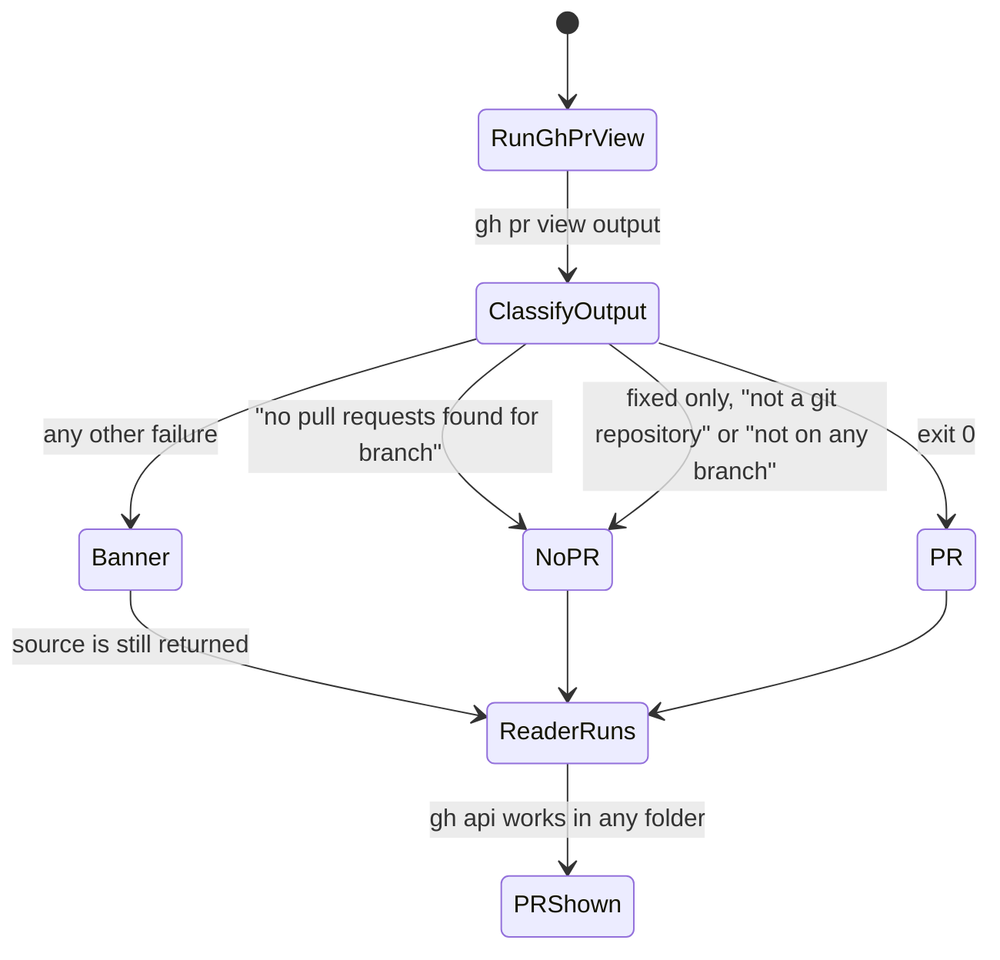

# Pull Requests Pane: When the Checkout Banner Shows

`CheckoutAlert.tla` models why the Pull requests pane of a Remote OpenCode Session shows "Could not read the current checkout's pull request using this OpenCode server's gh login." next to a pull request it read with that same login.

## Run

```bash
make -C docs/verification/pr-pane-checkout
```

The jar is `tla2tools.jar` v1.8.0, SHA-256 `fdffef247f563ef6edbfd44958d2a82db79e7564e07cb673262d896353fa6713`.
The 2026-11-20 run used a local copy of the previous pin because the release download no longer matched it.

TLC2 Version 2026.11.15.002146 (rev: bc1b506), OpenJDK 21.0.13.1. Each check finishes in about a second.

## What is modeled



- **Session folder** (`folder`): a Git branch, a jj workspace with a bookmark at or below `@`, a folder where no branch can be named (`detached`), or a folder that is not a repository (`notRepo`).
- **gh login** (`login`): working or broken.
- **What `gh pr view` prints** (`GhView`): checked by hand on 2026-11-20 with gh 2.104.0 and jj 0.47.1, using the exact command from `internal/rocketclaw/web/src/opencode-pr.ts:46`:
  - in `/Users/ucirello`, which is not a repository: `failed to run git: fatal: not a git repository`, exit 1;
  - in a colocated jj repository with no bookmark: `could not determine current branch: failed to run git: not on any branch`, exit 1;
  - `gh api --method GET repos/Rocketable/platform/pulls/1548` in `/Users/ucirello`: exit 0.
  The model does not assume which error `gh` prints first when both the folder and the login are bad, so it allows either.
- **Classifier** (`CLASSIFIER`): `current` is `opencode-pr.ts:47-58` before this fix, which counted only "no pull requests found for branch" as no checkout PR. `fixed` is the same lines after it: it also counts the "not a git repository" and "not on any branch" outputs above as no checkout PR. `broad` counts every failure as no checkout PR.
- **Concurrent lookups**: the checkout lookup, the history walk, and the PR reader run as separate processes. The reader waits for both lookups, as `thread-pr-panel.tsx:21-27` and `:75` do.

## Properties

- `AlertMeansLoginFailed`: the banner shows only when the gh login is broken. This is what the banner tells the user.
- `NoAlertBesideReadPR`: the banner never shows next to a PR read with the same login.
- `LoginFailureAlerts`: in a folder with a named branch, a broken login still shows the banner. This keeps a fix from hiding real login failures.

## Checks

On 2026-11-21, `make check` passed with TLC `2026.11.19.180144` (rev `bc1b506`) and OpenJDK `21.0.13.1`.

| Check | Classifier | Folders | Expected | Outcome | States (generated / distinct) |
|---|---|---|---|---|---|
| `repo-only` | current | branch, jj bookmark | pass | pass | 160 / 112 |
| `fixed` | fixed | all four | pass | pass | 384 / 264 |
| `screenshot` | current | not a repository | `NoAlertBesideReadPR` violated | violated | 90 / 66 |
| `current-claim` | current | all four | `AlertMeansLoginFailed` violated | violated, through `detached` | 153 / 137 |
| `too-broad` | broad | all four | `LoginFailureAlerts` violated | violated | 117 / 113 |

The `screenshot` trace matches the report: the session folder is `/Users/ucirello`, the login works, the history walk finds #1548, `gh pr view` fails with "not a git repository", the banner shows, and the reader shows the PR.

## Findings

- It is not a race. Every order of the three processes ends the same way. With a working login, the banner depends only on the folder the session runs in.
- The current classifier is truthful only in folders where a branch can be named (`repo-only` passes).
- Counting every failure as "no PR" hides real login failures (`too-broad`).

## What the model leaves out

- Moving a session to another folder while a lookup runs. `discoverOpenCodePR` reads the folder once, and the reader uses the same folder.
- Shell timeouts, proxy failures, and cancellation. `docs/verification/thread-pr/` covers those.
- Other `gh` error texts. The model has only the outputs listed above.
