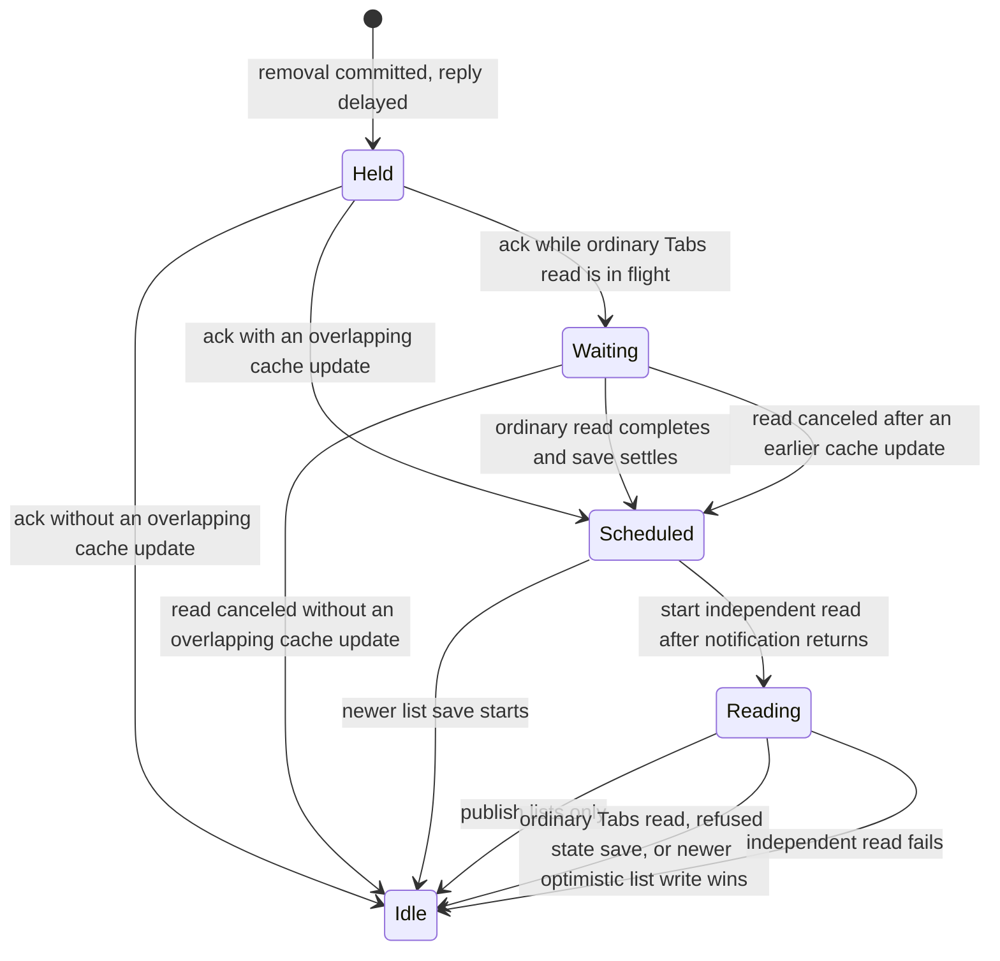

# Recent list refresh

A list save can commit before another window records a visit, yet reply after the saving window reads that visit. The save's reply is authoritative for the operation, not a snapshot of visits that happened later.

The model starts with a committed removal whose reply is held. The server can then record up to two further list changes. The saving window can have up to two ordinary reads, one at a time, a fold, one repair read, one refused tab-state save with a newer snapshot, and a superseding optimistic write. Each read takes a snapshot when it starts. An ordinary read can be held through the ack; its completion and the save settling in its notification are one step. Starting the independent read is a separate step after notification returns. A fold advances the cache timestamp and can cancel the ordinary read, not the independent one. The repair can fail without changing the settled reply.

`saveList` owns the held and waiting states, and compares the cache's data update count before writing its reply and scheduling the repair. `repairLists` reads from the same local server as the ordinary Tabs query, without joining it, and discards its result if a newer list save, an ordinary Tabs success, or a refused personal-state save's full snapshot wins. `tabsCall` cancels the repair only when applying that full snapshot to the repair's query, not for field-only writes. The repair changes only the cached lists, retaining the latest cache timestamp and the rest of the Tabs response.

Run `make -C docs/verification/recent-list-refresh`. A copy of the pinned jar can also be passed as `TOOLS` under the repository's `.tmp/`. The original ordering checks ran before implementation. The table records a later run that added the timestamp check, using OpenJDK 21.0.13.1, TLC `2026.11.26.020825` (`1138302`), and one worker. Each check reported under one second.

| Check | Result | Generated / distinct states |
| --- | --- | ---: |
| Guarded design | `VisitRecovered`, `NoStaleRepair`, and `StampPreserved` passed to depth 13 | 9,300 / 3,609 |
| No repair | `VisitRecovered` failed: a held reply lost a visit the ordinary read saw | 75 / 54 |
| Same notification | `VisitRecovered` failed: the read that was settling the ack also canceled the repair | 79 / 59 |
| Ignore the later read | `NoStaleRepair` failed: the repair published after a subsequent ordinary Tabs success | 673 / 392 |
| Ignore the refused save | `NoStaleRepair` failed: the repair published after a refused state save's newer snapshot | 704 / 411 |
| Ignore the newer mutation | `NoStaleRepair` failed: the repair published after a superseding optimistic write | 340 / 208 |
| Restore the starting timestamp | `StampPreserved` failed: a fold advanced the timestamp before the repair published | 561 / 337 |

`VisitRecovered` checks recovery on settlement when the prior read saw the visit and no failure or newer optimistic write intervened. `NoStaleRepair` checks publication order. `StampPreserved` checks that publishing the repair retains the current timestamp, not the timestamp when the repair started. No fairness or network delivery is assumed; the check does not prove that any request finishes, or model retry, identity changes, the server's list algorithms, or React rendering.

The browser test holds the removal reply while a visit from another window arrives, then checks that the visit returns without another focus and that the pending fold stays folded. Another case holds an ordinary read through the ack; starting the repair synchronously instead of after the cache notification reproduces the missing visit. Two cases hold the repair while a refused state save or an ordinary read publishes newer lists, then check that the newer rows remain.
