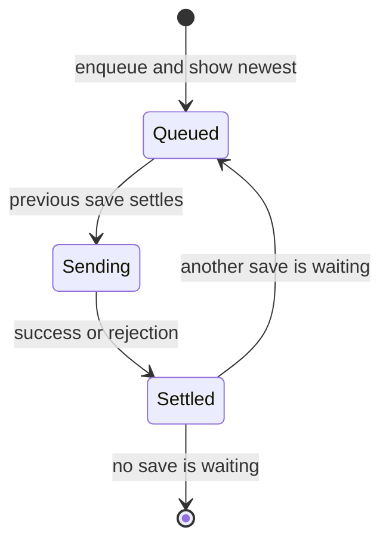

# Recent tab saves

When a save fails, only the newest save can clear the optimistic display. A failure does not detach later saves from the queue.

The model allows up to three saves in one browser. The queue represents the promise chain in `saveList`, and `pending` represents the save that owns the optimistic rows. A success or rejection can settle at any point after its request starts. The checks cover order and display ownership, not request delivery, cache refetches, or other browsers.

Run `make -k check` in this directory. TLC `2026.11.26.020825` (Java `21.0.13.1`) reported `00s` for each check.

| Check | Distinct states | Outcome |
| --- | ---: | --- |
| `fixed` | 16 | No error |
| `clear` | 10 | An older rejection clears the display, violating `NewestStaysVisible` |
| `reset` | 18 | Resetting the promise chain violates `SavesStayOrdered` |
