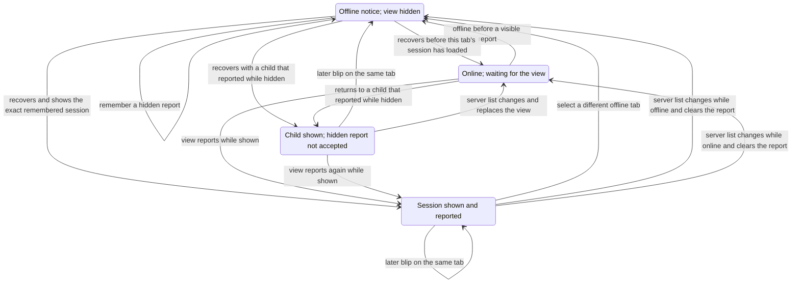

# Offline remote-session notice

The Web keeps one OpenCode view warm even while an offline notice covers it.
An embedded session report names what the view loaded, not necessarily what
the Web let the person see.

Run `make -k -C docs/verification/remote-session-offline` for all checks, or
append a check name from the table to run only that check. The Makefile
uses the pinned TLA+ tools and keeps its working files and logs under `.tmp/`.

`OfflineView.tla` has two open, configured tabs, each with one modeled subagent,
and a non-OpenCode route. The first tab starts offline. The user can select a
different tab and the listing can change either tab's offline flag. The
import can settle before or after either event. In `ui.tsx`, `start` still
decides when a view is wanted, and `show` publishes the visible route in a
layout effect. On a server configuration change, the mount effect disposes
the old view and clears its report before the show effect runs. `reportSession`
records a hidden report without claiming a route; `show` accepts that report
only for an exact match after showing the view. A report from the shown view
can still name a subagent of its route. The model tracks admission of the
current report, not whether the route was ever shown.

The model treats a React commit and its layout effect as one step and
distinguishes choosing a target, its router report, and its content painting.
It assumes the latest router target wins, as in the
[view navigation model](../oc-view-session/README.md). Starting a child
navigation and receiving its report are separate steps. Changing the target
cancels a pending child navigation. Both `fixed` and `hidden-child` let a
pending child report finish while the view is hidden. `fixed` checks that
this cannot dismiss the offline notice; `hidden-child` shows why the
broader continuity property does not hold. The browser can reproduce this
when a local tab covers the view: returning to the parent shows the child,
but a later blip can hide it. This also happens without the fix.
`shown-child` checks continuity only when child reports finish while shown.
There is no fairness assumption.
It models one server configuration change that replaces the view, but not
the server list itself, tabs closing, import failures, or discovery before
the offline flag is known.

| Check | Result | Distinct states |
| --- | --- | ---: |
| `fixed` | A hidden report cannot dismiss the notice while the selected tab is offline, including when a child report finishes while hidden. Reports match their route and are cleared on disposal. The shared view stays mounted while the configured servers stay the same. | 488 |
| `shown-child` | A painted view stays visible through a blip on the selected tab when child reports finish while shown. | 384 |
| `old` | Hidden report dismisses the offline notice (`NoOfflineWithoutVisibleReport`). | 23 |
| `guard-only` | Ignoring hidden reports loses the only report for a recovered session, so a later blip hides it (`OpenViewSurvivesOffline`). | 180 |
| `cut-start` | Selecting the first offline tab clears `start` and disposes the shared view even with the other tab open (`KeepWarmWithOpenTabs`). | 55 |
| `hidden-child` | A child reports while the parent is hidden. Returning to the parent displays the child but does not admit its report, so a later blip hides the view (`OpenViewSurvivesOffline`). | 428 |
| `stale-readmit` | A hidden parent report wrongly dismisses the notice after a child reported while hidden. The check fails even though the parent was previously shown (`NoOfflineWithoutVisibleReport`). | 425 |

Recorded with OpenJDK 21.0.13.1, PlusCal 1.12 and TLC 2026.11.26.020825.
The `fixed` and `shown-child` checks exited 0. Each negative check exited 12
with its named invariant violation. Each check took at most one second.
