# Retention of hidden cron runs: bounded verification

`RetentionHiddenRuns.tla` models RocketClaw's hourly retention pass (`PruneStateBefore` in
`internal/rocketclaw/backend/store.go`) over the conversations a scheduled cron run touches. A cron run is a hidden
(unlisted) conversation with retention `record` (`createConversation` in `store_dao.go`). As built, the pass dates a
hidden `record` conversation by nothing: it deletes one only when it has no messages at all
(`shouldPruneThreadConversation`, the "empty managed conversation" query). So a run that produced messages but no chat
shows (an empty reply, or a run never linked to a chat) is kept forever. `Shape` switches the rule for the run:

- `current`, as built: the run is deleted only when it has no messages and was created before the cutoff.
- `fixed`: a cron run that reports nowhere (`reports_to IS NULL`) and that no chat continues is dated by its newest
  message, as a listed chat is, and deleted in full when that is older than the cutoff.
- `unguarded`: every cron run is dated by its newest message, whatever chat shows it. This shape exists only to show
  why the fixed rule needs its ownership condition.

**Passing checks do not prove the code correct.**

## Run

From the repository root:

```sh
make -C docs/verification/retention-hidden-runs          # translate, then every check
make -C docs/verification/retention-hidden-runs fixed    # one check
```

Requires Java 11+, `curl` and Make. The Makefile downloads `tla2tools.jar` v1.8.0 and verifies SHA-256
`e1f11b75c4b5bc4478ba0ac5cb6ae28e40a01b0016bc33e0aa97da22dfdbcd7f`, as the other models here do. Tools, the
translator's copy, Java's temporary files, TLC's working files and each check's log go to the repository root's
`.tmp/verification/retention-hidden-runs/`. A passing check needs TLC exit 0 and `Model checking completed. No error
has been found.`; a check that must fail needs TLC exit 12 (safety) or 13 (liveness) and its named violation, so a
parse or tool error never counts.

On 2026-11-15 the tlaplus project replaced the v1.8.0 release's `tla2tools.jar`, so a fresh download fails the pinned
checksum. The pin was not changed. The recorded run used a jar with the pinned checksum already on the machine,
checked against the pinned SHA-256 and copied into this model's work directory before `make` ran.

## Hidden conversations the pass sees

Every unlisted conversation kind, where it is created, and what the retention pass does with it. Only the first row
changes.

| Hidden conversation | Created by | Retention, as built and after the fix |
|---|---|---|
| Cron and one-off cron run (`cron_run`, `one_off_cron_run`), `record`, no parent | `createConversation` with a `Run` | Reporting into a chat (`reports_to`) or continued by one: goes with that chat; in a sticky chat its old messages are trimmed and the then empty row is deleted by the empty rule. **Reporting nowhere and continued by no chat: as built, kept forever once it has a message; fixed, deleted in full 90 days after its newest message unless pending work keeps it.** |
| External MCP private run (`external_mcp_run`), `record` | `RegisterExternalMCPConversation` | Own rule (`pruneExternalMCP`), with its managed chat. Unchanged. |
| Subagent session (`subagent`), `record`, parent set | `startSubagent` | Goes with its top-level conversation's history; alone only when empty (empty rule). Unchanged. |
| Forked delegation copy, `record` or `nested`, parent set | `fork.go` | As a subagent. Unchanged. |
| Permission-review history (`review`), `private` under a Slack thread, cron run or External MCP run, else `nested` | `AppendChildEntry` | `private`: its own staleness (orphan rule); `nested`: goes with its parent. Not `record`, so never a candidate here. Unchanged. |
| Shadow Session (`shadow`), `record`, `shadow_parent` set | `bindShadows` | Never pruned alone; goes with its parent. Unchanged. |
| Agent Draft test chat (`agent_draft`), `record`, no parent | `startAgentDraftTestChat` | Empty rule only. Unchanged. |
| Remote OpenCode session, `remote` | `opencode.go` | Its own sync and prune. Unchanged. |
| Goal on a conversation that is not `record` | `BeginGoal` | `pruneGoal` asks the same function, which the fix limits to `record` rows. Unchanged. |

## A hidden cron run, step by step

```mermaid
stateDiagram-v2
  state "Running (hidden, record)" as Running
  state "Standalone: reports nowhere" as Standalone
  state "Shown in a chat (reports_to or continues)" as Shown
  state "Reports into a sticky chat" as InSticky
  state "Empty row" as Empty
  state "Deleted with entries, turns, steps, attachments, subagents" as Deleted
  state "Kept forever" as Leaked
  [*] --> Running
  Running --> Standalone: turn ends with an empty reply
  Running --> Shown: report opens or reuses a Web chat
  Running --> InSticky: report reuses the global sticky chat
  Standalone --> Shown: Open chat on the Cron page (ContinueRun binds it)
  Standalone --> InSticky: reported later
  Shown --> Deleted: the chat expires; the run goes with it
  InSticky --> Empty: sticky trim deletes messages older than 90 days
  Empty --> Deleted: empty rule, created before the cutoff
  Standalone --> Deleted: fixed, newest message older than 90 days and nothing pending
  Standalone --> Leaked: as built, once it has any message
  Standalone --> Standalone: pending work (waiting turn, scheduled message, background job, shadow binding)
```



## The model

Five conversations: `chat` (a listed Web chat), `sticky` (a sticky chat, never deleted), `run` (the cron run), `sub` (a
subagent session of `chat`) and `draft` (an Agent Draft test chat). Each has the age of its newest message (`none`,
`old` = before the cutoff, `fresh`) and a creation age. `chat` and `run` can have pending work. The run reports to
nothing, `chat` or `sticky`, and `chat` may continue it.

The `retention` process is weakly fair. It visits the candidates in the pass's order (sticky chats first, then the
recorded conversations) and handles one per atomic step:

| Model step | Code |
|---|---|
| visit `sticky`: old messages of it and of runs reporting to it become `none` | `pruneCandidate`, `pruneSticky` branch |
| `Pending(c)` | `conversationHasPendingWork`: the conversation and runs reporting to it |
| `LatestBefore(c)`: newest of the conversation and the runs it shows, else its creation, before the cutoff | `sessionLatestBefore` with the "read chat time" fallback |
| `EmptyManaged(c)`: no message in what it shows, created before the cutoff | the "empty managed conversation" query |
| `DatedByMessages`: `chat`, and in `fixed` a run with `reports_to IS NULL` that no chat continues | the "read chat time" query's `WHERE` |
| `Doomed(c)`: a chat takes its subagent and the runs it shows | `pruneCandidate` roots plus `ownedHistoryIDs` descendants |
| delete `Doomed(c)` | `deleteOwnedHistory`: entries, turns, steps, schedules, the rows, attachments queued for deletion |

Checking and deleting is one step: `pruneCandidate` locks the histories (`beginHistoryMutation`) and checks staleness
again inside that transaction before deleting.

The `world` process is not fair, so it may stop at any point. It appends a message to any live conversation (a message
in `sub` is also one in `chat`, since the turn that runs a subagent writes the parent's history), lets time pass the
cutoff (every `fresh` becomes `old`, every creation `old`), binds the run to `chat` or `sticky` when it reports nowhere,
lets `chat` continue the run (binding it to `chat`, as `ContinueRun` does), and turns pending work on or off.

## Properties

Safety, recorded by ghost state when a deletion happens:

- `NoFreshDeleted`: nothing with a message newer than the cutoff is deleted.
- `NoPendingDeleted`: nothing with pending work is deleted.
- `NoShownRunDeleted`: a run with messages is never deleted while a chat that retention keeps shows it.
- `OwnedKeepTheirRule`: a subagent session with messages is deleted only with its chat; an Agent Draft test chat with
  messages is never deleted.
- `TypeOK`.

Liveness, under the weak fairness of `retention`:

- `NoExpiredRunKeptForever`: a live run that reports nowhere or into the sticky chat, is not continued, has nothing
  pending, was created before the cutoff and has no newer message is eventually deleted or stops being so.
- `StickyRunGone`: the same for a run reporting into the sticky chat only.

Witnesses that the passing checks are not vacuous, each of which must fail with `Shape = "fixed"`:
`NeverStandaloneRunDeleted` (a standalone run with old messages is deleted), `NeverStickyRunDeleted` (a run in the
sticky chat is deleted), `NeverChatDeletedWithRun` (a chat is deleted with the run it shows) and
`NeverPendingRunKept` (an expired standalone run is kept for its pending work).

## Results

Recorded 2026-11-18 on Linux (aarch64, 16 cores), OpenJDK 21.0.13.0.3, TLC `2026.11.06.222357 (rev: d8fb231)`,
`pcal.trans` 1.12, one TLC worker. `make` ran every check in about 30 s. Every check matched its expected outcome.

| Check | Shape | Expected | Result | Generated / distinct states | Depth |
|---|---|---|---|---:|---:|
| `fixed` | fixed | every safety and liveness property holds | pass, complete state space | 407,290 / 47,181 | 25 |
| `current-safe` | current | every safety property holds | pass, complete state space | 398,722 / 45,687 | 25 |
| `current-sticky` | current | `StickyRunGone` holds | pass, complete state space | 398,722 / 45,687 | 25 |
| `current-leak` | current | `NoExpiredRunKeptForever` violated | violated | 167,519 / 22,577 | 12 |
| `unguarded-shown` | unguarded | `NoShownRunDeleted` violated | violated | 31,253 / 6,299 | 8 |
| `witness-standalone` | fixed | `NeverStandaloneRunDeleted` violated | violated | 3,957 / 1,192 | 6 |
| `witness-sticky` | fixed | `NeverStickyRunDeleted` violated | violated | 4,238 / 1,292 | 6 |
| `witness-chat` | fixed | `NeverChatDeletedWithRun` violated | violated | 1,525 / 589 | 5 |
| `witness-pending` | fixed | `NeverPendingRunKept` violated | violated | 12,669 / 3,074 | 7 |

Counts for failing checks are what TLC explored before it reported the counterexample.

`current-sticky` passing means a run reporting into a sticky chat already goes, as built: the sticky trim empties it
and the empty rule deletes the row in the same pass. The Go test `TestSessionServicePrunesOldState/sticky_message_window`
shows the same against PostgreSQL. Only standalone runs leak.

### Counterexample as built (`current-leak`)

1. The run gets a message; it reports nowhere.
2. Time passes the cutoff: the run's newest message and its creation are now old.
3. The pass visits sticky, chat, run, sub and draft, and returns to sticky. The run has messages, so the empty rule
   keeps it, and nothing else dates it.
4. Back to step 3, forever: the run stays live, expired and standalone.

### Why the fixed rule needs `reports_to IS NULL` (`unguarded-shown`)

1. The run gets a message, and time passes the cutoff.
2. The chat gets a new message, and the run reports into the chat.
3. The pass visits the run: dated by its own old message, it is deleted, while the chat it reports into is kept for
   its new message and would show the run's history.

## Limits

- Bounded: one chat, one sticky chat, one run, one subagent session and one Agent Draft test chat. A pass covers this
  finite model only.
- Time has two values per message, before and after the cutoff; the boundary instant is covered by the Go tests.
- Pending work is one flag per conversation for the chat and the run; the code's kinds (waiting turns, scheduled
  messages, background jobs, shadow comparisons) are one query, `conversationHasPendingWork`.
- A run reporting into a sticky chat that a second chat continues, and a run whose chat was removed without it (its
  `reports_to` set to null by the foreign key), are not modeled. The code keeps a run any chat continues.
- Busy workers (`errHistoryBusy`), lane turns without messages, External MCP sessions, Shadow Sessions, permission
  reviews and goals are not modeled; the table above shows the fix does not reach them.
