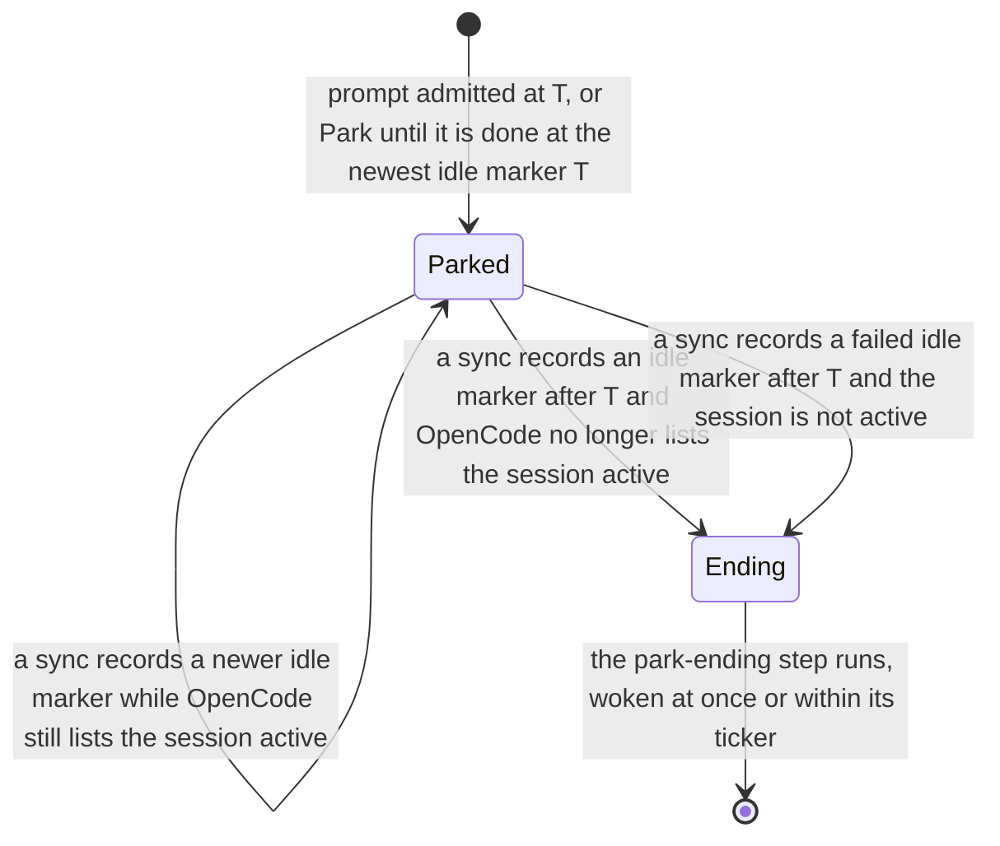

# Session done: bounded verification

`Doorbell.tla` models how a person's tab learns that a session is done: a fast signal wakes each check RocketClaw already runs, and those checks stay as the recovery path. For an OpenCode session it also models the race this design fixes: a park on a prompt must end only on an idle marker OpenCode writes after admitting that prompt. `OrderedLog.tla` models the design that was not chosen, which follows OpenCode's ordered session log instead. The plan is `docs/plans/2026-11-24-1409-feat-instant-session-done-plan.md`. **Passing checks do not prove the Go or TypeScript implementation correct.**

## Run

From the repository root:

```sh
make -C docs/verification/session-done              # translate, then every check
make -C docs/verification/session-done a-recovery   # one check
```

Requires Java 11+, `curl` and Make. The Makefile downloads `tla2tools.jar` v1.8.0 and verifies SHA-256 `67f9575c3b9ef7a0787b1bded34812862ffe79d711298e5a75b1a77720b19928`. The tools, the translator's copies, Java's temporary files, TLC's working files and each check's log go to the repository root's `.tmp/verification/session-done/`. A check that must pass passes only when TLC exits 0 and reports `Model checking completed. No error has been found.`; a check that must fail passes only when TLC exits 12 or 13 and names the violation the Makefile expects.

## The park



## Model to code

| Model process and labels | Code | Fairness |
|---|---|---|
| `Relay`: Send, Proxy, Respond | `internal/rocketclaw/frontend/rpc/relay.go`: forward the prompt, then record the park with the admission time from OpenCode's answer | weak: a person's send completes |
| `Person`: Want, Look, Write | Park until it is done on an OpenCode tab, reading the newest idle marker first (`ChangeAttention`) | weak: a person's park completes |
| `OpenCode`: Serve | OpenCode admitting a prompt; ending a busy period by deciding to settle, writing an idle marker (successful or failed) while still listed active, and settling into idle or straight into a successor | weak: turns end |
| `Lose`: Drop | a lost `session.status` event or a lost browser ring | none: loss is adversarial |
| `Sync`: Wait, Active, Stored, Idle, Again, Commit | the per-server loop in `internal/rocketclaw/backend/opencode.go`: `syncOpenCode` reads active sessions, the stored cursor and the newest idle marker, reads active sessions again after a new marker, and `storeOpenCodeSync` commits running, the cursor, and the turn-end step | weak: the loop keeps running |
| `Unpark`: Ring, End | `WakeParks` and `tickParks` in `internal/rocketclaw/backend/attention.go` | weak: the loop keeps running |
| `Browser`: Fetch, Show | the session listing loop and its ring subscription in `internal/rocketclaw/web/src/ui.tsx` | weak: an open window keeps polling |

## Properties

- `NoEarlyEnd` (invariant): an auto-park never ends before the busy period that ran its prompt has ended, and a manual park never ends before a busy period ends after it was set.
- `FreshSyncReady` (invariant): a sync that started after the session was done leaves an owed park ready to end.
- `ScreenCatchesUp` (temporal): once the session is done, the window eventually shows an owed park's tab unparked.

A park is owed an end when it is an auto-park, or when a busy period has ended since a manual park was set; Park until it is done on a session that is already idle waits for the next round of work, as `CONCEPTS.md` defines Parked.

## Assumptions

- OpenCode lists a session in `/api/session/active` from the start of a busy period until it settles, writes the idle marker before it settles, and starts a successor for a prompt admitted while settling in the same step that settles, so the session never leaves the list in between. This is OpenCode v2.4.1's `packages/core/src/session/run-coordinator.ts` (`active`, `settle`) served by `packages/server/src/handlers/session.ts` (`session.active`).
- A prompt admitted while a busy period still drains joins that period; OpenCode writes one idle marker per busy period.
- Each step a label names is atomic: one SQL statement, one HTTP read, or one in-memory channel send.
- Signals are lost only by `Lose`; the in-process park wake is never lost.
- Every park starts from `Init`. Parks open or paused by a question when migration 111 runs instead start from its backfill, which sets the threshold to the session's stored idle marker (one less when the park already saw its work end); `TestParkAfterIdleMigration` checks that those rows end like parks the model covers.

## What each check proves

On 2026-11-26, `make -k` with TLC `2026.11.26.020825` (rev `1138302`) and OpenJDK `21.0.13.1`
matched every TLC outcome (3 passes, 4 named counterexamples) in 9m 29s.

On 2026-11-24, `make` passed (exit 0, 21 minutes) with TLC `2026.11.19.180144` (rev `bc1b506`) and OpenJDK `21.0.13.1` on linux/aarch64 (16 workers). Every Doorbell check runs with `MaxSends = 2` and `MaxManual = 1`.

| Check | World | Required | Outcome | Distinct states | Depth | Time |
|---|---|---|---|---|---|---|
| `a-bells-only` | the design as built; no signal lost; no periodic check | every property | passed | 5,551,322 | 48 | 6 min 53 s |
| `a-recovery` | the design as built; feed events and browser rings may be lost; periodic checks run | every property | passed | 8,140,736 | 48 | 12 min 41 s |
| `a-no-racefix` | the design before this change, every signal delivered | `NoEarlyEnd` violated | violated | 49,537 | 17 | under 1 s |
| `a-no-recheck` | the design without the sync's second read of active sessions | `NoEarlyEnd` violated | violated | 276,499 | 19 | 1 s |
| `a-lossy-no-timers` | signals may be lost and no periodic check runs | `ScreenCatchesUp` violated | violated | 1,702,661 | 28 | 1 min 13 s |
| `c-replay` | the ordered session log, replayed after each of two disconnects | every property | passed | 3,174 | 26 | under 1 s |
| `c-no-replay` | the ordered log as `opencode serve` v2.4.1 serves it, with no replay | `ScreenCatchesUp` violated | violated | 2,620 | 23 | 1 s |

`a-no-recheck` is the counterexample that shaped the design: a sync reads OpenCode as idle before a prompt is admitted, the prompt arrives while the turn ahead of it settles, that turn writes its idle marker after the prompt's admission time, and the stale sync ends the new park before its turn runs. The second read of active sessions after a new idle marker closes it.

## Limits

- Bounded: two sends, one manual park, and one person, tab, session and server. Each server checks its own sessions, so several servers are several copies of this world.
- The model counts steps, not seconds. The recovery budget in seconds comes from the plan's KTD6 and the measured sync pass, not from TLC.
- Questions and the parks they end and bring back, background work, and turns OpenCode starts by itself are left out; the Go tests in `internal/rocketclaw/backend/opencode_test.go` and the `tab-attention` model cover them.
- The model trusts the OpenCode assumptions above; a different OpenCode version that drops a session from its active list between a busy period and its successor would need the model rerun.
