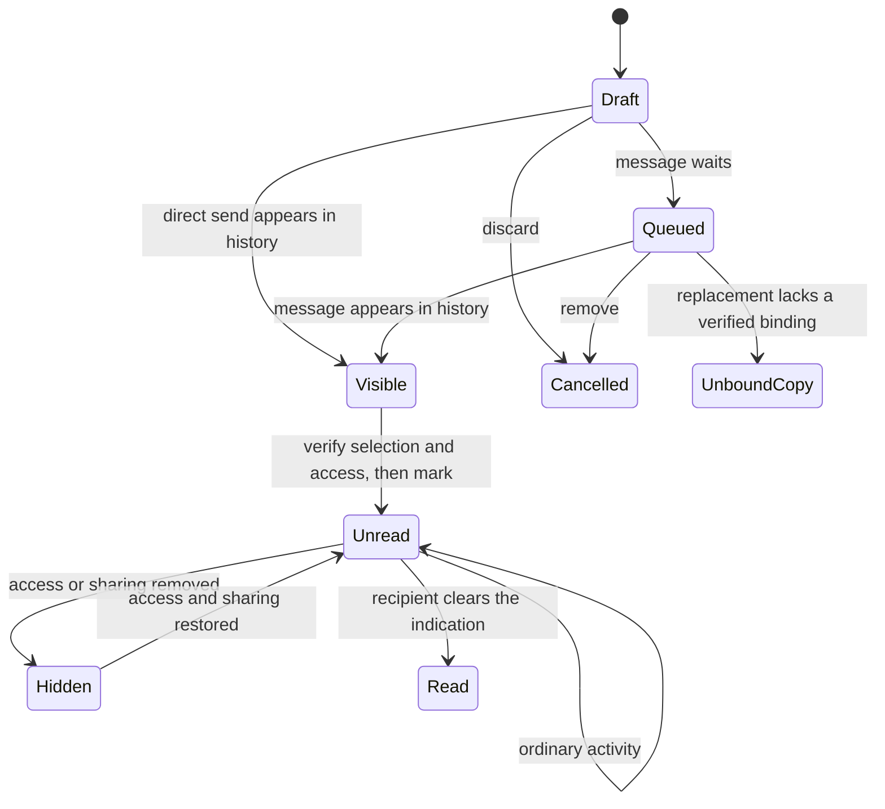

# Shared-session mention delivery

Run `make -C docs/verification/shared-session-mentions`. It checks the pinned tool, translates the PlusCal model, and runs the positive case and five cases that must fail for a named reason.

The model starts with one native message, one OpenCode message, one selected teammate, and one other person. Both people initially have access. Sending, cancelling, observing a visible message, changing access, and clearing an indication are separate steps. The modeled mark step checks an abstract eligibility flag and adds an unread indication together. The exposed view derives from the same flag; there is no separate read transaction in the model. The model does not check consumption of a binding, fairness, or delivery after a restart.

**Runtime boundary:** The model assumes that the existing directory yields a verified recipient, both backends can distinguish visible human messages from unbound copies, and each eligibility decision sees current state. It does not model direct messages, prove any of those assumptions, or establish that a rewritten queue item retains its selection.
