# `sticky: slack`: bounded verification

This PlusCal model checks the **design** of `sticky: slack` agents before any of it is built. These are Channel
Sessions, Thread Sessions, and the `slack_respond_in_thread` ratchet. **It does not prove any Go code correct.** A pass
means the properties hold for the finite worlds below, under the assumptions below. The step table maps each model
step to the code that will build it, or to the current code it changes.

**Gate status: VERIFIED** for the finite worlds below. On 2026-11-19, one `make -k` run of the final model exited 0:

- every required check finished with `Model checking completed. No error has been found.`;
- every must-fail check failed with its named violation (21 of 21).

The checks used TLC2 2026.11.15.002146 (rev `bc1b506`) and OpenJDK 21.0.13 on linux/aarch64, with 16 cores. The last
run followed the update that bounds the duplicate check to the last day of saved history (the `Window` process). No product
code exists yet. The model gates building it.

## Run

From the repository root:

```sh
make -C docs/verification/slack-sticky          # translate, then every check
make -k -C docs/verification/slack-sticky       # every check, even after one fails
make -C docs/verification/slack-sticky safety   # one check
```

You need Java 11+, `curl`, `shasum`, `perl` and Make.

The Makefile downloads `tla2tools.jar` v1.8.0 and checks its SHA-256
`7e53aa636dac8a3cb0533f343115c0548e03fc0ce5edc7739becf58d3d0fb84f` (build `bc1b506`, 2026-11-15). This change moved
that pin for every model, from build `d8fb231`, after the four checks in
`docs/packs/formal-modeling/stateful-design.md` held:

1. The download's hash matches the release's published digest.
2. Both builds came from the project's `master` runner.
3. `bc1b506` is one commit ahead of `d8fb231` ("Fix races in TLCSet/TLCGet with multiple workers").
4. Only three files differ: the manifest, `TLC.tla` (byte-for-byte equal to upstream at `bc1b506`), and
   `IdThread.class` (from the changed `IdThread.java`). No file was added or removed.

Everything else lives under `.tmp/run/slack-sticky-model/`: the tools, the translator's scratch copy, Java's
temporary files, TLC metadata, and every log, with full counterexample traces.

How the checks run:

- TLC is killed after 1800 seconds, and a killed run fails its check.
- Passing checks use 4 workers. Must-fail checks use one, so their first counterexample is the same on every run.
- A passing check must exit 0 and print `Model checking completed. No error has been found.`
- A must-fail check must exit 12 (safety) or 13 (liveness) and print its named violation. A parse error or a timeout
  never counts as the expected failure.

`SlackSticky.tla` holds the algorithm, the properties and the generated translation. Edit outside the
`BEGIN TRANSLATION`/`END TRANSLATION` markers, then run `make translate`. The constant `Mutation` is `"none"` for the
design. Each other value turns one design rule off, or keeps one behavior the current code has; the must-fail checks
use these.

## The design being checked

These decisions come from the owner's answers, and the model treats them as requirements:

- The channel's agent comes from the Slack channel settings, the same as today.
- `sticky: slack` is checked once, when a turn fires: when its session takes the request off its waiting line and
  starts running it. This covers every kind of turn (mentions, Web input, other agents' messages). If the agent is not
  `sticky: slack` then, RocketClaw logs a warning and the turn does not run. A turn resumed after a restart is the same
  turn continuing, and is not checked again. A warning strip in Web, like the sandbox one, is UI and is not modeled.
- **Channel Session**: one per channel and agent. A Root Slack Mention queues into it, and its reply goes to the top
  of the channel.
- **Thread Session**: one per thread and agent. A mention inside a thread queues into it, including a thread the bot
  did not open, and its reply goes into that thread.
- `slack_respond_in_thread` exists only on a Channel Session turn that a Slack mention started. Such a turn may call
  it at any point and any number of times. Calling `false`, or never calling it, keeps the reply at the top. The first `true` is terminal: the rest of the
  turn moves into the Thread Session of the turn's thread, where the tool does not exist.
- The Channel Session is told that the thread opened and is given the Thread Session's ID. Its agent can then write
  into it with `rocketclaw_sessions`.
- A busy Channel Session makes the next mention wait.
- Working state uses only Slack's native agent session status, on the turn's thread. The footer with the Web link stays
  as it is, and it links to the session that answered.

These are design choices the model makes, and each one is checked:

1. **The move is one transaction.** In one commit:
   - the Thread Session gets the running turn;
   - the Channel Session's lane is freed;
   - the Channel Session's history gets the note with the Thread Session's ID;
   - the root mention's hold on its thread is released.

   Counterexamples: `split-move` and `volatile-ratchet`.
2. **The ratchet is durable before anything acts on it.** The tool records `true` on the turn, and the move follows
   at the turn's next boundary. Turns without a Slack message of their own (Web input, agent writes, goals, wakes) do
   not get the tool, so a move always has the mention's thread to land in.

   Counterexample: `volatile-ratchet`.
3. **A Thread Session starts no turn while the thread's root mention still belongs to a Channel Session turn.** The
   hold is checked when a turn fires, not stored, so Web input sent to that Thread Session waits too. Stored `held`
   rows would not do: any Web input or agent write releases them today.

   Counterexample: `no-hold`.
4. **A thread mention admits its root mention first** when Slack delivers the thread mention before the root, in the
   same handler.

   Counterexample: `no-root-first`.
5. **A mention is deduplicated by its Slack message, across every conversation.** The session key includes the agent,
   so a duplicate delivery after the channel's agent changed would otherwise land in another session.

   Counterexample: `per-conv-dedup`, which is today's per-conversation query.

   The check reads saved history from the last day only (the `Window` process). Time is not modeled, so the window's
   length is an assumption: a day outlasts Slack's redeliveries (about 5 minutes) and the 10-minute root-first window.
   The model lets an admission record drop out only once no delivery can name its mention again.

   Counterexample: `short-window`, where a record may drop out at any time. Witness: `witness-expiry`.
6. **A thread under the bot's own top-level reply is a Thread Session, not a Report Thread.** The root must carry a
   Slack-side mark, such as message metadata, because the posting record in `steps` is gone once the turn closes.

   Counterexample: `legacy-report`, which is today's `slackThreadReplies` root check.
7. **`postOnce` must also find a lost top-level post.** `findPosted` pages `conversations.replies` of the posting's
   thread, so it never finds a top-level message.

   Counterexample: `thread-only-lookup`, which is today's code.
8. **A Slack Stop interrupts the turn it saw, wherever that turn now runs.** The interrupt compares the turn, not
   only the conversation.

   Counterexample: `stop-by-conv`. That is today's `InterruptConversation`, which stops whatever is running when the
   interrupt lands. In the trace, the seen turn moved into its thread, and the Channel Session's next mention got
   stopped instead.
9. **The status settles before the turn row closes**, as `finishResponse` does before `closeTurn` today.

   Counterexample: `settle-after-close`.
10. **A root's end, or its move, wakes the thread sessions it held.**

    Counterexample: `no-wake-on-release`.
11. **`sticky: slack` is checked when the turn fires**, and only then.

    Counterexample: `no-start-check`.
12. **The channel key includes the agent.**

    Counterexample: `key-without-agent`.
13. **The footer follows the move.**

    Counterexample: `no-footer-switch`.

```mermaid
stateDiagram-v2
    [*] --> Admitted: mention delivered (dedup by Slack message, status shown)
    [*] --> HeldInThread: mention in a thread whose root still belongs to a channel turn (root admitted first)
    HeldInThread --> Waiting: root moved or finished (hold released, thread session woken)
    Admitted --> Waiting: queued in the Channel or Thread Session
    Waiting --> Ignored: the turn fires while the agent is not sticky slack, warn (status settles)
    Waiting --> RunningChannel: pick in a Channel Session
    Waiting --> RunningThread: pick in a Thread Session
    RunningChannel --> RunningChannel: slack_respond_in_thread(false), or a crash (resumes)
    RunningChannel --> Ratcheted: slack_respond_in_thread(true) (durable)
    Ratcheted --> Ratcheted: post a top-level root when the turn has no Slack message
    Ratcheted --> RunningThread: move (one transaction, note in the channel, channel lane freed)
    RunningThread --> RunningThread: a crash (resumes in the thread)
    RunningChannel --> Delivering: answer ready (reply to the channel top)
    RunningThread --> Delivering: answer ready (reply into the thread)
    RunningChannel --> Delivering: Slack Stop on its thread (footer only)
    RunningThread --> Delivering: Slack Stop on its thread (footer only)
    Ratcheted --> Delivering: Slack Stop (still moves before the footer posts)
    Delivering --> Delivering: postOnce marker, post, record; a crash finds the lost post
    Delivering --> Settled: status settles unless another turn runs in that thread
    Settled --> [*]: row closes (a channel root releases its thread)
```



## What the model contains

The model's actors, each one a PlusCal process:

- **`Lane`**: one per session key, the session's Bridge. It does:
  - `pickLaterWork`;
  - the turn: root post, status, tool calls, move, finish;
  - delivery through `postOnce`;
  - settle, then close.
- **`Slack`**: the socket handler. It delivers each mention at least once, up to `Dups` more times, in any order. A
  mention under the bot's reply can only arrive once that reply exists.
- **`Submit`**: Web input into an existing Channel Session, Web input into a Thread Session (held or not), another
  agent's write into the Channel Session, and the channel agent's write into a Thread Session whose ID its note gave
  it.
- **`StopPress`** (a person; not fair) records the turn the in-memory session showed. **`StopDeliver`** interrupts
  later.
- **`Config`** (not fair): changes the channel's agent, and flips an agent's `sticky: slack`.
- **`Window`** (not fair): an admission record drops out of the duplicate check's one-day window, once Slack can no
  longer deliver its mention or, for a root, a mention in its thread.
- **`Lifecycle`** (not fair): up to `MaxCrashes` crashes. Each one is a crash plus restart in one step.
  - Kept: the database (conversations, queues, turn rows, the Step Journal, posting markers, notes) and Slack.
  - Lost: memory (wakes, shown statuses, in-flight posts, settle flags, pending events).
  - Restart behaves like `StartActiveTurns` (running rows resume) and `StartQueuedConversations` (sessions with
    waiting rows are woken).
- **`Settler`**: exists only for the `settle-after-close` mutation.

Item roles are fixed, so each world is picked by which items exist:

| Item | Role |
| --- | --- |
| 1, 2 | Root Slack Mentions |
| 3 | A mention in the thread of root 1 |
| 4 | Web input into the Channel Session |
| 5 | Another session's agent writing into the Channel Session |
| 6 | A mention under the bot's top-level reply to root 2 |
| 7 | The channel agent writing into the Thread Session that root 1 moved into |
| 8 | Web input into the Thread Session of root 1's thread |

### Atomic steps and the code

Each `either` branch of `Lane`, and each other process's step, is one atomic step. Its boundary is a transaction, a
Slack call, or one critical section.

| Step | Code (planned, or today's code it changes) | Boundary |
| --- | --- | --- |
| `Slack` admission | `handleAppMentionEvent` → `SubmitMention` (`frontend/slack/connector.go`, `backend/thread_bridges.go`). New: route to the Channel or Thread Session key, root first, dedup by `slack:<ch>:<ts>` across the channel's conversations (queued and running turns, and the last day of saved history), status shown | one "Slack mention admission" transaction (both items for root first) plus the status call |
| pick | `Bridge.pickLaterWork` → `activateInbound`/`claimQueueItem` (`backend/bridge.go`). New, in `activateInbound` for new turns: the thread hold (the request stays waiting), the running-row lane check, and the one `sticky: slack` check, ignoring with a warning. A resumed turn (`headRequest`) is not checked again | "turn start" transaction |
| root post | Web input mirrored at the top of the channel through `postOnce` (`frontend/slack/events.go`) | marker, Slack post, record |
| status | `startSession` → `setSessionStatus` on the turn's thread | Slack call |
| tool | new `slack_respond_in_thread` host tool, only on Channel Session turns a Slack mention started. `true` writes the ratchet step | one write, journaled by `recordHostCall` |
| move | new `moveTurn`, run by the channel's `Drain` (or by `handleInbound` when a Stop interrupted a ratcheted turn): the turn row, steps and attachments go to the Thread Session (created if missing, `slack_thread` set); the Channel Session's `running` is cleared; its history gets the note | one transaction, then wake both sessions |
| finish | `finishTurn` (`backend/store_dao.go`) | "finish" transaction |
| reply post | `sendTitledResponse` → `postOnce`, with the destination from the conversation row (`frontend/slack/events.go`). New: `findPosted` also searches channel history for top-level posts | marker, Slack post, record |
| settle | `finishResponse` → `settleSession` | Slack call |
| close | `closeTurn`. New: a Channel Session root wakes its thread's sessions | one transaction |
| stop | `handleAgentSessionStopped` → `InterruptThread`. New: look the turn up by thread, then interrupt only if that turn is still running, in whichever session holds it | in-memory lookup, later interrupt |
| crash | `app.go` startup order | restart |

## Properties

The Spec is `Init /\ [][Next]_vars` with weak fairness for `Lane`, `Slack`, `Submit`, `StopDeliver` and `Settler`.
People pressing Stop, configuration changes and crashes are not fair: they may happen, and nothing waits on them.

Safety (invariants):

- `OneOwner`: an item is in at most one place, either one session's running turn or one session's queue.
- `OneAdmission`: a Slack message is admitted at most once.
- `NoClobber`: a move never lands on a Thread Session that is running another turn.
- `HeldUntilRootSettles`: a Thread Session runs nothing while its thread's root mention is not yet admitted, waits, or
  runs unmoved in a Channel Session.
- `RatchetHonored`: once the tool has returned `true`, the reply is never at the top of the channel.
- `ReplyWhereTurnLives`: a reply goes to the top for a Channel Session turn, and into the thread for a moved turn or a
  Thread Session turn.
- `OneReply`, `OneRoot`: nothing is posted twice, even across a crash.
- `FooterMatchesSession`: the footer links to the session that answered.
- `OnlySlackAgentsRun`: only a `sticky: slack` agent starts a turn.
- `StopPrecise`: a Stop ends only the turn that its thread showed.
- `SessionAgentFixed`: every turn in a session runs as that session's agent.

Liveness:

- `Settles`: every queued item finishes.
- `MentionsAnswered`: every delivered mention is answered, stopped, or knowingly ignored, never dropped.
- `StatusClears`: in the end, no thread shows working without a running turn.
- `ChannelKnowsThread`: the Channel Session gets a note for every Thread Session its turns moved into.

Witnesses: each one claims a path never happens, and each must fail. A pass is only meaningful if these paths are
reachable:

- `NoMoveThenHeld`: a moved turn finishes after a crash, then the held thread mention runs.
- `NoReplyThread`: a mention under a top-level reply is answered.
- `NoWebHeldAfterMove`: Web input sent to a held Thread Session waits, and runs after the root's turn moved there.
- `NoStopAfterMove`: a Stop ends a turn that has moved.
- `NoIgnoredAtPick`: a turn that fires while its agent is not `sticky: slack` is ignored.
- `NoExpiry`: an admission record drops out of the duplicate check's window.

## Results

All checks below share these settings unless their row says otherwise:

- one agent;
- no duplicate deliveries;
- one tool-call step per turn;
- no crash, no Stop, no configuration change.

Required (must pass):

| Check | World | Properties | Distinct states | Depth | Time |
| --- | --- | --- | --- | --- | --- |
| `safety` | roots 1, 2; thread mention 3; Web input 8 into its Thread Session; each mention delivered up to twice; 2 tool-call steps; 1 crash | all invariants | 12,668,403 | 52 | 9m03s |
| `sources` | root 1, Web 4, agent write 5, thread write 7; 2 tool-call steps; 1 crash | all invariants | 106,052 | 46 | 6s |
| `stops` | roots 1, 2; thread mention 3; 2 Stops; 1 crash | all invariants | 5,146,716 | 41 | 2m11s |
| `config` | 2 agents; root 1, thread mention 3; up to twice; agent switch; sticky flip; 1 crash | all invariants | 105,206 | 30 | 3s |
| `replies` | root 2; mention 6 under its reply; up to twice; 2 tool-call steps; 1 crash | all invariants | 11,414 | 28 | 0s |
| `liveness-thread` | root 1, thread mention 3, Web input 8; up to twice; 1 Stop; 1 crash | all invariants and liveness | 133,620 | 38 | 2m23s |
| `liveness-channel` | roots 1, 2; 1 Stop; 1 crash | all invariants and liveness | 104,946 | 30 | 1m41s |
| `liveness-web` | root 1, Web 4; 1 crash | all invariants and liveness | 3,220 | 28 | 2s |
| `liveness-agent` | root 1, agent write 5, thread write 7; 1 crash | all invariants and liveness | 5,574 | 33 | 5s |
| `liveness-config` | 2 agents; root 1, thread mention 3; up to twice; agent switch; sticky flip | all invariants and liveness | 23,302 | 30 | 22s |
| `liveness-replies` | root 2, mention 6; up to twice; 2 tool-call steps; 1 crash | all invariants and liveness | 11,414 | 28 | 9s |

Liveness is checked in smaller worlds than safety. The two first liveness worlds tried both ran out of time at 1800
seconds, and neither found a violation before stopping:

- roots 1, 2 with thread mention 3, duplicates, a Stop and a crash: it had explored about 800,000 states;
- every source item together.

They were split into the worlds above, which together still cover each source of a liveness risk: holds, a shared
Channel Session, Web input, agent writes, configuration changes, reply threads, Stops and crashes. They do not cover
all of them interleaving in one run. The safety worlds are larger, but they check no liveness.

Must fail (each found its violation; the counterexample trace is in `.tmp/run/slack-sticky-model/<check>.log`):

| Check | What is turned off, or kept from today's code | Violation | States | Depth |
| --- | --- | --- | --- | --- |
| `no-ratchet` | one model step calls true and false, and the last call wins | `RatchetHonored` | 47 | 8 |
| `volatile-ratchet` | a returned true is kept only in memory until the move; a crash forgets it | `RatchetHonored` | 139 | 9 |
| `split-move` | the channel note is written after the move commits; a crash loses it | `ChannelKnowsThread` | 392 | 16 |
| `no-hold` | no hold check when a Thread Session's turn fires: a thread mention runs while its root waits | `HeldUntilRootSettles` | 8 | 3 |
| `no-root-first` | Slack delivers the thread mention first and the root is not admitted first | `HeldUntilRootSettles` | 7 | 3 |
| `per-conv-dedup` | **today:** dedup within one conversation; the agent changes between two deliveries | `OneAdmission` | 11 | 4 |
| `thread-only-lookup` | **today:** `findPosted` searches only thread replies; a crash after a top-level post | `OneReply` | 129 | 9 |
| `legacy-report` | **today:** a bot-rooted thread is a Report Thread; a mention under a reply | `MentionsAnswered` | 99 | 15 |
| `no-start-check` | no `sticky: slack` check when the turn fires; the agent is not `sticky: slack` then | `OnlySlackAgentsRun` | 9 | 4 |
| `key-without-agent` | the Channel Session key leaves out the agent; the channel's agent changes | `SessionAgentFixed` | 405 | 8 |
| `stop-by-conv` | **today:** a Stop interrupts whatever its conversation runs when it lands | `StopPrecise` | 574 | 10 |
| `settle-after-close` | the status settles from memory after the row closes; a crash in between | `StatusClears` | 292 | 15 |
| `no-footer-switch` | a moved turn's footer still opens the Channel Session | `FooterMatchesSession` | 46 | 9 |
| `no-wake-on-release` | a root's end clears its thread's hold but wakes nothing | `Settles` | 884 | 25 |
| `witness-move-held` | witness: a moved turn finishes after a crash, then the held mention runs | `NoMoveThenHeld` | 3,041 | 21 |
| `witness-reply-thread` | witness: a mention under a top-level reply is answered | `NoReplyThread` | 299 | 16 |
| `witness-web-held` | witness: Web input sent to a held Thread Session waits, then runs after the root's move | `NoWebHeldAfterMove` | 2,634 | 29 |
| `witness-stop-moved` | witness: a Stop ends a moved turn | `NoStopAfterMove` | 236 | 13 |
| `witness-ignored` | witness: a turn fires while its agent is not `sticky: slack`, and is ignored | `NoIgnoredAtPick` | 35 | 6 |
| `short-window` | the duplicate check's window is shorter than Slack's redeliveries | `OneAdmission` | 8 | 4 |
| `witness-expiry` | witness: an admission record drops out of the window | `NoExpiry` | 18 | 4 |

Four of the must-fail checks keep a behavior today's code has (marked **today**). Each of the four needs a change
before `sticky: slack` ships.

Two of the bugs the model found were fixed in the model before these runs:

- **The held flag was never set.** The admission computed it from the translated `exists'`, so the new session already
  looked existing. Assigning `held` before `exists` fixed it; `safety` found this.
- **`ChannelKnowsThread` read `notes` for an item with no session yet.** TLC reported this while running
  `split-move`.

## What the model leaves out

- **Losing an event on a crash (existing behavior).** The socket loop acks before handling
  (`frontend/slack/connector.go`), so a crash between the ack and the admission commit loses the mention. The model
  treats admission as atomic with delivery. The new behavior adds no window here: root first is the same handler and
  the same transaction.
- **Message content.** It does not model what text the moved turn carries, what history the Thread Session starts
  with, or what the Channel Session reads between mentions. Only ownership, placement, IDs and status are modeled.
- **Today's non-idempotent posts.** These are the overflow chunks, attachments and the checklist message. They are
  existing behavior and are not modeled.
- **Steers, Goals, Agent Pause, scheduled messages and shadows** in Channel and Thread Sessions are not modeled. They
  keep their existing rules.
- **Slack's own status expiry and refresh** (`pollSession`) are not modeled.
- **The Web warning strip, and the rule that hides `sticky: slack` agents from other surfaces**, are not modeled. They
  are UI and listing filters.
- **Small bounds.** These are 1 to 2 agents, at most 7 items, 1 to 2 tool-call steps per turn, 1 crash, and up to 2
  Stops. Behavior that needs more is not covered.
