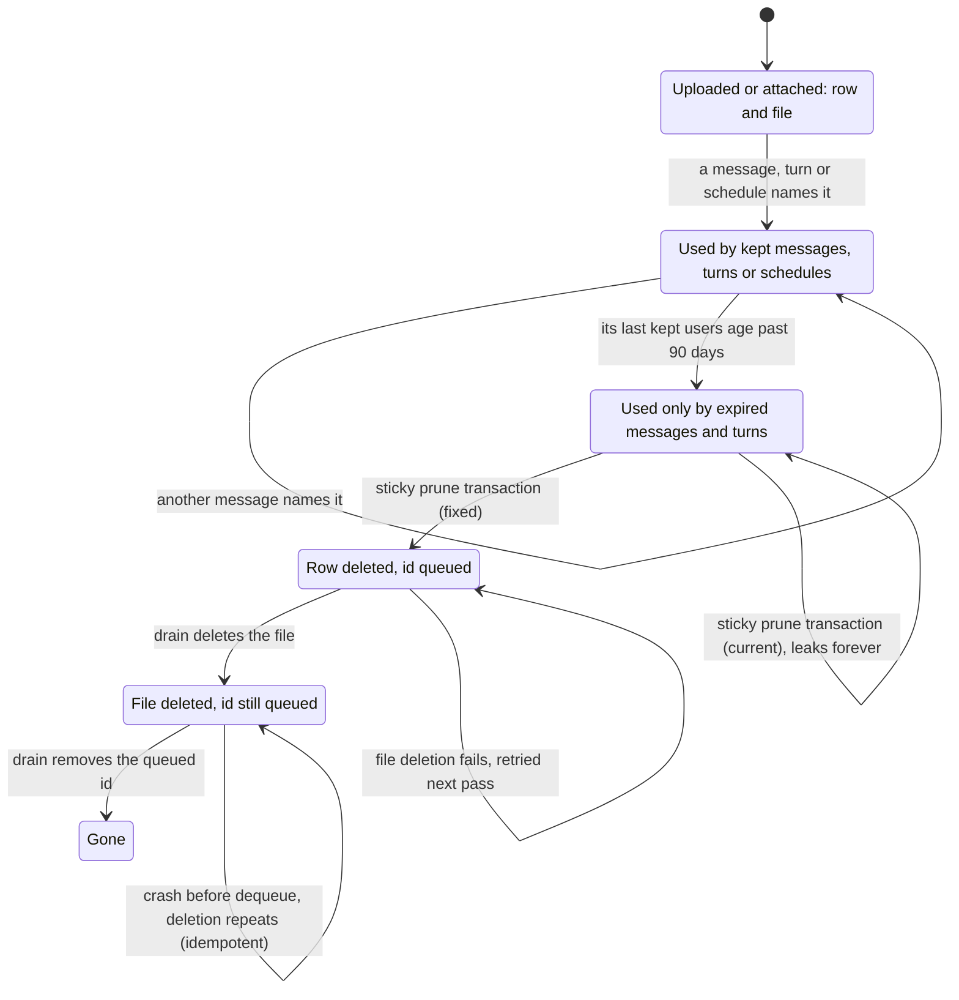

# Sticky chat attachments under retention: bounded verification

A Sticky Session is never deleted by retention. Instead the hourly prune
(`SessionService.pruneCandidate`, `pruneSticky` branch in
`internal/rocketclaw/backend/store.go`) deletes its messages older than 90 days
and its finished turns created before then, including those of runs that report
into it. Before this change the attachments those messages used were left behind:
their rows stayed in `attachments` and their files were never queued in
`pending_attachment_deletions`, so they stayed in storage forever.

The fix runs one more statement in the same transaction, before the messages
and turns are deleted. An attachment of the trimmed chats is removed, and its id
queued for file deletion, when at least one of the chats' messages, turns or
schedules uses it (its id appears in the payload, or it belongs to the turn) and
every one of them is about to be deleted. The prune pass then drains the queue
through `removeHistoryFiles`, as it does for deleted chats.

`StickyAttachmentRetention.tla` models that decision and the existing queue.
`Trim` selects the prune:

- `current`: as built before the fix, the prune never touches attachments.
- `fixed`: the prune removes the attachments that only deleted messages use.
- `unguarded`: the prune removes every attachment a deleted message uses, even
  when a kept one uses it too. It exists to show the guard is needed.

`Unlocked` selects how references are written outside the history lock:

- `fresh`: queued input and schedules, written without the history lock, use
  only attachments no message uses yet, as a Web upload does.
- `any`: such a write may reuse an attachment an older message already uses.

**Passing checks do not prove the code correct.**

## Run

From the repository root:

```sh
make -C docs/verification/sticky-attachment-retention          # translate, then every check
make -C docs/verification/sticky-attachment-retention fixed    # one check
```

Requires Java 11+, `curl` and Make. The Makefile downloads `tla2tools.jar`
v1.8.0 and verifies SHA-256
`e1f11b75c4b5bc4478ba0ac5cb6ae28e40a01b0016bc33e0aa97da22dfdbcd7f`, as the other
models here do. The tools, the translator's copy, Java's temporary files, TLC's
working files and each check's log go to the repository root's
`.tmp/verification/sticky-attachment-retention/`. A passing check needs TLC exit
0 and `Model checking completed. No error has been found.`; a check that must
fail needs TLC exit 12 (safety) or 13 (liveness) and its named violation.

On 2026-11-15 the tlaplus project replaced the v1.8.0 release's
`tla2tools.jar`, so a fresh download fails the pinned checksum. The recorded run
used a jar with the pinned checksum already on the machine, copied into the work
directory. The pin is unchanged.

## An attachment's life



## Model

Processes and atomic steps, with the code each one stands for:

| Process | Step | Code |
| --- | --- | --- |
| `User` | `Act`, upload branch | `SaveAttachment`: row and file in one transaction |
| `User` | `Act`, locked send | `appendSessionEntryDB` under `lockRunHistories`, serialized with the prune |
| `User` | `Act` then `Insert` | `putThreadQueueItem` / `putScheduledMessage`: no history lock |
| `Clock` | `Age` | a fresh, unpinned message passes the 90-day cutoff |
| `Retention` (fair) | `Prune` | the `pruneSticky` transaction under `beginHistoryMutation(roots, true)` |
| `Drainer` x2 (fair) | `Pick`, `Delete`, `Dequeue` | `removeHistoryFiles`: delete the file, then the queued id |

Pinned messages stand for queued input, live turns and recurring schedules:
they never age and the prune never deletes them.

Properties:

- `KeptResolve` (invariant): every kept message's attachments have their row
  and file.
- `RowHasBlob`: a row never outlives its file.
- `QueuedHasNoRow`: a queued id never has a row.
- `OnlyRemovedReferences`: the prune deletes only attachments a deleted message
  used, so a fresh upload no message uses yet is never touched.
- `NoLeak` (temporal): eventually always, every attachment used only by deleted
  messages has neither row nor file.

Fairness: `Retention` and both `Drainer`s are weakly fair, because the prune
runs every hour and the drain retries every pass. `User` and `Clock` are not
fair: people may stop, and time need not pass. File deletion may fail
`MaxFailures` times, then succeeds.

Assumptions:

- A send outside the lock does not span the 90-day cutoff: `Clock` does not age
  messages while a send is in flight.
- The prune runs only when the trimmed chats are idle (no open comparison, no
  running worker), as `beginHistoryMutation(..., true)` requires; the model's
  prune is one atomic step.
- Attachment ids are never reused.

## Checks and result

Bounds: `Files = {f1, f2}`, `Msgs = {m1, m2, m3}`, `MaxFailures = 1`, two
drainers. Deadlock checking is off, because every process waits for work.

| Check | Constants | Expected | Outcome | States (generated / distinct) | Depth |
| --- | --- | --- | --- | --- | --- |
| `fixed` | `Trim = "fixed"`, `Unlocked = "fresh"` | all invariants and `NoLeak` hold | passed | 164,250 / 55,101 | 21 |
| `current` | `Trim = "current"`, `Unlocked = "fresh"` | `NoLeak` violated | violated as expected | 13,224 / 5,021 | 11 |
| `unguarded` | `Trim = "unguarded"`, `Unlocked = "fresh"` | `KeptResolve` violated | violated as expected | 1,669 / 799 | 6 |
| `fixed-reuse` | `Trim = "fixed"`, `Unlocked = "any"` | `KeptResolve` violated | violated as expected | 5,483 / 2,548 | 7 |

Run on 2026-11-18 with TLC2 2026.11.06.222357 (rev d8fb231), pcal.trans 1.12,
OpenJDK 21.0.13 on Linux aarch64, one worker; the whole `make` took 32 seconds.

Counterexamples:

- `current`: two messages use `f1` and `f2`, both expire and are pruned, and
  the rows and files stay forever.
- `unguarded`: `m1` and `m2` both use `f1`; `m1` expires and the prune deletes
  `f1` while `m2` still shows it.
- `fixed-reuse`: `m1` uses `f1` and expires; a queued item naming `f1` is being
  written outside the lock when the prune deletes `f1`; the item lands naming a
  missing attachment. Whole-chat deletion has the same window today. In the
  code a missing attachment is skipped when the input is read
  (`inputAttachmentsDB` ignores `sql.ErrNoRows`), and only a typed
  `attachment:<id>` for a file more than 90 days old can reach it; a Web upload
  is always a new attachment.

## Left out

- Uploads that no message uses yet: the model shows the sticky prune never
  touches them; how else they are cleaned up is out of scope.
- Shadow comparison rows (`shadow_turns`) are not trimmed by the sticky prune
  and are not counted as users of an attachment.
- Forks copy attachments under new ids, so they are independent and not
  modeled.
- The text match is `strpos` on ids, as the rest of the store uses; ids are
  random and do not contain one another.
