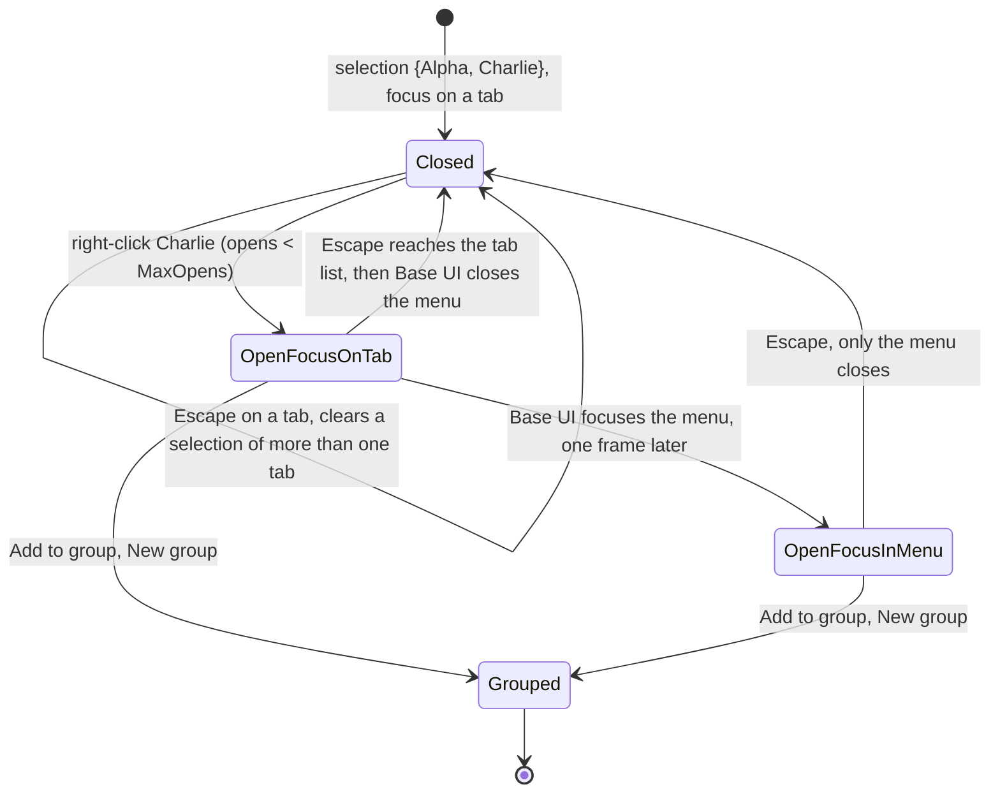

# Tab selection and Escape with a tab menu open: bounded verification

`TabSelectionEscape.tla` models one card's tab selection, its tab menu, and where keyboard focus sits, to check the fix
in `CardTabs`'s keydown handler: Escape on a tab clears a selection of more than one tab only while no tab menu is
open (`&& !menu`). Without that guard, Escape pressed right after a right-click, before the menu takes focus, reached the
tab, cleared the selection, and a later "Add to group" → "New group" on the same tab grouped that tab alone. **A pass
holds for this finite model, not for the TypeScript code.**

## Run

From the repository root:

```sh
make -C docs/verification/tab-selection-escape            # translate, then every TLC check
make -C docs/verification/tab-selection-escape fixed      # one check
```

Requires Java 11 or newer, `curl`, `shasum` and Make. The Makefile downloads `tla2tools.jar` v1.8.0 and verifies
SHA-256 `fdffef247f563ef6edbfd44958d2a82db79e7564e07cb673262d896353fa6713`. The tools, the translator's copy, Java's
temporary files, TLC's metadata and each check's log go to the repository root's `.tmp/run/tab-selection-escape-model/`.
A passing check must exit 0 and print `Model checking completed. No error has been found.`; a check that must fail must
exit 12 or 13 and print its named violation, so a parse error never counts as an expected failure.

## States



The guard decides what the `OpenFocusOnTab --> Closed` edge does to the selection: with `Guarded = TRUE` it keeps it,
with `Guarded = FALSE` (the old handler) it clears it. The `Closed --> Closed` edge clears it either way.

## Model

Tabs are Alpha, the tab in view, and Charlie, picked besides it. The selection is the tab in view plus the picked
tabs, as in `selectionIn`, so clearing the picked tabs leaves `{Alpha}`.

| Model step | Code |
| --- | --- |
| `User`, open branch: `menu := Charlie`, focus stays on the tab | `TabItem`'s `onContextMenu` → `CardEntry`'s `openMenu` → `Cards`'s `setMenu`; `cardFor` passes `menu` to every card, so `CardTabs` sees it |
| `User`, Escape branch, focus on a tab | `CardTabs` `onKeyDown`: `target.role === "tab" && event.key === "Escape" && selection.size > 1 && !menu` → `pick([])`; then Base UI's document-level dismiss closes the menu, and `TabMenu`'s `onOpenChange` calls `close` |
| `User`, Escape branch, focus in the menu | `TabMenu`'s `Menu.Popup` `onKeyDown` stops Escape, which never reaches the tab list (the popup is rendered by `CardMenuPopup` in `Cards`, outside `CardTabs`); Base UI closes the menu |
| `User`, group branch: `grouped := Targets(Selection)` | `CardMenuPopup`: `targets` is the selection when it holds `menu.path`, else `{menu.path}`; `menuItems` → `tabs.commands(..., targets, ...)` → the `group-new` command groups `paths` |
| `Focus` process: `focus := "menu"` while the menu is open | Base UI `FloatingFocusManager` moves focus into the opened popup through `enqueueFocus` (one `requestAnimationFrame` later), and skips it when the popup has closed by then (`shouldFocus` checks `openRef`) |
| constant `Guarded` | `TRUE`: the handler with `&& !menu`; `FALSE`: the handler before the fix |

Ghost variables, not in the code: `intended` is the selection the person means (Escape with no menu open and more than
one selected tab means "clear"; Escape with a menu open means "close the menu"); `lastEscape` records the focus, the
menu, and the selection before and after the latest Escape; `raced` records that an Escape reached a tab while a menu
was open.

## Checks

On 2026-11-21, `make check` passed with TLC `2026.11.19.180144` (rev `bc1b506`) and OpenJDK `21.0.13.1`.

All checks use `MaxOpens = 3`: the person can open the menu on Charlie and close it with Escape twice, then open it
again and group.

| Check | `Guarded` | Property | Must |
| --- | --- | --- | --- |
| `fixed` | TRUE | `TypeOK`, `EscapeWithMenuKeepsSelection` (an Escape while a menu is open never changes the selection), `GroupGetsSelection` (the new group is what the menu's rule gives for the selection the person meant: `{Alpha, Charlie}`, or `{Charlie}` after they cleared it on purpose) | pass |
| `intended` | TRUE | `EscapeWithoutMenuClears` (Escape on a tab with no menu open and more than one selected tab leaves only the tab in view) | pass |
| `old` | FALSE | `GroupGetsSelection` | find `Invariant GroupGetsSelection is violated.` |
| `old-escape` | FALSE | `EscapeWithMenuKeepsSelection` | find `Invariant EscapeWithMenuKeepsSelection is violated.` |
| `witness-race` | TRUE | `NoGroupAfterRace` (no group is made after an Escape reached a tab with a menu open) | find `Invariant NoGroupAfterRace is violated.` |
| `witness-clear` | TRUE | `NoEscapeClearsOnPurpose` (Escape on a tab with no menu open and more than one selected tab never happens) | find `Invariant NoEscapeClearsOnPurpose is violated.` |

`witness-race` shows the fixed model reaches the race and then makes a group, so `fixed` does not pass because the race
is unreachable; its trace ends with the group `{Alpha, Charlie}`. `witness-clear` shows the intended clear is reachable,
so `intended` is not vacuous. `old` reproduces the failure: open the menu on Charlie, Escape while focus is still on the
tab clears the selection to `{Alpha}`, reopen on Charlie, New group gives `{Charlie}`.

No liveness property is checked and neither process is fair: whether and when the person groups is their choice, and no
safety property depends on the menu taking focus.

## Recorded run

2026-11-17, `make -C docs/verification/tab-selection-escape`, one TLC worker, 1 GiB heap. OpenJDK 21.0.13.0.3, TLC
`2026.11.06.222357 (rev: d8fb231)`, `pcal.trans` 1.12. `make` exited 0 in 7.3 s, translation included; each TLC run
reported finishing in at most 1 s.

Rerun 2026-11-18 after the `tla2tools.jar` pin moved to build `bc1b506` (one upstream commit, "Fix races in TLCSet/TLCGet with multiple workers"): TLC `2026.11.15.002146 (rev: bc1b506)`, OpenJDK 21.0.13 on linux/aarch64; `make -k` exited 0.

| Check | Outcome | Exit | Generated / distinct states | Depth |
| --- | --- | ---: | ---: | ---: |
| `fixed` | `Model checking completed. No error has been found.` | 0 | 179 / 115 | 12 |
| `intended` | `Model checking completed. No error has been found.` | 0 | 179 / 115 | 12 |
| `old` | `Error: Invariant GroupGetsSelection is violated.` | 12 | 20 / 18 | 5 |
| `old-escape` | `Error: Invariant EscapeWithMenuKeepsSelection is violated.` | 12 | 4 / 4 | 3 |
| `witness-race` | `Error: Invariant NoGroupAfterRace is violated.` | 12 | 20 / 18 | 5 |
| `witness-clear` | `Error: Invariant NoEscapeClearsOnPurpose is violated.` | 12 | 3 / 3 | 2 |

The passing checks exhausted their state graphs. A failing check stops at its first counterexample, so its counts are
the explored prefix.

On this date the v1.8.0 release URL served a `tla2tools.jar` whose SHA-256 is
`7e53aa636dac8a3cb0533f343115c0548e03fc0ce5edc7739becf58d3d0fb84f`, so the Makefile's checksum step refused it. The run
used a `tla2tools.jar` already downloaded under the repository's `.tmp/` that matches the pinned SHA-256, placed in the
work directory, where the same checksum step accepted it.

## Assumptions and what is left out

- Two actors: the person (`User`) and Base UI's focus move (`Focus`). React and Base UI handlers run inside one key
  event, so one Escape is one atomic step: the tab list's handler reads `menu` as last rendered, then the menu closes.
- React has rendered the opened menu, and so `CardTabs` has the new `menu`, before the next key event. React's batching
  of `pick` and `setMenu` inside one event is not modeled beyond that atomic step.
- When the menu closes, focus is back on a tab. After New group, focus stays where the editor puts it; the model ends
  there.
- One card, one server, two tabs, one menu, always opened on Charlie. Opening the menu by keyboard (Shift+F10 or the
  menu key), opening it on Alpha, drag, clicks that change the selection, other servers' cards, the group editor,
  and the page-level Escape handler (which returns while a `[role="menu"]` exists) are left out. `menu` is shared by
  every card in the strip, so an open menu on another card also keeps the selection; the model has one card.
- At most three menu openings.
- Base UI closes an open menu on Escape wherever focus is: its dismiss hook listens for `keydown` on the whole document
  (`addEventListener(doc, 'keydown', closeOnEscapeKeyDown)` in `@base-ui/react/floating-ui-react/hooks/useDismiss.js`).

## Lean proof

`TabSelectionEscape.lean` states the tab list's Escape handler as a function of whether a menu is open, whether the
Escape reached a tab, the selection and the tab in view, and proves facts about it for every input, not a bounded world.
`make lean` (part of `make`) downloads Lean 4.36.0 for this machine into the repository's `.tmp/lean/`, checks its
SHA-256, and runs `lean` on the file; any unproved or false theorem fails the target.

| Theorem | What it says |
|---|---|
| `fixed_escape_keeps_selection_while_menu_open` | With a menu open, the fixed handler never changes the selection. |
| `fixed_and_old_escape_agree_without_menu` | With no menu open, the fixed and old handlers give the same result for every input. |
| `fixed_escape_on_tab_without_menu_clears_multi_tab_selection` | Escape on a tab with no menu open still clears a selection of more than one tab. |
| `old_escape_with_menu_open_groups_only_clicked_charlie` | The old handler clears {Alpha, Charlie} to {Alpha} with a menu open, so Charlie's menu then acts on Charlie alone, while the fixed handler keeps both. |
| `fixed_escapes_while_menu_open_keep_selection` | Any sequence of Escapes, each reaching the tab or the menu, leaves the selection unchanged while the menu is open. |
| `menu_after_escapes_while_open_targets_whole_selection` | After those Escapes, a menu opened on a selected tab acts on the whole selection. |

Recorded run: Lean 4.36.0 (linux aarch64) checked the file in about 0.24 s with no output and exit status 0. Every
theorem depends only on Lean's standard axioms (`propext`, and `Quot.sound` for the last two); none uses `sorry` or
`native_decide`. A deliberately false theorem, that the old handler keeps the selection while a menu is open, was
rejected with the unproved goal `targetIsTab = true → 1 < selection.length → [inView] = selection`.

Limits: the selection is a list, so "more than one tab" means a length above one, which matches the code's `Set` only
for a list without duplicates. The sequence theorem keeps the menu open for every Escape, which is stronger than the app
needs, since Base UI closes the menu on the first one; the TLA+ model covers the close. Like the model, the proof is
about the handler's rule, not about React or the browser delivering events.
