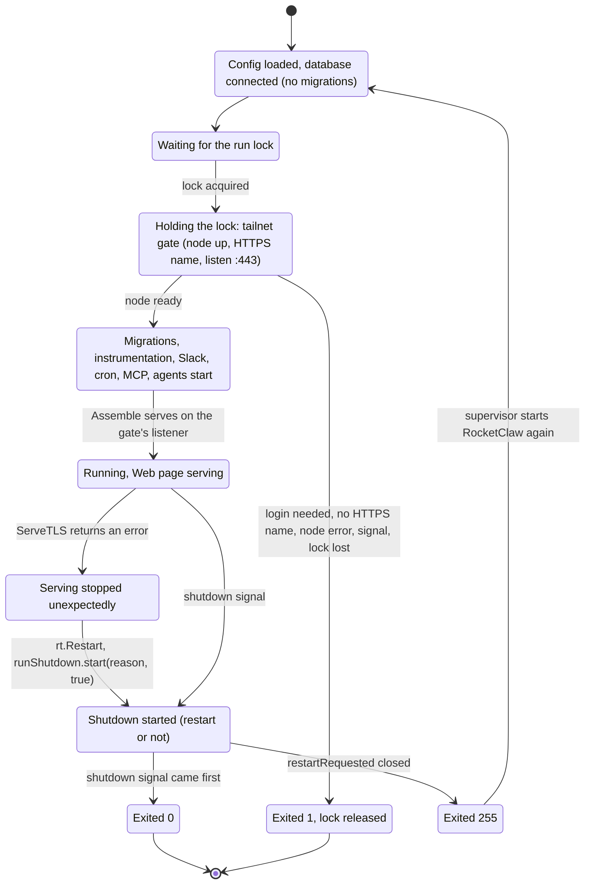

# Run lock and tailnet Web gate: bounded verification

`TailnetWebGate.tla` models the startup order of `rocketclaw run` for two RocketClaw processes that share one
database, and what happens when the Web page, served only over RocketClaw's own Tailscale node, cannot start or stops
later. `Design` picks one of three startup orders:

- `"current"`, as on main: migrate the database, take the run lock (`rocketclaw-run` in `rocketclaw_locks`), then start
  everything, the node last, in a goroutine. A node that needs a login logs a warning, and any other stop logs "Web
  HTTPS on the tailnet stopped"; either way RocketClaw keeps running without its page.
- `"gatefirst"`, an earlier proposal: start the node and check it, migrate, take the run lock, then everything else; a
  runtime stop requests a restart.
- `"fixed"`, as built: `backend.Run` (`internal/rocketclaw/backend/app.go`) opens the database without migrating it
  and calls `holdRunLock`, which creates the lock table with pglock's `TryCreateTable` and waits for the lock. The
  first thing `lockedRun.Run` does while holding it is `FrontendAssembler.Gate`. For `rocketclaw run` that is
  `processAssembler.Gate` (`cmd/rocketclaw/assemble.go`), which calls `startTailnet`: bring the node up (logging in
  with `web.tsnet.auth_key` when it is logged out), require an HTTPS name and listen on port 443. A gate error ends
  `lockedRun.Run`, pglock releases the lock, and `rocketclaw run` exits with code 1. Only then come PostHog
  instrumentation, the schema migrations (`newSessionService`), and everything else. The page serves on the gate's
  node and listener (`serveTailnet`); if `ServeTLS` returns anything but `http.ErrServerClosed`, `rt.Restart` requests
  a restart through `runShutdown.start(reason, true)`, `backend.Run` returns `ErrRestartRequested`, and `rocketclaw
  run` exits with code 255. The node closes before the lock is released.

**Passing checks do not prove that code correct.**

## Run

From the repository root:

```sh
make -C docs/verification/tailnet-web-gate          # translate, then every check
make -C docs/verification/tailnet-web-gate fixed    # one check
```

Requires Java 11+, `curl` and Make. The Makefile downloads `tla2tools.jar` v1.8.0 and verifies SHA-256
`fdffef247f563ef6edbfd44958d2a82db79e7564e07cb673262d896353fa6713`. The tools, the
translator's copy, Java's temporary files, TLC's working files and each check's log go to the repository root's
`.tmp/verification/tailnet-web-gate/`. A passing check needs TLC exit 0 and `Model checking completed. No error has
been found.`; a check that must fail needs TLC exit 12 (safety) or 13 (liveness) and its named violation, so a parse or
tool error never counts.

On 2026-11-15 the tlaplus project replaced the v1.8.0 release's `tla2tools.jar`, so a fresh download fails the pinned
checksum. The recorded run used a jar with the pinned checksum already on the machine, copied into the work directory.

## Lifecycle, as built



## The model

`Procs = {1, 2}`: two RocketClaw processes, each a weakly fair process that walks its design's startup order (`Order`)
and then runs, stops and, on exit code 255, starts again (the supervisor's restart is folded into the process).
`holder` is the run lock. Each step is atomic:

| Model step | Code |
|---|---|
| `lock`: wait until `holder = 0`, take it | `holdRunLock`, pglock `Do` and `AcquireContext` |
| `gate`: with `lasting = "none"` the node comes up, else exit `"1"`, releasing the lock | `lockedRun.Run` calls `Gate`; `processAssembler.Gate`, `startTailnet` |
| `migrate` | `newSessionService`, `initializeSessionDB` |
| `rest`: everything else starts and the page serves; in `"current"` a lasting cause leaves `web` at `login` or `failed` | `lockedRun.Run`, `processAssembler.Assemble`, `serveTailnet` |
| serving fails, at most `MaxFailures` times in the whole behavior | `ServeTLS` returns an error |
| `failed` handled: outside `"current"`, `RequestStop(p, "restart")` | `rt.Restart` |
| shutdown: `running` to `stopping`, close the server, then exit 255 if a restart was requested, else 0, releasing the lock | `lockedRun.Run`'s `select`, the deferred stops, `ErrRestartRequested`, `exitCodeError(255)` |
| exit 255 starts the process again from the top | the supervisor |
| `operator` (not fair): one shutdown signal to a running process | `shutdownSignals`, `shutdown.start("shutdown signal", false)` |

`RequestStop` is `runShutdown.start`: only the first caller sets `shutdown`, and only a restart caller sets `restart`.
`lasting` is chosen once and holds for both processes and across restarts: `"none"`, `"login"` (the node needs a login)
or `"https"` (the tailnet gives no HTTPS name). The two processes have separate node state, as two machines would.

Deadlock checking is off, because a process that exits with code 0 or 1 stops for good. Constants in every check:
`MaxFailures = 2`, `Procs = {1, 2}`.

## Properties

- `LockFirst` (safety): a process whose node is up, whose other parts started, or that is about to migrate holds the
  run lock. Nothing, migrations included, runs before the lock.
- `NoMigrateUnderOther` (safety): no process migrates while another holds the lock, so a newer build waiting for the
  lock never changes the database under the running one.
- `GateFirst` (safety): a process that is about to migrate, or whose other parts started, passed the gate.
- `GateFailureReleases` (safety): a process that exited with code 1 does not hold the lock.
- `NoRestartForLastingCause` (safety): exit code 255 only with `lasting = "none"`.
- `StopSignalStops` (safety): a process whose shutdown the signal started exits with code 0, even when serving fails
  during that shutdown.
- `WebComesBack` (liveness): with a transient cause, while some process runs and nobody stopped it, some process
  serves the page again.
- `LastingStops` (liveness): with a lasting cause, both processes end stopped with code 0 or 1, not running without the
  page and not in an endless 255 loop.
- `TypeOK`.

Witnesses that the passing check is not vacuous, each of which must fail with `Design = "fixed"`: `NeverWaits` (a
process waits for the lock while the other holds it), `NeverRestarted`, `NeverServesAfterRestart` (the page serves
again after a restart), `NeverGateFailure` (a gate failure exits 1), `NeverRestartRefused` (serving fails during a
signal's shutdown and its restart request is refused).

## Results

On 2026-11-21, `make all` passed with TLC `2026.11.19.180144` (rev `bc1b506`) and OpenJDK `21.0.13.1`.

Recorded 2026-11-18 on Linux (aarch64, 16 cores), OpenJDK 21.0.13.0.3, TLC `2026.11.06.222357 (rev: d8fb231)`,
`pcal.trans` 1.12, one TLC worker. `make` ran every check in about 7 s with the tools in place. Every check matched its
expected outcome.

| Check | Design | Expected | Result | Generated / distinct states | Depth |
|---|---|---|---|---:|---:|
| `fixed` | `"fixed"` | every property holds | pass, complete state space | 433 / 305 | 34 |
| `current-lock` | `"current"` | `LockFirst` violated | violated by an initial state | 3 initial | 1 |
| `current-under` | `"current"` | `NoMigrateUnderOther` violated | violated | 10 / 10 | 3 |
| `current-returns` | `"current"` | `WebComesBack` violated | violated | 265 / 166 | 15 |
| `current-lasting` | `"current"` | `LastingStops` violated | violated | 265 / 166 | 15 |
| `gatefirst-lock` | `"gatefirst"` | `LockFirst` violated | violated | 4 / 4 | 2 |
| `gatefirst-under` | `"gatefirst"` | `NoMigrateUnderOther` violated | violated | 25 / 20 | 5 |
| `fixed-waits` | `"fixed"` | `NeverWaits` violated | violated | 4 / 4 | 2 |
| `fixed-restarts` | `"fixed"` | `NeverRestarted` violated | violated | 77 / 67 | 11 |
| `fixed-returns` | `"fixed"` | `NeverServesAfterRestart` violated | violated | 136 / 113 | 15 |
| `fixed-stops` | `"fixed"` | `NeverGateFailure` violated | violated | 12 / 12 | 3 |
| `fixed-refused` | `"fixed"` | `NeverRestartRefused` violated | violated | 40 / 36 | 8 |

Counts for failing safety checks are the prefix explored before the first counterexample. The liveness checks explore
their whole state space.

### Counterexamples

As on main:

- `current-lock`: a process is about to migrate in its first state, without the lock.
- `current-under`: process 1 migrates and takes the lock; process 2 then migrates while process 1 holds it. This is a
  new build changing the database before it takes over.
- `current-returns`: the page serves, fails, and the process keeps running without it, forever.
- `current-lasting`: the node needs a login; the process warns and runs without its page forever.

The earlier gate-first design:

- `gatefirst-lock`: process 1 brings its node up before it holds the lock.
- `gatefirst-under`: process 1 passes the gate, migrates and takes the lock; process 2 then passes its gate, bringing
  its node up, and migrates while process 1 holds the lock.

As built:

- `fixed-stops`: with a node that needs a login, process 1 takes the lock, fails the gate, exits 1 and releases the
  lock before migrating; process 2 can then take the lock and fails the same way.
- `fixed-returns`: the page serves and fails, a restart is requested, the process exits 255 and releases the lock,
  starts again, takes the lock, passes the gate and serves.

## Limits

- Bounded: two processes, two transient serving failures in total, one shutdown signal. A pass covers this finite
  model only.
- Steps are atomic. In the code the gate can wait, with a warning, for device approval; pglock's heartbeat keeps the
  lock meanwhile, and a shutdown signal or a lost lock cancels the gate, which then fails with exit code 1. Transient
  gate failures, a lost lock and pglock's lease expiry after a crash are not modeled.
- Releasing the lock is atomic with the exit. In the code, pglock's release can miss the lock row when it cancels a
  heartbeat whose update already reached the database, so `holdRunLock` also deletes the row it owns after pglock
  returns.
- The two processes have separate node state. Two processes on one machine that use different databases and the same
  hostname share one node's state; nothing prevents that, and the model leaves it out.
- The supervisor restarts on 255 and only on 255; any other supervisor behavior is outside the model.
- Slack, cron, External MCP and PostHog instrumentation are folded into `rest`; `rocketclaw_restart` uses the same
  `runShutdown.start` once and is not modeled.
