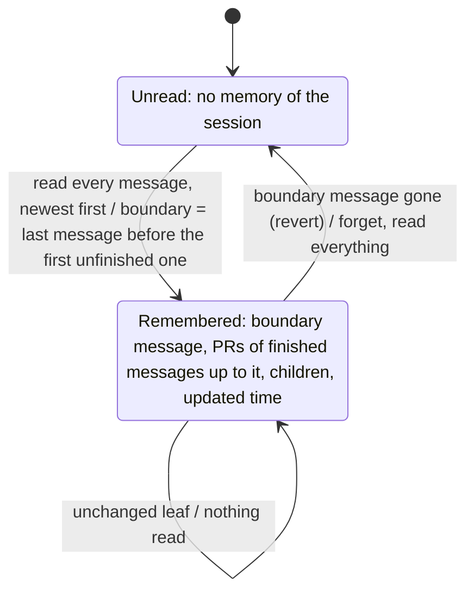

# Incremental pull request scan of an OpenCode thread: bounded verification

`ThreadPRScan.tla` models how `loadThreadPRs` in `internal/rocketclaw/web/src/thread-pr.ts` finds the pull requests of a
remote OpenCode thread without reading the whole session tree on every look. **Passing checks do not prove that code
correct.** The rest of thread PR discovery (classification, the pane, the watch, the reader, the shell) is
`../thread-pr`.

## Run

From the repository root:

```sh
make -C docs/verification/thread-pr-scan          # translate, then every check
make -C docs/verification/thread-pr-scan scan     # one check
```

Requires Java 11+, `curl` and Make. The Makefile downloads `tla2tools.jar` v1.8.0 and verifies SHA-256
`fdffef247f563ef6edbfd44958d2a82db79e7564e07cb673262d896353fa6713`. Tools, the translator's copy, Java's temporary files,
TLC's working files and logs go to the repository root's `.tmp/verification/thread-pr-scan/`. A passing check needs TLC
exit 0 and `Model checking completed. No error has been found.`; a check that must fail needs TLC exit 12 and the named
invariant violated.

## The design



## What each check proves

`Agreement`: a look that no server change interleaved with lists exactly the pull requests a full read of the current
tree would.

| Check | Shape | Expected | Result |
|---|---|---|---|
| `scan` | the design | `Agreement` holds | pass, 1,701,631 distinct states |
| `no-boundary-check` | the boundary is kept when its message is gone | violated: a revert leaves deleted messages' PRs listed | violated, as expected |
| `past-unfinished` | the boundary moves past an unfinished message | violated: that message is never read again | violated, as expected |
| `changed-parents-only` | only changed sessions list their children | violated: a grandchild that changed under an unchanged child is skipped | violated, as expected |
| `silent-spawn` | a subagent starts without changing its parent | violated: an unchanged leaf never lists its new child | violated, as expected |

`silent-spawn` names an assumption about OpenCode, not a rule of the code. On 2026-11-22 every one of the 12 sessions with
subagents on a live OpenCode server had been updated at or after each child's creation.

## Assumptions

- Message IDs increase; the server lists messages in ID order. A finished message never changes. A revert deletes a
  session's newest messages. A message may show a PR before it finishes.
- A session's updated time moves whenever its messages change, and is known from its parent's latest children listing;
  the thread itself is read on every look.
- Each session read and children listing is atomic; paging and its interleaving with server changes are abstracted.
- The scanner is weakly fair; the server is not.

## Recorded run

2026-11-22, linux/aarch64, OpenJDK 21.0.13.1, TLC `2026.11.19.180144 (rev: bc1b506)`, `pcal.trans` 1.12: every check
matched its expected outcome.

## Limits

- Bounded: three sessions in a chain (thread, child, grandchild), at most two messages per session, at most 4 server
  changes (3 in most failing checks) and that many looks plus two.
- Looks that a server change interleaved with are not checked; the next quiet look is.
- Several threads, cancelled looks and failed reads are not modeled.

## Lean proof

The TLC checks are bounded: three sessions, two messages each, four server changes. `ThreadPRScan.lean` proves the scan's
rule for any history. A message has an ID, whether it finished and the pull requests it shows; a server change adds a
message with a new, larger ID, rewrites an unfinished message, or reverts to a prefix; a look is the rule as
`openCodeSessionPRs` applies it to one session.

| Theorem | What it says |
|---|---|
| `look_correct` | A look lists exactly the pull requests a full read of the current messages lists, in the same order. |
| `look_remembers` | After a look, what the scan keeps still describes finished messages at the start of the log. |
| `change_wellFormed`, `change_remembers` | Every server change keeps message IDs increasing, and keeps the scan's memory either still at the start of the log or with its boundary message gone. |
| `every_look_lists_what_a_full_read_would` | From an empty server, for any interleaving of looks and changes, every look lists what a full read would. |
| `trusting_the_boundary_keeps_a_reverted_pull_request` | Without the boundary check, a revert leaves a deleted message's pull request listed; the rule as built does not. |
| `a_boundary_past_an_unfinished_reply_misses_its_pull_request` | Moving the boundary past an unfinished reply misses the pull request it shows when it finishes; the rule as built finds it. |

`make lean` (part of `make`) downloads Lean 4.36.0 into the repository's `.tmp/lean/`, checks its SHA-256 and runs
`lean` on the file. Recorded run 2026-11-22, linux aarch64: checked in about 0.5 s. The main theorem depends on
`propext`, `Classical.choice` and `Quot.sound`; the two counterexamples on no axioms; none uses `sorry` or
`native_decide`. A deliberately false theorem, that trusting the boundary always lists what a full read would, was
rejected.

Limits: one session at a time; the walk over subagents and their updated times is the TLC model's. Message IDs are
naturals compared numerically, where the code compares OpenCode's fixed-width IDs as strings.
