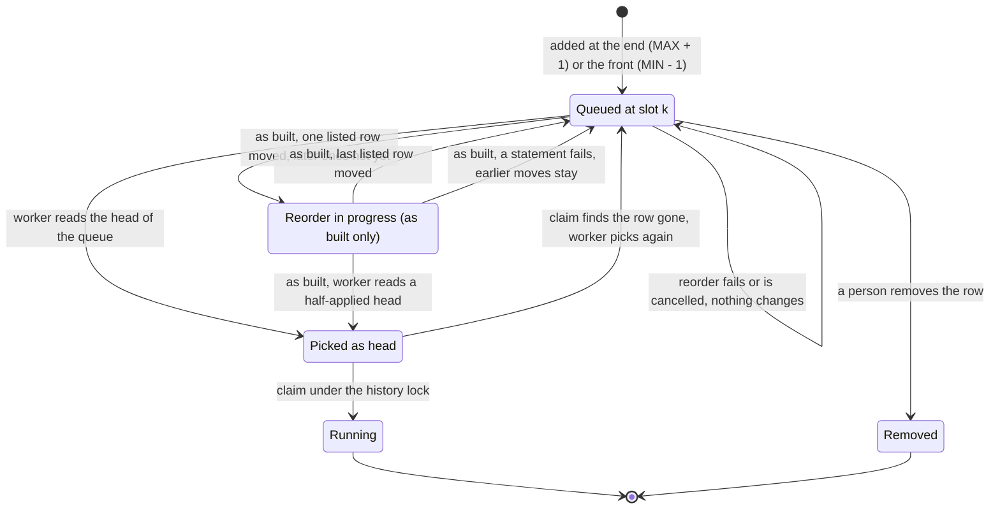

# Thread Queue reorder: bounded verification

`ThreadQueueReorder.tla` models how a person reorders a chat's Thread Queue while the chat's worker takes the next
queued item and other writers add and remove items. Web's queue panel sends the ids of the rows it shows, in the new
order, to `ReorderQueue` (`internal/rocketclaw/frontend/rpc/server.go`), which calls `Runtime.ReorderQueueItems`
(`internal/rocketclaw/backend/conversations.go`). `Fixed` switches between the two shapes of that call:

- `Fixed = FALSE`, as built before this change: one `UPDATE turns SET position = <index in the list>` per listed id,
  each its own statement, with no transaction, no lock, and no request context.
- `Fixed = TRUE`: one transaction that takes the conversation's history lock (`lockSessionHistory`, the lock the other
  queue writers and the worker's claim take) and runs one `UPDATE`. That statement ranks every queued row by
  `(position, created_at_unix_ns, input_id)`, gives the listed rows the slots the listed rows already hold, in the
  listed order, leaves every unlisted row in its slot, and renumbers all of them `0..n-1`. A failure or a cancelled
  request rolls everything back.

**Passing checks do not prove that code correct.**

## Why the listed order goes into the listed rows' own slots

The list a person sends can differ from the stored queue in three ways, and none of them is a mistake:

- the queue panel hides rows: `queueItems` drops items that are neither human nor from another session, so a queue with
  such a row is never listed whole;
- a row can run, be removed, or arrive between the panel's last refresh and the drop;
- a request may name an id that is gone (`TestRuntimeQueueAndLaterWorkOps` already sends `missing`).

Rejecting a mismatched list would fail every reorder in a queue with a hidden row, so the call applies the listed order
and keeps everything else where it was. Unknown ids are ignored, and a repeated id counts at its first place.

## Run

From the repository root:

```sh
make -C docs/verification/thread-queue-reorder          # translate, then every check
make -C docs/verification/thread-queue-reorder fixed    # one check
```

Requires Java 11+, `curl` and Make. The Makefile downloads `tla2tools.jar` v1.8.0 and verifies SHA-256
`67f9575c3b9ef7a0787b1bded34812862ffe79d711298e5a75b1a77720b19928`. The tools, the
translator's copy, Java's temporary files, TLC's working files and each check's log go to the repository root's
`.tmp/verification/thread-queue-reorder/`. A passing check needs TLC exit 0 and `Model checking completed. No error has
been found.`; a check that must fail needs TLC exit 12 (safety) or 13 (liveness) and its named violation, so a parse or
tool error never counts.

The 2026-11-18 run used a local copy of the then-pinned jar because a fresh download no longer matched it.

## A queued item, step by step



## The model

| Constant | Meaning | Value |
|---|---|---|
| `N` | rows queued at the start, ids `1..N`, positions `0..N-1` | 3 |
| `A` | rows added later | 1 |
| `Hidden` | rows the queue panel does not show | `{1}` |
| `Persons` | people reordering, each once | `{"alice", "bob"}` |
| `Fixed` | the shape above | per check |

Item ids follow creation order, so `(position, id)` stands for `(position, created_at_unix_ns, input_id)`. `DBOrder`
is the stored rows sorted that way. `order` is ghost state: the queue as it would be if every whole operation took
effect at once.

| Process and step | Code |
|---|---|
| `person.look`: read the shown rows | `ListQueue` → `queueItems`, which drops hidden rows |
| `person.submit`: pick any order of what was shown | the panel's drag, `ReorderQueue` |
| `person.submit`, `Fixed`: commit whole, or fail and change nothing | `ReorderQueueItems`: `beginStateTx`, `lockSessionHistory`, one `UPDATE`, `Commit` |
| `person.statement`, as built: one listed row per step, or fail | the old per-id `UPDATE` loop |
| `worker.pick`: read the head of `DBOrder` | `pickLaterWork` → `ThreadQueueForConversation` → `MixedLaterWork` |
| `worker.claim`: take the picked row if it still waits | `activateInbound` → `claimQueueItem` under `lockSessionHistory` |
| `adder.add`: one row at `MAX + 1` or `MIN - 1` | Web admission, Slack mention, agent writes (`stop` uses `MIN - 1`), all under `lockSessionHistory` |
| `remover.remove`: delete one row | `DeleteThreadQueueItem` |

Every process is weakly fair. The worker loops for ever; the others stop, so deadlock checking is off and the end
state is the worker waiting on an empty queue.

## Properties

- `DistinctPositions`: no two queued rows share a position, so the stored order never falls back on creation time.
- `OrderMatches`: whenever no reorder is half-applied (`pc # "statement"`), `DBOrder` equals the ghost `order`. A
  reorder is all or nothing, and adds, removes and claims keep the stored and ghost queue together.
- `WorkerFollowsOrder`: every pick is the head of the ghost `order`, the queue as last committed.
- `NoLossNoDup`: the stored queue, the run rows and the removed rows split the created rows with no overlap, nothing
  runs twice, and the ghost queue holds the stored rows once each.
- `Drained` (liveness): the queue is eventually empty for good.
- `TypeOK`.

Witnesses that the passing check is not vacuous, each of which must fail with `Fixed = TRUE`: `NeverChanged` (a
reorder changes the order), `NeverPickedAfterChange` (the worker picks after such a reorder), `NeverStaleList` (a
reorder commits a list that no longer matches the shown rows) and `NeverFailed` (a reorder fails and rolls back).

`NoStaleClaim` says the claimed row is still the head when it is claimed. It must fail with `Fixed = TRUE` too: it
records a limit, below, not a goal.

## Results

On 2026-11-26, `make -k` with TLC `2026.11.26.020825` (rev `1138302`) and OpenJDK `21.0.13.1`
matched every TLC outcome (1 pass, 8 named counterexamples) in 4m 11s.

On 2026-11-21, `make all` passed with TLC `2026.11.19.180144` (rev `bc1b506`) and OpenJDK `21.0.13.1`.

Recorded 2026-11-18 on Linux (aarch64, 16 cores), OpenJDK 21.0.13.0.3, TLC `2026.11.06.222357 (rev: d8fb231)`,
`pcal.trans` 1.12, one TLC worker. `make` ran every check in about 6 min with the tools in place: `fixed` took most of
it, every other check 1 s or less. Every check matched its expected outcome.

| Check | `Fixed` | Expected | Result | Generated / distinct states | Depth |
|---|---|---|---|---:|---:|
| `fixed` | TRUE | every property holds | pass, complete state space | 2,976,359 / 1,282,236 | 16 |
| `current-collide` | FALSE | `DistinctPositions` violated | violated | 310 / 229 | 4 |
| `current-half` | FALSE | `OrderMatches` violated | violated | 7,144 / 3,821 | 6 |
| `current-order` | FALSE | `WorkerFollowsOrder` violated | violated | 5,334 / 2,959 | 6 |
| `witness-changed` | TRUE | `NeverChanged` violated | violated | 57 / 48 | 3 |
| `witness-pick` | TRUE | `NeverPickedAfterChange` violated | violated | 366 / 284 | 4 |
| `witness-stale-list` | TRUE | `NeverStaleList` violated | violated | 320 / 251 | 4 |
| `witness-failed` | TRUE | `NeverFailed` violated | violated | 56 / 47 | 3 |
| `dispatch-window` | TRUE | `NoStaleClaim` violated | violated | 86 / 73 | 4 |

Counts for failing safety checks are the prefix explored before the first counterexample.

A check that `TypeOK`, `NoLossNoDup` and `Drained` also hold as built did not finish: the one-statement-per-row reorder
interleaves with everything else, and TLC stopped after an hour at 57,225,369 generated and 18,965,301 distinct states,
2,868,366 still queued, with no violation. It was removed and claims nothing.

### Counterexamples as built

Row 1 is hidden; the queue starts as 1, 2, 3 at positions 0, 1, 2.

`current-collide`: Alice sees 2, 3 and drops them unchanged. The first statement sets row 2 to position 0, which row 1
already holds.

`current-half`: Alice sees 2, 3 and drops 3 above 2. The first statement moves row 3 to position 0, the second fails.
Alice gets an error, but the stored order is 1, 3, 2 while the committed one is still 1, 2, 3.

`current-order`: an agent's `stop` write adds row 4 at position -1, so the queue is 4, 1, 2, 3. Alice sees 4, 2, 3 and
drops them unchanged. The first statement sets row 4 to position 0, tying with row 1, which is older, so the worker
picks row 1 while row 4 is first in every committed order.

With `Fixed = TRUE` each of these is one step: Alice's list lands in the slots of rows 2 and 3 (or 4, 2, 3), row 1
keeps slot 1, and positions become `0..n-1`.

### The dispatch window (`dispatch-window`)

The worker picks row 1, an agent's `stop` write then adds row 4 at the front, and the worker claims row 1. A reorder
committed between pick and claim does the same. The code has this window: `pickLaterWork` reads the head and hands its
id to the bridge, which claims that id when the turn starts. This change does not touch it.

## Limits

- Bounded: 4 rows, one hidden, two people reordering once each, one add, one remove. A pass covers this finite model
  only.
- Scheduled messages and parked rows (`park_after`) are left out. The reorder ranks every non-scheduled waiting row
  together, which keeps each park group's relative order.
- A row already handed to the bridge's request channel runs when the bridge reaches it, whatever the stored order
  says; the worker is modeled as reading the head and then claiming it, as `pickLaterWork` does.
- Writers that change positions without the history lock (`stashQueueItem` and its `releaseHeldInputs`) are not
  modeled; they can still collide with a concurrent reorder or with each other, as before this change.
- A list with a repeated id is not modeled; the code counts each id at its first place.
