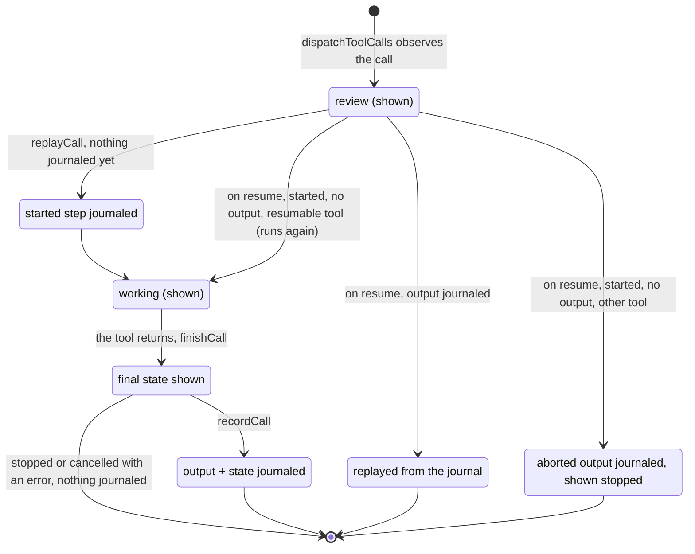

# Tool call states across a resumed turn: bounded verification

`TurnResumeCallState.tla` models the tool calls of one model response inside a RocketClaw turn: each call's output
and state being journaled, its state being shown in the Web's timeline, the server stopping between any two of those
database writes, and the turn resuming on the next start. The commit that adds this model ("keep a tool call's state
when a turn resumes") journals each call's state so that a resumed turn shows a finished call as it finished, instead
of marking every journaled call completed. The model checks that claim and the related guarantees. Run against the
first version of that change, it found three places where the code still changed a finished call's shown state; the
same commit fixes them (see [Findings](#findings)), and `fixed` checks the code as committed.

The model follows the code of that commit. The variant switches turn the three fixes off again to show what each one
prevents.

**Passing checks do not prove that code correct.**

## Run

From the repository root:

```sh
make -C docs/verification/turn-resume-call-state          # translate, then every check
make -C docs/verification/turn-resume-call-state fixed    # one check
```

Requires Java 11+, `curl` and Make. The Makefile downloads `tla2tools.jar` v1.8.0 and verifies SHA-256
`fdffef247f563ef6edbfd44958d2a82db79e7564e07cb673262d896353fa6713`. The tools, the translator's copy, Java's temporary
files, TLC's working files and each check's log go to the repository root's `.tmp/verification/turn-resume-call-state/`.
A passing check needs TLC exit 0 and `Model checking completed. No error has been found.`; a check that must fail needs
TLC exit 12 (safety) or 13 (liveness) and its named violation, so a parse or tool error never counts.

A fresh download no longer matches the pinned checksum. The recorded run used a jar with the pinned checksum already on
the machine, copied into the work directory.

## What the code does

Two stores are written, never in one transaction:

- **The journal** (`steps` rows, `Journal.Save`). Per call, keyed by `ToolCallKey`: first an empty "started" step, then
  the call's output and its state (`callStep.State`). The provider response itself is journaled
  before its calls run (`saveTurn(record, resp)`), and after all its calls end the tool outputs are saved with the turn
  (`saveTurn(record, nil)`), which clears the pending response.
- **The visible trace** (`turns.output_trace_json`, `Journal.SaveTrace`). Every `observe`/`finishCall` rewrites the
  whole in-memory trace of the run. The Web timeline shows it, and a completed turn's session entry takes the
  in-memory trace as its `OutputTrace`. A resumed run starts its in-memory trace from the copy saved with the turn
  (`steps` `<turn>/trace/…`), which, while the response's calls are pending, holds none of them.



A server stop can fall between any two of these writes.

## The model

One process, the **server**, weakly fair. Each step is one database write (or a read that decides the next write), so a
crash can fall between any two. The crash, a user stop, a graceful shutdown and a stop of a turn nobody runs are
choices in the same process; crashes are bounded by `MaxCrashes`.

| Constant | Meaning | Value |
|---|---|---|
| `Calls` | the response's calls | `{"r", "n"}` |
| `Resumable` | calls whose tool is resumable (`execute`, `task`) | `{"r"}` |
| `BgCalls` | calls that may move to the background | `{"r"}` (or `{}`) |
| `MaxCrashes` | server stops before the turn ends | 2 |
| `OldBuildFirst` | the first run is a build from before this change (journals no state) | per check |
| `UserStop` | the user may stop the turn | per check |
| `Cancels` | a graceful shutdown cancels running resumable calls | per check |
| `IdleStop` | after a restart, the user may stop the turn before it resumes (`stopIdleTurn`) | per check |

Variant switches (`TRUE` as built for `AbortedState`, `BackgroundState` and `IdleStopSettles`; `FALSE` as built for
`PreFix` and `RecordFirst`):

| Switch | `TRUE` means |
|---|---|
| `PreFix` | the code before calls journaled their state: a resumed turn shows every journaled call completed |
| `AbortedState` | a non-resumable call cut off by the stop is journaled with state `stopped` (`FALSE`: no state, the first version of the change) |
| `BackgroundState` | a call moved to the background is journaled with state `background` (`FALSE`: `completed`, or `stopped` when the turn was stopped meanwhile) |
| `RecordFirst` | the output is journaled before the final state is shown (as built: `finishCall`, then `recordCall`) |
| `IdleStopSettles` | stopping a turn nobody runs settles each call still shown `review`/`working`: its journaled state, else `stopped` (`FALSE`: left as is) |

| Variable | Meaning |
|---|---|
| `jStarted`, `jOut`, `jState` | the journal: started step, output (`none`, `real`, `aborted`), state (`none` = omitted) |
| `jobRow` | the background job's row exists (any status) |
| `outputsSaved`, `savedTrace` | the tool outputs are saved with the turn, and the trace saved with them |
| `terminal` | the turn's end is saved: `complete` or `stopped` |
| `visible` | the visible trace; `none` = the call is absent from it |
| `mem`, `observed`, `cs`, `outcome`, `stopReq`, `shuttingDown`, `errStop`, `fresh` | the run's memory, lost on a crash |
| `finishedAs` | ghost: the state shown when the call finished, in the run that journaled its output |
| `legacy` | ghost: the output was journaled by the older build |
| `firstFinal` | ghost: the first final state ever shown |
| `execs`, `rerunAfterJournal`, `jobsStarted`, `reusedRow`, `replayedAs`, `replays` | ghosts for the properties and witnesses |

A call's outcome when its tool returns: `completed`; `failed` (a tool error, or C+: a returned result with `.ok`
False, which `callExecute` returns as `toolResultError`, so `err != nil`); `bg` (moved to the background); after a user
stop, `stopErr` (returns the context error) or `stopNil` (returns a result anyway); after a graceful shutdown, a
resumable call's `cancel` (returns the context error) or `stopNil`.

### Mapping to the code

| Model step | Code |
|---|---|
| observe `review` | `looper.go` `dispatchToolCalls`: `l.observations.observe(ctx, &progress)` for each call, before any runs |
| not started: journal the started step, then show `working` | `replayCall`: `saveStep(…, &step)` with an empty step, then `observe` with `PublicProgressWorking` |
| started, no output, resumable: show `working`, run again | `replayCall`: `len(step.Output) == 0 && resumable` |
| started, no output, other tool: journal the aborted output, then show `stopped` | `replayCall`: `genericAbortedToolOutputText`, `step.State = PublicProgressStopped`, `saveStep(…, &step)`, `finishCall` |
| output journaled: show `cmp.Or(state, completed)` | `replayCall`: `state := cmp.Or(step.State, PublicProgressCompleted)`, `finishCall` |
| run | `call.tool.Call` / `CallReplay` under `callContext` (a resumable tool sees the turn's context; another tool is not cancelled by `ErrShutdown`) |
| `bg`: create the job row (unless it exists), show `background` | `background.go` `backgroundTool` → backend `backgroundTurn.Run` (`notedBackgroundJobs`, `createBackgroundJob`) → `finishCall(…, PublicProgressBackground)` |
| show the final state (skipped when shown `background`) | `dispatchToolCalls`: `state, errFinish = finishCall(…, state)`; `public_progress.go` `observeLocked` keeps a `background` entry and `finishCall` returns `background`, which `recordCall` journals |
| `stopErr`/`cancel`: nothing journaled, the run aborts | `failedCallResult` returns an error when `ctx.Err() != nil` |
| journal output and state | `recordCall(…, state)` → `callStep{Output, State}` |
| save the tool outputs with the turn | `runTurn`: `saveTurn(turnCtx, &record, nil, applied)` after `appendToolOutputReplay` |
| end the turn | completed: `Loop` appends the turn with `OutputTrace` = the in-memory trace; stopped: bridge `finish(…, TerminalStopped)` keeps `output_trace_json` |
| crash | the process dies; `turns` keeps phase `running`, the bridge resumes it (`headRequest`) |
| idle stop | `bridge.go` `InterruptActiveTurn` → `stopIdleTurn`: `settleStoppedTrace` (`harness.SettleStoppedTrace`: each call shown `review`/`working` gets its journaled state, `completed` for an output without one, else `stopped`), then `finishTurn(TerminalStopped)` |
| old build | a build before this change: `recordCall` journals no `State` |

## Properties

- `KeepsFinishedState` (the change's claim): a call whose output is journaled (not by the older build) and that is
  shown in a final state is shown in the state it had when it finished. Failed stays failed, stopped stays stopped,
  completed stays completed, background stays background. While a resumed run is between its `review` and the call's
  replay, the call shows `review`; that is not a final state.
- `NoReexecution`: a call never runs again once its output is journaled.
- `OneBackgroundJob`: a call starts at most one background job.
- `JournaledNeverRunning`: once the turn has ended, a call journaled before the stop is not shown `review` or `working`
  (the Web spins for those states, `web/src/ui.tsx` `toolStatus`, whether or not the turn runs).
- `NoRunningAfterTurn`: once the turn has ended, no call is shown `review` or `working`.
- `LegacyResumesCompleted` (documented compatibility): a call journaled by an older build, without a state, resumes as
  completed.
- `TurnEnds` (liveness): the turn ends.
- `VisibleFinalKept` (stricter than the claim, used to find where a shown state can still change): every final state
  shown equals the first final state the call was shown in, journaled or not.

Witnesses that must fail, so the passing checks are not vacuous: `NeverReplayedFailed`, `NeverReplayedBackground`,
`NeverStoppedReplayedTwice` (an aborted call resumed twice), `NeverRerun` (an unjournaled resumable call runs again),
`NeverReusedJobRow` (a re-run finds its job's row and starts no second job), `NeverLegacyFailedResumed` (an older
build's failed call resumes completed) and `NeverUserStopped`.

## Results

Recorded 2026-11-22 on Linux (aarch64, 16 cores), OpenJDK 21.0.13.1, TLC `2026.11.19.180144` (rev `bc1b506`),
`pcal.trans` 1.12, one TLC worker, after the fixes: `make -k all` ran every check in about 50 s with the tools in place
and exited 0, and the translation left `TurnResumeCallState.tla` unchanged. Every check matched its expected outcome.

| Check | Shape | Expected | Result | Generated / distinct states | Depth |
|---|---|---|---|---:|---:|
| `fixed` | the code as committed: all fixes, stops, shutdowns, idle stops | every property holds | pass | 116403 / 56314 | 35 |
| `fixed-legacy` | `fixed`, first run by the older build | every property holds | pass | 125820 / 61214 | 35 |
| `fixed-idle-stop` | `fixed`, idle stop, `IdleStopSettles` | every property holds | pass | 132651 / 65412 | 35 |
| `current-holds` | first version (fixes off), idle stop off | the properties it already kept | pass | 148445 / 74657 | 36 |
| `strict-record-first` | fixes, `RecordFirst`, no stops | `VisibleFinalKept`, `KeepsFinishedState` hold | pass | 14127 / 7921 | 31 |
| `pre-fix` | before calls journaled their state | `KeepsFinishedState` violated | violated | 1511 / 871 | 13 |
| `aborted-no-state` | `AbortedState` off | `KeepsFinishedState` violated | violated | 1624 / 936 | 13 |
| `background-completed` | `BackgroundState` off | `KeepsFinishedState` violated | violated | 3817 / 2211 | 15 |
| `current` | first version: fixes off, everything on | `KeepsFinishedState` violated | violated | 6250 / 3289 | 13 |
| `idle-stop` | fixes, idle stop, `IdleStopSettles` off | `JournaledNeverRunning` violated | violated | 755 / 481 | 10 |
| `strict-current` | fixes, as built order | `VisibleFinalKept` violated | violated | 1487 / 849 | 12 |
| `strict-stop` | fixes, `RecordFirst`, user stop | `VisibleFinalKept` violated | violated | 8952 / 4450 | 15 |
| `strict-cancel` | fixes, `RecordFirst`, shutdown | `VisibleFinalKept` violated | violated | 3027 / 1736 | 14 |
| `witness-failed` | `fixed` | `NeverReplayedFailed` violated | violated | 4988 / 2463 | 13 |
| `witness-background` | `fixed` | `NeverReplayedBackground` violated | violated | 10642 / 5276 | 15 |
| `witness-aborted-twice` | `fixed` | `NeverStoppedReplayedTwice` violated | violated | 8049 / 3961 | 14 |
| `witness-rerun` | `fixed` | `NeverRerun` violated | violated | 1920 / 1001 | 11 |
| `witness-reused-job` | `fixed` | `NeverReusedJobRow` violated | violated | 5107 / 2515 | 13 |
| `witness-legacy` | `fixed`, older build first | `NeverLegacyFailedResumed` violated | violated | 5079 / 2549 | 13 |
| `witness-user-stop` | `fixed` | `NeverUserStopped` violated | violated | 4495 / 2233 | 13 |

Counts for failing safety checks are the prefix explored before the first counterexample. `current-holds` shows that
the first version already kept `NoReexecution`, `OneBackgroundJob`, `JournaledNeverRunning`, `NoRunningAfterTurn`,
`LegacyResumesCompleted` and `TurnEnds` when no idle stop happens.

### Counterexamples

Each was read state by state.

- `pre-fix`: `r` fails, is shown `failed` and journaled `failed`; the server stops; the resumed turn shows it
  `completed`. This is the bug the change fixes.
- `aborted-no-state`: `n` (not resumable) is started, the server stops; the resumed turn journals the aborted output
  with no state and the server stops again before showing it; the next resume reads the step as an older build's and
  shows `n` `completed`, while the model was told the call was aborted. The same happens when the first resume did show
  it `stopped` (`witness-aborted-twice` shows that path, which the fix keeps `stopped`).
- `background-completed`: `r` moves to the background (job row created, shown `background`) and is journaled
  `completed`; the server stops before the tool outputs are saved; the resumed turn shows it `completed`.
- `current`: the as-built model fails first on the `aborted-no-state` path.
- `idle-stop`: `n` is cut off; the resumed run shows it `review`, journals the aborted output, and the server stops
  before showing `stopped`; after the restart the user stops the turn before it resumes. The turn ends with `n` shown
  `review`, a spinner that never ends.
- `strict-current`: `n` completes and is shown `completed`; the server stops before `recordCall`; the resumed turn
  aborts it and shows `stopped`.
- `strict-stop`: the user stops the turn, `r` returns the context error and is shown `stopped` (nothing journaled);
  the server stops before the turn's `stopped` end is saved; the turn resumes, `r` runs again and is shown `completed`.
- `strict-cancel`: a graceful shutdown cancels `r`, shown `stopped`; after the restart it runs again and completes.
  This is the intended behaviour of a resumable tool.

## Findings

Mismatches between the first version of the change (as at 5fbe215d) and the approved behaviour ("restart keeps failed
calls failed", C+, U2: a call's bookkeeping state is decided once and kept). All three are fixed in the commit that adds
this model:

1. **A cut-off call resumed twice shows completed.** `harness/looper.go` `replayCall`: the branch for a started,
   non-resumable call without output saves the aborted output with `step.State` empty, so the next resume reads
   `cmp.Or("", PublicProgressCompleted)`. Happens when the server stops again while the resumed turn has not yet saved
   its tool outputs. Reproduced in Go with a scratch test (not committed): a non-resumable tool cut off by the stop, a resumable
   tool cut off in the first two runs, three runs; the final `OutputTrace` shows the cut-off call `completed` (it shows
   `stopped` after two runs, as `TestLooperResumesTurnCutOffMidCall` checks). Fixed: `step.State =
   PublicProgressStopped` before that `saveStep` (`aborted-no-state` fails without it, `fixed` passes).
   `TestLooperResumeKeepsCutOffAndBackgroundStates` is that scratch test, committed.
2. **A call moved to the background shows completed after a resume.** `dispatchToolCalls` journals the state it
   computed (`completed`, or `stopped` if the turn was stopped meanwhile) for a call that `backgroundTool` already marked
   `background`; `observeLocked` keeps `background` only for the in-memory trace of that run. After a restart that
   resumes the turn before its tool outputs are saved, the call shows `completed` and the Web loses its "Moved to the
   background" line. Same scratch test: the call shows `completed` instead of `background`. Fixed: `finishCall`
   returns the state the call is shown in, `background` for a moved call, and that is what `recordCall` journals
   (`background-completed` fails without it, `fixed` passes).
3. **A turn stopped before it resumes can leave calls spinning forever.** `backend/bridge.go` `stopIdleTurn` ends a
   running turn no loop owns and keeps `turns.output_trace_json` as last saved, which after a restart can show a call
   `review` or `working` (the resumed run observed it, or the server stopped mid-call); `web/src/ui.tsx` `toolStatus`
   spins for those states even in an ended turn. That includes calls whose output was journaled. Not reproduced in Go
   or the Web: it depends on `stopIdleTurn` running for a turn after a restart and before its resume starts, a window
   whose width I did not measure. Fixed: `stopIdleTurn` settles such calls from the journal before it ends the turn
   (`IdleStopSettles`; `idle-stop` fails without it, `fixed` and `fixed-idle-stop` pass).
   `TestIdleStopSettlesCallsLeftRunning` checks it against the database: a journaled failed call shows failed, a
   journaled call without a state completed, a cut-off call stopped.

Not mismatches with the approved behaviour, recorded for the integrator:

4. **Shown before journaled.** `dispatchToolCalls` calls `finishCall` before `recordCall`; a stop between them leaves a
   call shown final with no journaled output, so the resumed turn runs a resumable call again or shows another call
   `stopped` (`strict-current`). The model's input after the resume matches the new shown state. Journaling first
   (`RecordFirst`) closes this window (`strict-record-first` passes).
5. **A user stop is kept only once the turn's end is saved.** A call the user stopped that returned the context error
   is not journaled; if the server stops before the bridge saves the `stopped` end, the turn resumes and a resumable
   call runs again (`strict-stop`).
6. **The background job path keeps one job per call.** A call re-run after a restart finds its job's row (whatever the
   job's status: still running, finished, or marked killed by `recoverJobs` while the server was down), starts no
   second job, and shows `background` (`witness-reused-job`, `OneBackgroundJob` holds as built).

## Limits

- Bounded: two calls (one resumable and background-capable, one not), at most two server stops, one stop per run. A
  pass covers this finite model only.
- Calls run in any interleaving, but each call's steps are atomic writes; the errgroup's limit and ordering are not
  modelled.
- The calls the dispatch rejects (tool not found, repeated call, permission denied or refused by review) are not
  journaled and are decided again on resume; not modelled. Nor are the host calls inside a script
  (`recordHostCall`, journaled per call) or the code-mode call records.
- The older build only journals in the first run; an older build's aborted output is not modelled.
- After a resume's first trace write, calls not yet observed in that run are absent from the visible trace until
  observed (`visible = none`); the properties do not count that as running.
- A turn ending in an error (`TerminalFailed`) and the next model response after the tool outputs are not modelled.
