# Turn secrets: bounded verification

**Status: passed on 2026-11-24.** Both passing checks pass and every
must-fail check finds its named violation. The first run of this model found
three flaws in the design as first planned; the design was changed and the
model rerun (see "Findings and fixes").

This PlusCal model checks a small abstraction of a turn secret's lifecycle:
the agent asks for a named secret, the person saves or declines it, commands
receive it as an environment variable, results are redacted before they are
journaled or handed to the model, and the value is erased when the turn ends.
The pass means the properties hold for this finite model under its
assumptions, not that the Go code is correct.

## Run

From the repository root:

```sh
make -C docs/verification/turn-secrets
make -C docs/verification/turn-secrets -k
make -C docs/verification/turn-secrets erase-without-run-reset
```

`-k` runs every check even after a passing check fails. Requires Java 11+,
`curl`, `shasum` and Make. The runner downloads `tla2tools.jar` v1.8.0 and
verifies SHA-256
`fdffef247f563ef6edbfd44958d2a82db79e7564e07cb673262d896353fa6713`. A passing
check must print `Model checking completed. No error has been found.`; a check
that must fail must exit 12 or 13 and print its named violation, so a parse
error never counts as an expected failure. Tools, Java temporary files, TLC
metadata and full logs with traces go to the repository root's
`.tmp/run/turn-secrets-model/`.

`TurnSecrets.tla` holds the PlusCal algorithm, the properties and the generated
translation. Edit outside the translation markers, then translate.

## Lifecycle

```mermaid
stateDiagram-v2
    [*] --> Requested: agent asks (Web turn only)
    [*] --> Refused: agent asks (any other turn)
    Requested --> Held: person saves
    Requested --> Declined: person declines
    Requested --> Withdrawn: turn ends / moves to background / stopped
    Requested --> Gone: process restarts
    Held --> Held: a command runs with it (output hidden), or it is asked again under the same name (value replaced, old value still hidden)
    Held --> Erased: native turn and its background jobs end; OpenCode run ends; next Web prompt relayed to the OpenCode session
    Held --> Gone: process restarts
    Refused --> [*]
    Declined --> [*]
    Withdrawn --> [*]
    Erased --> [*]
    Gone --> [*]
```



## Model

Processes:

- `Native`: one native turn. It may ask up to twice, under either of two
  names (asking again under a held name replaces the value given to later
  commands, and the store keeps the replaced value for redaction), start one
  background job, run one Code Mode command, and finish. While waiting on an
  ask it gets the answer, a decline, or withdraws the request (stopped,
  failed, or moved to the background), and then may keep working.
- `Job`: one background job. It holds the turn, receives the values held when
  it starts, prints all of them, and releases the turn.
- `Person`: posts Save or Decline once per request, at any time, including
  after the request ended. A post for a request that is not pending stores
  nothing.
- `OpenCode`: one root session with two consecutive runs. Each run is prompted
  from the RocketClaw Web or not. Relaying a Web prompt erases the store the
  previous run left, so each Web-prompted run starts with a fresh store; a
  prompt sent some other way does not pass through RocketClaw and erases
  nothing. A run may ask once (refused when not prompted from the Web), may
  run one command through the command tool, and ends. The command tool takes
  a snapshot of the values it gives the command and redacts that command's
  output against the snapshot and whatever the store still holds. The run's
  end produces an end-of-run event or the event is lost. An ask may be
  aborted, which withdraws it and ends the run.
- `Follow`: processes end-of-run events, in any order and with any delay;
  each erases the root's store, current and replaced values, and withdraws
  its pending request. A late event for run 1 can therefore erase run 2's
  store; run 2's later commands then get no secrets and the agent must ask
  again. That trades availability for safety and is accepted.
- `Sync`: the periodic sync. While the root is idle and a run ended that it
  has not handled, it erases the root's store and withdraws its request.
- `Crash`: one process restart, at any point between steps. It empties every
  store, current and replaced values, turns pending and answered requests into `gone`, drops every
  in-memory copy (job, in-flight command, answer handoff), ends the native
  turn, and replays the native turn's asks.

Values are abstracted to the request that saved them, so a value carries the
turn or run it belongs to. Command output is the set of values the command
received (worst case: it prints all of them). The journal and model input
are the sets of raw values that reached them; redaction removes the values
the store knows when it runs, current and replaced. The end of a native turn
(the last `turnRoot` release) and of an OpenCode run erases both.

Initial state: no stores, no requests, empty journal and model input.

Native and OpenCode turns share no store, request or copy, so they are checked
as separate cases (`Case`). Checked together, the state space passed 57
million distinct states in 20 minutes without finishing.

`Variant` selects a design change that a must-fail check uses:
`erase-at-run-end` erases the native store when the foreground run ends even
while the job holds the turn; `no-inner-redaction` journals the Code Mode
call's result before redacting it; `no-replaced-redaction` drops a replaced
value from redaction when its name is saved again; `erase-without-run-reset`
does not erase the store when a new Web prompt is relayed, so only end-of-run
events and the sync erase.

## Properties

Invariants:

- `JournalNeverHoldsValue`: the journal never holds a raw value.
- `ModelInputNeverHoldsValue`: model input never holds a raw value.
- `NoValueCrossesTurns`: no command receives a value saved in a different
  turn or run.
- `EndedTurnHoldsNothing`: once the native turn ended and nobody holds it, its
  store (current and replaced values), the job's and the in-flight command's copies, and any answer handoff
  are empty; once RocketClaw handled an OpenCode run's end, the store holds
  none of that run's current or replaced values and its request is not pending.
- `LateSaveStoresNothing`: no answer is handed over for a turn that ended.
- `CrashLeavesNothing`: after a restart no store holds, as current or
  replaced, a value saved before it, and a replayed ask never says `saved`.

Temporal properties:

- `RequestsSettle`: every pending or answered request ends saved, declined,
  withdrawn, refused or gone.
- `NativeValuesErased`: once the native foreground run finished, the native
  store, current and replaced values, is eventually empty.
- `OpenCodeValuesErased`: once an OpenCode run ended, the store eventually
  holds none of its current or replaced values.

The fixes did not weaken any property; all three temporal properties hold.

## Fairness and bounds

`Native`, `Job`, `Person`, `OpenCode`, `Follow` and `Sync` are weakly fair:

- `Native`: a running turn eventually finishes; while it waits on an ask its
  withdraw step stays enabled, so a turn whose person never answers still ends.
- `Job`: a background job eventually finishes and releases the turn.
- `Person`: a person who sees the form eventually answers, unless the turn
  ends first.
- `OpenCode`: a running OpenCode run eventually ends.
- `Follow` and `Sync`: RocketClaw keeps reading events and keeps syncing. The
  sync only runs while the root is idle, so an end missed while a later run
  is busy is handled once that run ends, which the `OpenCode` fairness
  guarantees.

`Crash` is not fair: a restart may never happen. Event loss is a free choice,
so fairness never forces delivery.

Bounds: one native turn with at most two asks, one background job and one
command; one OpenCode root with two runs, one ask and one command each; two
names; at most one restart. There are no state constraints or symmetry sets.
Replacement under a held name is exercised only in the native case, since
each OpenCode run asks once; both cases use the same store operations.

## Mapping to code

| Label | Code |
| --- | --- |
| `NStart`, `NFinish`, `JFinish` | The turn's `turnRoot` in `Bridge.runTurn` and its `release`; the release that drops the last holder erases the store and withdraws a pending request |
| `NLoop` ask branch, `NWait`, `OAsk`, `OWait` | `ask_secret` (native custom tool and MCP Bridge tool) waiting in the in-memory registry; the save into the turn secret store |
| `retired`, `Known`, `Redact`, and erasing in `NFinish`, `JFinish`, `FEvent`, `SPoll`, `CStrike` | The turn secret store's Save (a replaced value stays known), Redact (current and replaced values) and Erase (both) |
| `OPrompt` erasing the store when the run is Web-prompted | The OpenCode relay of a Web prompt to the root session, which erases the previous run's store before forwarding it |
| `PAnswer` | `AnswerSecret` |
| `NLoop` job branch, `JPrint` | A background job started by the turn, holding `turnRoot` |
| `NLoop` command branch | The command's environment built from the turn store in `sandboxedShellSystem.Bash` |
| `NInner` | Redaction in `recordHostCall` |
| `NOuter` | Redaction in `dispatchToolCalls` |
| `ORun`, `ORead` | `run_with_secrets` on OpenCode's terminal API: the snapshot of values given to the command at call start, and redaction of its output against that snapshot and the store |
| `OEnd`, `FEvent` | OpenCode's end-of-run events read by `openCodeShells.follow` |
| `SPoll` | `syncOpenCode` |
| `CStrike`, `CReplay` | Process restart; the ask's typed host step replayed on resume |

## Results

Recorded 2026-11-24 with `make -C docs/verification/turn-secrets`, which
exited 0 in about 69 seconds: TLC `2026.11.19.180144` (rev `bc1b506`),
`pcal.trans` 1.12, OpenJDK `21.0.13.1` on linux/aarch64, one worker, 1 GiB
heap.

| Check | Required | Outcome | Generated / distinct | Depth | Time |
| --- | --- | --- | ---: | ---: | ---: |
| `safe-native` | pass, all invariants and temporal properties | pass | 18,567 / 10,545 | 18 | 6 s |
| `safe-opencode` | pass, all invariants and temporal properties | pass | 217,491 / 72,714 | 20 | 58 s |
| `erase-at-run-end` | `JournalNeverHoldsValue` | violation found | 1,743 / 1,196 | 9 | <1 s |
| `no-inner-redaction` | `JournalNeverHoldsValue` | violation found | 339 / 266 | 7 | <1 s |
| `no-replaced-redaction` | `JournalNeverHoldsValue` | violation found | 3,283 / 2,130 | 10 | <1 s |
| `erase-without-run-reset` | `NoValueCrossesTurns` | violation found | 5,141 / 3,279 | 10 | <1 s |

Passing checks exhaust their finite state graphs. Counts for must-fail checks
are explored prefixes up to the first counterexample.

## Findings and fixes

The first run of this model, against the design as first planned, failed both
passing checks with three counterexamples:

1. **A replaced value escaped redaction (native).** The turn saves a value
   under a name, starts a background job, asks again under the same name and
   the new value replaces the old one. The job still has the old value and
   prints it; redaction knew only the current values, so the old value
   reached the journal and model input. **Fix:** saving a name again replaces
   the value given to later commands, but the replaced value stays known for
   redaction until the turn or run ends, and the end erases both.
   `no-replaced-redaction` drops this and finds the same trace.
2. **A late or lost end-of-run event let the next run use the previous run's
   value (OpenCode).** Run 1 saves a value and ends; its end event is queued
   or lost; run 2, prompted from the Web, calls the command tool and gets run
   1's value. The sync could not help: it ends runs only while the session is
   idle, and run 2 is busy. **Fix:** relaying a Web prompt erases the store the
   previous run left, so each Web-prompted run starts with a fresh store; end
   events and the idle-only sync still erase. `erase-without-run-reset` drops
   the reset and finds the same trace. The original `erase-on-sync-only`
   check, which ignored end events, found that trace too, so it showed nothing
   the first design avoided; this check replaces it.
3. **A late end-of-run event erased the store during the next run's command
   (OpenCode).** Run 1 saves nothing and ends with its event queued; run 2
   saves a value and starts a command; the late event erases the store, and
   the output, redacted against the now-empty store, put run 2's value into
   model input. **Fix:** `run_with_secrets` snapshots the values it gives the
   command at call start and redacts that command's output against the
   snapshot and whatever the store still holds. Without this fix the fixed
   model still fails `ModelInputNeverHoldsValue` at depth 12 (checked in a
   scratch copy; there is no committed check for it).

## What the model leaves out

- Copies outside RocketClaw's control: child process memory, the HTTP
  server's read buffers, the strings `os/exec` builds, the OpenCode runtime
  and its terminals after a restart.
- Encoded, split or transformed copies; redaction is exact set removal.
- An OpenCode abort that lands while a command is running, and a closed MCP
  request that RocketClaw notices later than the abort.
- The relay's erase and the start of the new run are one step: the model
  assumes no tool call of the new run reaches RocketClaw before the relay
  erases the previous run's store. Prompts queued while a run is busy are not
  modeled.
- Command output is the set of values the command was given; a command that
  reads a secret some other way (a file another run wrote) is not modeled.
- Subagents, the Permission Review guardian, OpenCode child sessions, and
  turns other than one native turn and one OpenCode root.
- Name and value validation, the Web form, page reloads and the sidebar.
- More than one restart, more asks, commands, jobs or runs.
