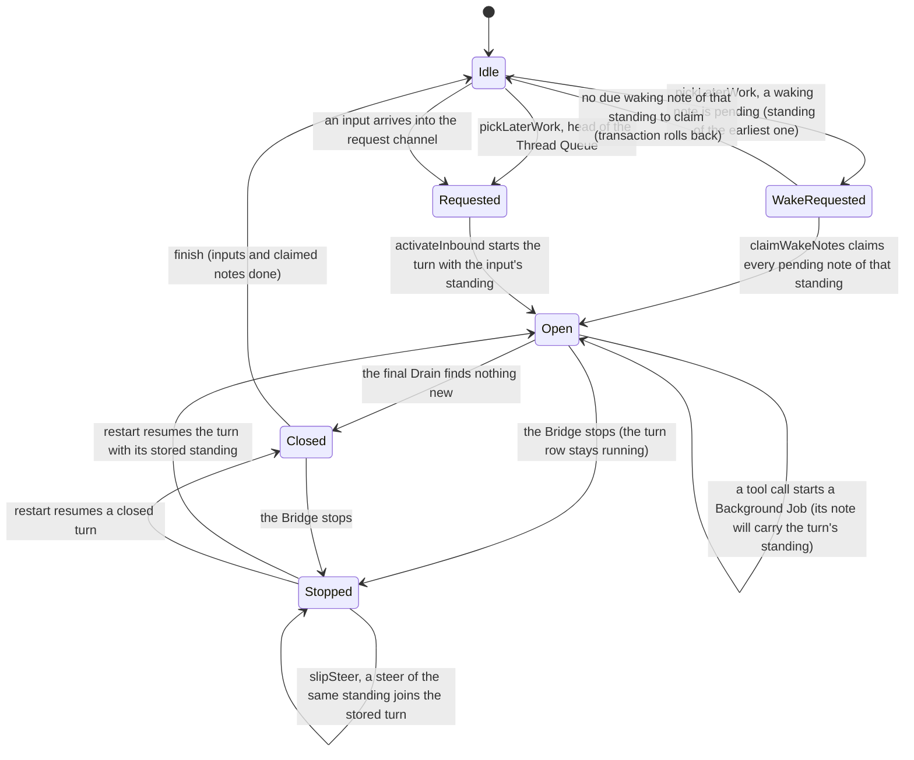

# Turn standing: bounded verification

This PlusCal model checks one rule of a session's Bridge: **a turn only ever runs inputs of one standing.** **It does
not prove any Go code correct.** A pass means the properties hold for the finite worlds below, under the assumptions
below. The step table maps each model step to the code in `internal/rocketclaw/backend` that implements it.

The rule was built before this model was written, so the model checks the implemented design after the fact rather
than gating it.

**Gate status: VERIFIED** for the finite worlds below. On 2026-11-25, one `make -k` run exited 0 in 1m43s:

- every required check finished with `Model checking completed. No error has been found.` (3 of 3);
- every must-fail check failed with its named violation (8 of 8: three mutations, the non-guarantee, four
  witnesses).

The run used TLC2 2026.11.19.180144 (rev `bc1b506`) and OpenJDK 21.0.13.1 on linux/aarch64, with 16 cores.

## Run

From the repository root:

```sh
make -C docs/verification/turn-standing          # translate, then every check
make -k -C docs/verification/turn-standing       # every check, even after one fails
make -C docs/verification/turn-standing safety   # one check
```

You need Java 11+, `curl`, `shasum`, `perl` and Make.

The Makefile downloads `tla2tools.jar` v1.8.0 and checks its SHA-256
`fdffef247f563ef6edbfd44958d2a82db79e7564e07cb673262d896353fa6713`, the same pin as `docs/verification/slack-sticky`.
Everything else lives under `.tmp/run/turn-standing-model/`: the tools, the translator's scratch copy, Java's
temporary files, TLC metadata, and every log, with full counterexample traces.

How the checks run:

- TLC is killed after 1800 seconds, and a killed run fails its check.
- Passing checks use 4 workers. Must-fail checks use one, so their first counterexample is the same on every run.
- A passing check must exit 0 and print `Model checking completed. No error has been found.`
- A must-fail check must exit 12 (safety) or 13 (liveness) and print its named violation. A parse error or a timeout
  never counts as the expected failure.

`TurnStanding.tla` holds the algorithm, the properties and the generated translation. Edit outside the
`BEGIN TRANSLATION`/`END TRANSLATION` markers, then run `make translate`. The constant `Mutation` is `"none"` for the
design. Each other value brings back one behavior the rule forbids; the must-fail checks use these.

## The rule being checked

- Every input has a standing: **addressed**, or **unaddressed** (a Slack ambient message, marked with
  `InboundAmbientMetadataKey`).
- A turn's standing is fixed when it starts, from the input or wake that starts it.
- A steer joins a running turn that is open for input only when both have the same standing. Otherwise it waits and
  later runs as its own turn, with its own standing.
- A Background Job's Completion Note carries the standing of the turn that started the job.
- A running turn's `Drain` claims only notes of its standing.
- A wake takes the standing of the earliest due waking note and claims only notes of that standing. Other notes stay
  for a later wake.
- A non-waking note (a stopped or killed job) runs only with a later turn of its standing. If no such turn comes, it
  waits forever. That is accepted, and the model states it as a non-guarantee, not a property.



A steer of the other standing, or any input that arrives while the turn is closed, takes the queue: the request
channel, or the Thread Queue. A Completion Note moves `running → pending` (waking or not) `→ claimed → done`.

## What the model contains

Each `either` branch, and each other process's step, is one atomic step.

- **`Lane`** (fair): the Bridge. It picks later work, starts turns, and runs the turn: `Drain`, a Background Job start,
  close, and finish. It does nothing while the Bridge is stopped.
- **`Arrive`** (fair): each input arrives once. It is either a steer that joins the open turn, or it takes the queue,
  as a prompt or as a steer that does not join. While the Bridge is up it can go to the request channel or the Thread
  Queue; while it is stopped it can only go to the Thread Queue.
- **`JobRunner`** (fair): a running Background Job finishes, and its note is waking (completed) or not (stopped or
  killed).
- **`Shutdown`** (not fair): up to `MaxShutdowns` Bridge stops. Waiting inputs in the request channel are stored in the
  Thread Queue, a wake request is dropped, and the turn row stays running.
- **`Restart`** (fair): the Bridge comes back and resumes the running turn.

### Atomic steps and the code

| Model step | Code (`internal/rocketclaw/backend`) | Boundary |
| --- | --- | --- |
| `Arrive`, join | `Bridge.enqueue` → `Bridge.joinsTurnLocked` (`bridge.go`); `Bridge.admitAgentWrite` with `sessionWriteSteer` (`thread_bridges.go`); while the Bridge is stopped, `storeStopped` → `Bridge.slipSteer` (`bridge.go`), which compares the ambient mark of the in-memory turn, or of the stored running turn from `headTurn` | `b.mu` critical section, plus the steer journal |
| `Arrive`, request channel | `Bridge.enqueue` → `b.requestCh` | channel send |
| `Arrive`, Thread Queue | `admitAgentWrite` (queue row), `storeStopped` (`PutThreadQueueItem`) | one transaction |
| `Lane`, pick | `Bridge.pickLaterWork` (`bridge.go`): blocked while a turn runs or the request channel is not empty; `SessionService.backgroundWake` (`store_dao.go`) reads the earliest due waking note, and the wake's inbound carries that note's ambient mark; otherwise `submitEnqueuedItem` | reads, then `enqueue` |
| `Lane`, start an input turn | `Bridge.handle` → `Bridge.activateInbound` → `startTurnDB`; `Bridge.openInputWindow` sets `activeUnaddressed` from the starting inbound | "turn start" transaction, then `b.mu` |
| `Lane`, start a wake | `activateInbound` → `claimWakeNotes` → `claimBackgroundNotes(…, held=false, unaddressed)` (`store_dao.go`); no due waking note claimed means no turn | "turn start" transaction, rolled back when nothing wakes |
| `Lane`, drain | `Bridge.Drain` (`conversations.go`) → `claimBackgroundNotes(…, held=true, b.activeUnaddressed)` | "consumed input" transaction |
| `Lane`, start a job | `runTurn` → `backgroundTurn{origin: msg}` (`bridge.go`): the job's origin is the turn's starting inbound, ambient mark included | job row |
| `Lane`, close | `Drain` at the final answer with nothing offered: `snapshot.Closed`, `inputOpen = false` | same transaction |
| `Lane`, finish | `Bridge.finish` → `finishTurn`, then `settleSteers` | "finish" transaction |
| `JobRunner` | `SessionService.finishBackgroundJob` (`store_dao.go`) writes `note` and `wake`; `noteReady` → `PickLaterWork` | one transaction |
| `Shutdown` | Bridge stop: `storeQueued` → `storeStopped` (a background wake is not stored) | — |
| `Restart` | `StartActiveTurns` resumes the running row; `openInputWindow` reads the standing from the stored inbound again | — |

## Properties

The Spec is `Init /\ [][Next]_vars` with weak fairness for `Lane`, `Arrive`, `JobRunner` and `Restart`. Bridge stops
are not fair: they may happen, and nothing waits on them.

Safety (invariants):

- `NoMixedTurn`: every input and every note a turn holds has the turn's standing. Its note half is the
  "an addressed result runs in an addressed turn" property.
- `OneOwner`: an input is in at most one place (the request channel, the Thread Queue, or the turn), and a note is
  claimed only by the running turn.

Liveness:

- `InputsRun`: every input that arrived, addressed or unaddressed, eventually runs.
- `WakingNotesRun`: every waking note eventually runs. With `NoMixedTurn`, that means it runs in a turn of its own
  standing, so waking notes of one standing cannot starve those of the other.

The non-guarantee, which must fail:

- `NonWakingNotesRun`: every non-waking note eventually runs. It does not hold, by design.

Witnesses: each one claims a path never happens, and each must fail. A pass is only meaningful if these paths are
reachable:

- `NoSteerJoins`: a steer joins an open turn of its standing.
- `NoSlipJoin`: a steer joins the stored turn while the Bridge is stopped.
- `NoTwoStandingWakes`: an addressed wake and an unaddressed wake both run.
- `NoLateNote`: a non-waking note runs with a later turn of its standing.

## Results

Inputs are numbered; each world says which are addressed and which unaddressed. Logs and full traces are in
`.tmp/run/turn-standing-model/<check>.log`.

Required (must pass):

| Check | World | Properties | Distinct states | Depth | Time |
| --- | --- | --- | --- | --- | --- |
| `safety` | addressed 1, 2; unaddressed 3, 4; 3 Background Jobs; 2 Bridge stops | `NoMixedTurn`, `OneOwner` | 8,243,898 | 36 | 33s |
| `safety-inputs` | addressed 1, 2, 3; unaddressed 4, 5; 2 Background Jobs; 1 Bridge stop | `NoMixedTurn`, `OneOwner` | 2,713,138 | 35 | 14s |
| `liveness` | addressed 1, 2; unaddressed 3, 4; 2 Background Jobs; 1 Bridge stop | both invariants; `InputsRun`, `WakingNotesRun` | 345,128 | 31 | 49s |

Must fail (each found its violation):

| Check | World | What is turned on | Violation | States | Depth |
| --- | --- | --- | --- | --- | --- |
| `mixed-wake` | addressed 1; unaddressed 2; 2 jobs | the old `claimWakeNotes`: a wake claims every pending note, and runs unaddressed if any claimed note is | `NoMixedTurn` | 1,741 | 15 |
| `steer-any` | addressed 1; unaddressed 2 | a steer joins any open turn, whatever its standing (the old `inputOpen`-only check) | `NoMixedTurn` | 15 | 4 |
| `drain-any` | addressed 1; unaddressed 2; 1 job | a non-waking note is claimed by a turn of any standing | `NoMixedTurn` | 152 | 10 |
| `non-waking-may-wait` | addressed 1; unaddressed 2; 1 job | nothing: the design | `NonWakingNotesRun` (temporal) | 210 | 15 |
| `witness-join` | addressed 1, 2; unaddressed 3 | witness | `NoSteerJoins` | 30 | 4 |
| `witness-slip` | addressed 1, 2; unaddressed 3; 1 Bridge stop | witness | `NoSlipJoin` | 107 | 5 |
| `witness-both-wakes` | addressed 1; unaddressed 2; 2 jobs | witness | `NoTwoStandingWakes` | 1,981 | 19 |
| `witness-late-note` | addressed 1; unaddressed 2, 3; 1 job | witness | `NoLateNote` | 151 | 6 |

The traces:

- `mixed-wake`: addressed input 1 starts job 1, which is stopped (a non-waking addressed note). Unaddressed input 2
  starts job 2, which completes (a waking unaddressed note). The wake claims both notes and runs unaddressed, so the
  addressed result runs in an unaddressed turn.
- `steer-any`: addressed input 1 starts a turn, and unaddressed input 2 joins it as a steer.
- `drain-any`: addressed input 1 starts job 1 and finishes. Unaddressed input 2 starts a turn. Job 1 is stopped, and
  the unaddressed turn's `Drain` claims its addressed note.
- `non-waking-may-wait`: unaddressed input 2 runs first. Addressed input 1 starts job 1 and closes; the job is stopped
  after the close. No later addressed turn comes, so the note stays pending forever. This is the accepted
  non-guarantee.

Sizing, and a check that liveness can fail. These ran outside `make`, on the same model and jar:

- **The first safety world did not finish.** Addressed 1, 2, 3, unaddressed 4, 5, 6, 3 jobs and 2 Bridge stops ran out
  of time at 1800 seconds: 232.8 million distinct states, depth 23, 54.3 million still queued, no violation found. It
  was split into `safety` and `safety-inputs`.
- **Liveness with 3 jobs** (addressed 1, 2; unaddressed 3, 4; 1 Bridge stop) passed: 4,953,752 distinct states, depth
  34, 12m05s. It is not a `make` check because it takes 12 minutes.
- **Liveness is not vacuous.** A scratch copy whose `pickLaterWork` always asks for an addressed wake failed
  `InputsRun` and `WakingNotesRun`: an unaddressed waking note is never claimed, and the Bridge requests the same empty
  wake forever.

## What the model leaves out

- **Time.** Wake delays (`wakeAfter`, retry backoff) are not modeled; every waking note is due. "Earliest" is arrival
  order; the code orders by `GREATEST(run_at_unix_ns, now)`, `updated_at_unix_ns`, `input_id`.
- **When `pickLaterWork` runs.** The model lets it run whenever the Bridge is idle. The code calls it after every
  request `handle` processes, on `noteReady`, on timers and on restart. A missing call is not modeled.
- **Other sessions and other kinds of turn.** Goals, Agent Pause, history mutations (revert, branch), hidden runs and
  wakes into another destination (`SyncDestination`, producers), shadows, Task subagent Bridges (`b.parent`), Channel
  Session moves (`movedNotes`), `skipUnstickyTurn` releasing claims, `releaseStaleBackgroundClaims`, and
  `inputPersistenceError` paths are not modeled.
- **Notes claimed by a turn before this rule existed.** `claimBackgroundNotes` with `held = true` returns the notes the
  turn already holds with no standing filter. That is safe because every claim path filters by standing, but a turn
  that claimed mixed notes under the old code and resumes after the upgrade still holds them.
- **Releasing claimed notes.** In the model, finish always runs the turn's notes. In `finishTurn`, a turn that ends
  with no entries releases its claimed notes as non-waking, and a hidden run releases them to wake again after a
  delay. Both keep the note's standing, so `NoMixedTurn` is unaffected. But `WakingNotesRun` only says that a waking
  note reaches a turn of its standing, not that the turn produced output.
- **Background Jobs** do not stop with the Bridge, and whether a note wakes is a free choice.
- **Steer and queue removal, message content and delivery** are not modeled.
- **Small bounds.** One session, at most 5 inputs, 3 Background Jobs and 2 Bridge stops. Behavior that needs more is
  not covered.
