# `read` waiting for a file descriptor: bounded verification

`ReadFdRetry.tla` models `read` inside `execute` when the process (`EMFILE`) or the whole machine (`ENFILE`) has run
out of file descriptors. `read` loads the whole file in one go: it opens the file, copies all of it into memory and
closes it, so a descriptor is open only during that copy. If opening fails with `EMFILE` or `ENFILE`, `read` waits and
tries again until it succeeds, or until the turn is cancelled. Up to 64 reads run at once under `map`/`gather`, and the
rest of the server (and, for `ENFILE`, other programs) open and close descriptors too.

The model fixes how that wait works, and the checks below show why each part of it is needed. The Go code must follow
the behaviour in the next section.

**Passing checks do not prove that code correct.** They show the properties hold for this small finite model.

## The Go behaviour this model requires

One value shared by every `read` in the process, for normal and Easy agents alike:

- a wake channel `wake chan struct{}` guarded by a `sync.Mutex`;
- a retry slot `retrySlot chan struct{}` with a buffer of 1.

One read:

```go
backoff := 10 * time.Millisecond
retrying := false
for {
	if retrying {
		select {
		case retrySlot <- struct{}{}:
		case <-ctx.Done():
			return errCancelled
		}
	}
	wake := currentWake()
	file, err := attempt()
	if retrying {
		<-retrySlot
	}
	if err == nil {
		break
	}
	if !errors.Is(err, syscall.EMFILE) && !errors.Is(err, syscall.ENFILE) {
		return err
	}
	retrying = true
	timer := time.NewTimer(backoff)
	select {
	case <-wake:
	case <-timer.C:
	case <-ctx.Done():
	}
	timer.Stop()
	if ctx.Err() != nil {
		return errCancelled
	}
	backoff = min(2*backoff, time.Second)
}
```

1. **One attempt** is every step of one read that opens a descriptor: `os.OpenRoot` for Easy agents (`EasyRoot`), the
   `Lstat` calls of `rejectSymlink`, and `root.Open`. If any of them fails, the attempt closes whatever it opened
   before returning. An `EMFILE`/`ENFILE` from any of them is a failed attempt; any other error ends the read as
   today. The check comes before today's mapping of open errors to `File not found: <path>`.
2. **Hold nothing while waiting**: no descriptor, no retry slot and no other lock. This includes the per-agent
   mutexes `sandboxedFileSystem.mu` and `easyFiles.mu`, which `ReadResult` holds today for the whole read. A wait under
   such a mutex makes reads of the same agent queue on a `sync.Mutex` that cannot be cancelled, behind a read that may
   belong to another turn (`uncancellable-slot` shows the same failure for the retry slot). Run the open-and-retry
   loop outside such a mutex, or take it with a wait that also watches `ctx.Done()`. Holding it for the copy alone is
   fine: the copy never waits for descriptors.
3. **The wait** ends at the first of: the backoff timer (10 ms, doubling after every wait, at most 1 s, starting over
   for each `read`), the wake channel taken just before the attempt being closed, or the turn's context being done.
4. **After every wait**, check `ctx.Err()` first. Go's `select` picks at random among ready cases, so a timer or wake
   that is ready at the same time as cancellation must not lead to another attempt (`cancel-race`). Cancellation
   gives the error result `read cancelled while waiting for a file descriptor`.
5. **The first attempt** of a read does not take the retry slot. **Every retry** takes it before the attempt and gives
   it back right after, success or failure, waiting for it with a `select` that also watches `ctx.Done()`. It is never
   held while waiting or reading (`unserialized`, `uncancellable-slot`).
6. **After a successful attempt**: `Stat`, grow the buffer, copy the whole file, close the file (and the Easy root) on
   every path, with no wait, no context check and no retry slot in between. Then wake every waiting read:
   lock, `close(wake)`, `wake = make(chan struct{})`, unlock. A read wakes others only after its own descriptors are
   closed (`keep-open`, `keep-open-leak`).
7. The timer is not optional: descriptors freed by the rest of the server or by other programs never close `wake`
   (`wake-only`).

A cancelled read that already holds its descriptor finishes the copy and closes it; cancellation is only seen while
waiting or while waiting for the retry slot. A read whose copy fails closes the file the same way.

## Run

From the repository root:

```sh
make -C docs/verification/typed-execute-emfile          # translate, then every check
make -C docs/verification/typed-execute-emfile retry    # one check
```

Requires Java 11+, `curl` and Make. The Makefile downloads `tla2tools.jar` v1.8.0 and verifies SHA-256
`67f9575c3b9ef7a0787b1bded34812862ffe79d711298e5a75b1a77720b19928`, as the other models here do. The tools, the
translator's copy, Java's temporary files, TLC's working files and each check's log go to the repository root's
`.tmp/verification/typed-execute-emfile/`. A passing check needs TLC exit 0 and `Model checking completed. No error has
been found.`; a check that must fail needs TLC exit 12 (safety) or 13 (liveness) and its named violation, so a parse or
tool error never counts.

## One read, step by step

```mermaid
stateDiagram-v2
  state "Attempt: take the wake channel (a retry first takes the retry slot)" as Attempt
  state "OpenDir: Easy root, or os.Root's directory on the way to the file" as OpenDir
  state "OpenFile" as OpenFile
  state "Wait: timer, wake or cancellation; holds nothing" as Wait
  state "Read: copy the whole file" as Read
  state "Close: close everything, wake every waiting read" as Close
  state "Cancelled: error result" as Cancelled
  [*] --> Attempt
  Attempt --> OpenDir: two-step open
  Attempt --> OpenFile: one-step open
  Attempt --> Cancelled: cancelled while waiting for the retry slot
  OpenDir --> OpenFile: ok
  OpenDir --> Wait: EMFILE / ENFILE, give back the slot
  OpenFile --> Read: ok, give back the slot
  OpenFile --> Wait: EMFILE / ENFILE, close the directory, give back the slot
  Wait --> Attempt: timer fired or woken, not cancelled
  Wait --> Cancelled: cancelled
  Read --> Close
  Close --> [*]
  Cancelled --> [*]
```



Errors other than `EMFILE`/`ENFILE` end the read as today and are not modeled.

## The model

| Process | Fairness | Meaning |
|---|---|---|
| `Reader[r]`, r ∈ 1..`N` | weak | one `read` call (or, with `Recycle`, a `map` slot that starts a new read after each one) |
| `InProcess` | none | the rest of the server: takes and frees descriptors counted against both limits, for as long as it likes |
| `OtherProcesses` | none | other programs: take and free descriptors counted against the machine's limit only |
| `Canceller` | none | when `Cancelable`, cancels any reader's turn at any time |

Readers are weakly fair because a goroutine that can run eventually runs, and a timer always fires. The backoff timer
is a branch of the reader's own `Wait` step that is always enabled, so its duration is not modeled; a wait may last
any time, while other processes act. Nobody else gets fairness: the rest of the server and other programs may hold
descriptors forever, so the liveness properties assume (`OthersRelease`) that they eventually stop holding any.

| Constant | Meaning | Checked value |
|---|---|---|
| `N` | concurrent reads | 3 |
| `ProcCap` | the process's descriptor limit (`EMFILE`) | 2 |
| `SysCap` | the machine's descriptor limit (`ENFILE`) | 3 |
| `TwoStep` | an attempt opens a directory descriptor, then the file while still holding it: Easy's root, or the directory `os.Root` holds while it opens a file in a subdirectory | per check |

Design switches, all `TRUE` in the chosen design; each check that must fail turns one off:

| Switch | `FALSE` means |
|---|---|
| `Backoff` | a failed attempt is retried at once, with no wait |
| `Timer` | the wait ends only on a wake or cancellation |
| `ReleaseOnWait` | a reader keeps its directory descriptor while it waits for the file |
| `CloseAfterRead` | the descriptors stay open after the copy |
| `SerializeRetries` | retries do not take the retry slot |
| `SlotCancel` | waiting for the retry slot ignores cancellation (a `sync.Mutex`) |
| `CancelCheck` | after a wait, a ready timer or wake may win over a cancellation |

`Recycle` (`FALSE` unless named) makes each reader start a new read after finishing one, forever.

| Variable | Meaning |
|---|---|
| `dirHeld[r]`, `fileHeld[r]` | descriptors reader `r` holds |
| `inProc`, `otherSys` | descriptors held by the rest of the server and by other programs |
| `lock` | the reader holding the retry slot, or 0 |
| `woken[r]` | the wake channel `r` took has been closed |
| `cancelled[r]`, `outcome[r]` | the turn was cancelled; how the read ended |
| `retrying[r]` | the read has failed once (decides whether it takes the retry slot) |
| `failedSinceWait[r]`, `retriedCancelled[r]`, `sawEnfile` | ghosts for `NoSpin`, `NoRetryAfterCancel` and `witness-enfile` |

An open succeeds when `ProcUse < ProcCap /\ SysUse < SysCap`, where `ProcUse` counts readers' and the rest of the
server's descriptors and `SysUse` adds other programs'. A failure while the process has room is an `ENFILE`.

| Model step | Go |
|---|---|
| `Attempt` | top of the loop: take the retry slot if retrying (or return on cancellation), take the wake channel |
| `OpenDir` | `os.OpenRoot` (Easy), or `os.Root` opening a directory on the way to the file |
| `OpenFile` | `root.Open`; give back the retry slot; on failure close the directory first |
| `Wait` | `select` on `wake`, the timer and `ctx.Done()`, then `ctx.Err()` |
| `Read` | `Stat`, grow the buffer, copy |
| `Close` | close the file and the root, then `close(wake)` and replace it |

## Properties

Safety (invariants):

- `CapRespected`: descriptors in use never exceed either limit. The kernel enforces this; the check keeps the model
  honest.
- `HeldBound`: a reader holds at most one file descriptor and at most one directory descriptor; with one-step opens,
  at most one descriptor in total.
- `HoldsOnlyWhileOpeningOrReading`: a reader holds a directory only from `OpenFile` to `Close`, and a file only in
  `Read` and `Close`. So it holds nothing while waiting, nothing when cancelled and nothing when done.
- `NoLeak`: a finished reader, successful or cancelled, holds nothing.
- `NoSpin`: a reader never starts an attempt right after a failed one; a wait always comes between.
- `LockOnlyWhileOpening`: the retry slot is held only during an attempt, never while waiting or reading.
- `NoRetryAfterCancel`: a wait that ends after cancellation never leads to another attempt.
- `TypeOK`.

Liveness (weak fairness on readers):

- `AllReadsEnd`: if the rest of the server and other programs eventually hold nothing, every read ends.
- `CancelEnds`: a cancelled read ends, even if descriptors are never freed.
- `SomeReaderKeepsReading` (`Recycle`): with reads starting forever, reads keep completing.
- `EachReaderKeepsReading` (`Recycle`): every reader keeps completing reads. Expected to fail; see the limits.

Witnesses, each of which must fail: `NeverRetriedThenRead` (a read fails, waits and then succeeds; with the timer
off in `witness-wake`, it was woken by another read's close), `NeverEnfile` (an attempt fails because the machine is
full while the process has room) and `NeverCancelled` (a waiting read is cancelled).

## Results

On 2026-11-26, `make -k` with TLC `2026.11.26.020825` (rev `1138302`) and OpenJDK `21.0.13.1`
matched every TLC outcome (4 passes, 13 named counterexamples) in 11m 27s.

Recorded 2026-11-21 on Linux (aarch64, 16 cores), OpenJDK 21.0.13.1, TLC `2026.11.15.002146 (rev: bc1b506)`,
`pcal.trans` 1.12, one TLC worker. `make -k` ran every check in about 12 minutes with the tools in place and exited 0.
Every check matched its expected outcome.

Rerun 2026-11-21 after the `tla2tools.jar` pin moved to the 2026-11-19 rebuild of `bc1b506` (same revision; only the
manifest differs): TLC `2026.11.19.180144 (rev: bc1b506)`, OpenJDK 21.0.13.1 on linux/aarch64, from a fresh download;
`make -k` exited 0 in about 16 minutes, every check matched its expected outcome, and the four passing checks explored
the same states as below. Rerun again on the same pin after rebasing onto the main branch that pins it too: fresh
download (checksum matched), `make -k` exited 0 in 11 minutes 42 seconds, same outcomes and state counts.

| Check | Shape | Expected | Result | Generated / distinct states | Depth | Time |
|---|---|---|---|---:|---:|---:|
| `retry` | chosen design, one-step opens | every invariant, `AllReadsEnd` | pass, complete state space | 257,200 / 52,134 | 30 | 29 s |
| `retry-two-step` | chosen design, two-step opens | every invariant, `AllReadsEnd` | pass, complete state space | 212,110 / 44,514 | 33 | 28 s |
| `retry-cancel` | chosen design, two-step, cancellation | every invariant, `AllReadsEnd`, `CancelEnds` | pass, complete state space | 1,433,333 / 251,880 | 35 | 5 min 29 s |
| `recycle-progress` | chosen design, two-step, reads forever | every invariant, `SomeReaderKeepsReading` | pass, complete state space | 1,549,469 / 275,616 | 35 | 1 min 37 s |
| `no-backoff` | retry at once | `NoSpin` violated | violated | 251 / 84 | 5 | 0 s |
| `keep-open` | descriptors kept after the copy | `AllReadsEnd` violated | violated | 84,829 / 16,272 | 26 | 13 s |
| `keep-open-leak` | descriptors kept after the copy | `NoLeak` violated | violated | 554 / 158 | 5 | 1 s |
| `wake-only` | no timer | `AllReadsEnd` violated | violated | 68,768 / 15,534 | 26 | 11 s |
| `hold-dir` | two-step, directory kept while waiting | `AllReadsEnd` violated | violated | 324,670 / 69,858 | 35 | 35 s |
| `unserialized` | two-step, retries without the slot | `AllReadsEnd` violated | violated | 254,732 / 48,246 | 33 | 31 s |
| `cancel-race` | timer or wake may win over cancellation | `NoRetryAfterCancel` violated | violated | 3,523 / 820 | 7 | 0 s |
| `uncancellable-slot` | slot taken with a `sync.Mutex` | `CancelEnds` violated | violated | 512,111 / 96,763 | 17 | 1 min 4 s |
| `recycle-starve` | chosen design, reads forever | `EachReaderKeepsReading` violated | violated (known limit) | 1,068,282 / 209,889 | 21 | 1 min 4 s |
| `witness-wait` | chosen design, two-step | `NeverRetriedThenRead` violated | violated | 26,258 / 6,256 | 12 | 0 s |
| `witness-wake` | no timer, one-step | `NeverRetriedThenRead` violated | violated | 24,853 / 6,349 | 13 | 0 s |
| `witness-enfile` | chosen design | `NeverEnfile` violated | violated | 732 / 204 | 6 | 0 s |
| `witness-cancel` | chosen design, cancellation | `NeverCancelled` violated | violated | 3,502 / 819 | 7 | 0 s |

Counts for failing safety checks are the prefix explored before the first counterexample. Every liveness
counterexample was read to confirm it fails for the reason named below, with the rest of the server and other
programs holding nothing at the end where `AllReadsEnd` is the property.

### What the counterexamples show

- `no-backoff`: a reader fails, then attempts again in the next step.
- `keep-open`: readers 2 and 3 finish holding both descriptors; reader 1 waits, retries and fails forever.
- `wake-only`: the rest of the server fills the table; reader 1 fails and waits; the server frees both descriptors,
  but nothing closes `wake`, so reader 1 waits forever.
- `hold-dir`: readers 1 and 3 each hold a directory and fail to open their file; each waits holding its directory,
  so neither can ever get the second descriptor. A deadlock among readers alone.
- `unserialized`: readers 1 and 2 each open a directory, both fail on the file, both close and wait, and repeat
  forever, with nobody else holding anything. With the retry slot, only one retry is between its two opens at a time,
  so this cannot repeat once the first attempts are over.
- `cancel-race`: reader 1 is cancelled while waiting, a timer is also ready, and it attempts again.
- `uncancellable-slot`: reader 1 is cancelled while waiting for the retry slot; reader 2 keeps taking it for its
  own retries (the rest of the server never frees its descriptor), so reader 1 never gets past the slot.
- `recycle-starve`: readers 2 and 3 keep finishing reads and starting new ones, filling the table each time just
  before reader 1 attempts.

### Design changes the checks forced

The design (§7 of the design document) had the timer, the wake signal and cancellation. The model added:

1. **Close what a failed attempt opened before waiting** (`hold-dir`). Easy reads open a root, and `os.Root` opens
   directories on the way to a file in a subdirectory (`os/root_openat.go`, `doInRoot`), so every Easy read and every
   read of a file below the top folder needs two descriptors at once.
2. **Retries take a process-wide retry slot** (`unserialized`). Two-descriptor attempts can otherwise fail each other
   forever. The first attempt of each read stays free, so reads that never hit `EMFILE` never touch the slot.
3. **The slot is taken with a `select` that watches `ctx.Done()`** (`uncancellable-slot`).
4. **`ctx.Err()` is checked after every wait** (`cancel-race`).

Fairness is weak fairness on readers only. An earlier version needed strong fairness (relying on `sync.Mutex`'s
starvation mode) for `CancelEnds`; making the slot cancellable removed that assumption.

## Limits

- Bounded: 3 reads, a process limit of 2 and a machine limit of 3. A pass covers this finite model only.
- Durations are not modeled. The timer fires at some point; 10 ms → 1 s only sets how soon.
- Each open is one atomic step. In deeper paths `os.Root` holds a parent directory while opening the next one, and an
  Easy read also holds its root, so one attempt can briefly hold three descriptors. The model's two-step attempt keeps
  the shape that matters: holding a descriptor while asking for another, and closing everything when that fails.
- The rest of the server and other programs are two pools of descriptors with no wake signal; who they are does not
  matter to the model.
- **No starvation-freedom with an endless stream of reads.** With finitely many reads (any one script, plus whatever
  else runs), every read ends. If new reads keep starting forever and they alone exceed the limit, one read can lose
  every race (`recycle-starve`): a new read's first attempt does not queue behind waiting reads. Only a strict FIFO
  hand-off between reads would exclude that; it is not part of this design.
- A failed attempt that closes its own directory does not wake other reads; the timer covers it.
- The copy is one step and its errors are not modeled; the Go code closes on every path.
