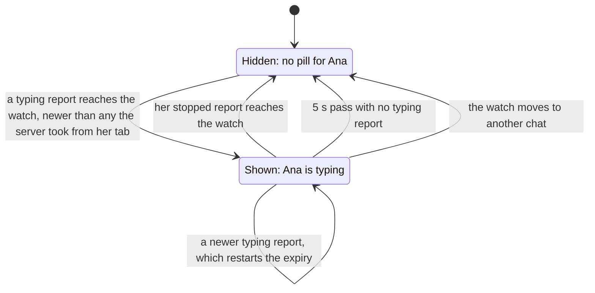

# Who else is typing: bounded verification

`Typing.tla` models the Web's typing pill: one typist's browser tab reporting "typing" and "stopped" to the server,
the server passing reports on to the other people watching the chat, and each watch's pill. The design as built is
`reportTyping` and `useTypists` in `internal/rocketclaw/web/src/typing.tsx`, and `reportTyping` and `watchTyping` in
`internal/rocketclaw/frontend/rpc/typing.go`. **Passing checks do not prove that code correct.**

## Run

From the repository root:

```sh
make -C docs/verification/typing          # translate, then every check
make -C docs/verification/typing built    # one check
```

Requires Java 11+, `curl` and Make. The Makefile downloads `tla2tools.jar` v1.8.0 and verifies SHA-256
`e1f11b75c4b5bc4478ba0ac5cb6ae28e40a01b0016bc33e0aa97da22dfdbcd7f`. The tools, the translator's copy, Java's
temporary files, TLC's working files and each check's log go to the repository root's `.tmp/verification/typing/`.
A passing check needs TLC exit 0 and `Model checking completed. No error has been found.`; a check that must fail
needs TLC exit 12 (safety) or 13 (liveness) and its named violation, so a parse or tool error never counts.

## A typist's pill, as one watch sees it



A report on its way may reach the server out of order or never. The server drops it when nobody watches the chat, or
when it is numbered no higher than the newest it took from the same tab. Otherwise it passes the report to every
watch but the typist's own, and drops it for a watch whose buffer is full.

## What each check proves

Requirements:

- `NoSelf`: nobody sees their own typing, not even in another tab of theirs;
- `NoCrossChat`: a pill names someone typing in the chat on screen, never one the viewer left;
- `NoStaleReturn`: once a watch heard Ana stop, it never shows her again from a typing report she made before;
- `PillClears` (liveness): once Ana's draft stays empty, Bea's pill for her goes for good, whatever was dropped,
  late or lost;
- `ReportedWithText`, `NewestOnlyWatched`, `TypeOK`: the tab reports typing exactly while its draft holds text, and the
  server keeps report numbers only for a chat somebody watches.

| Check | Shape | Expected | Result |
|---|---|---|---|
| `built` | as built | every requirement holds | pass, 10,092 distinct states, depth 18 |
| `unordered` | the server keeps no report numbers | `NoStaleReturn` violated: a typing report a later stop overtook brings the pill back | violated, as expected |
| `no-expiry` | no 5 s expiry | `PillClears` violated: a stop that is dropped or lost leaves the pill for good | violated, as expected |
| `unkeyed` | the pill keeps its typists when the viewer moves chat | `NoCrossChat` violated | violated, as expected |
| `no-self-filter` | the server passes reports to the typist's own watches | `NoSelf` violated | violated, as expected |
| `unheard` | as built | `NoStaleAnywhere` violated: the limit below | violated, as expected |
| `seen` | as built | `NeverSeen` violated: Bea does see a pill | violated, as expected |
| `overtaken` | as built | `NeverOvertaken` violated: a report reaches the server after a later one | violated, as expected |
| `stale` | as built | `NeverStale` violated: the server drops such a report | violated, as expected |
| `dropped` | as built | `NeverDropped` violated: an event is dropped for a full watch | violated, as expected |

`seen`, `overtaken`, `stale` and `dropped` show the passing `built` check is not passing because the model never
reaches those states. Checks that must fail run with one TLC worker, so the first counterexample, and the violation it
names, is the same on every run.

`unheard` names what the design does not promise. A watch that never heard Ana stop, because its buffer was full or it
opened after the server took her stop, shows her from an older typing report that arrives late, until it expires. With
one TLC worker its first counterexample is the full buffer; with a larger buffer TLC finds the watch that opened late.

## Assumptions

- The network, each watch and the clock are fair; Ana, and the people who move watches, act when they like.
- A report on its way may be overtaken by any later one, or never arrive.
- The server handles one report at a time, under one lock, as `typingMu` does.
- Ticks stand for seconds scaled down: `Throttle = 1` for 2 s, `Expiry = 2` for 5 s.

## Recorded run

2026-11-13, on macOS (Apple silicon, 12 workers), OpenJDK 21.0.13, TLC `2026.11.06.222357 (rev: d8fb231)`,
`pcal.trans` 1.12: every check matched its expected outcome; `make` took 17 s with the tools already downloaded.
Translating changed nothing in `Typing.tla`.

## Limits

- Bounded: one typist with one tab that types, at most 3 reports, two watches (Bea's and Ana's other tab), two chats,
  a buffer of one event per watch.
- One typist, so a watch holds at most one entry: the order of names in the pill, and two people sharing a display
  name, are not modeled.
- One server process; the Web's throttle is modeled, React rendering, the browser's timers and `EventSource` reconnects
  are not.
- The OpenCode view's pill, which watches the tab's main session while a subagent's is shown, is the same protocol on
  another chat id and is not modeled separately.
