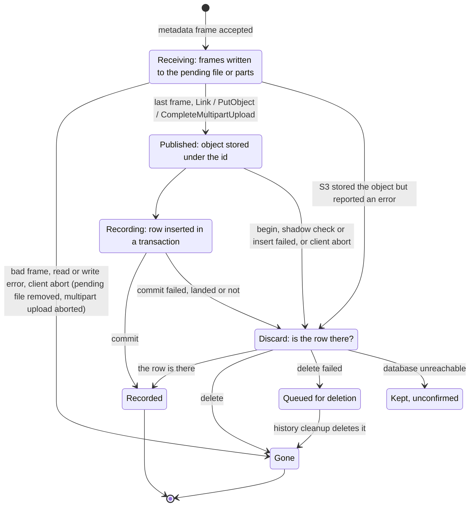

# Streamed Web uploads: bounded verification

`UploadStreaming.tla` models one Web upload as `SessionService.SaveUpload`
(`internal/rocketclaw/backend/attachments.go`) stores it. Before, the upload handler collected the whole file in
memory and `SaveAttachment` stored it inside an open database transaction. Now the frames go to attachment storage as
they arrive, and the row is written in a short transaction afterwards, so the transaction is not held open while the
client sends. The order is: write the pending file (disk) or, through the AWS SDK's S3 transfer manager
(`feature/s3/transfermanager`), the multipart upload (S3; a file under 16 MiB is buffered and sent in one request),
publish it under the attachment id, insert and commit the `attachments` row. When anything after the first write fails, the existing
`discardUnsavedAttachment` runs: if no row exists it deletes the object, or queues the id in
`pending_attachment_deletions` when the delete fails. `removeHistoryFiles`, run when sessions are deleted and by
the retention prune (`PruneStateBefore`), later deletes queued objects.

Three switches name the design choices the checks depend on:

- `DiscardOnPutError`: a failed Put is followed by the discard too. S3 can store an object and still report an error
  (the reply is lost, or the client cancels during `CompleteMultipartUpload`). `FALSE` returns the error at once, as
  `SaveAttachment` does for its own Put.
- `DetachDiscard`: the discard runs on `context.WithoutCancel`. `FALSE` runs it on the request's context, which a
  client abort cancels.
- `DatabaseMayFail`: the discard's own database read (is the row there?) or queue insert may fail.

## Run

From the repository root:

```sh
make -C docs/verification/upload-streaming          # translate, then every check
make -C docs/verification/upload-streaming fixed    # one check
```

Requires Java 11+, `curl` and Make. The Makefile downloads `tla2tools.jar` v1.8.0 and verifies SHA-256
`67f9575c3b9ef7a0787b1bded34812862ffe79d711298e5a75b1a77720b19928`. The tools, the
translator's copy, Java's temporary files, TLC's working files and each check's log go to the repository root's
`.tmp/verification/upload-streaming/`. A passing check needs TLC exit 0 and `Model checking completed. No error has
been found.`; a check that must fail needs TLC exit 12 (safety) or 13 (liveness) and its named violation, so a parse or
tool error never counts.

The recorded run used a jar with the pinned checksum already on the machine, copied into the work directory.

## The upload, step by step



## The model

Three processes. The **upload** is weakly fair. The **client** may abort once, at any time, and never has to. The
**sweeper** (`removeHistoryFiles`) is weakly fair; a delete it fails is a sweep that has not happened yet.

| Variable | Meaning |
|---|---|
| `pending` | the pending file (`.pending-<random>`) or the open multipart upload |
| `object` | an object readable under the attachment id |
| `published` | ghost: the object was published at least once |
| `record` | `none`, `open` (inserted, not committed), `committed` |
| `queued` | the id is in `pending_attachment_deletions` |
| `aborted` | the client went away: the request context is canceled |

| Model step | Code |
|---|---|
| `Receive`, `Stream` | `uploadFrames.Read` feeding `attachmentStorage.Put`: `io.Copy` into the pending file, or `transfermanager.UploadObject` (8 MiB parts with `UploadPart`, five at a time, from 16 MiB up); a frame error or a canceled stream fails the read, and Put removes the pending file (`defer root.Remove`), or the transfer manager calls `AbortMultipartUpload` on a fresh context (`FailTimeout`) |
| `Publish` | `root.Link`, `PutObject` or `CompleteMultipartUpload`, all with no overwrite (`If-None-Match: *`); three outcomes: stored, stored but an error returned, not stored |
| `Begin` | `BeginTx`, `rejectShadowMutation` and the `INSERT`; each fails on a canceled context or a database error |
| `Commit` | `tx.Commit`: committed, rolled back, or committed with an error returned; a canceled context rolls back |
| `PutFailed`, `Discard` | `SaveUpload`'s deferred `discardUnsavedAttachment(context.WithoutCancel(ctx), id)` and its row check |
| `Delete`, `Queue` | `attachments.Delete` (disk: remove the file; S3: one plain `DeleteObject`, which also succeeds for a missing object), then the `pending_attachment_deletions` insert |
| `Sweep`, `Dequeue` | `removeHistoryFiles`: delete, then remove the queued id |

## Properties

- `NoDanglingRecord` (safety): a committed row always has its object.
- `NothingLeftBehind` (safety): once the upload has finished, there is no pending file, and an object has either a
  committed row or a queued deletion.
- `Settles` (liveness, under weak fairness): eventually the object exists exactly when its row does.
- `TypeOK`.

Witnesses that the passing check is not vacuous, each of which must fail with the fixed shape: `NeverCommitted` (an
upload is recorded), `NeverQueued` (a failed delete is queued) and `NeverRemovedAfterAbort` (an object published
before the client aborted is removed).

## Results

On 2026-11-26, `make -k` with TLC `2026.11.26.020825` (rev `1138302`) and OpenJDK `21.0.13.1`
matched every TLC outcome (1 pass, 6 named counterexamples) in 3s.

On 2026-11-21, `make all` passed with TLC `2026.11.19.180144` (rev `bc1b506`) and OpenJDK `21.0.13.1`.

Recorded 2026-11-20 on Linux (aarch64, 16 cores), OpenJDK 21.0.13.1, TLC `2026.11.15.002146 (rev: bc1b506)`,
`pcal.trans` 1.12, one TLC worker. `make -k` ran every check in about 6 s with the tools in place and exited 0. Every
check matched its expected outcome.

| Check | Shape | Expected | Result | Generated / distinct states | Depth |
|---|---|---|---|---:|---:|
| `fixed` | discard on Put errors, detached, database up | every property holds | pass, complete state space | 99 / 56 | 11 |
| `put-error-kept` | `DiscardOnPutError = FALSE` | `NothingLeftBehind` violated | violated | 33 / 24 | 6 |
| `canceled-discard` | `DetachDiscard = FALSE` | `NothingLeftBehind` violated | violated | 63 / 43 | 8 |
| `database-down` | `DatabaseMayFail = TRUE` | `NothingLeftBehind` violated | violated | 48 / 32 | 7 |
| `witness-committed` | fixed | `NeverCommitted` violated | violated | 26 / 18 | 6 |
| `witness-queued` | fixed | `NeverQueued` violated | violated | 49 / 34 | 7 |
| `witness-abort` | fixed | `NeverRemovedAfterAbort` violated | violated | 68 / 45 | 9 |

Counts for failing safety checks are the prefix explored before the first counterexample.

Rerun the same day after S3 writes moved from hand-written multipart calls to the SDK's transfer manager. The modeled
steps and their order did not change (the transfer manager makes the same `PutObject`, `UploadPart`,
`CompleteMultipartUpload` and `AbortMultipartUpload` calls, with `If-None-Match: *` on the publishing one), and every
check gave the same result and state counts.

### Counterexamples

- `put-error-kept`: S3 stores the object but the reply is an error; Put fails and nothing removes the object. This is
  why `SaveUpload` runs the discard after a failed Put too.
- `canceled-discard`: the object is published, recording fails, the client aborts, and the discard's row check fails
  on the canceled context, so the object stays. This is why the discard runs on `context.WithoutCancel`.
- `database-down`: the object is published, recording fails, and the row check fails too. The discard keeps the
  object, because it cannot tell whether the commit landed, and cannot queue it either. This is a known limit, shared
  with `SaveAttachment` (#1447): an unreachable database during cleanup can leave an unrecorded object behind.

## Limits

- Bounded: one upload, one abort, no crash. A process crash after publishing and before the commit or the discard
  leaves an unrecorded object, as it does for `SaveAttachment`; a crash while writing leaves a `.pending-` file on
  disk or an incomplete multipart upload on S3.
- Removing the pending file (`root.Remove`, whose error is ignored) and `AbortMultipartUpload` are assumed to succeed.
  An incomplete multipart upload is not an object under the id; a bucket lifecycle rule removes any left behind.
- Attachment ids are random (`rand.Text()`), so two uploads never share one; `If-None-Match: *` and `Link` refuse to
  replace an existing object.
- `object` means readable under the id. In a versioned bucket a plain delete leaves earlier versions until a lifecycle
  rule removes them; the model does not track those.
- The sweeper is assumed to run again until its delete succeeds; in the code that is the next session deletion or
  retention prune.
- A pass covers this finite model only. **Passing checks do not prove the code correct.**
