# Web voice call retry limit: bounded verification

`VoiceRetryLimit.tla` models one Web voice call in the browser (`internal/rocketclaw/web/src/voice.ts`). After a
network loss (the audio connection fails, the page loses RocketClaw, RocketClaw loses OpenAI, or the audio is not up
20 seconds after OpenAI answers) the browser waits 1 second, doubling to 10, and starts a new call on the same
conversation and microphone. As built it does so until the person hangs up, forever. The change keeps that, and ends
the call when it has not come back for 15 minutes.

**Failing continuously** is measured from the loss that starts an outage: the first loss after the call was last
live, or, for a call never live yet, its first failed try. The browser already marks an outage with its reconnecting
tick (`ticking`): it starts at that loss and clears when the audio channel opens. The outage's start is taken there,
so a call that comes back starts the next outage at zero. The limit is checked each time a try ends in a network
loss: once the outage has lasted 15 minutes (`reconnectLimit`), no further try starts and the call ends with "Call
ended: could not reconnect for 15 minutes.", as other final endings show their message. A try already running at
15 minutes is not cut short: it may still bring the call back, and its failure ends the call.

`Limited` switches between the two shapes:

- `Limited = FALSE`, as built: a loss always schedules the next try.
- `Limited = TRUE`: a loss whose outage has lasted `Budget` or more ends the call instead.

`ResetOnOpen = FALSE` is a design that forgets to clear the outage when the call comes back. It is not a candidate;
it shows that `NoEarlyStop` catches that mistake.

**Passing checks do not prove that code correct.**

## Run

From the repository root:

```sh
make -C docs/verification/voice-retry-limit          # translate, then every check
make -C docs/verification/voice-retry-limit fixed    # one check
```

Requires Java 11+, `curl` and Make. The Makefile downloads `tla2tools.jar` v1.8.0 and verifies SHA-256
`fdffef247f563ef6edbfd44958d2a82db79e7564e07cb673262d896353fa6713`. The tools, the
translator's copy, Java's temporary files, TLC's working files and each check's log go to the repository root's
`.tmp/verification/voice-retry-limit/`. A passing check needs TLC exit 0 and `Model checking completed. No error has
been found.`; a check that must fail needs TLC exit 12 (safety) or 13 (liveness) and its named violation, so a parse or
tool error never counts.

A fresh download no longer matches the pinned checksum. The recorded run used a jar with the pinned checksum already
on the machine, copied into the work directory.

## The call, step by step

```mermaid
stateDiagram-v2
  state "Trying: a new call to OpenAI" as Trying
  state "Live: audio channel open" as Live
  state "Lost: the try or the live call ended with a network loss" as Lost
  state "Waiting: 1 s, doubling to 10 s" as Waiting
  state "Ended with a message" as Stopped
  state "Hung up" as HungUp
  [*] --> Trying: the person starts the call
  Trying --> Live: the channel opens, the outage clears
  Trying --> Lost: the try fails
  Live --> Lost: the connection drops
  Lost --> Waiting: no outage yet, it starts now; or the outage is under 15 minutes
  Lost --> Stopped: the outage has lasted 15 minutes (as built, never)
  Waiting --> Trying: the wait ends
  Trying --> HungUp: Stop, page closed or hidden 30 s
  Live --> HungUp
  Waiting --> HungUp
  Stopped --> [*]
  HungUp --> [*]
```



Other endings (another device takes the call, OpenAI ends it, a refused credential, a server error) end the call at
once, as before, and are not modeled.

## The model

Two processes. The **browser** is weakly fair: it keeps taking its steps. Whether a try goes live or fails is chosen
in the browser's step, so every try may fail forever, which is the dead zone that never ends. The **world** loses a
live call (at most `MaxLosses` times) and hangs up; it never has to act.

| Constant | Meaning | Value |
|---|---|---|
| `Budget` | the limit, in ticks (15 minutes in the code) | 3 |
| `MaxLosses` | how many times a live call can drop | 2 |

Time is counted in ticks: a wait takes one tick, a failed try zero or one. Elapsed times are kept only up to `Budget`,
since the code only compares them with the limit; this keeps the state space finite while the as-built shape retries
forever.

| Variable | Meaning |
|---|---|
| `state` | `trying`, `live`, `lost`, `waiting`, `stopped`, `hungup` |
| `ticking`, `elapsed` | the code's outage: `ticking` set, and the time since its start (`Date.now() - outage`) |
| `inOutage`, `outageTime` | ghost: the outage by the definition above, kept apart from the code's variables |
| `failures` | ghost: failed tries in the current outage, up to 2 |
| `reconnected` | ghost: the call came back after an outage at least once |
| `losses` | live calls dropped so far |

| Model step | Code (`voice.ts`) |
|---|---|
| `trying` → `live`, `ticking := FALSE` | `channel.onopen`: `clearInterval(ticking)`, `ticking = undefined`, `wait = 1_000` |
| `trying` → `lost` | the try's stream ends in a network loss: `error` is in `networkLosses` |
| `live` → `lost` (world) | the same, for a live call: audio failed, `ended: lost`, the stream drops |
| `lost`, `ticking = FALSE` → start the outage | `if (!ticking) { outage = Date.now(); … }` |
| `lost`, `Limited /\ elapsed >= Budget` → `stopped` | `if (Date.now() - outage >= reconnectLimit) throw new VoiceFailure(gaveUp)` |
| `lost` → `waiting` | `set({ state: "reconnecting" })` and the wait |
| `waiting` → `trying` | the wait ends; the next loop iteration starts a try |
| `stopped` | `finally`: the microphone, the audio and the tick stop; `state: "error"` with the message |
| `hungup` (world) | `call.stop`: Stop, `pagehide`, hidden for 30 s |

## Properties

- `NoEarlyStop` (safety): a call ends for its outage only when that outage, by the ghost's definition, has lasted
  the budget. So a call that comes back within the budget keeps going, and a reconnect starts the budget over.
- `BoundedRetries` (safety, the bound): no try is scheduled once the outage has lasted the budget.
- `OutageEnds` (liveness, under the browser's weak fairness): an outage always ends: the call comes back, ends with
  the message, or is hung up.
- `TypeOK`.

Witnesses that the passing check is not vacuous, each of which must fail with `Limited = TRUE`:
`NeverReconnectAfterFailures` (the call comes back after at least 2 failed tries), `NeverStopped` (the call ends
after the budget) and `NeverStopAfterReconnect` (the call comes back, drops again and ends after a full new budget).

## Results

On 2026-11-21, `make all` passed with TLC `2026.11.19.180144` (rev `bc1b506`) and OpenJDK `21.0.13.1`.

Recorded 2026-11-20 on Linux (aarch64, 16 cores), OpenJDK 21.0.13.1, TLC `2026.11.15.002146 (rev: bc1b506)`,
`pcal.trans` 1.12, one TLC worker. `make -k` ran every check in about 11 s with the tools in place and exited 0. Every
check matched its expected outcome.

| Check | Shape | Expected | Result | Generated / distinct states | Depth |
|---|---|---|---|---:|---:|
| `fixed` | `Limited`, `ResetOnOpen` | every property holds | pass, complete state space | 173 / 125 | 17 |
| `current-bound` | as built | `BoundedRetries` violated | violated | 78 / 65 | 9 |
| `current-ends` | as built | `OutageEnds` violated | violated | 181 / 125 | 17 |
| `no-reset` | `Limited` only | `NoEarlyStop` violated | violated | 98 / 83 | 10 |
| `witness-reconnect` | `Limited`, `ResetOnOpen` | `NeverReconnectAfterFailures` violated | violated | 119 / 98 | 11 |
| `witness-stop` | `Limited`, `ResetOnOpen` | `NeverStopped` violated | violated | 78 / 65 | 9 |
| `witness-reset` | `Limited`, `ResetOnOpen` | `NeverStopAfterReconnect` violated | violated | 153 / 114 | 13 |

Counts for failing safety checks are the prefix explored before the first counterexample.

### Counterexample as built (`current-ends`)

| State | Step | Outage time | Failed tries |
|---|---|---:|---:|
| 1 | the first try runs | | |
| 2 | it fails: the outage starts | 0 | 0 |
| 3 | waiting | 0 | 0 |
| 4–5 | the next try fails | 2 | 1 |
| 6–8 | waiting, then the next try fails | 3 (the budget) | 2 |
| 9–10 | waiting, then trying again | 3 | 2 |
| back to 8 | the try fails and the browser waits again, forever | 3 | 2 |

The browser keeps working and the call never comes back, ends or stops. `current-bound` stops at its own state 9:
after two failed tries the outage is at the budget, and the browser waits for another try.

### A missing reset (`no-reset`)

The call fails once, comes back at tick 1, and drops again. The outage is not cleared, so its old start is kept: the
first failed try of the new outage, at 2 ticks into it, ends the call, while `NoEarlyStop` needs 3.

### The budget starting over (`witness-reset`)

The first try fails, the next try brings the call back, then it drops. The new outage starts at zero, two more tries
fail, and the call ends when that outage reaches 3 ticks.

## Limits

- Bounded: one call, a budget of 3 ticks, at most 2 drops of a live call. A pass covers this finite model only.
- Each try is one atomic step that ends; the model assumes a try always ends in finite time. In the code a try waits up
  to 3 s for ICE and, after OpenAI answers, 20 s for audio; before the answer it waits for RocketClaw's response with no
  timer of its own, so a call can end later than 15 minutes by however long that last try takes.
- The doubling wait and the tones are not modeled; each wait is one tick.
- Endings that are not network losses, the 30 s hidden-page hang-up's timer and RocketClaw's own reconnect to OpenAI
  (the `chatgpt` route, inside one call) are not modeled.
